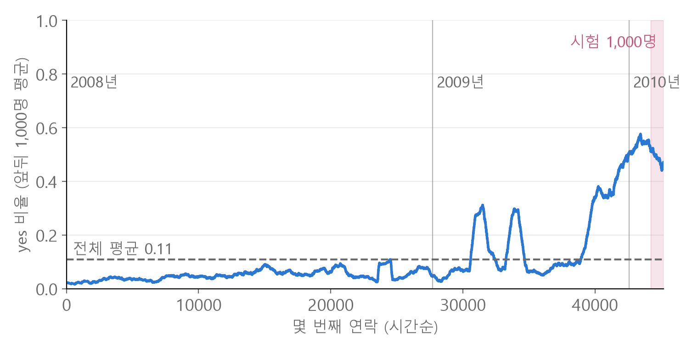
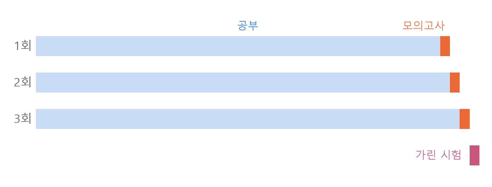
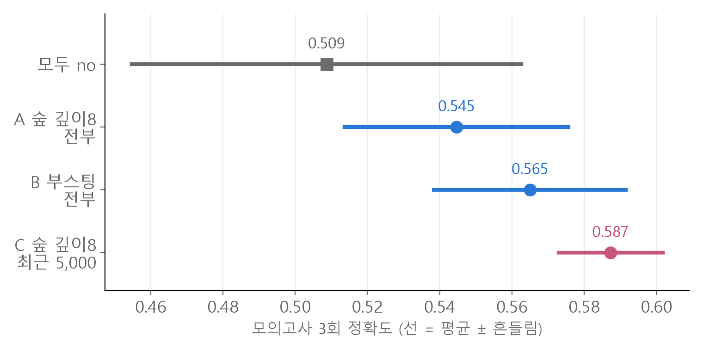
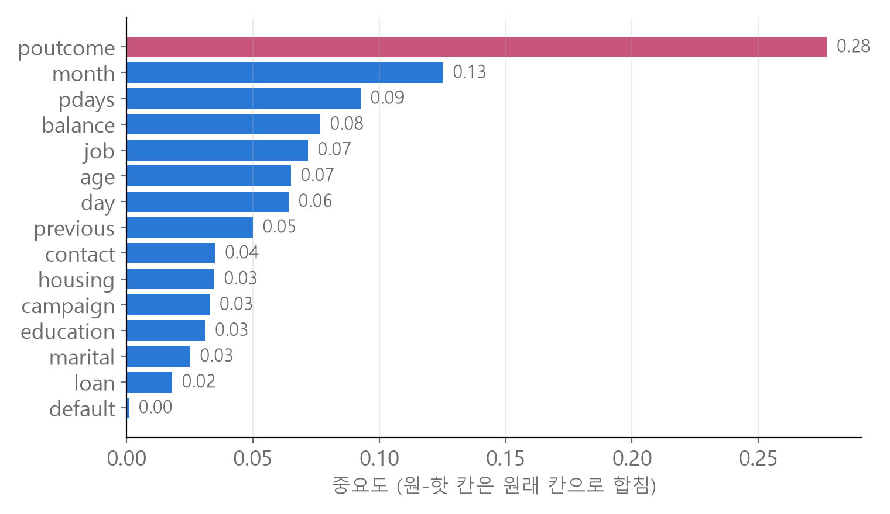

<style>
.content table { width: 100%; border-collapse: collapse; margin: 14px 0 24px; font-size: 17px; line-height: 1.5; }
.content th, .content td { border-bottom: 1px solid #e6dde0; padding: 8px 10px; text-align: left; vertical-align: top; }
.content thead { background: #fbf1f4; }
.content figure { margin: 18px 0; }
.content figure img { width: 100%; height: auto; }
.content td, .content th { word-break: keep-all; overflow-wrap: normal; }
.content .katex-display { overflow-x: auto; overflow-y: hidden; padding: 4px 0; }
@media (max-width: 560px) { .content th, .content td { padding: 7px 5px; font-size: 16px; } }
</style>
<link rel="stylesheet" href="https://cdn.jsdelivr.net/npm/katex@0.16.11/dist/katex.min.css">
<script defer src="https://cdn.jsdelivr.net/npm/katex@0.16.11/dist/katex.min.js"></script>
<script defer src="https://cdn.jsdelivr.net/npm/katex@0.16.11/dist/contrib/auto-render.min.js" onload="renderMathInElement(document.querySelector('.content')||document.body,{delimiters:[{left:'\\[',right:'\\]',display:true},{left:'\\(',right:'\\)',display:false}]})"></script>

<div class="wc"><p><b>은행 예금 가입 예측은 왜 해 볼까요?</b><br>
<a href="https://archive.ics.uci.edu/dataset/222/bank+marketing">Bank Marketing 데이터</a>는 포르투갈 은행의 전화 마케팅 기록 45,211건으로, 고객이 정기예금에 가입했는지(yes/no)를 맞히는 이진 분류 문제예요.<br>
기록이 날짜순(2008년 5월부터 2010년 11월)이라, 시간이 흐르며 데이터 모양이 바뀌는 문제를 직접 겪어 볼 수 있어요.<br>
여기서 익힌 「예측 시점에 없는 정보 빼기」와 「시간 순서로 검증하기」는 판매·수요·센서처럼 시간이 흐르는 데이터 어디에나 쓰는 기준이에요. (2026년 11월 2일 기준)</p></div>

데이터 살펴보기부터 모델 고르기까지 **일곱 단계**를, 헷갈리기 쉬운 곳과 실제 숫자로 정리했어요.<br>
숫자와 그림은 모두 파이썬(pandas, scikit-learn)으로 직접 계산한 값이에요.

<div class="keyline">공개 데이터 45,211건 중 맨 끝 1,000건을 정답을 가린 시험으로 떼어 두고 시작할게요.</div>

```python
import pandas as pd

full = pd.read_csv("bank-full.csv", sep=";")
train, test = full.iloc[:-1000], full.iloc[-1000:]
```
→ `train` 44,211건으로 모든 판단을 하고, `test` 1,000건(2010년 7월부터 11월)은 고르는 데 쓰지 않고 마지막에 채점만 해요.<br>
`iloc[-1000:]`은 「뒤에서 1,000번째 줄부터 끝까지」, `iloc[:-1000]`은 「처음부터 그 앞까지」예요.

## <span class="no">1</span> 전체 순서 한눈에 보기

| 단계 | 질문 | 이 데이터의 답 |
|---|---|---|
| 기준선 | 찍기만 해도 몇 점? | 학습 데이터 0.891, 최근은 약 0.5 |
| 결측치 | 빈칸이 숨어 있나? | NaN 0개, `unknown`과 `-1`이 빈칸 역할 |
| 누수 | 예측 시점에 없는 칸은? | `duration`(통화 시간) 빼기 |
| 인코딩 | 글자 칸은 어떻게? | 원-핫(one-hot) 50칸 |
| 검증 | 모의고사는 어디서? | 시간 순서로 맨 끝에서 |
| 모델 | 무엇을 고르나? | 모의고사 평균과 흔들림으로 |
| 개선 | 더 올리려면? | 새 정보가 필요해요 |

처음 보는 데이터는 칸마다 어떤 값이 들어 있는지부터 한 표로 봐요.

```python
pd.set_option("display.max_colwidth", None)
num = pd.api.types.is_numeric_dtype
pd.DataFrame([[c, f"{train[c].min()} ~ {train[c].max()}" if num(train[c])
               else ", ".join(sorted(train[c].astype(str).unique()))] for c in train.columns])
```
→ 17줄짜리 표 하나에 `poutcome: failure, other, success, unknown`처럼 칸별 값이 다 보여요. `value_counts()`를 칸마다 출력하면 줄이 많아 화면에서 잘리기 쉬워요.

## <span class="no">2</span> 기준선 0.891의 함정

**기준선(baseline)** 은 모델 없이 찍었을 때의 점수예요.

$$\text{정확도(accuracy)} = \frac{\text{맞힌 수}}{\text{전체 수}}$$

`train`은 no 39,411건, yes 4,800건이라 「모두 no」로 찍으면 0.891이에요. 그런데 이 숫자는 최근 고객에게는 맞지 않아요.

<figure></figure>

| 구간 | 건수 | yes 비율 |
|---|---|---|
| 2008년 | 27,729 | 0.051 |
| 2009년 | 14,862 | 0.171 |
| 2010년 (train) | 1,620 | 0.533 |
| 가린 시험 1,000건 | 1,000 | 0.489 |

시험 구간에서 「모두 no」는 0.511이에요. 이 문제의 실제 기준선은 **0.5 근처**예요.<br>
데이터에 연도 칸은 없어요. 날짜순이라 달이 12월에서 1월로 돌아가는 곳을 세서 연도를 만들었어요.

## <span class="no">3</span> 숨은 결측치와 duration 누수

`isna().sum()`은 모든 칸이 0이에요. 빈칸이 **글자나 숫자로 숨어** 있어요.

| 칸 | 숨은 빈칸 | 뜻 |
|---|---|---|
| poutcome | `unknown` 36,614 | 지난 캠페인 때 연락한 적 없음 |
| pdays | `-1` 36,610 | 지난 연락 후 지난 날수 없음 |
| contact | `unknown` 12,889 | 연락 방식 기록 없음 |
| education | `unknown` 1,798 | 학력 기록 없음 |
| job | `unknown` 277 | 직업 기록 없음 |

poutcome의 `unknown`은 82%라도 빼지 않아요. 「연락한 적 없음」이라는 뜻이 있고, 값마다 yes 비율이 크게 달라요(success 0.612, unknown 0.089).

**duration(통화 시간, 초)** 은 빼요. 통화가 끝나야 알 수 있는 값이라, 「누구에게 전화할까」를 정하는 시점에는 없어요.

```python
X = pd.get_dummies(train.drop(columns=["y"]))                 # ❌
X = pd.get_dummies(train.drop(columns=["y", "duration"]))     # ✅
```
❌는 오류 없이 돌아가고 점수도 높아요. yes 고객의 통화 시간 가운데값은 453초, no는 164초라 답을 거의 알려 주기 때문이에요.<br>
예측 시점에 없는 정보가 입력에 섞이는 것을 **데이터 누수(data leakage)** 라고 해요.

## <span class="no">4</span> 원-핫 인코딩과 칸 맞추기

글자 칸 9개는 **원-핫 인코딩(one-hot encoding)** 으로 값마다 0/1 칸을 만들어요. `job`을 admin. 0, blue-collar 1처럼 번호로 바꾸면 크기 순서가 없는 값에 순서가 생겨요.

```python
X = pd.get_dummies(train.drop(columns=["y", "duration"]), dtype=int)
X_test = pd.get_dummies(test.drop(columns=["y", "duration"]), dtype=int)
X_test = X_test.reindex(columns=X.columns, fill_value=0)
y = (train["y"] == "yes").astype(int)
```
→ `X` (44211, 50), `X_test` (1000, 50). 정답 `y`는 yes 1, no 0이에요.

시험 구간에는 1월부터 6월과 12월이 없어서, 따로 원-핫을 하면 `month_jan` 같은 칸이 생기지 않아요. `reindex`는 test의 칸 이름·순서·개수를 train과 똑같이 맞추고, 없던 칸은 0으로 채워요.

## <span class="no">5</span> 시간 순서로 모의고사 만들기

모의고사는 **시험과 닮은 곳**에서 떼어야 해요. 시험이 가장 최근이면 모의고사도 가장 최근에서 떼어요.

```python
from sklearn.model_selection import train_test_split
X_tr, X_val, y_tr, y_val = train_test_split(X, y, test_size=0.2, random_state=0)  # ❌
X_tr, X_val = X.iloc[:-1000], X.iloc[-1000:]                                       # ✅
y_tr, y_val = y.iloc[:-1000], y.iloc[-1000:]                                       # ✅
```
❌는 2008년부터 2010년까지를 섞어 떼서, 모의고사의 대부분이 yes가 드문 옛날 고객이에요. 이렇게 나누면 「모두 no」가 0.889, 숲(Random Forest, 아래 A와 같은 설정) 모델이 0.898로 나와요.
- 모델이 찍기보다 0.009밖에 높지 않아서, 모델이 쓸모 있는지조차 보여 주지 못해요.
- 시험 구간과 닮지 않아서 점수 크기도 틀려요. 가린 시험에서 A는 0.656이었어요.

모의고사 한 번은 운이 섞여서, 시간을 따라 **세 번** 굴려요. 매번 그 앞까지 전부 공부하고, 바로 다음 1,000건으로 시험해요.

<figure></figure>

$$\bar{s} = \frac{1}{3}\sum_{i=1}^{3} s_i, \qquad \sigma = \sqrt{\frac{1}{3}\sum_{i=1}^{3}(s_i - \bar{s})^2}$$

$$s_i$$는 $$i$$번째 모의고사 정확도, $$\bar{s}$$는 평균, $$\sigma$$는 점수가 흔들리는 폭이에요.

## <span class="no">6</span> 모델 비교와 가린 시험

후보 셋을 같은 모의고사로 비교했어요.

- **A** : 숲, `max_depth=8`, 공부 구간 전부
- **B** : 부스팅(`HistGradientBoostingClassifier`), 공부 구간 전부. 앞 트리가 틀린 것을 다음 트리가 고치며 쌓아요.
- **C** : A와 같은 숲, 공부 구간의 **최근 5,000건만**

<figure></figure>

| 후보 | 3회 점수 | 평균 | σ | 평균 − σ |
|---|---|---|---|---|
| 모두 no | 0.582, 0.490, 0.454 | 0.509 | 0.054 | 0.455 |
| A | 0.582, 0.506, 0.546 | 0.545 | 0.031 | 0.514 |
| B | 0.602, 0.552, 0.541 | 0.565 | 0.027 | 0.538 |
| C | 0.585, 0.606, 0.571 | **0.587** | **0.014** | **0.573** |

C는 평균이 가장 높고 흔들림이 가장 작아서 C를 골랐어요. 고른 뒤 공부 구간 끝 5,000건으로 다시 학습하고, 가린 시험을 한 번 채점했어요.

| 모델 | 가린 시험 1,000건 |
|---|---|
| 모두 no | 0.511 |
| A | 0.656 |
| B | 0.655 |
| C | **0.666** |

1,000건 시험의 표준오차는 약 0.015예요. A, B, C의 차이(0.011)는 그 안이라, 셋의 순위는 이 시험으로 가릴 수 없어요. 세 모델 모두 기준선보다 약 0.15 높은 건 분명해요.

## <span class="no">7</span> 점수를 더 올리려면

**feature importance(중요도)** 로 모델이 어떤 칸을 많이 썼는지 먼저 봐요.

```python
imp = pd.Series(model.feature_importances_, index=X.columns)   # model = C
imp.groupby(lambda c: c.split("_")[0]).sum().sort_values(ascending=False)
```
원-핫으로 나뉜 칸(`poutcome_success` 등)을 원래 칸 이름으로 다시 합쳤어요.

<figure></figure>

트리 기반 중요도는 값 종류가 많은 숫자 칸을 부풀리는 경향이 있어서 순서는 참고용이에요. 그래도 「지난 캠페인 결과」가 가장 큰 단서라는 건 3번의 yes 비율과도 맞아요.

여러 방법을 시도한 결과예요. 설정은 모두 모의고사로 골랐고, 가린 시험 점수는 비교해 보이려고 적었을 뿐 고르는 데 쓰지 않았어요.

| 시도 | 가린 시험 |
|---|---|
| C (기준) | 0.666 |
| 문턱 낮추기: 확률 0.45 이상이면 yes | 0.663 |
| 문턱 낮추기: 0.40 | 0.653 |
| 조합 288개 중 모의고사 1등 (깊이 제한 없는 숲(잎 최소 5건), 공부 구간 전부, 연락 순서 칸 추가, 문턱 0.45) | 0.673 |
| C + duration ❌ 누수 | 0.751 |

- **문턱(threshold)** : 모델은 yes일 확률을 내고, 보통 0.5 이상이면 yes예요. C가 yes를 28%만 골라서 문턱을 낮췄지만 점수는 오르지 않았어요.
- **조합을 많이 돌리기** : 모델 4종·공부 구간·문턱·추가 칸(연도, 연락 순서)을 바꾼 288개 중 1등은 모의고사에서 0.626으로 C(0.587)보다 0.039 높았어요. 가린 시험에서는 0.673으로 C보다 0.007 높아서, 표준오차 0.015 안이에요. 많이 비교할수록 운 좋게 높게 나온 조합이 1등이 되기 쉬워서, 모의고사 차이가 시험에서 줄어들어요.
- **duration** : 혼자 0.085를 올려요. 점수를 크게 바꾸는 건 모델보다 **정보** 라는 뜻이지만, 이 칸은 쓰면 안 되는 정보예요.

점수를 올리려면 **전화하기 전에 알 수 있는 새 정보** 를 더하는 쪽이 유망해요. 같은 연구진이 공개한 확장판(bank-additional)에는 연락 시점의 금리·고용 같은 경제 지표가 들어 있어요.

<div class="done"><div class="done-t">🎉 시험이 최근이면 모의고사도 최근에서, 예측 시점에 없는 칸은 빼세요!</div></div>

<p style="font-size:16px">데이터 출처: Moro, S., Rita, P., &amp; Cortez, P. (2014). Bank Marketing [Dataset]. UCI Machine Learning Repository. <a href="https://doi.org/10.24432/C5K306">https://doi.org/10.24432/C5K306</a> (CC BY 4.0)</p>
