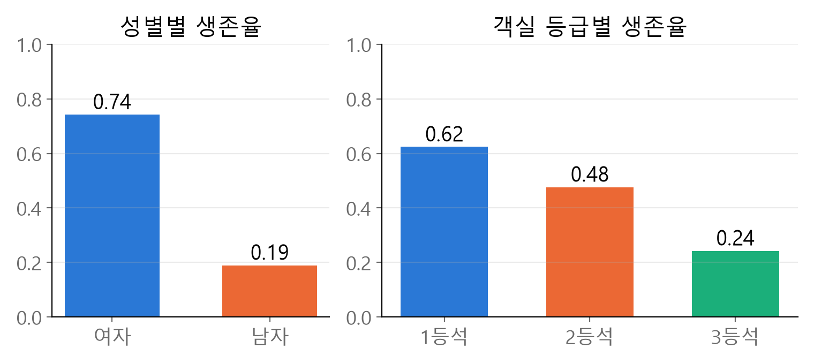
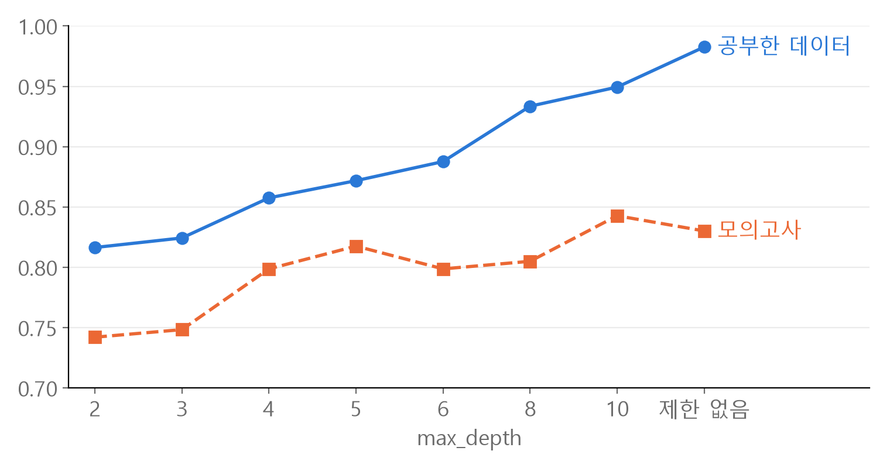
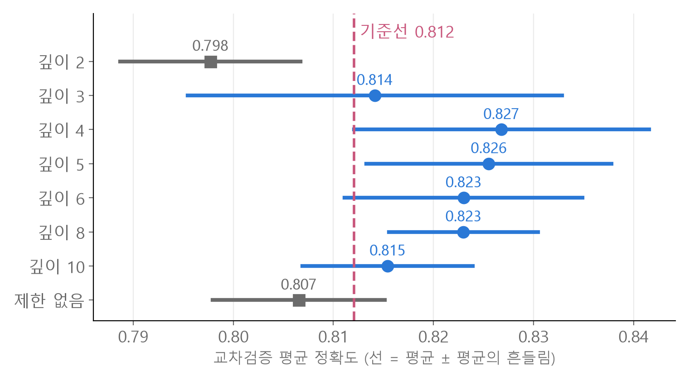

<style>
.content table { width: 100%; border-collapse: collapse; margin: 14px 0 24px; font-size: 17px; line-height: 1.5; }
.content th, .content td { border-bottom: 1px solid #e6dde0; padding: 8px 10px; text-align: left; vertical-align: top; }
.content thead { background: #fbf1f4; }
.content figure { margin: 18px 0; }
.content figure img { width: 100%; height: auto; }
.content td, .content th { word-break: keep-all; overflow-wrap: normal; }
.content .katex-display { overflow-x: auto; overflow-y: hidden; padding: 4px 0; }
@media (max-width: 560px) { .content th, .content td { padding: 7px 5px; font-size: 16px; } }
</style>
<link rel="stylesheet" href="https://cdn.jsdelivr.net/npm/katex@0.16.11/dist/katex.min.css">
<script defer src="https://cdn.jsdelivr.net/npm/katex@0.16.11/dist/katex.min.js"></script>
<script defer src="https://cdn.jsdelivr.net/npm/katex@0.16.11/dist/contrib/auto-render.min.js" onload="renderMathInElement(document.querySelector('.content')||document.body,{delimiters:[{left:'\\[',right:'\\]',display:true},{left:'\\(',right:'\\)',display:false}]})"></script>

<div class="wc"><p><b>타이타닉 생존자 예측은 왜 해 볼까요?</b><br>
타이타닉 데이터는 승객 정보로 생존(1)과 사망(0)을 맞히는 이진 분류 문제로, <a href="https://www.kaggle.com/competitions/titanic">Kaggle 입문 대회</a>로 널리 쓰여요.<br>
빈칸 채우기, 글자를 숫자로 바꾸기, 모델 학습, 검증, 예측 파일 만들기까지 머신러닝의 한 바퀴가 작은 표 하나에 다 들어 있어요.<br>
여기서 익힌 과적합 판단과 교차검증은 데이터가 커지거나 모델이 바뀌어도 그대로 쓰는 기준이에요. (2026년 11월 2일 기준)</p></div>

데이터 살펴보기부터 예측 파일 저장까지 **여섯 단계**를, 헷갈리기 쉬운 곳과 실제 숫자로 정리했어요.<br>
숫자와 그림은 모두 파이썬(pandas, scikit-learn)으로 직접 계산한 값이에요.

<div class="keyline">공개 타이타닉 데이터 891명 중 100명을 정답을 가린 채 떼어 두고 시작할게요.</div>

```python
import pandas as pd
from sklearn.model_selection import train_test_split

full = pd.read_csv("titanic.csv")
train, test = train_test_split(full, test_size=100, random_state=42)
test_answer = test["Survived"]
test = test.drop(columns=["Survived"])
```
→ `train` 791명(정답 있음)으로 모든 판단을 하고, `test` 100명은 마지막에 한 번만 채점해요.

## <span class="no">1</span> 생존율과 기준선 먼저 보기

`Survived`가 0과 1이라 **그룹별 평균이 곧 생존율**이에요.

```python
train.groupby("Sex")["Survived"]         # ❌
train.groupby("Sex")["Survived"].mean()  # ✅
```
❌는 `SeriesGroupBy object`만 나와요. 그룹으로 나누기만 하고 무엇을 계산할지 정하지 않았기 때문이에요.<br>
✅ → `female 0.742`, `male 0.190`

<figure></figure>

모델을 만들기 전에 **기준선(baseline)** 을 정해요. 모델이 이 점수를 못 넘으면 학습한 의미가 없어요.

$$\text{정확도(accuracy)} = \frac{\text{맞힌 수}}{\text{전체 수}}$$

| 찍는 방법 | 791명 정확도 |
|---|---|
| 전부 사망 | 0.618 |
| 여자는 생존, 남자는 사망 | 0.786 |

성별 한 칸으로 0.786이 나와요. 모델의 목표는 이보다 높게 맞히는 거예요.

## <span class="no">2</span> 빈칸은 train 값으로 채우기

빈칸은 **train에서 계산한 값으로, train과 test를 똑같이** 채워요.

| 칸 | train 빈칸 | 처리 |
|---|---|---|
| Age (나이) | 160 | train 평균 29.7 (중앙값 28.0과 비슷) |
| Embarked (탄 항구) | 2 | train 최빈값 S |
| Cabin (선실) | 612 (77%) | 칸째 빼기 |

`dropna()`는 빈칸이 있는 **줄**을 지워요. train이 158명, test가 25명만 남아서 쓸 수 없어요. 예측해야 할 test 승객은 한 명도 지우면 안 돼요.

```python
train = train.fillna(train["Embarked"].mode()[0])            # ❌ 표 전체
test["Age"] = train["Age"].fillna(test["Age"].mean())        # ❌ 표가 뒤바뀜

train["Embarked"] = train["Embarked"].fillna(train["Embarked"].mode()[0])  # ✅
test["Embarked"] = test["Embarked"].fillna(train["Embarked"].mode()[0])    # ✅
train["Age"] = train["Age"].fillna(train["Age"].mean())                    # ✅
test["Age"] = test["Age"].fillna(train["Age"].mean())                      # ✅
```
- 첫 번째 ❌ : 표 전체에 적용돼서 Age 빈칸까지 `'S'`로 채워요.
- 두 번째 ❌ : 오류 없이 실행돼요. pandas가 두 표의 줄 번호(index)를 맞춰 넣어서, test 나이 칸이 엉뚱한 값이나 빈칸(NaN)이 돼요. 여기서는 줄 번호가 겹치지 않아 100명 전부 NaN이 돼요.
- `mode()`는 최빈값이 여러 개일 수 있어 Series로 돌려줘서 `[0]`으로 첫 값을 꺼내요.

채우는 값은 학습 때 쓴 값과 같아야 해요. 실제로는 새 승객이 한 명씩 들어오니 「그들의 평균」을 미리 낼 수 없어요.<br>
train과 test를 합친 평균으로 train까지 채우면, 예측할 데이터의 정보가 학습에 섞여요. 이걸 **데이터 누수(data leakage)** 라고 하고, 검증 점수가 실제보다 좋게 나오는 원인이 돼요.

## <span class="no">3</span> 글자는 숫자로, 뜻 없는 칸은 빼기

scikit-learn 모델은 숫자만 받아서, 글자 칸은 **종류 수(`nunique()`)** 를 보고 바꾸거나 빼요.

| 칸 | 종류 수 | 처리 |
|---|---|---|
| Sex | 2 | 숫자로 (male 0, female 1) |
| Embarked | 3 | 숫자로 (S 0, C 1, Q 2) |
| Ticket | 616 | 빼기 |
| Name | 791 | 빼기 |

```python
train["Sex"] = train["Sex"].map({"male": 0, "female": 1})
test["Sex"] = test["Sex"].map({"male": 0, "female": 1})
```
Embarked도 같은 방법으로 train과 test를 모두 바꿔요. 이 줄은 **한 번만** 실행해요. 두 번 실행하면 이미 0·1이 된 값에서 `"male"`을 찾지 못해 전부 `NaN`이 돼요.

**Name·PassengerId를 번호로 바꿔 쓰면 안 되는 이유** : 승객마다 값이 달라서, 모델이 「357번은 생존」처럼 사람별 답을 외워요. test 승객은 처음 보는 사람이라 그 번호에서 배울 게 없어요.

**Fare는 종류가 236개인데 남겨요.** 숫자 크기에 뜻이 있기 때문이에요. 요금을 4구간으로 나누면 생존율이 0.21 → 0.29 → 0.46 → 0.57로 올라가요.

Embarked의 S 0, C 1, Q 2에는 실제 크기 순서가 없어요. 트리 모델은 「1 이하인가?」처럼 나누기만 해서 영향이 작지만, 숫자 크기를 그대로 계산에 쓰는 KNN·로지스틱 회귀에서는 원핫 인코딩(one-hot encoding)으로 칸을 나누는 편이 안전해요.

## <span class="no">4</span> Random Forest와 과적합

**Random Forest** 는 데이터를 무작위로 조금씩 다르게 뽑아 결정 트리 여러 개를 만들고, 그 예측을 합쳐요.

$$\hat{y} = \arg\max_{c} \ \frac{1}{T}\sum_{t=1}^{T} p_t(c \mid x)$$

$$T$$는 트리 개수(기본 100), $$p_t(c \mid x)$$는 $$t$$번째 트리가 본 승객 $$x$$가 클래스 $$c$$일 확률이에요. scikit-learn은 트리별 투표 대신 <a href="https://scikit-learn.org/stable/modules/ensemble.html">확률을 평균</a>해서 가장 큰 쪽을 골라요.

791명 중 20%(159명)를 **모의고사(validation)** 로 떼어 두고, 나머지로 학습했어요.

```python
from sklearn.ensemble import RandomForestClassifier

X = train.drop(columns=["PassengerId", "Name", "Ticket", "Cabin", "Survived"])
y = train["Survived"]
X_test = test.drop(columns=["PassengerId", "Name", "Ticket", "Cabin"])
X_tr, X_val, y_tr, y_val = train_test_split(X, y, test_size=0.2, random_state=42)
model = RandomForestClassifier(random_state=42).fit(X_tr, y_tr)
```

| 점수 | 정확도 |
|---|---|
| 공부한 데이터 (`X_tr`) | 0.983 |
| 모의고사 (`X_val`) | 0.830 |
| 같은 159명, 성별로만 찍기 | 0.767 |

공부한 데이터는 거의 다 맞히고 모의고사는 15%p 낮아요. 학습 데이터의 우연한 특징까지 외운 상태를 **과적합(overfitting)** 이라고 해요.<br>
트리의 질문 단계를 제한하는 `max_depth`를 바꿔 보면 차이가 보여요.

<figure></figure>

모의고사 점수만 보면 깊이 10(0.843)이 1등이에요. 하지만 159명에서 한 명은 0.006점이라, 다른 159명이었다면 순위가 바뀔 수 있어요.

## <span class="no">5</span> 교차검증과 1-SE 규칙

**교차검증(cross validation)** 은 데이터를 $$k$$조각으로 나눠, 조각마다 한 번씩 모의고사로 쓰고 평균을 내요.

```python
from sklearn.model_selection import cross_val_score
s = cross_val_score(RandomForestClassifier(max_depth=d, random_state=42), X, y, cv=5)
```

$$\bar{s} = \frac{1}{k}\sum_{i=1}^{k} s_i, \qquad SE = \frac{\sigma}{\sqrt{k}}$$

$$s_i$$는 $$i$$번째 점수, $$\sigma$$는 점수 $$k$$개의 표준편차(numpy 기본값인 모표준편차)예요. $$\sigma$$는 시험 **한 번**이 흔들리는 폭이고, **SE(standard error, 평균의 흔들림)** 는 평균이 흔들리는 폭이에요.

| 깊이 | 평균 | SE | 평균 − SE |
|---|---|---|---|
| 2 | 0.798 | 0.009 | 0.789 |
| 3 | 0.814 | 0.019 | 0.795 |
| 4 | **0.827** | 0.015 | 0.812 |
| 5 | 0.826 | 0.012 | 0.813 |
| 6 | 0.823 | 0.012 | 0.811 |
| 8 | 0.823 | 0.007 | **0.816** |
| 10 | 0.815 | 0.009 | 0.807 |
| 제한 없음 | 0.807 | 0.009 | 0.798 |

**1-SE 규칙** 은 1등 평균에서 1등의 SE를 뺀 값을 기준선으로 그어요.

$$\text{기준선} = 0.827 - 0.015 = 0.812$$

<figure></figure>

깊이 3부터 10까지는 평균이 기준선보다 높아요. 평균이 기준선 위에 있으면 **이 데이터로는 1등과 차이를 가릴 수 없다** 고 보고 동점으로 쳐요.

동점 안에서 고르는 기준은 두 가지예요.

- **가장 단순한 모델** (1-SE 규칙) : 깊이 3. 덜 외워서 새 데이터에서 덜 흔들릴 거라고 보는 선택이에요.
- **평균 − SE가 가장 높은 모델** : 깊이 8. 평균을 낮게 잡아 봐도 가장 높은 선택이에요.

## <span class="no">6</span> 처음 보는 100명으로 확인

깊이를 정했으면 **791명 전체** 로 다시 학습하고 test를 예측해요. 모의고사로 떼어 둔 159명도 학습에 쓰는 거예요.<br>
여기서는 두 번째 기준(평균 − SE가 가장 높음)으로 깊이 8을 골랐어요.

```python
final = RandomForestClassifier(max_depth=8, random_state=42).fit(X, y)
pred = final.predict(X_test)
result = pd.DataFrame({"PassengerId": test["PassengerId"], "Survived": pred})
result.to_csv("result.csv", index=False)
```
승객 번호는 학습에서 뺐어도 원본 `test`에 남아 있어서 여기서 꺼내 써요.

| 모델 | 100명 중 맞힌 수 |
|---|---|
| 깊이 3 | 82 |
| 깊이 4 | 84 |
| 깊이 5 | 83 |
| 깊이 6 | 82 |
| 깊이 8 | 82 |
| 깊이 10 | 80 |
| 제한 없음 | 80 |
| 성별로만 찍기 | 79 |

동점이었던 깊이 3에서 10까지는 80명에서 84명 사이로, 차이가 네 명 안이었어요.<br>
100명 시험에서는 이 정도 차이가 우연으로도 생겨요. 교차검증이 「순위를 가릴 수 없다」고 본 것과 같은 결과예요.

이 표는 모델을 고른 **뒤에** 한 번 확인하는 용도예요. test 정답을 보고 깊이를 다시 고르면, test 점수가 새 데이터 실력을 더는 대표하지 못해요.

<div class="done"><div class="done-t">🎉 기준선을 먼저 정하고, 점수 차이는 SE와 함께 보세요!</div></div>
