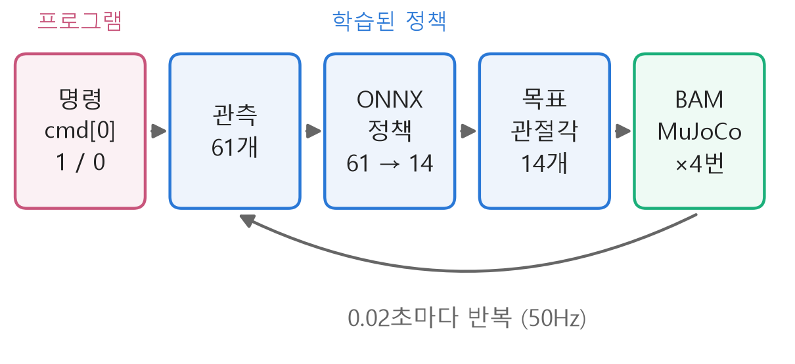
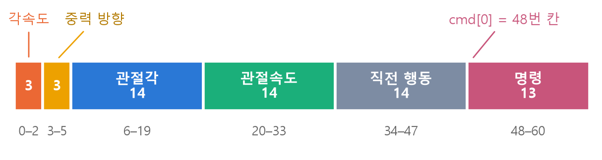
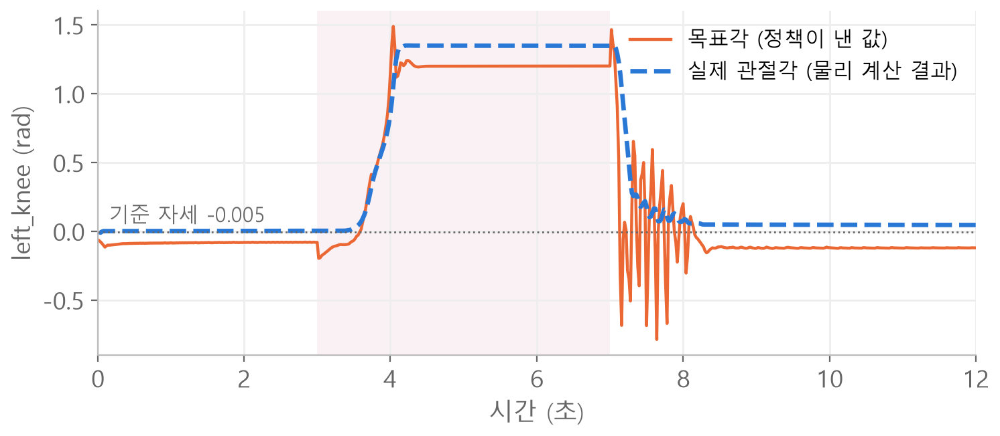
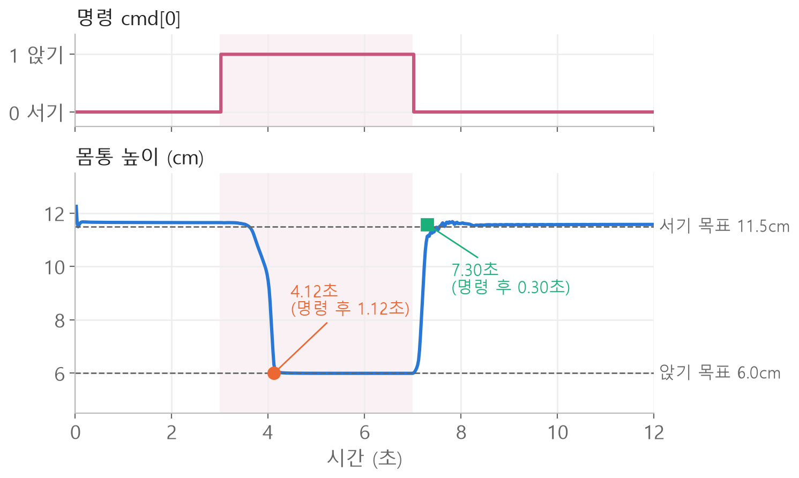

<style>
.content table { width: 100%; border-collapse: collapse; margin: 14px 0 24px; font-size: 17px; line-height: 1.5; }
.content th, .content td { border-bottom: 1px solid #e6dde0; padding: 8px 10px; text-align: left; vertical-align: top; }
.content thead { background: #fbf1f4; }
.content figure { margin: 18px 0; }
.content figure img { width: 100%; height: auto; }
.content td, .content th { word-break: keep-all; overflow-wrap: normal; }
.content .katex-display { overflow-x: auto; overflow-y: hidden; padding: 4px 0; }
@media (max-width: 560px) { .content th, .content td { padding: 7px 5px; font-size: 16px; } }
</style>
<link rel="stylesheet" href="https://cdn.jsdelivr.net/npm/katex@0.16.11/dist/katex.min.css">
<script defer src="https://cdn.jsdelivr.net/npm/katex@0.16.11/dist/katex.min.js"></script>
<script defer src="https://cdn.jsdelivr.net/npm/katex@0.16.11/dist/contrib/auto-render.min.js" onload="renderMathInElement(document.querySelector('.content')||document.body,{delimiters:[{left:'\\[',right:'\\]',display:true},{left:'\\(',right:'\\)',display:false}]})"></script>

<div class="wc"><p><b>마이크로덕 코드는 왜 읽어 볼까요?</b><br>
마이크로덕(Microduck)은 2025년 허깅페이스에 인수된 Pollen Robotics가 만든 키 약 25cm의 두 발 로봇이고, <a href="https://github.com/pollen-robotics/microduck_rl">학습 코드</a>와 <a href="https://huggingface.co/pollen-robotics/microduck-policies">학습된 정책</a>이 공개돼 있어요.<br>
걷기·넘어진 뒤 일어나기·앉았다 서기 같은 동작을 강화학습으로 시뮬레이션에서 학습하고, ONNX 파일로 내보내 실제 로봇에서 50Hz로 돌려요.<br>
명령이 신경망 입력으로 들어가 관절 목표각이 되는 한 바퀴를 알면, 강화학습 로봇 코드의 관측·행동·보상이 어디에 있는지 바로 찾을 수 있어요. (2026년 11월 3일 기준)</p></div>

공개 정책 `alpha_sitstand.onnx`가 앉았다 서는 12초 시뮬레이션을 **일곱 단계**로 나눠, 실제 코드 줄과 숫자로 따라가요.

<div class="keyline">핵심은 하나예요. 언제 앉을지는 프로그램이 정하고, 관절 14개를 어떻게 움직일지는 학습된 정책이 정해요.</div>

## <span class="no">1</span> 0.02초마다 도는 제어 루프

정책 코드는 0.02초마다 같은 다섯 칸을 한 바퀴 돌아요.

<figure></figure>

물리 시뮬레이터 MuJoCo는 0.005초씩 계산하고, 정책은 그 네 번에 한 번 행동을 내요.

$$\Delta t = 4 \times 0.005\,\text{s} = 0.02\,\text{s}$$

$$\Delta t$$는 정책이 행동을 한 번 내는 간격(control step)이에요. 1초에 50번(50Hz)이에요.
BAM은 서보 모터 XL330의 전압·마찰을 흉내 내는 모터 모델이에요.

## <span class="no">2</span> 앉기 명령은 프로그램이 바꿔요

시뮬레이션 재생 스크립트에서 "몇 번째 단계에 앉아"를 정하는 줄은 아래 한 줄이에요. 이 재생 루프는 직접 만든 예시예요.

```python
# 600 × 0.02초 = 12초
for step in range(600):
    # 3초에 앉기, 7초에 서기
    if step in (150, 350):
        policy.toggle_sit()
    # 정책이 행동 14개 계산
    action = policy.infer()
    # 행동 → 목표 관절각
    policy.apply_action(action)
    # 물리 계산 4번
    for _ in range(4):
        bam.update()
        mujoco.mj_step(model, data)
```

단계 번호에 $$\Delta t$$를 곱하면 시각이에요.

$$t = N \times \Delta t$$

$$150 \times 0.02 = 3\,\text{s}$$

$$350 \times 0.02 = 7\,\text{s}$$

→ 3초까지 서기, 7초까지 앉기, 12초까지 다시 서기.

`toggle_sit()`은 저장소 `scripts/infer_policy.py` 808행에 있어요. 키보드로 돌릴 때는 Y 키가 이 함수를 불러요. 핵심은 두 줄이에요.

```python
# 앉기 상태를 뒤집기
self.sit_mode = not self.sit_mode
...
# 정책에 넣을 명령 배열 다시 만들기
self._update_command()
```

## <span class="no">3</span> 명령 13칸 중 첫 칸이 앉기 플래그

`_update_command()`(461행)는 명령을 숫자 13개짜리 배열로 만들어요. SitStand 정책에서는 첫 칸 `cmd[0]`이 앉기 플래그(flag)예요.

```python
cmd = np.zeros(13, dtype=np.float32)
# 1 = 앉기, 0 = 서기
cmd[0] = 1.0 if self.sit_mode else 0.0
# 머리 자세 명령 4칸
cmd[3:7]  = self.head_offset
# 몸통 자세 명령 6칸
cmd[7:13] = self.body_cmd
self.command = cmd
```

→ 2.98초(149단계): `cmd = [0, 0, 0, … 0]`
→ 3.00초(150단계): `cmd = [1, 0, 0, … 0]`

자주 헷갈리는 점은 **0도 명령**이라는 거예요. 0은 "서기"예요. 코드 주석에도 앞 세 칸이 모두 0이면 이 정책에서는 서기 명령이라고 적혀 있어요. 허깅페이스 허브의 정책 설명 파일 `manifest.json`도 `"sit": 1.0, "stand": 0.0`으로 같은 규칙을 적어 둬요.

## <span class="no">4</span> 관측 61개는 몸 상태 48개와 명령 13개

`get_observations()`(656행)는 여섯 묶음을 이어 붙여 정책 입력 61개를 만들어요.

<figure></figure>

| 묶음 | 개수 | 알려 주는 것 |
|---|---|---|
| 각속도 base_ang_vel | 3 | 몸통이 얼마나 빨리 도는지 |
| 중력 방향 projected_gravity | 3 | 몸이 어느 쪽으로 기울었는지 |
| 관절각 joint_pos | 14 | 기준 자세에서 벗어난 정도 |
| 관절속도 joint_vel | 14 | 관절이 움직이는 빠르기 |
| 직전 행동 last_action | 14 | 바로 전에 낸 행동 |
| 명령 command | 13 | 앉기 플래그, 머리·몸통 자세 |

3 + 3 + 14 + 14 + 14 + 13 = 61이에요.

중력 방향은 세계의 아래쪽 벡터를 몸통 기준 좌표로 돌려 본 값이에요.

$$g^{body} = R^{\top} \begin{bmatrix} 0 \\ 0 \\ -1 \end{bmatrix}$$

$$R$$은 몸통의 회전(자세), $$R^{\top}$$은 그 반대 방향 회전이에요.
2.98초의 값은 `[0.048, 0.021, -0.999]`예요. 세 번째 값이 -1에 가까우니 몸통이 거의 똑바로 서 있다는 뜻이에요.

같은 함수의 설명 주석에는 아직 **"Total: 51D"**가 남아 있어요. 명령 칸이 3개였던 예전 구성의 숫자예요. 지금 SitStand 정책은 명령 13칸을 쓰므로 실제 입력은 61개이고, ONNX 파일의 입력 모양도 `[1, 61]`이에요.

## <span class="no">5</span> ONNX 정책은 61개를 받아 14개를 내요

`infer()`(857행)는 관측을 ONNX 런타임에 넣고 행동을 받아요.

```python
# 관측 61개 → 모양 [1, 61]
obs = self.get_observations()
obs_batch = obs.reshape(1, -1)
# 정책 실행 → 모양 [1, 14] → 14개
action = self.ort_session.run(...)[0]
action = action.squeeze(0)
# 다음 관측의 34–47번 칸에 들어감
self.last_action = action.copy()
```

$$a_t = \pi_\theta(o_t)$$

$$o_t \in \mathbb{R}^{61}, \quad a_t \in \mathbb{R}^{14}$$

$$\pi_\theta$$는 가중치 $$\theta$$로 정해진 정책 신경망, $$o_t$$는 관측, $$a_t$$는 행동이에요.

행동 14개의 순서는 왼다리 5개(0–4번), 목·머리 4개(5–8번), 오른다리 5개(9–13번)예요. 다리마다 hip_yaw, hip_roll, hip_pitch, knee, ankle 순이에요. 이 정책은 다리뿐 아니라 목과 머리도 함께 움직여요.

## <span class="no">6</span> 행동은 기준 자세에 더하는 각도

`apply_action()`(866행)은 행동을 목표 관절각으로 바꿔요.

$$q^{target} = q^{default} + s \cdot a_t$$

$$q^{default}$$는 기준 자세(HOME pose)의 관절각, $$s$$는 행동 배율(action scale), 단위는 라디안(rad)이에요. SitStand에서는 $$s = 1.0$$이에요.

앉아 있는 6.98초, 왼쪽 무릎(3번)에 값을 넣어 보면 이래요.

$$q^{target} = -0.0049 + 1.0 \times 1.2054$$

$$= 1.2005\ \text{rad}$$

→ 약 69도까지 무릎을 굽히라는 목표예요.

```python
# ❌ 행동값을 그대로 목표각으로 쓰기
target = action
# ✅ 기준 자세에 더하기
target = (self.default_pose
          + action * self.action_scale)
```

행동이 0이면 목표는 기준 자세예요. ❌처럼 쓰면 행동 0이 "모든 관절 0 rad"가 되어, 정책이 학습한 자세와 전혀 다른 곳을 목표로 잡아요. 행동은 모터 토크나 전압도 아니에요. 목표각을 받은 모터 모델이 토크를 계산해요.

## <span class="no">7</span> 목표각과 실제 관절각, 그리고 결과

목표각은 "이 각도로 가라"는 값일 뿐, 관절이 그 각도에 정확히 도착한다는 뜻은 아니에요.

<figure></figure>

앉아 있는 6초에서 7초 사이 평균으로 목표는 1.20 rad, 실제 무릎은 1.35 rad예요. 다시 선 11초에서 12초 사이에도 목표 -0.12 rad, 실제 0.05 rad로 차이가 남아요.

BAM 모터 모델은 목표와 실제의 차이로 모터 전압을 정해요.

$$d = g \cdot k_p \, (q^{target} - q)$$

$$V = v_{in} \cdot d$$

$$d$$는 듀티비(전원 전압 중 몇 %를 걸지, -1과 1 사이로 잘림), $$g$$는 각도 오차를 듀티비로 바꾸는 상수(XL330은 약 0.0029), $$k_p$$는 비례 이득, $$V$$는 모터에 거는 전압이에요.
예를 들어 $$k_p = 200$$, 오차 0.15 rad이면 $$d \approx 0.086$$, 전압은 약 0.64V예요.
차이가 0이면 전압도 0이라, 몸무게를 버티는 동안에는 차이가 남아야 힘이 나요. 실제 무릎 1.35 rad는 학습 설정에 적힌 앉은 자세(knee 1.35 rad)와 같아요. 정책은 더 작은 목표 1.20을 내서 실제 관절이 1.35에 머물게 해요. 그래서 목표각만 보고 실제 자세를 판단하면 안 돼요.

몸통 높이로 보면 명령이 동작으로 이어진 게 보여요.

<figure></figure>

| 구간 | 높이 | 도착 |
|---|---|---|
| 서기 | 11.65cm | 시작부터 |
| 앉기 | 6.00cm | 4.12초 (명령 후 1.12초) |
| 다시 서기 | 11.58cm | 7.30초 (명령 후 0.30초) |

평균 높이는 각 구간의 마지막 1초 값이에요. 도착 시각은 목표 ±0.5cm 안에 들어와 끝까지 머문 첫 단계가 끝난 시각이에요. 학습 설정의 목표 높이는 서기 0.115m, 앉기 0.060m예요. 앉을 때는 천천히 내려가다 마지막 0.1초쯤에 툭 내려앉고, 일어설 때는 0.3초 만에 올라와요. 하나의 시작 상태로 한 번 돌린 결과라, 정책의 평균 성능으로 일반화하지는 않아요.

재현 조건: 저장소 커밋 `bae39f5`, 허브의 `alpha_sitstand.onnx`(SHA256 앞자리 `a6f102d9`, manifest 기준 체크포인트 2250), 시작 높이 0.125m, 기준 자세에서 출발, MuJoCo 0.005초 × 4, BAM 모터 모델(전압 7.4V, 부하 전압 강하 0.1V/Nm, kp 200), 학습 없음.

<div class="done">🎉 앉을지 설지는 cmd[0] 한 칸, 관절 14개를 어떻게 움직일지는 정책 출력에 기준 자세를 더한 목표각이 정해요.</div>
