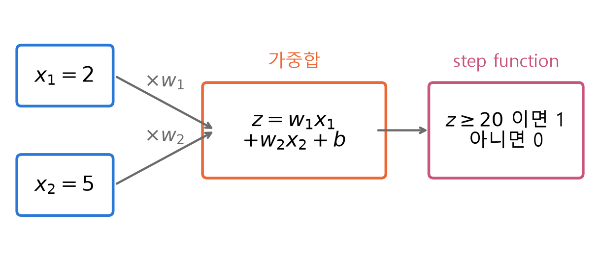
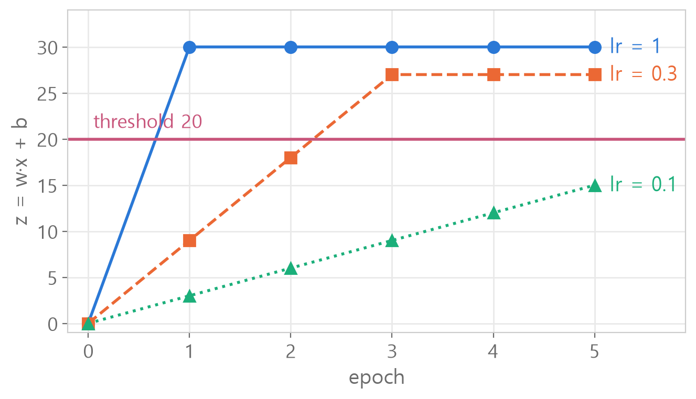

<style>
.content table { width: 100%; border-collapse: collapse; margin: 14px 0 24px; font-size: 17px; line-height: 1.5; }
.content th, .content td { border-bottom: 1px solid #e6dde0; padding: 8px 10px; text-align: left; vertical-align: top; }
.content thead { background: #fbf1f4; }
.content figure { margin: 18px 0; }
.content figure img { width: 100%; height: auto; }
.content td, .content th { word-break: keep-all; overflow-wrap: normal; }
.content .katex-display { overflow-x: auto; overflow-y: hidden; padding: 4px 0; }
@media (max-width: 560px) { .content th, .content td { padding: 7px 5px; font-size: 16px; } }
</style>
<link rel="stylesheet" href="https://cdn.jsdelivr.net/npm/katex@0.16.11/dist/katex.min.css">
<script defer src="https://cdn.jsdelivr.net/npm/katex@0.16.11/dist/katex.min.js"></script>
<script defer src="https://cdn.jsdelivr.net/npm/katex@0.16.11/dist/contrib/auto-render.min.js" onload="renderMathInElement(document.querySelector('.content')||document.body,{delimiters:[{left:'\\[',right:'\\]',display:true},{left:'\\(',right:'\\)',display:false}]})"></script>

<div class="wc"><p><b>퍼셉트론은 왜 직접 만들어 볼까요?</b><br>
퍼셉트론(Perceptron)은 입력에 가중치를 곱해 더하고, 그 값이 기준을 넘으면 1을 내는 가장 작은 인공 뉴런이에요.<br>
PyTorch의 <a href="https://docs.pytorch.org/docs/stable/generated/torch.nn.Linear.html">nn.Linear</a> 층도 입력에 가중치를 곱하고 bias를 더하는 같은 가중합을 계산해요.<br>
클래스로 한 번 직접 짜 보면 fit과 predict가 안에서 무엇을 하는지 보여서, 딥러닝 모델 코드가 훨씬 덜 낯설어요. (2026년 11월 3일 기준)</p></div>

단층 퍼셉트론을 numpy 클래스로 직접 만들며 **헷갈리기 쉬운 것 여섯 가지**와 완성본을 정리했어요.<br>
숫자와 그림은 모두 파이썬으로 직접 계산한 값이에요.

<div class="keyline">예시는 입력 x = [2, 5], 정답 y = 1, threshold(기준값) 20 하나로 끝까지 갈게요.</div>

## <span class="no">1</span> 퍼셉트론은 가중합 + step function

퍼셉트론은 **가중합을 계산하고, 기준을 넘었는지만 판정**해요.

$$z = w_1x_1 + w_2x_2 + b$$

$$\hat{y} = \begin{cases} 1 & (z \geq 20) \\ 0 & (z < 20) \end{cases}$$

- $$w_1, w_2$$ : 가중치(weight). 입력마다 얼마나 중요한지
- $$b$$ : bias(절편). 입력과 상관없이 더하는 값
- $$\hat{y}$$ : 예측. 0 또는 1

<figure></figure>

가중치가 $$w = [2, 5]$$, $$b = 1$$이라면 $$z = 2 \times 2 + 5 \times 5 + 1 = 30$$이에요.<br>
30은 20 이상이라 예측은 1이에요. 학습은 이런 $$w$$와 $$b$$를 스스로 찾는 과정이에요.

## <span class="no">2</span> 클래스는 설계도, 객체는 제품

`class`는 **퍼셉트론을 찍어 내는 설계도**예요. 기능 네 개를 담아요.

```python
class Perceptron:
    def __init__(self, n_inputs): ...
    # 처음 만들 때 한 번
    def step_function(self, z): ...
    # 0/1 판정
    def predict(self, x): ...
    # 가중합 → 판정
    def fit(self, X, y, lr, epoch): ...
    # 학습
```

```python
p_a = Perceptron(2)
p_b = Perceptron(2)
```
같은 설계도로 만든 퍼셉트론 두 개예요. 기능은 같고, **가중치는 각자 따로** 들고 있어요.

| 코드 | 뜻 |
|---|---|
| `Perceptron(2)` | 설계도로 퍼셉트론 하나 만들기 |
| `self.w` | 그 퍼셉트론이 들고 있는 가중치 |
| `p_a.predict(x)` | p_a **안에 있는** predict를 p_a의 가중치로 실행 |

점(`.`)은 「그 객체 안의」라는 뜻이에요. scikit-learn의 `model.fit()`, `model.predict()`도 같은 구조예요.

**`Perceptron(2)`의 2는 데이터 하나에 들어 있는 입력 개수예요.** 데이터가 몇 개인지와는 상관없어요.

```python
X = np.array([[0, 0], [0, 1], [1, 0], [1, 1]])
X.shape
```

```text
(4, 2)
```

데이터 4개, 데이터마다 입력 2개예요. `Perceptron( )`에 넣는 숫자는 뒤의 2예요.

## <span class="no">3</span> \_\_init\_\_과 step function

`__init__`은 가중치를 **입력 개수만큼 0으로** 준비해요.

```python
# ❌
def __init__(self, n_inputs):
    self.w = np.zeros(self, n_inputs)
    self.bias = 0
```
이렇게 쓰면 `Perceptron(2)`를 만들 때 `TypeError`가 나요. `self`는 `np.zeros` 같은 바깥 함수에 넣는 값이 아니에요.

```python
# ✅
def __init__(self, n_inputs):
    self.w = np.zeros(n_inputs)
    self.bias = 0
```
이제 `Perceptron(2).w`는 `[0. 0.]`이에요.

`step_function`은 문제의 말을 부등호로 그대로 옮겨요. 「20 **미만**이면 0」이면 20은 1이에요.

```python
def step_function(self, z):
    if z < 20:
        return 0
    else:
        return 1
```
`p.step_function(15)`는 0, `p.step_function(20)`은 1, `p.step_function(30)`은 1이에요.

`<`를 `<=`로 쓰면 z가 딱 20일 때 0이 돼요. 경계값 하나로 결과가 바뀌니 직접 넣어 확인해요.

## <span class="no">4</span> predict는 가중합을 판정에 넘겨요

`predict`는 **두 단계**예요. z를 먼저 만들고, 다 만든 z를 step function에 넘겨요.

```python
# ❌
def predict(self, x):
    z = np.dot(self.w, self.step_function(z)) + self.bias
    return self.dot(z)
```
- 첫 줄 : z를 만드는 줄에서 아직 없는 z를 쓰고 있어요.
- 둘째 줄 : `dot`은 numpy 함수라 `np.dot`이에요. 클래스 안에는 `dot`이 없어요.

```python
# ✅
def predict(self, x):
    z = np.dot(self.w, x) + self.bias
    return self.step_function(z)
```

`np.dot(self.w, x)`는 짝끼리 곱해서 모두 더해요. $$w = [2, 5]$$, $$x = [2, 5]$$, $$b = 1$$ → `np.dot`이 29, z는 30, 예측은 1.

`self.`이 붙은 것은 객체가 들고 있는 값·기능, 안 붙은 `x`는 밖에서 받아 온 값이에요.

## <span class="no">5</span> fit은 틀린 만큼 고쳐요

학습 규칙은 **오차(정답 - 예측)만큼, 입력 방향으로** 가중치를 고쳐요.

$$w \leftarrow w + \eta \,(y - \hat{y})\, x$$

$$b \leftarrow b + \eta \,(y - \hat{y})$$

$$\eta$$는 learning rate(학습률), 한 번에 얼마나 크게 고칠지예요.

| 경우 | 정답 - 예측 | 가중치 |
|---|---|---|
| 예측 0, 정답 1 | +1 | 커짐 → 다음엔 z가 올라감 |
| 예측 1, 정답 0 | -1 | 작아짐 → z가 내려감 |
| 맞힘 | 0 | 그대로 |

```python
def fit(self, X, y, lr, epoch):
    for e in range(epoch):
        for i in range(len(X)):
            pred = self.predict(X[i])
            error = y[i] - pred
            self.w += lr * error * X[i]
            self.bias += lr * error
        print(f"epoch {e+1}: w = {self.w}, bias = {self.bias}")
```

`X`, `y`, `lr`, `epoch`는 **부를 때 들어올 값의 이름표**예요. `p.fit(X, y, 0.3, 5)`로 부르면 순서대로 각 이름에 담겨요.

| 대문자 `X` | 소문자 `x` |
|---|---|
| 데이터 **전체** (fit이 받음) | 데이터 **하나** (predict가 받음) |

`X[i]`는 「전체에서 i번째 하나」예요. fit → predict(X[i]) → step_function(z) 순서로 이어져요.

자주 하는 실수예요.
```python
# ❌ 판정만 하고 가중합을 건너뜀, 소문자 x는 없는 이름
pred = self.step_function(x[i])
# ✅
pred = self.predict(X[i])

# ❌ 입력값을 안 곱해서 w1, w2가 똑같이 변함
self.w += lr * error
# ✅
self.w += lr * error * X[i]
```
`print`는 `for i`와 같은 들여쓰기예요. 그래야 데이터를 다 돈 뒤 **epoch마다 한 번** 찍혀요.

## <span class="no">6</span> learning rate가 작으면 못 도착해요

같은 데이터를 epoch 5번, 학습률만 바꿔 돌렸어요(x = [2, 5], y = 1, 가중치 0에서 시작).

<figure></figure>

| lr | w | b | z | 20 넘은 때 |
|---|---|---|---|---|
| 1 | [2, 5] | 1 | 30 | 1번째 |
| 0.3 | [1.8, 4.5] | 0.9 | 27 | 3번째 |
| 0.1 | [1.0, 2.5] | 0.5 | 15 | 못 넘음 |

w, b, z는 epoch 5번이 끝난 뒤의 값이에요.

한 번 틀릴 때 z가 오르는 양은 $$\eta \times (2^2 + 5^2 + 1) = 30\eta$$예요.<br>
그래서 lr 1은 30, 0.3은 9, 0.1은 3씩 올라요. 0.1은 20을 넘으려면 7번이 필요해서 5번으로는 모자라요.

학습률이 크면 빨리 가지만 한 번에 크게 뛰고, 작으면 촘촘하지만 정해진 epoch 안에 못 도착할 수 있어요.<br>
출력에 `0.8999999999999999`처럼 보이는 건 소수를 이진수로 저장할 때 생기는 아주 작은 오차예요.

## <span class="no">7</span> 틀부터 하나씩 채운 완성본

처음부터 다 쓰려면 막혀요. **`pass`로 빈 틀을 먼저 만들고, 한 칸씩 채우며 실행**하면 어디서 틀렸는지 바로 보여요.

```python
class Perceptron:
    def __init__(self, n_inputs):
        pass
    def step_function(self, z):
        pass
    def predict(self, x):
        pass
    def fit(self, X, y, lr, epoch):
        pass
```
`pass`는 「아직 비어 있음」 표시라 이대로도 에러 없이 실행돼요.

한 칸을 채울 때마다 **클래스 칸을 다시 실행하고 `p = Perceptron(2)`로 새로 만든 뒤** 확인해요. 예전에 만든 `p`는 고치기 전 코드로 동작해요.

1. `__init__` : `p.w` → `[0. 0.]`
2. `step_function` : `p.step_function(15)`, `p.step_function(20)` → `0`, `1`
3. `predict` : `p.w = np.array([2.0, 5.0])`, `p.bias = 1` 뒤 `p.predict([2, 5])` → `1`
4. `fit` : `p.fit(np.array([[2, 5]]), np.array([1]), 0.3, 5)` → 3번째 epoch부터 `w = [1.8 4.5]`

네 칸을 다 채우면 이렇게 돼요.

```python
import numpy as np

class Perceptron:
    def __init__(self, n_inputs):
        self.w = np.zeros(n_inputs)
        self.bias = 0

    def step_function(self, z):
        if z < 20:
            return 0
        else:
            return 1

    def predict(self, x):
        z = np.dot(self.w, x) + self.bias
        return self.step_function(z)

    def fit(self, X, y, lr, epoch):
        for e in range(epoch):
            for i in range(len(X)):
                pred = self.predict(X[i])
                error = y[i] - pred
                self.w += lr * error * X[i]
                self.bias += lr * error
            print(f"epoch {e+1}: w = {self.w}, bias = {self.bias}")
```

<div class="done">🎉 퍼셉트론 = 가중합 + step function, 학습 = 틀린 만큼 입력 방향으로 고치기!</div>
