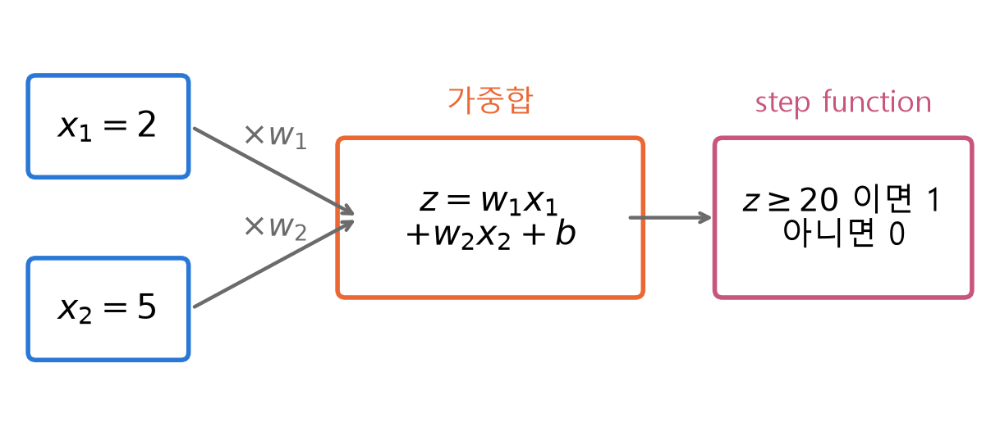
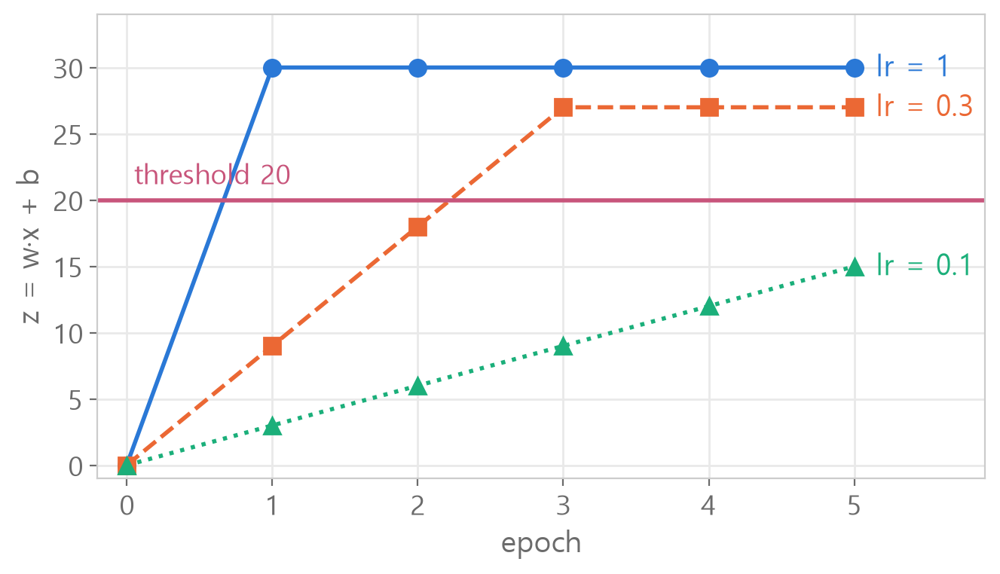
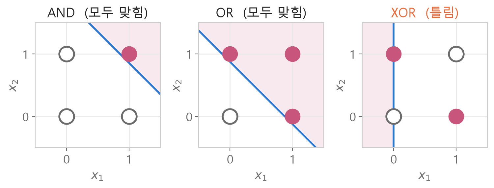

<style>
.content table { width: 100%; border-collapse: collapse; margin: 14px 0 24px; font-size: 17px; line-height: 1.5; }
.content th, .content td { border-bottom: 1px solid #e6dde0; padding: 8px 10px; text-align: left; vertical-align: top; }
.content thead { background: #fbf1f4; }
.content figure { margin: 18px 0; }
.content figure img { width: 100%; height: auto; }
.content td, .content th { word-break: keep-all; overflow-wrap: normal; }
.content .katex-display { overflow-x: auto; overflow-y: hidden; padding: 4px 0; }
@media (max-width: 560px) { .content th, .content td { padding: 7px 5px; font-size: 16px; } }
</style>
<link rel="stylesheet" href="https://cdn.jsdelivr.net/npm/katex@0.16.11/dist/katex.min.css">
<script defer src="https://cdn.jsdelivr.net/npm/katex@0.16.11/dist/katex.min.js"></script>
<script defer src="https://cdn.jsdelivr.net/npm/katex@0.16.11/dist/contrib/auto-render.min.js" onload="renderMathInElement(document.querySelector('.content')||document.body,{delimiters:[{left:'\\[',right:'\\]',display:true},{left:'\\(',right:'\\)',display:false}]})"></script>

<div class="wc"><p><b>퍼셉트론은 왜 직접 만들어 볼까요?</b><br>
퍼셉트론(Perceptron)은 입력에 가중치를 곱해 더하고, 그 값이 기준을 넘으면 1을 내는 가장 작은 인공 뉴런이에요.<br>
PyTorch의 <a href="https://docs.pytorch.org/docs/stable/generated/torch.nn.Linear.html">nn.Linear</a> 층도 입력에 가중치를 곱하고 bias를 더하는 같은 가중합을 계산해요.<br>
단층 퍼셉트론이 XOR을 못 푸는 한계는 1969년 책 <a href="https://en.wikipedia.org/wiki/Perceptrons_(book)">Perceptrons</a>로 널리 알려졌고, 이 한계를 알면 신경망이 왜 층을 쌓는지 보여요. (2026년 11월 3일 기준)</p></div>

빈 클래스부터 한 칸씩 채워 퍼셉트론을 만들고, AND·OR·XOR을 학습시켜 **한계까지 일곱 단계**로 따라가요.<br>
처음에 틀린 코드와 다시 물어본 질문도 그 자리에 그대로 넣었어요. 숫자는 모두 파이썬으로 직접 계산한 값이에요.

<div class="keyline">예시는 입력 x = [2, 5], 정답 y = 1, 기준값(threshold) 20으로 시작할게요.</div>

## <span class="no">1</span> 데이터와 빈 틀 만들기

먼저 데이터를 numpy 배열로 준비해요.

```python
X = np.array([[2, 5]])
y = np.array([1])
```

```text
NameError: name 'np' is not defined
```

`np`를 쓰기 전에 불러와야 해요. `import`는 맨 위 칸에 둬요.

```python
import numpy as np
import pandas as pd

X = np.array([[2, 5]])
y = np.array([1])
X.shape
```

```text
(1, 2)
```

데이터 1개, 데이터마다 입력 2개예요.

퍼셉트론은 기능 네 개를 가진 클래스로 만들어요. 처음부터 다 쓰면 막히니까 **`pass`로 빈 틀**을 먼저 만들어요.

```python
class Perceptron:
    def __init__(self, n_inputs):
        pass
    def step_function(self, z):
        pass
    def predict(self, x):
        pass
    def fit(self, X, y, lr, epoch):
        pass
```
`pass`는 「아직 비어 있음」 표시라 이대로도 에러 없이 실행돼요. 이제 한 칸씩 채우고, 채울 때마다 바로 확인해요.

## <span class="no">2</span> \_\_init\_\_: 가중치를 0으로

`__init__`은 퍼셉트론을 만들 때 한 번 실행돼요. 가중치를 **입력 개수만큼 0으로**, bias를 0으로 준비해요.

```python
# ❌ 처음 쓴 코드
class Perception:
    def __init__(self, n_inputs):
        self.w = np.zeros(self, n_inputs)
        self.bias = 0
```

```python
p = Perceptron(2)
print(p.w, p.bias)
```

```text
AttributeError: 'Perceptron' object has no attribute 'w'
```

틀린 곳이 두 군데예요.

- 클래스 이름이 `Perception`(셉션)이라 다른 클래스가 따로 생겼어요. `Perceptron(2)`(셉트론)은 앞에서 만든 `pass` 빈 틀로 만들어져서 `w`가 없어요. 빈 틀을 실행하지 않았다면 `NameError: name 'Perceptron' is not defined`가 나요.
- `np.zeros(self, n_inputs)` : `self`는 `np.zeros` 같은 바깥 함수에 넣는 값이 아니에요. 이름만 고치면 다음엔 `TypeError`가 나요.

```python
# ✅
class Perceptron:
    def __init__(self, n_inputs):
        self.w = np.zeros(n_inputs)
        self.bias = 0
```
클래스 칸을 다시 실행한 뒤 확인 칸을 실행하면 `[0. 0.] 0`이 나와요.

코드를 고친 뒤에는 **클래스 칸을 먼저 다시 실행**하고, 확인 칸에서 `p = Perceptron(2)`로 새로 만들어요. 클래스 칸을 다시 실행하지 않거나 예전에 만든 `p`를 그대로 쓰면, 고치기 전 코드로 동작해요.

`self.w`처럼 `self.`이 붙은 값은 **만들어진 퍼셉트론이 계속 들고 있는 값**이에요.

## <span class="no">3</span> step_function과 predict

퍼셉트론은 **가중합을 계산하고, 기준을 넘었는지 판정**해요.

$$z = w_1x_1 + w_2x_2 + b$$

$$\hat{y} = \begin{cases} 1 & (z \geq 20) \\ 0 & (z < 20) \end{cases}$$

$$w$$는 가중치(weight), $$b$$는 bias(절편), $$\hat{y}$$는 예측이에요.

<figure></figure>

판정은 `step_function`이 해요. 「20 **미만**이면 0」이라 딱 20이면 1이에요. `<=`로 쓰면 20일 때 0이 돼서 틀려요.

```python
def step_function(self, z):
    if z < 20:
        return 0
    else:
        return 1
```
`p.step_function(15)`는 0, `p.step_function(20)`은 1이에요.

`predict`는 z를 만들어 `step_function`에 넘겨요. 처음엔 두 줄의 자리가 뒤바뀌었어요.

```python
# ❌ 처음 쓴 코드
def predict(self, x):
    z = np.dot(self.w, self.step_function(z)) + self.bias
    return self.dot(z)
```
이 predict를 부르면 `UnboundLocalError: cannot access local variable 'z' where it is not associated with a value`가 나요.

z를 만드는 줄에서 아직 없는 z를 쓰고 있어요. `dot`은 numpy 함수라 `self.dot`도 없어요.

```python
# ✅ 1단계 z 만들기 → 2단계 판정에 넘기기
def predict(self, x):
    z = np.dot(self.w, x) + self.bias
    return self.step_function(z)
```
`np.dot`은 짝끼리 곱해서 더해요. 가중치를 직접 `[3, 5]`, bias를 `1`로 넣어 보면 $$3 \times 2 + 5 \times 5 + 1 = 32$$ → 20 이상이라 `1`이에요.

`self.`이 붙은 `self.w`, `self.bias`, `self.step_function`은 퍼셉트론이 들고 있는 것, 안 붙은 `x`는 밖에서 받아 온 값이에요.

## <span class="no">4</span> fit: 틀린 만큼 고치기

학습은 **틀린 만큼, 입력 방향으로** 가중치를 고치는 거예요.

$$w \leftarrow w + \eta \,(y - \hat{y})\, x$$

$$b \leftarrow b + \eta \,(y - \hat{y})$$

$$\eta$$는 learning rate(학습률), 한 번에 얼마나 크게 고칠지예요.

| 경우 | 정답 - 예측 | 가중치 |
|---|---|---|
| 예측 0, 정답 1 | +1 | 커짐 → z가 올라감 |
| 예측 1, 정답 0 | -1 | 작아짐 → z가 내려감 |
| 맞힘 | 0 | 그대로 |

```python
# ❌ 처음 쓴 코드
def fit(self, X, y, lr, epoch):
    for e in range(epoch):
         for i in  range(len(X)):
              pred = self.step_function(x[i])
              error = y[i] - pred
              self.w += lr * error
              self.bias += lr *error
        print(f"epoch {e+1}: w={self.w}, bias = {self.bias}")
```
`range(epoch)`, `error = y[i] - pred`, bias 줄은 맞았어요. 고칠 곳은 네 군데이고, 에러는 위에서부터 하나씩 나와요.

- 들여쓰기 : `for i`부터 5칸씩 들어가고 `print`는 8칸이라 어느 단계와도 맞지 않아요. 클래스 칸을 실행하자마자 `IndentationError`가 나요.
- `x[i]` : fit이 받은 이름은 대문자 `X`예요. 소문자 `x`는 없어서 `NameError`가 나요.
- `self.step_function(...)` : 가중합을 건너뛰고 데이터 `[2, 5]`를 통째로 판정에 넣어서 `ValueError`가 나요. `predict`를 불러야 해요.
- `lr * error` : `× X[i]`가 빠져서 w1, w2가 늘 똑같이 변해요.

```python
# ✅
def fit(self, X, y, lr, epoch):
    for e in range(epoch):
        for i in range(len(X)):
            pred = self.predict(X[i])
            error = y[i] - pred
            self.w += lr * error * X[i]
            self.bias += lr * error
        print(f"epoch {e+1}: w = {self.w}, bias = {self.bias}")
```
들여쓰기는 한 단계에 4칸이에요. `print`는 `for i`와 같은 줄이라 **epoch마다 한 번** 찍혀요.

대문자 `X`는 데이터 **전체**, `X[i]`는 그중 **하나**예요. fit → predict(X[i]) → step_function(z) 순서로 이어져요.

## <span class="no">5</span> 학습률 비교와 결과 표

같은 데이터를 epoch 5번, 학습률만 1, 0.3, 0.1로 바꿔 학습해요.

```python
p1 = Perceptron(2)
p1.fit(X, y, lr=1, epoch=5)
```
`p2`(lr 0.3), `p3`(lr 0.1)도 같은 방법으로 만들어요.

<figure></figure>

| lr | w | b | z | 20 넘은 때 |
|---|---|---|---|---|
| 1 | [2, 5] | 1 | 30 | 1번째 |
| 0.3 | [1.8, 4.5] | 0.9 | 27 | 3번째 |
| 0.1 | [1.0, 2.5] | 0.5 | 15 | 못 넘음 |

한 번 틀릴 때 z는 $$\eta \times (2^2 + 5^2 + 1) = 30\eta$$씩 올라요. lr 0.1은 3씩 올라서 20을 넘으려면 7번이 필요한데, 5번으로는 모자라요.<br>
출력에 `0.8999999999999999`가 보이는 건 소수를 이진수로 저장할 때 생기는 아주 작은 오차예요.

**❓ 다시 물어본 것 : 「결과 표는 어떻게 쓰는지 감이 안 와요」**

만들 표를 먼저 그리면 코드가 보여요. 칸 하나가 학습 하나예요.

```python
result = pd.DataFrame(
    {1: [p1.w[0], p1.w[1], p1.bias],
     2: [p2.w[0], p2.w[1], p2.bias],
     3: [p3.w[0], p3.w[1], p3.bias]},
    index=["w1", "w2", "bias"])
```
```
        1    2    3
w1    2.0  1.8  1.0
w2    5.0  4.5  2.5
bias  1.0  0.9  0.5
```

- `{1: [...]}` : 칸 이름 1에 값 세 개를 위에서부터
- `p1.w[0]` : p1의 가중치 중 첫 번째(파이썬은 0부터 세요)
- `index=` : 왼쪽 줄 이름

## <span class="no">6</span> AND·OR 학습

이제 입력 두 개(0 또는 1)로 0과 1을 정하는 논리 게이트를 학습해요. 퍼셉트론은 그대로, lr 1, epoch 100이에요.

**❓ 다시 물어본 것 : 「이 X, y가 뭔지 모르겠어요」**

`X`는 **문제 네 개**, `y`는 **같은 순서의 정답**이에요.

```python
X = np.array([[0, 0], [0, 1], [1, 0], [1, 1]])
y = np.array([0, 0, 0, 1])
# AND의 정답
```

| x1 | x2 | AND | OR | XOR |
|---|---|---|---|---|
| 0 | 0 | 0 | 0 | 0 |
| 0 | 1 | 0 | 1 | 1 |
| 1 | 0 | 0 | 1 | 1 |
| 1 | 1 | 1 | 1 | 0 |

AND는 둘 다 1일 때만, OR은 하나라도 1이면, XOR은 둘이 다를 때만 1이에요. `X`는 그대로 두고 `y`만 바꿔요.

```python
p_and = Perceptron(2)
p_and.fit(X, y, lr=1.0, epoch=100)
print([p_and.predict(x) for x in X])
```

```text
epoch 1: w = [1. 1.], bias = 1.0
epoch 2: w = [2. 2.], bias = 2.0
epoch 3: w = [3. 3.], bias = 3.0
epoch 4: w = [4. 4.], bias = 4.0
epoch 5: w = [5. 5.], bias = 5.0
epoch 6: w = [6. 6.], bias = 6.0
epoch 7: w = [7. 7.], bias = 7.0
epoch 8: w = [7. 7.], bias = 7.0
…
epoch 100: w = [7. 7.], bias = 7.0
[0, 0, 0, 1]
```

가운데 epoch 9~99 줄은 모두 `w = [7. 7.], bias = 7.0`이라 줄였어요. 마지막 줄 `[0, 0, 0, 1]`이 정답과 같아요.

z는 차례로 7, 14, 14, 21이에요. **둘 다 켜져야 21로 20을 넘어요.** 가중치는 epoch 7 뒤로 바뀌지 않아요. 다 맞히면 정답 - 예측이 0이라 고칠 양도 0이에요.<br>
OR은 `w = [8, 8]`, `bias = 13`을 찾아요. 하나만 켜져도 $$8 + 13 = 21$$이에요.

**❓ 「Perceptron(2)의 2는 데이터가 2개라는 뜻인가요?」**

데이터 **하나에 들어 있는 입력 개수**예요. `X.shape`가 `(4, 2)`면 데이터 4개, 입력 2개이고, 넣는 숫자는 뒤의 2예요. 가중치도 입력마다 하나씩 2개가 생겨요.

**❓ 「fit의 X, y가 여기서 뭔지 잘 모르겠어요」**

`def fit(self, X, y, lr, epoch)`의 이름은 **부를 때 들어올 값의 이름표**예요. `p_and.fit(X, y, 1.0, 100)`로 부르면 순서대로 담겨요. 바깥 이름이 `inputs`, `answers`여도 똑같이 동작해요.

**❓ 「[p_and.predict(x) for x in X] 형식이 어려워요」**

for문을 한 줄로 줄인 것이에요. 아래 세 줄과 같아요.

```python
result = []
for x in X:
    result.append(p_and.predict(x))
```
「X에서 x를 하나씩 꺼내, predict한 값을, 리스트로 모아」라고 뒤에서부터 읽어요.

**❓ 「predict라는 함수가 어디 안에 들어 있는 거예요?」**

`class Perceptron` 안이에요. 클래스는 **설계도**, `Perceptron(2)`로 만든 `p_and`, `p_or`는 그 설계도로 만든 **객체**예요. 기능은 같고 가중치는 각자 따로 들고 있어요.<br>
`p_and.predict(x)`의 점(`.`)은 「p_and 안의」라는 뜻이라, p_and의 가중치로 계산해요. scikit-learn의 `model.predict()`도 같은 구조예요.

## <span class="no">7</span> XOR은 왜 안 될까

같은 방법으로 XOR(`y = [0, 1, 1, 0]`)을 학습하면 100번을 돌려도 `[1, 1, 0, 0]`이 나와요. 네 개 중 두 개가 틀려요.

<figure></figure>

$$w_1x_1 + w_2x_2 + b = 20$$은 평면 위의 **직선 하나**예요. 칠한 쪽이 퍼셉트론이 1이라고 답하는 영역이에요.<br>
AND·OR은 1과 0을 직선 하나로 가를 수 있어요. XOR은 1끼리, 0끼리 대각선으로 마주 봐서 어떤 직선으로도 못 갈라요.

식으로도 확인돼요. XOR을 맞히려면 네 조건이 동시에 맞아야 해요.

$$b < 20, \quad w_1 + w_2 + b < 20$$

$$w_2 + b \geq 20, \quad w_1 + b \geq 20$$

윗줄 둘을 더하면 $$w_1 + w_2 + 2b < 40$$, 아랫줄 둘을 더하면 $$w_1 + w_2 + 2b \geq 40$$이에요.<br>
두 식이 동시에 맞을 수 없어서, 그런 $$w$$와 $$b$$는 처음부터 없어요. epoch를 늘리거나 학습률을 바꿔도 안 되는 이유예요.

**epoch 끝의 가중치가 멈췄다고 학습이 끝난 건 아니에요.** XOR은 epoch 26부터 매 epoch 네 번 모두 틀려서 네 번 고치는데, 한 바퀴를 돌면 `w = [-1, 0]`, `bias = 20`으로 되돌아와요.<br>
학습 중에는 하나 틀릴 때마다 가중치가 바뀐 뒤 다음 문제를 풀어서 네 개를 차례로 다 틀리고, epoch이 끝난 가중치로 네 개를 다시 풀면 두 개가 틀려요.<br>
학습이 끝났는지는 **틀린 개수가 0인지**로 확인해요.

<div class="done">🎉 퍼셉트론 하나는 직선 하나, 직선 하나로 못 가르는 XOR은 못 풀어요!</div>
