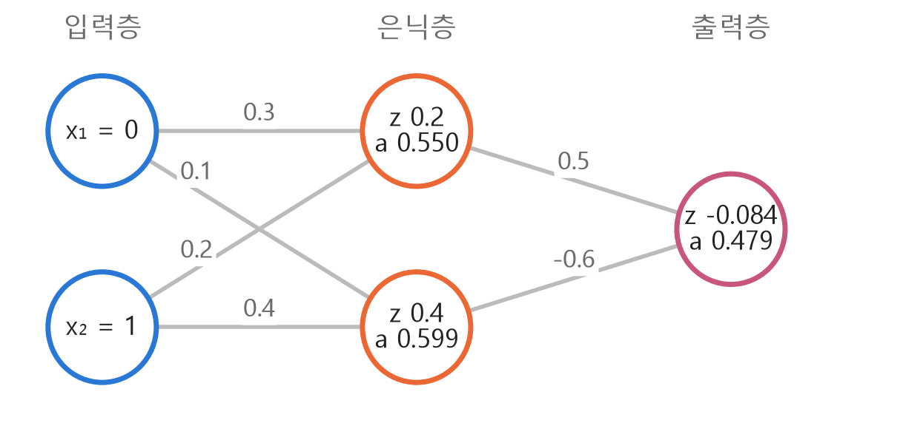
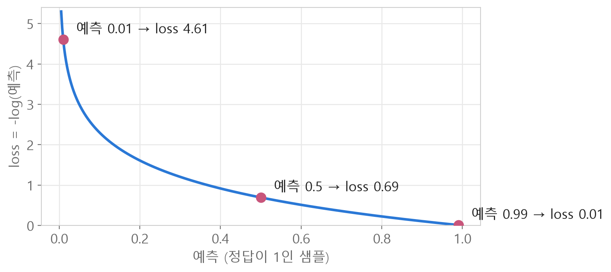
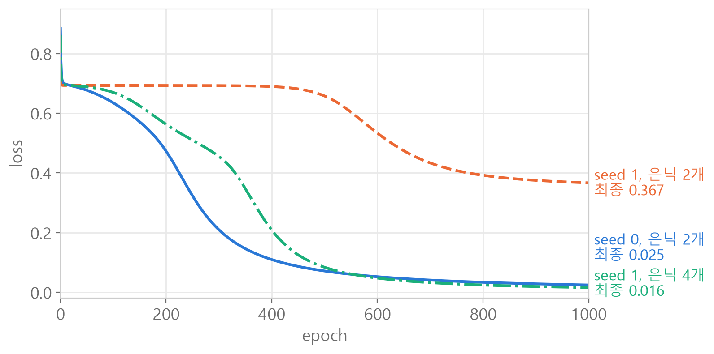

<style>
.content table { width: 100%; border-collapse: collapse; margin: 14px 0 24px; font-size: 17px; line-height: 1.5; }
.content th, .content td { border-bottom: 1px solid #e6dde0; padding: 8px 10px; text-align: left; vertical-align: top; }
.content thead { background: #fbf1f4; }
.content figure { margin: 18px 0; }
.content figure img { width: 100%; height: auto; }
.content td, .content th { word-break: keep-all; overflow-wrap: normal; }
.content .katex-display { overflow-x: auto; overflow-y: hidden; padding: 4px 0; }
.content td code { white-space: normal; overflow-wrap: anywhere; }
@media (max-width: 560px) { .content th, .content td { padding: 7px 5px; font-size: 16px; } }
</style>
<link rel="stylesheet" href="https://cdn.jsdelivr.net/npm/katex@0.16.11/dist/katex.min.css">
<script defer src="https://cdn.jsdelivr.net/npm/katex@0.16.11/dist/katex.min.js"></script>
<script defer src="https://cdn.jsdelivr.net/npm/katex@0.16.11/dist/contrib/auto-render.min.js" onload="renderMathInElement(document.querySelector('.content')||document.body,{delimiters:[{left:'\\[',right:'\\]',display:true},{left:'\\(',right:'\\)',display:false}]})"></script>

<div class="wc"><p><b>순전파와 역전파는 왜 직접 짜 볼까요?</b><br>
순전파(forward)는 입력에서 예측을 계산하는 과정, 역전파(backpropagation)는 loss에서 거꾸로 가며 가중치마다 기울기를 구하는 과정이에요.<br>
PyTorch 신경망은 순전파 → loss → 역전파 → 가중치 업데이트를 반복해 학습하고, 역전파는 <a href="https://docs.pytorch.org/tutorials/beginner/basics/autogradqs_tutorial.html">torch.autograd</a>가 자동으로 계산해요.<br>
한 번 손으로 짜 보면 <code>loss.backward()</code>와 <code>.grad</code>가 무엇을 하는지 보여서, shape 에러나 학습이 멈추는 원인을 찾기 쉬워져요. (2026년 11월 3일 기준)</p></div>

은닉층 하나짜리 신경망으로 XOR을 푸는 과정을 **순전파부터 autograd까지** 따라가고, 마지막에 쓴 **PyTorch 함수를 표로** 모았어요.<br>
처음에 틀린 코드와 다시 물어본 질문도 그 자리에 넣었어요. 숫자는 모두 파이썬으로 직접 계산한 값이에요.

[단층 퍼셉트론](/2026/11/03/perceptron-limit/)은 직선 하나라 XOR을 못 풀어요. 여기서는 은닉 노드 2개를 넣은 신경망으로 풀어요.

<div class="keyline">XOR 데이터 4개, 은닉 노드 2개, seed 0으로 시작할게요.</div>

## <span class="no">1</span> 데이터와 가중치 만들기

XOR 입력과 정답을 **실수(float) 텐서**로 만들어요. sigmoid와 log 계산은 실수로 해야 해요.

```python
import torch

X = [[0, 0], [0, 1], [1, 0], [1, 1]]
y = [0, 1, 1, 0]
X_tensor = torch.tensor(X, dtype=torch.float32)
y_tensor = torch.tensor(y, dtype=torch.float32).view(4, 1)
print(X_tensor.shape, y_tensor.shape)
```

```text
torch.Size([4, 2]) torch.Size([4, 1])
```

샘플 4개 × 입력 2개, 샘플 4개 × 정답 1개예요.

가중치 모양은 **(들어오는 노드 수, 나가는 노드 수)** 순서예요.

| 이름 | 모양 | 뜻 | 처음 값 |
|---|---|---|---|
| w1 | (2, 2) | 입력 2 → 은닉 2 | 무작위 |
| b1 | (2,) | 은닉 노드마다 하나 | 0 |
| w2 | (2, 1) | 은닉 2 → 출력 1 | 무작위 |
| b2 | (1,) | 출력 노드 하나 | 0 |

`X_tensor @ w1`은 (4, 2) @ (2, 2)예요. **안쪽 두 숫자가 같아야** 계산되고, 결과는 바깥 두 숫자 (4, 2)가 돼요.

```python
# ❌ 처음 쓴 코드
self.w1 = torch.tensor(2, 2)
self.b2 -= torch.tensor(1)
```
- `torch.tensor(2, 2)` → `TypeError: tensor() takes 1 positional argument but 2 were given`
- `self.b2 -=` → `AttributeError`. `-=`는 이미 있는 b2에서 빼라는 뜻인데 b2가 아직 없어요.

| 함수 | 괄호 안 숫자의 뜻 | 예 |
|---|---|---|
| `torch.tensor` | 값 | `torch.tensor(2)` → 숫자 2 하나 |
| `torch.randn` | 모양 | `torch.randn(2, 2)` → 2×2 무작위 |
| `torch.zeros` | 모양 | `torch.zeros(2)` → 0 두 개 |

```python
# ✅
class MLP:
    def __init__(self):
        self.w1 = torch.randn(2, 2)
        self.b1 = torch.zeros(2)
        self.w2 = torch.randn(2, 1)
        self.b2 = torch.zeros(1)
```

**❓ 다시 물어본 것 : 「초기화는 무작위 아니에요? 은닉·출력은 왜 0이에요?」**

0으로 시작하는 건 노드가 아니라 **bias**예요. 표의 「은닉 노드마다 하나」는 b1에 숫자가 몇 개인지를 말해요. 무작위가 꼭 필요한 건 w예요. 입력 (1, 0)이 은닉 노드 둘에 받는 점수를 예로 들어 볼게요.

| 경우 | 은닉 노드 1 | 은닉 노드 2 |
|---|---|---|
| w 전부 0 | 1×0 + 0×0 = 0 | 1×0 + 0×0 = 0 |
| w 무작위, b 0 | 1×0.34 + 0×0.23 = 0.34 | 1×0.13 + 0×(-0.41) = 0.13 |

w가 전부 0이면 두 노드가 같은 값으로 시작하고, 역전파에서도 똑같이 고쳐져서 끝까지 같은 노드로 남아요. w가 무작위면 b가 0이어도 이미 달라요. 초기화 방법은 [경사하강법·가중치 초기화 글](/2026/10/26/gradient-descent-init/)에 정리했어요.

## <span class="no">2</span> sigmoid와 순전파

sigmoid는 **어떤 숫자든 0과 1 사이로** 바꿔요.

$$\sigma(z) = \frac{1}{1 + e^{-z}}$$

```python
def sigmoid(z):
    return 1 / (1 + torch.exp(-z))

print(sigmoid(torch.tensor([-5.0, 0.0, 5.0])))
```

```text
tensor([0.0067, 0.5000, 0.9933])
```

큰 음수는 0 쪽, 0은 반반, 큰 양수는 1 쪽이에요.

```python
# ❌
torch.tensor(-5.0 0.0 5.0)
# ✅
torch.tensor([-5.0, 0.0, 5.0])
```
숫자 여러 개는 대괄호로 묶고 쉼표로 나눠요. 쉼표가 없으면 `SyntaxError`예요. 거듭제곱을 `^`로 쓰는 것도 자주 하는 실수예요. 파이썬에서 `^`는 비트 XOR이라 `torch.exp(-z)`로 써요.

**❓ 다시 물어본 것 : 「sigmoid 안에 무슨 값이 들어가요?」**

**점수 z**가 들어가요. z는 앞 단계 값에 가중치를 곱해 더하고 bias를 더한 값이에요. 입력 (0, 1) 하나만 따라가 볼게요. 가중치는 계산하기 쉬운 값으로 정했고, bias는 0이에요.

<figure></figure>

- 은닉 노드 1 : $$z = 0 \times 0.3 + 1 \times 0.2 = 0.2$$ → $$\sigma(0.2) = 0.550$$
- 출력 : $$z = 0.550 \times 0.5 + 0.599 \times (-0.6) = -0.084$$ → $$\sigma(-0.084) = 0.479$$

0.479는 「입력 (0, 1)의 답이 1일 확률 47.9%」예요. sigmoid에 들어가는 건 점수, 나오는 건 0과 1 사이의 확률이에요.

이 계산을 샘플 4개 × 노드 전부에 한 번에 하는 게 순전파예요.

$$Z_1 = XW_1 + b_1, \quad A_1 = \sigma(Z_1)$$

$$Z_2 = A_1W_2 + b_2, \quad \hat{Y} = \sigma(Z_2)$$

```python
# ❌
self.z2 = a1 @ self.w2 + self.b2
mlp = MLP
```
- `a1` → `NameError`. 윗줄에서 `self.a1`로 저장했으니 꺼낼 때도 `self.a1`이에요.
- `MLP`는 설계도 자체라 가중치가 없어요. `mlp.forward(X_tensor)`에서 `TypeError: MLP.forward() missing 1 required positional argument: 'X'`가 나요. `MLP()`로 만들어야 `__init__`이 실행돼요.

```python
# ✅ __init__ 아래에 이어서
    def forward(self, X):
        self.z1 = X @ self.w1 + self.b1
        self.a1 = sigmoid(self.z1)
        self.z2 = self.a1 @ self.w2 + self.b2
        self.a2 = sigmoid(self.z2)
        return self.a2

mlp = MLP()
```
값을 `self.`에 저장하는 이유는 역전파에서 a1, a2를 다시 꺼내 쓰기 때문이에요.

**❓ 「class를 또 써야 해요?」** 네. class에 함수 하나만 따로 끼워 넣을 수 없어서, `__init__`과 `forward`를 한 class 안에 다시 써요. 주피터 노트북에서는 **마지막으로 실행한 class**가 쓰여요.

**❓ 「@가 뭐예요?」** 짝지어 곱한 다음 **전부 더하는** 행렬곱이에요. 위 그림의 $$0 \times 0.3 + 1 \times 0.2$$가 `@` 한 칸이에요.

```python
a = torch.tensor([1.0, 2.0, 3.0])
b = torch.tensor([4.0, 5.0, 6.0])
print(a * b, a @ b)
```

```text
tensor([ 4., 10., 18.]) tensor(32.)
```

`*`는 곱하기만, `@`는 곱한 뒤 더하기예요.

| 변수 | 모양 | 뜻 |
|---|---|---|
| X | (4, 2) | 샘플 4개, 입력 2개 |
| z1, a1 | (4, 2) | 샘플 4개, 은닉 노드 2개 |
| z2, y_pred | (4, 1) | 샘플 4개, 출력 1개 |

앞 숫자는 끝까지 4, 뒤 숫자만 노드 수로 바뀌어요. b1은 (2,)인데 (4, 2)에 더해지는 건 PyTorch가 **같은 b1을 네 줄에 모두** 더해 주기 때문이에요(브로드캐스팅).

학습 전 seed 0의 예측은 `[0.224, 0.268, 0.184, 0.237]`이에요. 정답 `[0, 1, 1, 0]`과 상관없는 값이 정상이에요.

## <span class="no">3</span> BCE loss: 얼마나 틀렸나

loss는 **틀린 정도를 숫자 하나로** 잰 값이에요. 0과 1을 맞히는 문제에는 BCE(binary cross entropy)를 써요.

$$L = -\frac{1}{N}\sum_{i=1}^{N}\Big[y_i \log \hat{y}_i + (1-y_i)\log(1-\hat{y}_i)\Big]$$

정답이 1이면 $$-\log \hat{y}$$, 0이면 $$-\log(1-\hat{y})$$만 남아요. $$\frac{1}{N}\sum$$은 샘플 N개의 평균이에요.

<figure></figure>

정답이 1인데 0.01로 예측하면 4.61, 반반이면 0.69, 거의 맞히면 0.01이에요. 반대쪽을 확신할수록 크게 벌을 받아요.

```python
# ❌
def bce_loss(self, y_pred, y_true):
    rerturn =-(y_true*torch.log(y_pred) + (1-y_true)*torch.log(1-y_pred).mean())
```
- `rerturn =` : 오타와 `=` 때문에 값을 변수에 저장만 하고 돌려주지 않아서 `None`이 나와요.
- `.mean()`이 뒷부분 안에 있어서 **뒷부분만** 평균 내요. 샘플 하나로 시험할 땐 결과가 같아 보이지만 4개를 넣으면 숫자 하나가 안 나와요.

```python
# ✅
    def bce_loss(self, y_pred, y_true):
        return -(y_true*torch.log(y_pred) + (1-y_true)*torch.log(1-y_pred)).mean()

loss = mlp.bce_loss(y_pred, y_tensor)
```
`y_true`는 함수 **안에서만** 쓰는 이름이에요. 부를 때는 정답이 든 실제 변수 `y_tensor`를 넣어요.

**❓ 다시 물어본 것 : 「0.7 근처라던 loss가 0.99가 나와요」**

예측이 한쪽으로 쏠리면 loss가 더 커져요. seed 0의 loss 0.8834를 샘플별로 나누면 이래요.

| 입력 | 정답 | 예측 | 샘플 loss |
|---|---|---|---|
| (0, 0) | 0 | 0.224 | 0.25 |
| (0, 1) | 1 | 0.268 | 1.32 |
| (1, 0) | 1 | 0.184 | 1.69 |
| (1, 1) | 0 | 0.237 | 0.27 |

예측이 모두 낮은 쪽이라 정답이 1인 두 개를 크게 틀렸어요. 실행할 때마다 값이 바뀌는 건 `MLP()`가 매번 새 무작위 가중치를 뽑기 때문이에요. `torch.manual_seed(0)`을 위에 두면 매번 같아요.

## <span class="no">4</span> 역전파: 누구 탓인지 나누기

**❓ 다시 물어본 것 : 「순전파가 역전파를 위한 건가요, 반대인가요?」**

순전파가 주인공이에요. 예측을 내는 계산이고, 학습이 끝나면 순전파만 써요. 역전파는 순전파가 틀린 만큼 가중치를 **어느 쪽으로 얼마나** 고칠지 구해요. 순전파 때 저장한 a1, a2가 있어야 계산돼요.

기울기 $$\frac{\partial L}{\partial w}$$는 「w를 조금 늘리면 loss가 얼마나 변하나」예요. loss에서 가까운 출력층부터 거꾸로 구해요.

**① 출력층 점수의 기울기**는 sigmoid와 BCE를 같이 미분하면 간단해져요.

$$\frac{\partial L}{\partial Z_2} = \frac{\hat{Y} - Y}{N}$$

| 입력 | 정답 | 예측 | dz2 | 뜻 |
|---|---|---|---|---|
| (0, 0) | 0 | 0.224 | +0.056 | 점수를 조금 낮춰라 |
| (0, 1) | 1 | 0.268 | -0.183 | 점수를 많이 올려라 |
| (1, 0) | 1 | 0.184 | -0.204 | 점수를 많이 올려라 |
| (1, 1) | 0 | 0.237 | +0.059 | 점수를 조금 낮춰라 |

**② 가중치의 기울기 = (그 가중치에 들어온 입력) × dz2**

$$\frac{\partial L}{\partial W_2} = A_1^{\top}\,\frac{\partial L}{\partial Z_2}$$

출력 점수는 $$z_2 = a_1[0]\,w_2[0] + a_1[1]\,w_2[1] + b_2$$예요. w2[0]을 0.01 늘리면 z2는 $$a_1[0] \times 0.01$$만큼 변해요. a1[0]이 0에 가까운 샘플에서는 w2[0]의 책임도 거의 없어요.

| 입력 | a1[0] | dz2 | a1[0] × dz2 |
|---|---|---|---|
| (0, 0) | 0.500 | +0.056 | +0.028 |
| (0, 1) | 0.102 | -0.183 | -0.019 |
| (1, 0) | 0.824 | -0.204 | -0.168 |
| (1, 1) | 0.346 | +0.059 | +0.021 |
| 합 | | | **-0.138** |

네 줄을 곱해서 더한 게 `self.a1.T @ self.dz2`예요. `.T`(전치)는 a1을 (4, 2)에서 (2, 4)로 눕혀서, 한 줄에 「은닉 노드 하나의 출력 4개」가 오게 해요.

```python
# ❌
self.dz2 = (y_pred - y) / N
self.dw2 = N.T @ self.dz2
```
- `y_pred`는 class 바깥의 변수예요. 바깥에 남아 있던 다른 예측을 몰래 가져다 써서, 에러 없이 `self.a2`와 다른 숫자가 나올 수 있어요. 예측은 `self.a2`예요.
- `N`은 숫자 4라 `.T`가 없어요(`AttributeError`). w2에 들어온 입력은 `self.a1`이에요.

은닉층도 같은 공식이에요. 두 줄만 새로 생겨요.

```python
    def backward(self, X, y):
        N = X.shape[0]
        self.dz2 = (self.a2 - y) / N
        self.dw2 = self.a1.T @ self.dz2
        self.db2 = self.dz2.sum(dim=0)
        self.da1 = self.dz2 @ self.w2.T
        # 출력층 책임을 w2를 거꾸로 타고 은닉 노드로
        self.dz1 = self.da1 * self.a1 * (1 - self.a1)
        # sigmoid를 거꾸로 통과: σ' = a(1-a)
        self.dw1 = X.T @ self.dz1
        # 출력층과 같은 공식
        self.db1 = self.dz1.sum(dim=0)
```
seed 0으로 forward 뒤 backward를 한 번 실행하면 `dw2 = [-0.1382, -0.1423]`, `db2 = [-0.2717]`, `dw1 = [[0.0176, 0.0495], [0.0036, 0.0387]]`이에요.

**기울기 모양은 항상 자기 가중치 모양과 같아요.** dw1 (2, 2), db1 (2,), dw2 (2, 1), db2 (1,)가 나오면 구조가 맞아요.

**❓ 「db2는 왜 Size([1])이에요?」** `dz2.sum(dim=0)`이 샘플 4개를 세로로 더해서 4가 사라지고, 출력 노드 수 1만 남아요. `Size([2])`는 대괄호 한 겹인 숫자 2개짜리 줄, `Size([1, 2])`는 1행 2열짜리 표예요.

## <span class="no">5</span> 경사하강법과 학습곡선

가중치를 **기울기 반대 방향으로** 학습률 η만큼 옮겨요.

$$W \leftarrow W - \eta\,\frac{\partial L}{\partial W}$$

dw2가 -0.138이면 $$-(-0.138) = +0.138$$이라 w2가 올라가요. seed 0에서 η = 1로 한 번 고치면 w2가 `[-1.0845, -1.3986]` → `[-0.9464, -1.2563]`, loss는 0.8834 → 0.7784로 내려가요.

```python
# ❌ bias 두 줄에서 - 대신 =
self.b1 = self.b1 = lr * self.db1
self.b2 = self.b2 = lr * self.db2
```
`-` 대신 `=`를 치면 bias 자리에 기울기가 그대로 들어가 부호가 반대가 돼요. 에러는 안 나고 loss가 0.9235로 **올라가요.** 이런 실수는 loss가 줄어드는지 봐야만 찾을 수 있어요.

```python
# ✅ class 안에 이어서
    def gd(self, lr):
        self.w1 = self.w1 - lr * self.dw1
        self.b1 = self.b1 - lr * self.db1
        self.w2 = self.w2 - lr * self.dw2
        self.b2 = self.b2 - lr * self.db2
```

학습은 네 줄을 반복하는 거예요.

```python
torch.manual_seed(0)
mlp = MLP()
for epoch in range(1000):
    y_pred = mlp.forward(X_tensor)
    loss = mlp.bce_loss(y_pred, y_tensor)
    mlp.backward(X_tensor, y_tensor)
    mlp.gd(1.0)
    if epoch % 100 == 0:
        print(epoch, loss.item())
```

```text
0 0.883373498916626
100 0.6350012421607971
200 0.4730548858642578
300 0.20953066647052765
400 0.10972603410482407
500 0.07138947397470474
600 0.05219698324799538
700 0.04089190065860748
800 0.033506352454423904
900 0.028327887877821922
```

loss가 0.8834에서 0.0283(epoch 900)까지 내려가요. 최종 loss 0.0245, 예측 `[0.0217, 0.9722, 0.9717, 0.0190]`, 0.5 기준 판정 `[0, 1, 1, 0]`으로 정답과 같아요.

**seed는 무작위 숫자 목록의 시작 번호**예요. 컴퓨터의 무작위는 정해진 공식으로 만든 목록이라, seed가 같으면 목록도 같아요. seed 0 목록은 `1.5410, -0.2934, -2.1788, 0.5684, -1.0845, -1.3986, …`이고, 앞 4개가 w1, 다음 2개가 w2가 돼요.

코드는 그대로 두고 seed만 1로 바꾸면 학습이 **갇혀요.**

<figure></figure>

- seed 1, 은닉 2개 : 약 400 epoch 동안 0.693 근처에 머물러요. 0.693은 예측이 전부 0.5일 때의 loss예요. 그 뒤 내려가다 0.367에서 평평해져요.
- 예측 `[0.018, 0.970, 0.498, 0.513]` : (1, 0)과 (1, 1)을 구분하지 못하고 둘 다 0.5에 멈췄어요.
- 3,000번에 0.349, 10,000번에 0.347이라 **더 돌려도 거의 안 풀려요.** 0이 아닌 곳에서 평평하면 갇힌 신호예요.

**은닉 노드를 4개로 늘리면** seed 1도 0.016까지 내려가요. 새 가중치 변수를 만드는 게 아니라, 은닉 노드 수 자리의 숫자만 바꿔요.

```python
# ❌ 쓰이지 않는 변수만 늘어남
self.w3 = torch.randn(2, 2)
self.w4 = torch.randn(2, 1)
# ✅ 은닉 노드 수 자리만 4로
self.w1 = torch.randn(2, 4)
self.b1 = torch.zeros(4)
self.w2 = torch.randn(4, 1)
```
forward와 backward는 그대로예요. `@`가 모양에 맞춰 계산해요.

| 은닉 노드 | seed 0~19, 20번 학습 | loss 0.2 넘게 남음 |
|---|---|---|
| 2개 | 20번 | 6번 |
| 4개 | 20번 | 0번 |

조건은 learning rate 1.0, epoch 1,000, sigmoid, BCE예요. 은닉 노드가 늘면 같은 seed라도 w2가 다른 숫자로 시작해서, 노드 수의 효과는 seed 하나보다 이 20번 비교로 보는 게 맞아요.

## <span class="no">6</span> autograd로 바꾸기

손으로 짠 역전파를 PyTorch가 `loss.backward()` **한 줄로** 대신해요. 신경망은 그대로이고 바뀌는 곳만 모으면 이래요.

| 어디 | 손으로 짠 버전 | autograd 버전 |
|---|---|---|
| 가중치 | `torch.randn(2, 2)` | `torch.randn(2, 2, requires_grad=True)` |
| sigmoid | `sigmoid(z)` | `torch.sigmoid(z)` |
| loss | BCE 식 직접 | `F.binary_cross_entropy(y_pred, y_true)` |
| 역전파 | `mlp.backward(X, y)` 기울기 7줄 | `loss.backward()` |
| 기울기 | `self.dw1` | `self.w1.grad` |
| 업데이트 | `self.w1 = self.w1 - lr * self.dw1` | `self.w1 -= lr * self.w1.grad` |

```python
# class 안의 gd
    def gd(self, lr):
        with torch.no_grad():
            self.w1 -= lr * self.w1.grad
            # b1, w2, b2도 같은 모양
            self.w1.grad.zero_()
            # 쓴 기울기 지우기
```

위 표대로 `__init__`, `forward`, `bce_loss`를 고친 class를 다시 실행한 뒤 확인해요.

```python
import torch.nn.functional as F

torch.manual_seed(0)
mlp = MLP()
loss = F.binary_cross_entropy(mlp.forward(X_tensor), y_tensor)
loss.backward()
print(mlp.w2.grad.view(-1))
```

```text
tensor([-0.1382, -0.1423])
```

4절에서 손으로 구한 dw2와 똑같아요. 1,000번 학습한 loss도 0.8834 → 0.0283(epoch 900)까지 소수 넷째 자리까지 같아요.

gd 안의 두 줄이 autograd에서 실수가 제일 많은 곳이에요.

- `.grad.zero_()` : `backward()`는 기울기를 지우지 않고 **더해 쌓아요.** 같은 가중치로 `backward()`를 두 번 하면 w2.grad가 `[-0.2763, -0.2845]`로 두 배가 돼요.
- `with torch.no_grad():`와 `-=` : 가중치를 고치는 빼기는 기록하지 않게 해요. no_grad 안에서 `self.w1 = self.w1 - …`로 새로 만들면 `requires_grad`가 `False`가 돼서 다음 반복에서 기울기를 못 구해요. no_grad 없이 `-=`를 쓰면 `RuntimeError`가 나요.

## <span class="no">7</span> PyTorch 함수 정리

이 글에서 쓴 PyTorch 함수예요.

| 함수 | 하는 일 | 이 글에서 |
|---|---|---|
| `torch.tensor(data, dtype=torch.float32)` | 리스트를 실수 텐서로 | X, y 만들기 |
| `.view(4, 1)` | 모양 바꾸기 | y를 (4, 1)로 |
| `.shape` | 모양 확인 | `torch.Size([4, 2])` |
| `torch.randn(2, 2)` | 그 모양을 무작위 수로 | w1, w2 |
| `torch.zeros(2)` | 그 모양을 0으로 | b1, b2 |
| `torch.manual_seed(0)` | 무작위 목록 시작 번호 고정 | 결과 재현 |
| `@` | 행렬곱: 짝지어 곱하고 더하기 | `X @ w1` |
| `.T` | 전치: 행과 열 뒤집기 | `a1.T @ dz2` |
| `torch.exp`, `torch.log` | e의 거듭제곱, 자연로그 | sigmoid, BCE |
| `.sum(dim=0)` | 샘플 방향으로 더하기 | db1, db2 |
| `.mean()` | 평균 | BCE |
| `.item()` | 텐서 속 숫자 하나 꺼내기 | loss 출력 |
| `requires_grad=True` | 기울기 구할 텐서 표시 | autograd 가중치 |
| `torch.sigmoid` | sigmoid | autograd 순전파 |
| `F.binary_cross_entropy` | BCE loss | autograd loss |
| `loss.backward()` | 역전파로 기울기 계산 | 기울기 7줄 대신 한 줄 |
| `.grad` | 계산된 기울기가 담기는 곳 | `w1.grad` |
| `.grad.zero_()` | 쌓인 기울기 지우기 | 반복마다 |
| `torch.no_grad()` | 기울기 기록 끄기 | 가중치 업데이트 |

<div class="done">🎉 순전파 → loss → 역전파 → 업데이트, 이 네 줄이 PyTorch 학습 반복의 기본 모양이에요!</div>
