<style>
.content table { width: 100%; border-collapse: collapse; margin: 14px 0 24px; font-size: 17px; line-height: 1.5; }
.content th, .content td { border-bottom: 1px solid #e6dde0; padding: 8px 10px; text-align: left; vertical-align: top; }
.content thead { background: #fbf1f4; }
.content figure { margin: 18px 0; }
.content figure img { width: 100%; height: auto; }
.content td, .content th { word-break: keep-all; overflow-wrap: normal; }
.content .katex-display { overflow-x: auto; overflow-y: hidden; padding: 4px 0; }
.content td code { white-space: nowrap; }
.content pre .nb { padding: 0; border: 0; border-radius: 0; background: none; }
@media (max-width: 560px) { .content th, .content td { padding: 7px 5px; font-size: 16px; } }
</style>
<link rel="stylesheet" href="https://cdn.jsdelivr.net/npm/katex@0.16.11/dist/katex.min.css">
<script defer src="https://cdn.jsdelivr.net/npm/katex@0.16.11/dist/katex.min.js"></script>
<script defer src="https://cdn.jsdelivr.net/npm/katex@0.16.11/dist/contrib/auto-render.min.js" onload="renderMathInElement(document.querySelector('.content')||document.body,{delimiters:[{left:'\\[',right:'\\]',display:true},{left:'\\(',right:'\\)',display:false}]})"></script>

<div class="wc"><p><b>경사하강법은 왜 알아야 할까요?</b><br>
경사하강법(Gradient Descent)은 모델이 틀린 정도가 줄어드는 쪽으로 모델 안의 숫자를 조금씩 고치는 방법이에요.<br>
<a href="https://docs.pytorch.org/tutorials/beginner/basics/optimization_tutorial.html">PyTorch 공식 학습 튜토리얼</a>도 데이터를 묶음으로 나눠, 묶음마다 이렇게 숫자를 고쳐요.<br>
묶음 크기에 따라 달라지는 세 방식을 알면 학습 코드의 <code>batch_size</code>를 왜 그렇게 정했는지 읽을 수 있어요. (2026년 11월 4일 기준)</p></div>

경사하강법 세 방식의 개념과 장단점을 그림으로 먼저 보고, 같은 데이터로 직접 돌려 비교했어요. 헷갈리는 포인트 네 가지와 자주 하는 실수 네 가지도 정리했어요.

**경사하강법 → 세 방식과 장단점 → 코드로 학습하고 비교하기 → 헷갈리는 곳**

<div class="keyline">먼저 경사하강법이 무엇인지부터 볼게요.</div>

## <span class="no">1</span> 경사하강법이란

경사하강법은 loss가 줄어드는 쪽으로 가중치를 조금씩 고치는 일을 반복하는 방법이에요. 먼저 용어 네 개만 잡을게요.

| 용어 | 뜻 |
|---|---|
| 가중치 | 모델 안의 숫자. 학습은 이 숫자를 고치는 일이에요 |
| loss | 모델의 답이 정답에서 얼마나 틀렸는지 나타낸 숫자. 작을수록 좋아요 |
| 기울기 | 가중치를 조금 키울 때 loss가 얼마나 변하는지 나타낸 숫자 |
| learning rate | 한 번에 얼마나 고칠지 정하는 숫자 |

가중치 하나로 보면 고치는 식은 이래요.

$$\theta_{new} = \theta_{old} - \eta \nabla L(\theta_{old})$$

$$\theta$$는 가중치, $$\eta$$는 learning rate, $$\nabla L$$은 기울기예요.

기울기가 양수면 가중치를 키울수록 loss가 커진다는 뜻이라, 기울기에 learning rate를 곱한 만큼 빼서 가중치를 줄여요. $$\theta_{old} = 3$$, $$\eta = 0.3$$, 기울기가 3이면 $$\theta_{new} = 3 - 0.3 \times 3 = 2.1$$이에요.

아래 그림은 loss가 $$\frac{1}{2}\theta^2$$이고 기울기가 $$\theta$$일 때 이 계산을 네 번 반복한 모습이에요. loss 최소에 가까워질수록 기울기가 작아져서 한 걸음도 작아져요.

<figure>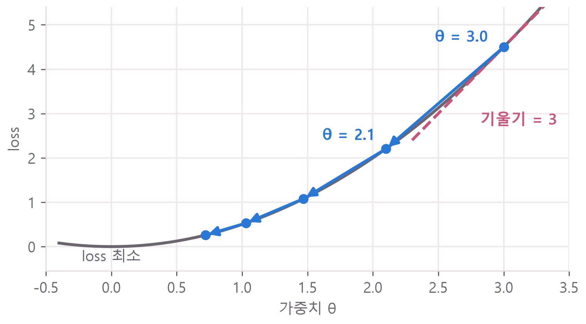</figure>

## <span class="no">2</span> 세 방식의 개념과 장단점

세 방식의 차이는 기울기를 몇 행의 데이터로 계산하느냐예요. loss는 행마다 정답과 모델의 답으로 계산하니, 기울기도 행마다 달라요. 여러 행을 쓰면 행마다 기울기를 구해 평균을 내요.

$$\theta_{new} = \theta_{old} - \eta \cdot \frac{1}{B} \sum_{i=1}^{B} \nabla L_i(\theta_{old})$$

$$B$$는 한 번에 보는 행 수(묶음 크기, batch size)이고, $$\nabla L_i$$는 $$i$$번째 행의 기울기예요. 앞의 기울기 3은 기울기가 2와 4인 두 행의 평균일 수 있어요. 이때 $$B = 2$$예요.

| 방식 | 기울기를 계산할 데이터 |
|---|---|
| Batch GD | 전체 데이터 |
| SGD | 무작위로 고른 1행 |
| Mini-batch GD | 작은 묶음(예: 32행) |

SGD는 Stochastic Gradient Descent(확률적 경사하강법)의 줄임말이에요. Mini-batch GD까지 SGD라고 부르는 자료도 있는데, 이 글에서는 묶음 크기가 1인 경우만 SGD라고 할게요.

이 차이로 가중치를 고치는 횟수가 달라져요. 전체 데이터를 한 번 다 보는 것이 **Epoch**이고, 가중치를 한 번 고치는 것이 **Iteration**이에요. 데이터 700행으로 1 Epoch를 돌면 세 방식은 이렇게 달라요.

<figure>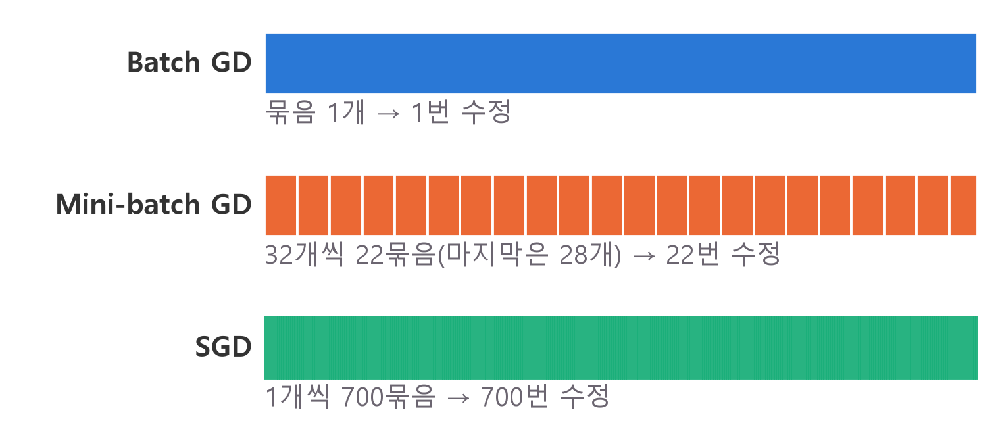</figure>

1 Epoch의 Iteration 수는 이렇게 구해요.

$$\text{Iteration 수} = \left\lceil \frac{N}{B} \right\rceil$$

$$N$$은 데이터 수이고, $$\lceil \ \rceil$$는 올림이에요. $$N = 700$$, $$B = 32$$이면 21.875를 올려서 22예요. 이 글에서 "수정 1번"은 Iteration 1번과 같은 말이에요.

행 수가 달라지면 고치는 방향도 달라져요. 입력 2칸에 가중치를 하나씩 곱해 더하고 0과 1 사이로 바꾸는, 가중치가 2개뿐인 모델로 확인해 볼게요. 입력은 뒤에서 만들 데이터의 2번 칸과 3번 칸이에요. 같은 가중치에서 묶음을 40번씩 뽑아 가중치를 어디로 고치는지 그렸어요.

<figure>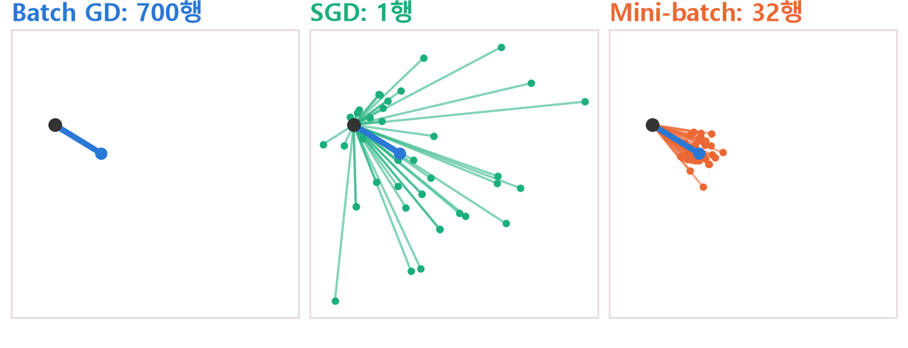</figure>

검은 점이 지금 가중치이고, 선 끝이 고친 뒤의 가중치예요. 굵은 파란 선은 700행 전체로 계산한 수정이라 언제나 하나뿐이에요. 1행은 뽑을 때마다 크게 달라지고, 32행은 파란 선 근처에 모여요.

이번에는 같은 모델을 같은 지점에서 출발시켜 10 Epoch씩 돌려 볼게요. 세 방식 모두 `lr=0.1`이고 7,000행을 봐요. 왼쪽의 회색 선은 loss가 같은 곳을 이은 등고선이고, 별이 loss 최소예요. 세 그림의 축이 같아서 그대로 비교할 수 있어요.

### Batch GD

전체 700행의 평균 기울기로 1번 고쳐요. 같은 가중치에서는 언제나 같은 방향으로 고치고, 1 Epoch에 1번만 고쳐요.

<figure>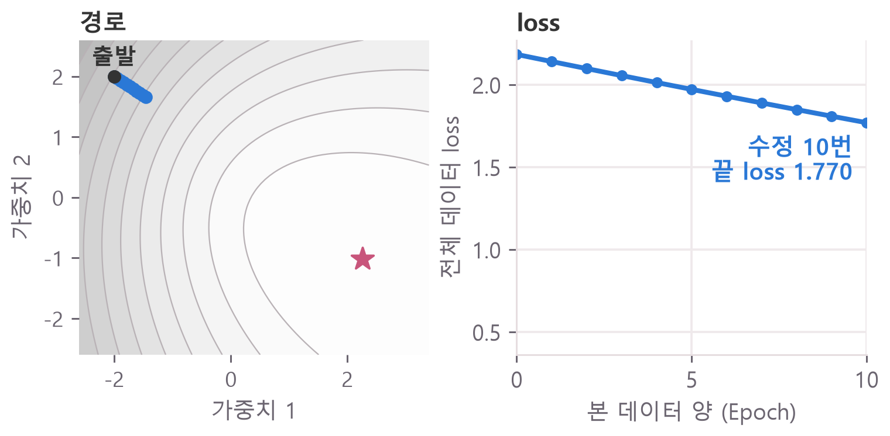</figure>

경로는 곧은데, 10번 고쳐서는 loss가 2.18에서 1.77까지만 내려갔어요.

- **장점:** 방향이 흔들리지 않아요. learning rate가 너무 크지 않으면 loss가 매끄럽게 내려가요.
- **단점:** 1번 고칠 때마다 전체 행을 계산해요. 데이터가 커질수록 1번 고치는 시간이 길어지고, 메모리도 더 필요해요. 같은 Epoch에서 수정 횟수가 가장 적어요.

### SGD

무작위로 고른 1행의 기울기로 1번 고쳐요. 700행이면 1 Epoch에 700번 고쳐요.

<figure>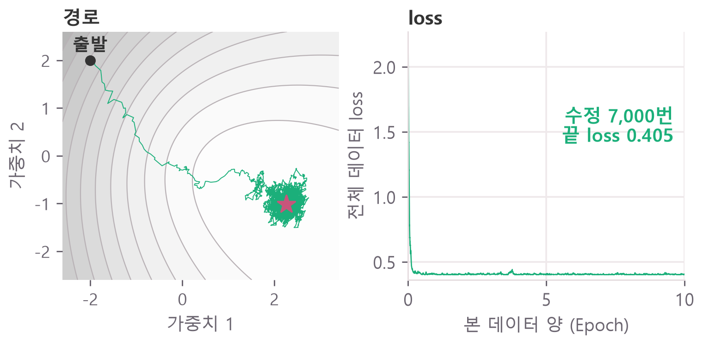</figure>

1 Epoch 만에 loss가 0.41까지 내려갔어요. 그런데 별 근처에 도착한 뒤에도 가중치가 멈추지 않고 계속 움직여요. 행마다 기울기가 달라서 그래요.

- **장점:** 1번 고치는 계산이 가장 작아요. 같은 Epoch에서 수정 횟수가 가장 많아서 Epoch 기준으로 초반 loss가 빨리 내려가요.
- **단점:** 방향이 크게 흔들려요. 흔들림을 줄이려면 learning rate를 작게 맞춰야 해요. 1행씩 따로 계산하니 1 Epoch를 도는 시간은 가장 길어요.

이 흔들림이 local minimum에서 벗어나는 데 도움이 된다는 설명도 자주 나와요. 이 글의 실험으로 확인한 내용은 아니에요.

### Mini-batch GD

32행처럼 작은 묶음의 평균 기울기로 1번 고쳐요. 700행이면 1 Epoch에 22번 고쳐요.

<figure>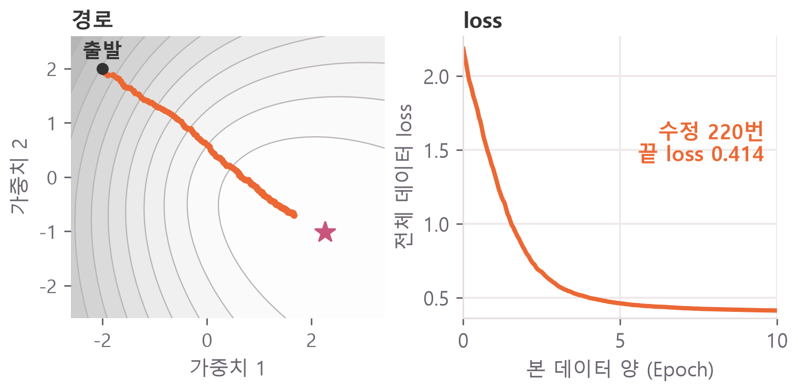</figure>

흔들림이 거의 보이지 않을 만큼 작고, 곧게 별 쪽으로 가요. loss는 매끄럽게 0.41까지 내려갔어요.

- **장점:** 흔들림이 SGD보다 작고, 수정 횟수는 Batch GD보다 많아요. 32행을 한 번에 묶어 계산하니 행 하나당 계산이 SGD보다 빨라요.
- **단점:** 묶음 크기를 직접 정해야 해요. 크기를 바꾸면 흔들림과 수정 횟수가 함께 달라져서 learning rate도 다시 봐야 할 수 있어요.

그래서 학습 코드에서는 Mini-batch를 많이 써요. 맨 앞에 링크한 PyTorch 튜토리얼도 `batch_size=64`예요.

세 방식을 표로 모으면 이래요. 시간은 4절에서 돌릴 4칸 입력 모델(가운데 층 32칸)로 잰 값이에요.

| 항목 | Batch GD | SGD | Mini-batch |
|---|---|---|---|
| 수정 1번에 쓰는 행 | 700 | 1 | 32 |
| 1 Epoch 수정 횟수 | 1 | 700 | 22 |
| 수정 1번 시간 | 약 3ms | 약 0.14ms | 약 0.32ms |
| 1 Epoch 시간 | 약 3ms | 약 100ms | 약 7ms |
| 방향 흔들림 | 없음 | 큼 | 작음 |

1 Epoch 시간만 보면 Batch GD가 가장 짧아요. 대신 그동안 1번밖에 못 고쳐요. 이제 이 숫자들을 코드로 직접 만들어 볼게요. 식은 [경사하강법 정리](/2026/10/26/gradient-descent-init/)에도 있어요.

## <span class="no">3</span> 문제 만들고 묶음 꺼내기

세 방식을 공정하게 비교하려면 같은 문제가 필요해요. 숫자 4칸을 보고 정답 0 또는 1을 맞히는 문제를 1000행 만들어요. 표로 생각하면 행 하나가 데이터 하나예요.

코드는 위에서부터 이어져요. `pip install torch`로 설치하거나 Google Colab에서 돌릴 수 있어요. ❌ 표시가 붙은 블록은 일부러 틀린 코드예요. 결과값은 torch 2.11 CPU에서 실행한 값이고, 시간은 컴퓨터와 실행마다 달라요.

```python
import torch  # 텐서 계산 도구
import torch.nn as nn  # 신경망 층과 loss
from torch.utils.data import (
    DataLoader,  # 묶음을 꺼내 주는 도구
    TensorDataset,  # X와 y를 짝짓는 도구
)

torch.manual_seed(42)  # 난수 고정
X = torch.randn(1000, 4)  # 1000행 4칸
noise = 0.3 * torch.randn(1000)
# 0번 칸 × 1번 칸 + 2번 칸
score = X[:, 0] * X[:, 1] + X[:, 2]
score = score - 0.5 * X[:, 3] + noise
# 1000행 1칸 모양으로
y = (score > 0).float().reshape(-1, 1)

X_train, y_train = X[:700], y[:700]
X_test, y_test = X[700:], y[700:]
print(X_train.shape, y_train.shape)
print(X_test.shape, y_test.shape)
print(round(y_train.mean().item(), 4))
```

```text
torch.Size([700, 4]) torch.Size([700, 1])
torch.Size([300, 4]) torch.Size([300, 1])
0.5014
```

첫 줄은 700행에 입력 4칸, 700행에 정답 1칸, 둘째 줄은 300행에 입력 4칸, 300행에 정답 1칸이에요.<br>
0.5014는 정답의 절반이 1이라는 뜻이라, 찍으면 약 50점이에요.

`X`는 입력이고 `y`는 정답이에요. `torch.randn`은 무작위 숫자를 만들고, `score`가 0보다 크면 정답이 1이에요.

700행으로 학습하고, 학습에 쓰지 않은 300행으로 시험을 봐요.

이제 700행을 묶음으로 나눠요. `TensorDataset`이 X와 y를 같은 번호끼리 짝짓고, `DataLoader`가 그 짝을 묶음으로 꺼내 줘요.

```python
dataset = TensorDataset(X_train, y_train)
loader = DataLoader(
    dataset,
    batch_size=32,  # 한 번에 32행
    shuffle=True,  # Epoch마다 섞기
)

X_batch, y_batch = next(iter(loader))
print(X_batch.shape, y_batch.shape)
print(len(loader))
```

```text
torch.Size([32, 4]) torch.Size([32, 1])
22
```

32행씩 꺼내고, 묶음은 22개예요.

`iter(loader)`로 꺼낼 준비를 하고, `next`로 첫 묶음만 꺼내 본 코드예요. 학습에서는 `for`가 이 일을 대신해요.

`[32, 4]`는 **32행, 행마다 4칸**이라는 뜻이에요. 4는 Epoch와 상관없는 숫자예요. 실제로 꺼낸 묶음을 표로 그리면 이래요.

<figure>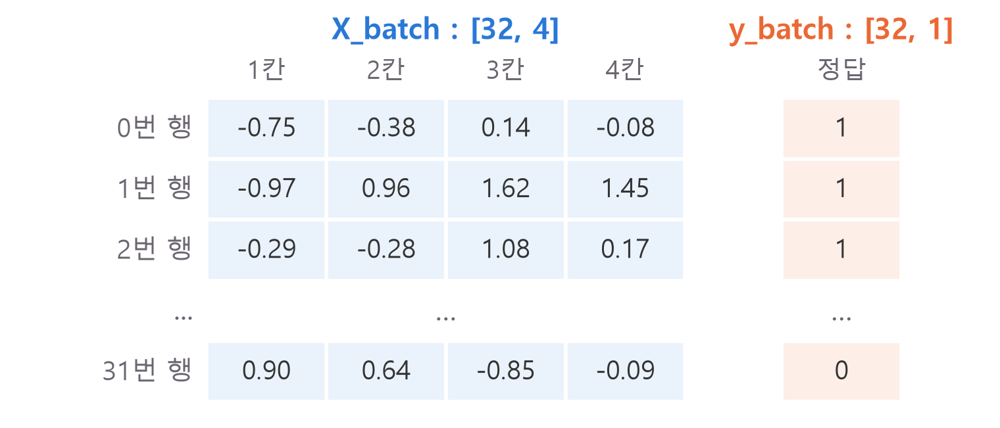</figure>

모델은 한 행의 4칸을 보고 정답 1칸을 맞혀요. `batch_size`를 바꾸면 앞 숫자만 바뀌고, 뒤의 4와 1은 그대로예요.

## <span class="no">4</span> 세 방식 학습하고 비교하기

묶음 크기만 바꿔 같은 코드로 돌려요. 모델은 4칸을 받아 계산을 두 번 거쳐 0과 1 사이 숫자 하나를 내요. `Linear`가 하는 계산은 6절에서 보고, 클래스 구조는 [nn.Module 입문](/2026/11/04/nn-module-shape-dim/)에 자세히 있어요.

```python
class SimpleNet(nn.Module):
    def __init__(self):
        super().__init__()
        self.net = nn.Sequential(
            nn.Linear(4, 32),  # 4칸 → 32칸
            nn.ReLU(),  # 음수는 0으로
            nn.Linear(32, 1),  # 32칸 → 1칸
            nn.Sigmoid(),  # 0과 1 사이로
        )

    def forward(self, x):
        return self.net(x)
```

학습 함수는 `for` 안에 `for`가 있는 모양이에요. 바깥은 Epoch, 안쪽은 묶음을 반복해요. 안쪽에서 2절의 식을 묶음마다 실행해요.

```python
def train(size, epochs=100, lr=0.1, seed=0):
    torch.manual_seed(seed)  # 같은 출발점
    loader = DataLoader(
        TensorDataset(X_train, y_train),
        batch_size=size,
        shuffle=True,
    )
    model = SimpleNet()
    optimizer = torch.optim.SGD(
        model.parameters(), lr=lr
    )
    criterion = nn.BCELoss()
    losses, updates = [], 0

    for epoch in range(epochs):
        model.train()
        epoch_loss = 0
        for X_b, y_b in loader:
            # 예측하고 채점
            pred = model(X_b)
            loss = criterion(pred, y_b)
            optimizer.zero_grad()  # 비우기
            loss.backward()  # 기울기 계산
            optimizer.step()  # 수정
            epoch_loss += loss.item()
            updates += 1
        losses.append(
            epoch_loss / len(loader)
        )

    model.eval()
    with torch.no_grad():
        # 0.5 이상이면 1로 답하기
        p = (model(X_test) >= 0.5).float()
    correct = (p == y_test).float()
    acc = correct.mean().item()  # 맞힌 비율
    return losses, updates, acc
```

새로 나온 이름은 이런 뜻이에요.

| 코드 | 뜻 |
|---|---|
| `torch.optim.SGD` | 기울기로 가중치를 고치는 도구(optimizer) |
| `nn.BCELoss` | 정답이 0 또는 1일 때 쓰는 loss |
| `loss.backward()` | 기울기 계산 |
| `optimizer.step()` | 2절의 식으로 가중치 수정 |
| `optimizer.zero_grad()` | 앞 묶음의 기울기 비우기 |
| `torch.no_grad()` | 시험에서 기울기 계산 끄기 |
| `model.train()`, `model.eval()` | 학습할 때와 시험 볼 때 모드 바꾸기 |

반복문의 흐름은 [학습 반복문 다섯 단계](/2026/11/04/xor-training-loop/)와 같아요. 묶음 22개면 100 Epoch에 2,200번 고쳐요.

Batch GD를 위해 묶음 크기로 700을 넘기면 묶음이 1개만 나와요. 네 가지 크기를 돌려 볼게요. SGD 줄은 10초쯤 걸려요.

```python
sizes = {
    "Batch GD": 700,
    "Mini-batch 256": 256,
    "Mini-batch 32": 32,
    "SGD": 1,
}
for name, size in sizes.items():
    losses, updates, acc = train(size)
    print(name, updates,
          round(losses[-1], 4),
          round(acc, 4))
```

```text
Batch GD 100 0.3978 0.7767
Mini-batch 256 300 0.279 0.8367
Mini-batch 32 2200 0.1575 0.8933
SGD 70000 0.1779 0.88
```

출력은 차례로 방식 이름, 수정 횟수, 마지막 Epoch의 평균 loss, 시험 300행에서 맞힌 비율이에요. 그림은 Epoch마다의 평균 loss예요.

<figure>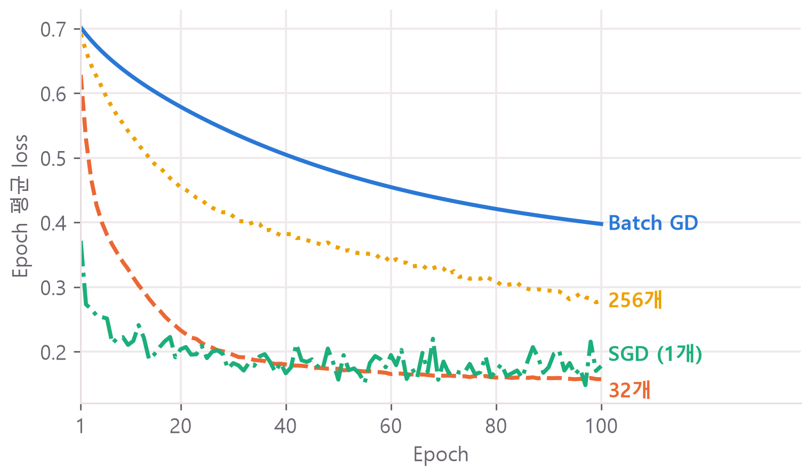</figure>

같은 Epoch 수라면 묶음이 작을수록 수정을 더 많이 해서 초반에 loss가 빨리 내려가요. 다만 SGD는 `lr=0.1`에서 삐죽삐죽 흔들리며 32행 묶음보다 위에 머물러요. 행 하나로 어림한 기울기는 다른 행에 맞지 않을 때가 많기 때문이에요.

그런데 한 번의 결과는 우연일 수 있어요. 난수의 시작값인 시드(seed)가 달라지면 처음 가중치와 섞는 순서가 달라지거든요. 시드 5개로 평균을 내 볼게요. 약 1분 걸려요.

```python
import time

def repeat(size, epochs=100, lr=0.1):
    accs, ends = [], []
    start = time.perf_counter()
    for seed in range(5):
        losses, _, acc = train(
            size, epochs, lr, seed
        )
        accs.append(acc)
        ends.append(losses[-1])
    sec = (time.perf_counter() - start) / 5
    return (round(sum(accs) / 5, 4),
            round(sum(ends) / 5, 4),
            round(sec, 2))

for name, size in sizes.items():
    print(name, repeat(size))
```

| 방식 | 100 Epoch 수정 | 최종 loss | 시험 점수 | 1번 실행 시간 |
|---|---|---|---|---|
| Batch GD | 100번 | 0.3810 | 0.7913 | 0.3초 |
| Mini-batch 256 | 300번 | 0.2707 | 0.8500 | 0.3초 |
| Mini-batch 32 | 2,200번 | 0.1581 | 0.9013 | 0.7초 |
| SGD | 70,000번 | 0.1780 | 0.8727 | 10초 |

조건은 학습 700행, 시험 300행, 가운데 층 1개(32칸), learning rate `lr=0.1`, 시드 0부터 4까지예요. 이 조건에서는 Mini-batch 32가 점수도 가장 높고, SGD보다 훨씬 빨랐어요.

이 표로 "SGD는 점수가 낮다"고 결론 내리면 안 돼요. Batch GD는 수정 횟수가 적고, SGD는 `lr=0.1`이면 흔들림이 커요. 조건을 맞춰 다시 볼게요.

## <span class="no">5</span> 수정 횟수를 맞추면 보이는 것

수정 횟수를 700번으로 맞추면 32행 묶음, 256행 묶음, 700행 전체의 loss가 거의 겹쳐요. 코드는 앞의 학습 반복문에 두 가지만 바꿨어요. 수정할 때마다 학습 데이터 전체의 loss를 기록하고, 700번 고치면 멈춰요.

```python
def by_updates(size, max_updates=700):
    torch.manual_seed(0)
    loader = DataLoader(
        TensorDataset(X_train, y_train),
        batch_size=size,
        shuffle=True,
    )
    model = SimpleNet()
    optimizer = torch.optim.SGD(
        model.parameters(), lr=0.1
    )
    criterion = nn.BCELoss()
    curve = []
    while len(curve) < max_updates:
        for X_b, y_b in loader:
            pred = model(X_b)
            loss = criterion(pred, y_b)
            optimizer.zero_grad()
            loss.backward()
            optimizer.step()
            with torch.no_grad():
                all_loss = criterion(
                    model(X_train), y_train
                )
            curve.append(all_loss.item())
            if len(curve) == max_updates:
                break
    return curve

for name, size in sizes.items():
    curve = by_updates(size)
    print(name, round(curve[-1], 4))
```

```text
Batch GD 0.1872
Mini-batch 256 0.1871
Mini-batch 32 0.188
SGD 0.2483
```

<figure>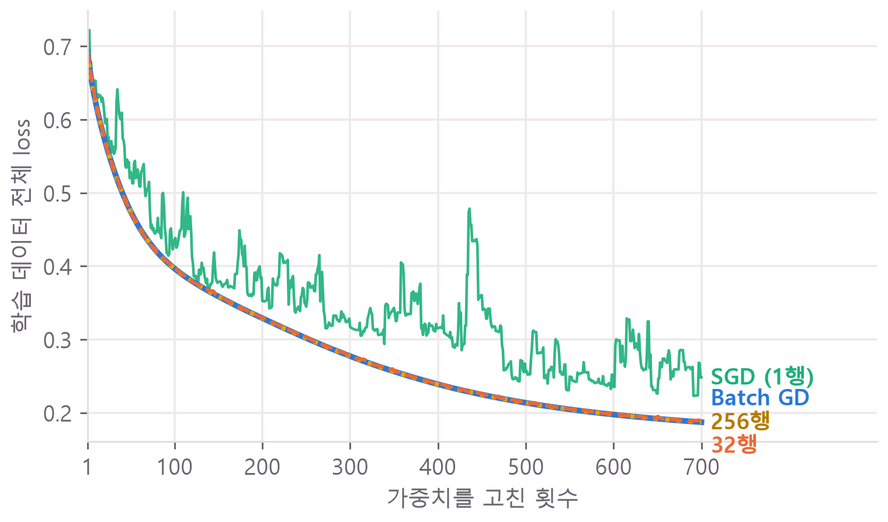</figure>

2절의 가중치 2개 모델로 이번에는 수정 횟수를 40번씩 맞춰 경로를 겹쳐 보면, Batch GD와 32행 묶음이 거의 같은 길로 가요.

<figure>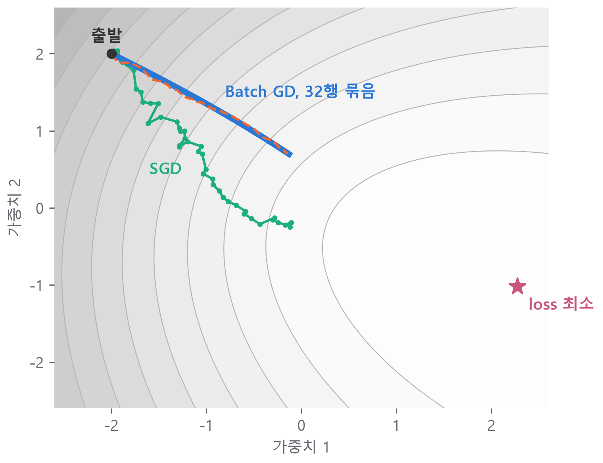</figure>

SGD는 다른 길로 가는데, 이 40번만 보면 끝점의 loss가 0.71로 Batch GD의 0.88보다 오히려 낮아요. 앞의 700번 그림에서는 SGD가 위에 있으니, 짧은 구간만 보고 판단하면 안 돼요.

그럼 32행 묶음의 기울기가 전체와 거의 같아서 겹치는 걸까요? 이번에는 4절의 4칸 입력 모델로 재 봤어요. 두 기울기의 방향이 얼마나 같은지는 cosine similarity로 재요. 1이면 같은 방향, 0이면 상관없는 방향이에요.

<figure>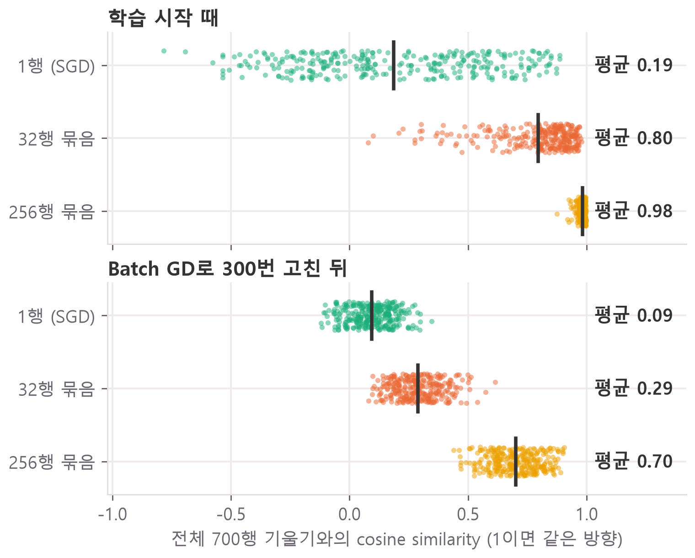</figure>

점 하나가 무작위로 뽑은 묶음 하나예요. 학습이 진행되면 32행 묶음 하나의 방향은 평균 0.29까지 떨어져요. 묶음 하나만 보면 전체와 꽤 달라요.

그래도 1 Epoch 동안 700행을 한 번씩 다 쓰니, 같은 가중치에서 22개 묶음의 기울기를 평균 내면 전체 기울기와 거의 같아져요(cosine similarity 0.9997). 묶음마다 어긋난 방향이 서로 상쇄되는 거예요. 22번 고치는 동안 가중치가 많이 움직이지 않으면 이 상쇄가 학습에서도 유지되니, loss가 겹친 이유를 이렇게 볼 수 있어요. 1행 묶음은 방향이 훨씬 더 흩어져서 loss가 크게 흔들렸어요.

이번에는 세 방식이 비슷한 점수에 닿게 맞춘 뒤 시간을 재 볼게요. Batch GD는 수정 횟수가 모자랐으니 Epoch를 2,200으로 늘려요. SGD는 흔들림이 컸으니 learning rate를 0.003으로 줄여요. 약 2분 걸려요.

```python
print(repeat(700, epochs=2200))
print(repeat(32))
print(repeat(1, lr=0.003))
```

| 설정 | 수정 횟수 | 최종 loss | 시험 점수 | 1번 실행 시간 |
|---|---|---|---|---|
| Batch GD, 2,200 Epoch | 2,200 | 0.1533 | 0.8993 | 7.4초 |
| Mini-batch 32, 100 Epoch | 2,200 | 0.1581 | 0.9013 | 0.8초 |
| SGD, lr=0.003, 100 Epoch | 70,000 | 0.1585 | 0.9033 | 11초 |

Mini-batch 32는 앞 표와 같은 실험을 다시 잰 값이라 시간만 조금 달라요.

<figure>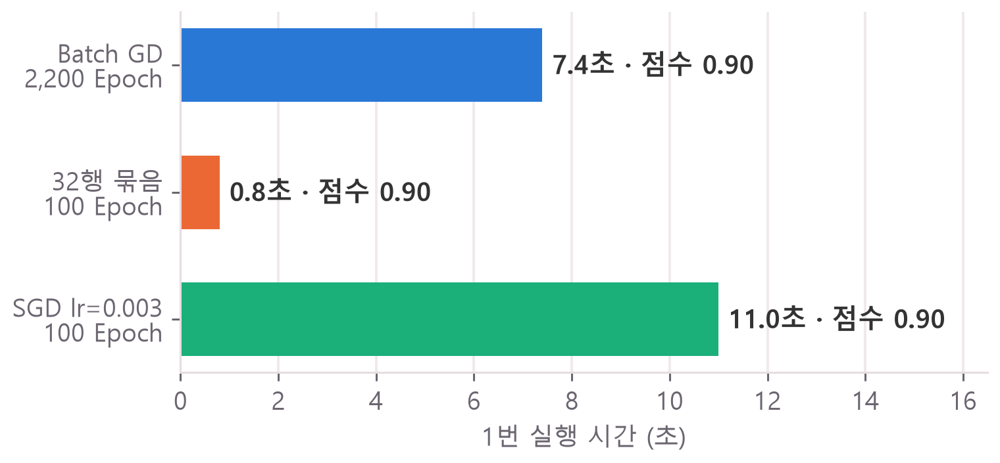</figure>

세 방식 모두 약 0.90에 닿았고, 차이는 시간이에요. Batch GD는 수정할 때마다 700행을 계산해서 Mini-batch 32보다 약 9배 걸렸어요. SGD와 Mini-batch 32는 둘 다 100 Epoch에 70,000행을 보는데, SGD는 10배 넘게 걸렸어요. 2절 표의 수정 1번 시간은 4절 표에서 나온 값이에요(SGD 10초 ÷ 70,000번, 32행 묶음 0.7초 ÷ 2,200번). 32행을 한 번에 계산해도 1행의 약 2배라서, 묶어서 계산하는 쪽이 빨라요.

이 실험에서 Mini-batch를 고를 이유가 여기 있어요. 다른 데이터에서는 점수 순서가 달라질 수 있고, `lr`에 따라서도 달라져요.

## <span class="no">6</span> 헷갈리기 쉬운 네 가지

**마지막 묶음은 32행이 아니에요.** 700을 32로 나누면 28행이 남고, 이 28행이 22번째 묶음이 돼요.

```python
counts = [len(X_b) for X_b, _ in loader]
print(counts[0], counts[-1], len(counts))

small = DataLoader(
    dataset, batch_size=32, drop_last=True
)
print(len(small))
```

```text
32 28 22
21
```

첫 묶음 32행, 마지막 묶음 28행, 묶음 22개예요.<br>
`drop_last=True`면 작은 묶음을 버려서 21개가 돼요.

**`Linear(32, 1)`의 32는 `batch_size=32`와 상관없어요.** 이 32는 모델 가운데 층의 칸 수이고, 이 글에서 우연히 숫자가 같아요. `batch_size`를 바꿔도 모델 코드는 그대로예요.

`Linear`가 32칸을 1칸으로 줄이는 방법은 곱해서 모두 더하기예요. 3칸 입력 $$[2, 1, 3]$$에 가중치 $$[0.5, -1, 1]$$을 곱해 더하면 $$1 - 1 + 3 = 3$$으로 숫자 하나가 돼요. 이 계산을 몇 세트 하느냐가 출력 칸 수예요.

**`torch.optim.SGD`는 묶음을 나누지 않아요.** 이름은 SGD인데 이 글의 네 가지 크기 모두 이 optimizer를 썼어요. optimizer는 받은 기울기로 가중치를 고치는 일을 하고, 묶음 크기는 `DataLoader`의 `batch_size`가 정해요.

**Epoch 1의 loss가 방식마다 달라요.** 그래프 첫 점이 Batch GD는 0.7018, SGD는 0.3718이에요. Batch GD는 수정하기 전에 잰 값 하나이고, SGD는 그 Epoch 안에서 700번 고치는 동안 잰 값의 평균이에요. 처음 가중치의 차이로 보면 안 돼요. 모두 같은 시드에서 출발했어요.

## <span class="no">7</span> 자주 하는 실수와 함수 정리

**정답의 모양을 안 맞추기.** `BCELoss`는 예측과 정답의 모양이 같아야 해요.

```python
# ❌ 에러: 예측은 [32, 1], 정답은 [32]
wrong = y_batch.reshape(-1)
p = torch.full((32, 1), 0.5)
nn.BCELoss()(p, wrong)
```

```text
ValueError: Using a target size (torch.Size([32])) that is different to the input size (torch.Size([32, 1])) is deprecated. Please ensure they have the same size.
```

정답을 만들 때 `.reshape(-1, 1)`을 붙이면 돼요.

**모델만 새로 만들기.** optimizer는 만들 때 넘겨받은 모델의 가중치만 고쳐요. 칸을 순서 없이 다시 실행하다가 자주 생기고, 에러 없이 loss만 멈춰요.

```python
# ❌ optimizer는 예전 모델을 고쳐요
torch.manual_seed(0)
model = SimpleNet()
optimizer = torch.optim.SGD(
    model.parameters(), lr=0.1
)
model = SimpleNet()  # 새 모델

criterion = nn.BCELoss()
for epoch in range(3):
    pred = model(X_train)
    loss = criterion(pred, y_train)
    optimizer.zero_grad()
    loss.backward()
    optimizer.step()
    print(round(loss.item(), 4))
```

```text
0.7513
0.7513
0.7513
```

세 번 다 같아요.

모델을 새로 만들면 optimizer도 바로 다음 줄에서 새로 만드세요.

**횟수 세는 줄의 들여쓰기.** 반복문 밖에 두면 한 번만 세요. 학습에는 영향이 없어서 숫자만 틀리니 알아채기 어려워요.

```python
# ❌ 100번 돌았는데 1
updates = 0
for epoch in range(100):
    pass
updates += 1
print(updates)

# ✅
updates = 0
for epoch in range(100):
    updates += 1
print(updates)
```

```text
1
100
```

**정렬된 데이터를 안 섞기.** 학습 데이터를 정답 순서로 정렬하고 `shuffle=False`로 돌리면, 앞쪽 묶음은 전부 0이고 뒤쪽 묶음은 전부 1이에요. 32행 묶음, 100 Epoch, 시드 5개로 재 보니 시험 점수 평균이 `shuffle=False`는 0.888, `shuffle=True`는 0.9013이었어요. 시드마다 모두 `shuffle=True`가 높았어요.

이 글에서 쓴 함수를 순서대로 모으면 이래요.

| 함수 | 하는 일 |
|---|---|
| `TensorDataset(X, y)` | X와 y를 같은 번호끼리 짝짓기 |
| `DataLoader(...)` | 짝을 묶음으로 나눠 꺼내기 |
| `next(iter(loader))` | 묶음 하나만 꺼내 보기 |
| `len(loader)` | 1 Epoch의 묶음 수 |
| `torch.optim.SGD(...)` | 받은 기울기로 가중치 고치기 |

<div class="done">🎉 묶음 크기가 수정 횟수를 정하고, 수정 횟수와 계산량이 loss와 시간을 정해요.</div>
