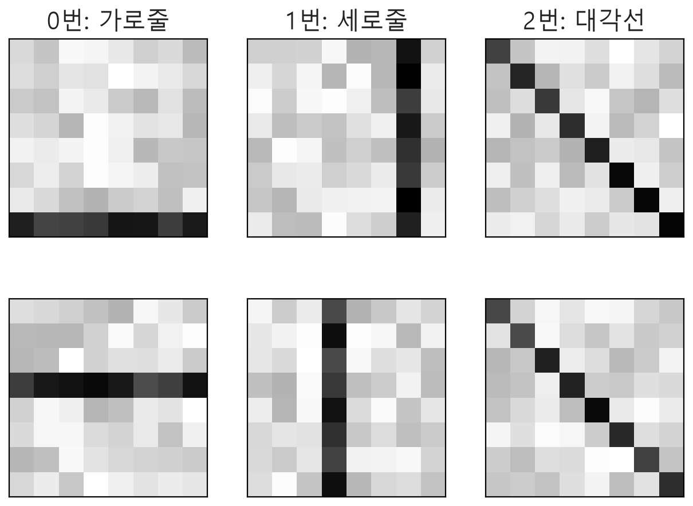
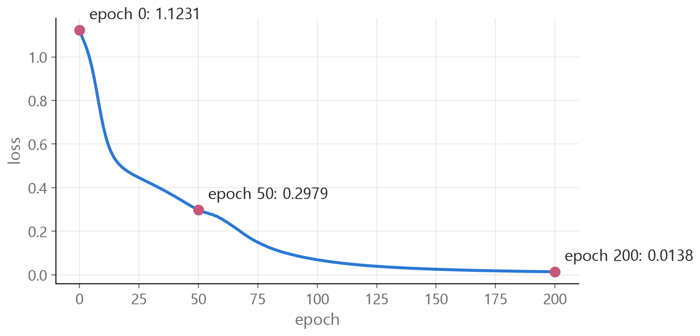

<style>
.content table { width: 100%; border-collapse: collapse; margin: 14px 0 24px; font-size: 17px; line-height: 1.5; }
.content th, .content td { border-bottom: 1px solid #e6dde0; padding: 8px 10px; text-align: left; vertical-align: top; }
.content thead { background: #fbf1f4; }
.content figure { margin: 18px 0; }
.content figure img { width: 100%; height: auto; }
.content td, .content th { word-break: keep-all; overflow-wrap: normal; }
.content .katex-display { overflow-x: auto; overflow-y: hidden; padding: 4px 0; }
.content td code { white-space: normal; overflow-wrap: anywhere; }
.content pre .nb { padding: 0; border: 0; border-radius: 0; background: none; }
@media (max-width: 560px) { .content th, .content td { padding: 7px 5px; font-size: 16px; } }
</style>
<link rel="stylesheet" href="https://cdn.jsdelivr.net/npm/katex@0.16.11/dist/katex.min.css">
<script defer src="https://cdn.jsdelivr.net/npm/katex@0.16.11/dist/katex.min.js"></script>
<script defer src="https://cdn.jsdelivr.net/npm/katex@0.16.11/dist/contrib/auto-render.min.js" onload="renderMathInElement(document.querySelector('.content')||document.body,{delimiters:[{left:'\\[',right:'\\]',display:true},{left:'\\(',right:'\\)',display:false}]})"></script>

<div class="wc"><p><b>nn.Module은 왜 배울까요?</b><br>
nn.Module은 PyTorch에서 모든 신경망 모듈의 <a href="https://docs.pytorch.org/docs/2.14/generated/torch.nn.Module.html">기본 클래스</a>예요.<br>
층 하나도, 층을 모은 모델 전체도 이 클래스를 바탕으로 만들어요.<br>
클래스 구조와 학습 흐름을 알면 다른 사람의 모델 코드를 읽기 쉽고, shape 에러의 원인도 빨리 찾을 수 있어요. (2026년 11월 4일 기준)</p></div>

8×8 이미지를 직접 만들어 모델을 학습·예측까지 해 보고, 헷갈리는 점과 자주 하는 실수 다섯 가지를 정리했어요.

코드는 위에서부터 셀 하나씩 실행하면 이어져요. `pip install torch`로 설치하거나 Google Colab에서 바로 돌릴 수 있어요. ❌ 표시가 붙은 블록은 일부러 에러를 내는 코드라서, 한 파일로 묶어 돌릴 때는 빼 주세요. 결과값은 torch 2.11 CPU에서 실행한 값이고, 환경에 따라 소수 값은 조금 다를 수 있어요.

**데이터 만들기 → 모델 설계 → 모델에 넣기 → 학습 → 예측**

<div class="keyline">가로줄·세로줄·대각선 이미지를 구분하는 모델을 만들어 볼게요.</div>

## <span class="no">1</span> 8×8 이미지 데이터 만들기

신경망에 넣는 이미지는 숫자가 담긴 텐서(tensor)예요. 값이 큰 줄이 있는 8×8 이미지 세 종류를 코드로 만들어요. 아래 그림은 큰 값을 어둡게 그렸어요.

```python
import torch          # 텐서 계산 도구
from torch import nn  # 층과 모델 도구

torch.manual_seed(0)  # 난수 고정

def make_images(n):   # 종류마다 n장 만들기
    images, labels = [], []
    for label in range(3):  # 0, 1, 2번 종류
        for _ in range(n):
            img = torch.rand(8, 8) * 0.3  # 배경 값
            pos = torch.randint(0, 8, (1,)).item()  # 줄 위치
            if label == 0:
                img[pos, :] += 0.7  # pos번 줄 전체
            elif label == 1:
                img[:, pos] += 0.7  # pos번 칸 전체
            else:
                img[range(8), range(8)] += 0.7  # 대각선
            images.append(img)
            labels.append(label)
    # 목록을 텐서 하나로 묶어서 돌려줘요
    return torch.stack(images), torch.tensor(labels)

X_train, y_train = make_images(100)  # 학습용 300장
X_test, y_test = make_images(20)     # 시험용 60장
print(X_train.shape)  # 이미지
print(y_train.shape)  # 정답 번호
print(y_train[0], y_train[100], y_train[200])
```
→ `torch.Size([300, 8, 8])`<br>
→ `torch.Size([300])`<br>
→ `tensor(0) tensor(1) tensor(2)`

<figure></figure>

| 이름 | shape | 뜻 |
|---|---|---|
| `X_train` | `(300, 8, 8)` | 8×8 이미지 300장 |
| `y_train` | `(300,)` | 이미지마다 정답 번호 하나 |
| `X_test` | `(60, 8, 8)` | 학습에 쓰지 않는 시험 이미지 60장 |
| `y_test` | `(60,)` | 시험 이미지의 정답 번호 |

shape의 맨 앞 숫자는 보통 데이터 개수예요. 학습에 쓰지 않은 데이터로 시험해야 처음 보는 이미지도 맞히는지 알 수 있어요.

## <span class="no">2</span> nn.Module로 모델 만들기

`nn.Module`을 물려받아 `__init__`에 쓸 층을 만들고, `forward`에 데이터가 지나가는 순서를 써요.

```python
class ImageNet(nn.Module):  # nn.Module 물려받기
    def __init__(self):     # 쓸 부품 정하기
        super().__init__()  # nn.Module 준비
        self.flatten = nn.Flatten()  # 8×8 → 64칸
        # Sequential: 넣은 순서대로 실행
        self.layers = nn.Sequential(
            nn.Linear(64, 32),  # 64칸 → 32칸
            nn.ReLU(),          # 음수를 0으로
            nn.Linear(32, 3),   # 32칸 → 점수 3개
        )

    def forward(self, x):       # 지나갈 순서 정하기
        x = self.flatten(x)     # 먼저 펴고
        return self.layers(x)   # 층을 지나요

torch.manual_seed(1)  # 시작 가중치 고정
model = ImageNet()    # 설계도로 실제 모델 만들기
print(model)
```

```
ImageNet(
  (flatten): Flatten(start_dim=1, end_dim=-1)
  (layers): Sequential(
    (0): Linear(in_features=64, out_features=32, bias=True)
    (1): ReLU()
    (2): Linear(in_features=32, out_features=3, bias=True)
  )
)
```

숫자는 이렇게 정해요.

- **64:** 8×8 이미지를 펴면 64칸이에요.
- **32:** 은닉층 크기예요. 데이터로 정해지지 않고 만드는 사람이 골라요.
- **3:** 구분할 종류가 3개라서 종류마다 점수가 하나씩 나와요.

## <span class="no">3</span> 모델에 넣고 shape 따라가기

층을 지날 때마다 맨 앞의 이미지 수 3은 그대로이고 뒤쪽 숫자만 바뀌어요.

```python
x = X_train[:3]         # 이미지 3장
print(x.shape)
x = model.flatten(x)    # 펴기
print(x.shape)
x = model.layers[0](x)  # Linear(64, 32)
print(x.shape)
x = model.layers[1](x)  # ReLU
print(x.shape)
x = model.layers[2](x)  # Linear(32, 3)
print(x.shape)
```
→ `(3, 8, 8)` → `(3, 64)` → `(3, 32)` → `(3, 32)` → `(3, 3)`

**Linear** 는 칸 수를 바꾸는 층이고, 학습되는 가중치가 여기에 있어요.

$$y = xW^{T} + b$$

$$x$$는 입력, $$W$$는 가중치(weight), $$W^{T}$$는 행과 열을 뒤집은 전치, $$b$$는 편향(bias)이에요.

<figure></figure>

```python
print(model.layers[0].weight.shape)  # (출력, 입력) 순서
```
→ `torch.Size([32, 64])` : (32, 64)로 저장되어 있어서 전치한 뒤 곱해요. 이 계산은 `nn.Linear`가 알아서 해요.

**ReLU** 는 음수를 0으로 바꾸고 양수는 그대로 둬요.

$$\text{ReLU}(x) = \max(0, x)$$

```python
print(nn.ReLU()(torch.tensor([-0.5, 0.3, 0.0, 1.2])))
```
→ `tensor([0.0000, 0.3000, 0.0000, 1.2000])`

ReLU가 없으면 층을 쌓아도 하나로 합쳐져요. 두 층 $$u = 2x + 1$$, $$y = 3u - 1$$을 이으면 $$y = 6x + 2$$ 한 층과 같아요. 가운데에 ReLU를 넣으면 꺾이는 곳이 생겨요.

<figure></figure>

[XOR](/2026/11/03/xor-forward-backprop/)처럼 직선 하나로 못 푸는 문제를 풀려면 이런 비선형 함수가 필요해요.

**모델 전체를 실행할 때는** `model(x)`로 불러요. 나오는 값은 종류별 점수(logits)이고, `nn.Softmax`로 확률로 바꿀 수 있어요.

$$p_i = \frac{e^{z_i}}{\sum_j e^{z_j}}$$

$$z_i$$는 $$i$$번 종류의 점수, $$p_i$$는 확률이에요.

```python
logits = model(X_train[:3])        # 종류별 점수
probs = nn.Softmax(dim=1)(logits)  # 합이 1인 확률로
print(probs.argmax(dim=1))         # 가장 큰 번호
print(y_train[:3])                 # 실제 정답

pred = model(X_test).argmax(dim=1)      # 시험 이미지 예측
print((pred == y_test).float().mean())  # 맞힌 비율
```
→ `tensor([1, 1, 1])`<br>
→ `tensor([0, 0, 0])`<br>
→ `tensor(0.2167)`

아직 학습 전이라 가중치가 무작위예요. 60장 중 13장만 맞혀서, 세 종류를 무작위로 고를 때의 기댓값 $$1/3$$에도 못 미쳐요.

## <span class="no">4</span> 학습하고 예측하기

학습은 **예측 → 채점 → 기울기 계산 → 가중치 수정**을 반복하는 일이에요. 채점에는 분류에서 많이 쓰는 cross entropy를 써요.

$$L = -\ln p_{y}$$

$$p_{y}$$는 정답 종류에 준 확률이에요. 정답 확률이 $$1/3$$이면 $$L = 1.0986$$, $$0.9$$면 $$L = 0.1054$$예요. 이미지가 여러 장이면 장마다 구한 값의 평균이 loss예요.

수정에는 경사하강법(SGD)을 써요.

$$\theta_{new} = \theta_{old} - \eta \nabla L$$

$$\theta$$는 가중치, $$\eta$$는 learning rate, $$\nabla L$$은 loss의 기울기예요.

```python
loss_fn = nn.CrossEntropyLoss()  # 채점 방법
optimizer = torch.optim.SGD(     # 가중치 수정 방법
    model.parameters(),          # 고칠 가중치
    lr=0.5,                      # learning rate
)

model.train()                    # 학습 모드
for epoch in range(201):         # 전체 데이터 201번
    logits = model(X_train)          # 1 예측
    loss = loss_fn(logits, y_train)  # 2 채점
    optimizer.zero_grad()            # 3 지난 기울기 지우기
    loss.backward()                  # 4 기울기 계산
    optimizer.step()                 # 5 가중치 수정
    if epoch % 50 == 0:              # 50번마다 출력
        print(epoch, round(loss.item(), 4))
```

| epoch | 0 | 50 | 100 | 150 | 200 |
|---|---|---|---|---|---|
| loss | 1.1231 | 0.2979 | 0.0689 | 0.0253 | 0.0138 |

처음 loss 1.1231은 정답 확률이 $$1/3$$일 때의 1.0986과 비슷해요.

<figure></figure>

이제 학습에 쓰지 않은 시험 이미지로 확인해요.

```python
model.eval()            # 평가 모드
with torch.no_grad():   # 기울기 기록 끄기
    pred = model(X_test).argmax(dim=1)
print((pred == y_test).float().mean())

with torch.no_grad():
    samples = X_test[[0, 20, 40]]  # 종류별로 한 장씩
    probs = nn.Softmax(dim=1)(model(samples))
print(probs.round(decimals=3))
```
→ `tensor(1.)` : 60장을 모두 맞혔어요. 학습 전에는 0.2167이었어요.

| 시험 이미지 | 가로줄 | 세로줄 | 대각선 |
|---|---|---|---|
| 가로줄 | 0.923 | 0.076 | 0.001 |
| 세로줄 | 0.015 | 0.984 | 0.001 |
| 대각선 | 0.000 | 0.000 | 1.000 |

이 데이터는 패턴이 뚜렷해서 쉬운 문제예요. 실제 이미지에서 이 작은 모델로 같은 정확도가 나온다는 뜻은 아니에요.

`model.eval()`은 Dropout처럼 학습과 평가에서 다르게 움직이는 층을 평가 모드로 바꿔요. 이 모델에는 그런 층이 없어서 결과는 같지만, 습관처럼 함께 써요.

## <span class="no">5</span> 헷갈리는 포인트: dim

`dim`은 shape에서 몇 번째 자리인지 가리키는 번호이고, 0부터 세요. `nn.Softmax(dim=1)`, `argmax(dim=1)`, `Flatten(start_dim=1)`의 숫자가 모두 이 번호예요.

```
shape:  (2, 3)
dim:     0  1
```

```python
t = torch.tensor([[2., 1., 0.],
                  [0., 3., 1.]])
print(t.sum(dim=0))  # 줄 번호만 바뀌는 값끼리
print(t.sum(dim=1))  # 칸 번호만 바뀌는 값끼리
```
→ `tensor([2., 4., 1.])` : 2+0, 1+3, 0+1<br>
→ `tensor([3., 4.])` : 2+1+0, 0+3+1

| 형식 | shape 예시 | 쓸 수 있는 dim | 읽는 법 |
|---|---|---|---|
| 리스트 모양 | `(3,)` | 0 | 전체가 한 묶음 |
| 표 모양 | `(2, 3)` | 0, 1 | 0은 세로, 1은 가로로 보여요 |
| 이미지 묶음 | `(300, 8, 8)` | 0, 1, 2 | 자리 번호로 읽어요 |

대괄호 속 번호는 값의 위치이고, `dim`은 shape의 자리예요.

```python
v = torch.tensor([10., 20., 30.])
print(v[1])          # 값의 위치 1
print(v.sum(dim=0))  # shape의 0번 자리
```
→ `tensor(20.)`<br>
→ `tensor(60.)`

**Flatten이 맨 앞 숫자를 남기는 이유** 는 이미지를 구분하기 위해서예요. `nn.Flatten()`은 기본값이 `start_dim=1`이라 0번 자리는 두고 1번 자리부터 펴요.

$$(N, H, W) \rightarrow (N, H \times W)$$

$$N$$은 이미지 수, $$H$$와 $$W$$는 세로와 가로 크기예요. 작은 숫자로 보면 이래요.

<figure></figure>

```python
# ❌ 에러: 전부 펴면 숫자 192개가 한 줄
model.layers(X_train[:3].flatten())
```
→ `RuntimeError: mat1 and mat2 shapes cannot be multiplied (1x192 and 64x32)`

```python
# ✅ (3, 64): 이미지별 64칸
model.layers(nn.Flatten()(X_train[:3]))
```

**Softmax의 dim=1과 dim=0** 은 분모의 합을 구하는 방향이 달라요. 위의 `t`를 이미지 2장의 점수로 보고 비교해 볼게요.

<figure></figure>

```python
e = torch.exp(t)  # e의 거듭제곱
# Softmax(dim=1)과 같아요
print(e / e.sum(dim=1, keepdim=True))
# Softmax(dim=0)과 같아요
print(e / e.sum(dim=0, keepdim=True))
```

첫 칸을 계산하면 $$e^2 = 7.389$$, 줄의 합은 $$7.389 + 2.718 + 1 = 11.107$$이고 $$7.389 / 11.107 = 0.6652$$예요. `keepdim=True`는 합을 구한 뒤에도 차원 수를 유지해서 칸을 맞춰 나누게 해요.

`dim=0`은 에러가 나지 않고 shape도 같아서 놓치기 쉬워요. 이미지 0의 합이 0.8808 + 0.1192 + 0.2689 = 1.2689라서 이미지별 확률 분포가 아니에요. 이미지마다 종류별 확률을 구해야 하니 `dim=1`을 써요.

## <span class="no">6</span> 자주 하는 실수 다섯 가지

**1. 정답 텐서의 자료형과 모양.** 여기처럼 정답이 종류 번호이면 `nn.CrossEntropyLoss`에 정수, 모양 `(개수,)`로 넘겨요.

```python
# ❌ 에러: 실수
loss_fn(model(X_train[:4]), y_train[:4].float())
```
→ `RuntimeError: expected scalar type Long but found Float`

```python
# ❌ 에러: 모양 (4, 1)
loss_fn(model(X_train[:4]), y_train[:4].view(4, 1))
```
→ `RuntimeError: 0D or 1D target tensor expected, multi-target not supported`

```python
# ✅ 정수, 모양 (4,)
loss_fn(model(X_train[:4]), y_train[:4])
```

**2. 모델 안에 Softmax 넣기.** [`nn.CrossEntropyLoss`](https://docs.pytorch.org/docs/2.14/generated/torch.nn.modules.loss.CrossEntropyLoss.html)는 logits를 입력으로 받아요. 마지막 층 뒤에 Softmax를 넣으면 확률에 Softmax 계산을 한 번 더 하게 돼요.

`nn.Linear(32, 3)` 뒤에 `nn.Softmax(dim=1)`을 한 줄 넣은 모델을, 같은 시작 가중치와 learning rate로 201번 학습해 비교했어요.

| 모델 | 마지막 loss | 시험 정확도 |
|---|---|---|
| logits를 그대로 넘김 | 0.0138 | 1.0 |
| 모델 안에 Softmax 추가 | 0.5896 | 1.0 |

이 쉬운 데이터에서는 정확도가 같아도 loss는 크게 남아요. 정답 확률이 1, 나머지가 0일 때도 loss가 $$-\ln\frac{e}{e+2} \approx 0.551$$ 아래로 내려가지 못해요.

**3. zero_grad 빼기.** `loss.backward()`는 기울기를 덮어쓰지 않고 더해요.

```python
torch.manual_seed(1)
m = ImageNet()
loss_fn(m(X_train), y_train).backward()
print(m.layers[2].bias.grad)  # 1번째
loss_fn(m(X_train), y_train).backward()
print(m.layers[2].bias.grad)  # 2번 쌓임
```
→ `tensor([-0.0113,  0.0221, -0.0108])`<br>
→ `tensor([-0.0226,  0.0443, -0.0216])` : 가중치가 같으니 두 배가 돼요.

같은 시작 가중치로 빼고 학습해 보면 시험 정확도는 1.0으로 같아요. 대신 쌓인 기울기만큼 가중치가 크게 움직여서, 50번째 반복에서 점수(logits)의 절댓값이 약 400까지 커지고 loss는 0에 가까워져요. 에러가 없고 결과도 좋아 보여서 더 놓치기 쉬워요. 이번 반복의 기울기로 고치려면 매번 지워야 해요.

**4. forward 직접 부르기.** 계산은 되지만 [등록된 hook](https://docs.pytorch.org/docs/2.14/generated/torch.nn.Module.html)(실행 전후에 끼어드는 함수)을 건너뛰어요.

```python
# ❌ hook이 실행되지 않아요
model.forward(X_test)

# ✅
model(X_test)
```

**5. 층을 파이썬 리스트에 담기.** `nn.Module`이 그 층을 찾지 못해서 가중치 목록에서 빠져요. 옵티마이저에도 전달되지 않아요.

```python
class ListNet(nn.Module):
    def __init__(self):
        super().__init__()
        # ❌ 파이썬 리스트
        self.layers = [nn.Linear(64, 32), nn.Linear(32, 3)]

class ModuleListNet(nn.Module):
    def __init__(self):
        super().__init__()
        # ✅ nn.ModuleList
        self.layers = nn.ModuleList([nn.Linear(64, 32), nn.Linear(32, 3)])

print(sum(p.numel() for p in ListNet().parameters()))
print(sum(p.numel() for p in ModuleListNet().parameters()))
```
→ `0`<br>
→ `2179`

이 2179개가 학습으로 고치는 숫자예요. 앞의 `model`과 개수가 같아요.

$$64 \times 32 + 32 + 32 \times 3 + 3 = 2179$$

`Flatten`과 `ReLU`는 학습할 값이 없어서 개수에 들어가지 않아요. 이름과 크기는 `model.named_parameters()`로 볼 수 있어요.

## <span class="no">7</span> PyTorch 함수 정리

이 글에서 쓴 함수를 흐름 순서로 모았어요.

| 함수 | 하는 일 |
|---|---|
| `torch.rand(8, 8)` | 0과 1 사이 난수로 그 모양의 텐서 만들기 |
| `torch.randint(0, 8, (1,))` | 0 이상 8 미만 정수 난수 |
| `torch.stack(목록)` | 같은 모양의 텐서들을 맨 앞 차원으로 묶기 |
| `torch.manual_seed(0)` | 난수 시작값 고정 |
| `nn.Module` | 모델 클래스가 물려받는 기본 클래스 |
| `super().__init__()` | nn.Module 초기 준비 |
| `nn.Flatten()` | 1번 자리부터 한 줄로 펴기 |
| `nn.Linear(입력, 출력)` | 가중치와 편향으로 칸 수 바꾸기 |
| `nn.ReLU()` | 음수를 0으로 |
| `nn.Sequential(...)` | 넣은 순서대로 층 실행 |
| `model(x)` | 모델 실행, 안에서 forward 호출 |
| `nn.Softmax(dim=1)` | 점수를 합이 1인 확률로 |
| `.argmax(dim=1)` | 가장 큰 값의 번호 |
| `nn.CrossEntropyLoss()` | logits와 정답 번호로 loss 계산 |
| `torch.optim.SGD(...)` | 기울기로 가중치 수정 |
| `optimizer.zero_grad()` | 쌓인 기울기 지우기 |
| `loss.backward()` | 기울기 계산 |
| `optimizer.step()` | 가중치 수정 |
| `model.train()`, `model.eval()` | 학습 모드, 평가 모드 |
| `torch.no_grad()` | 기울기 기록 끄기 |
| `model.parameters()` | 학습할 가중치 목록 |
| `.numel()` | 텐서에 든 숫자 개수 |

<div class="done">🎉 데이터 → 모델 → 예측 → 채점 → 수정, 이 흐름이 PyTorch 학습의 기본 모양이에요!</div>
