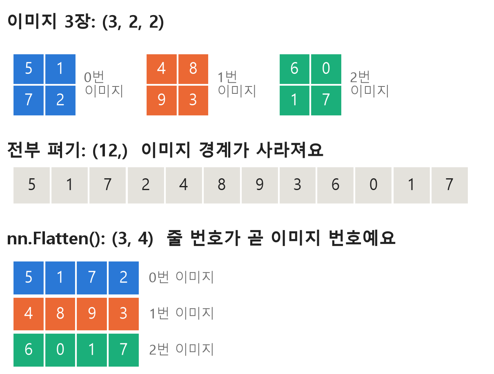
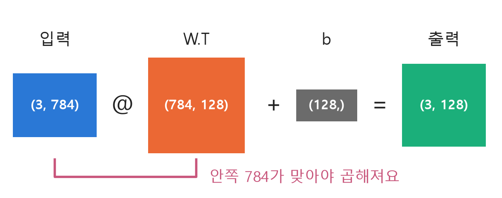
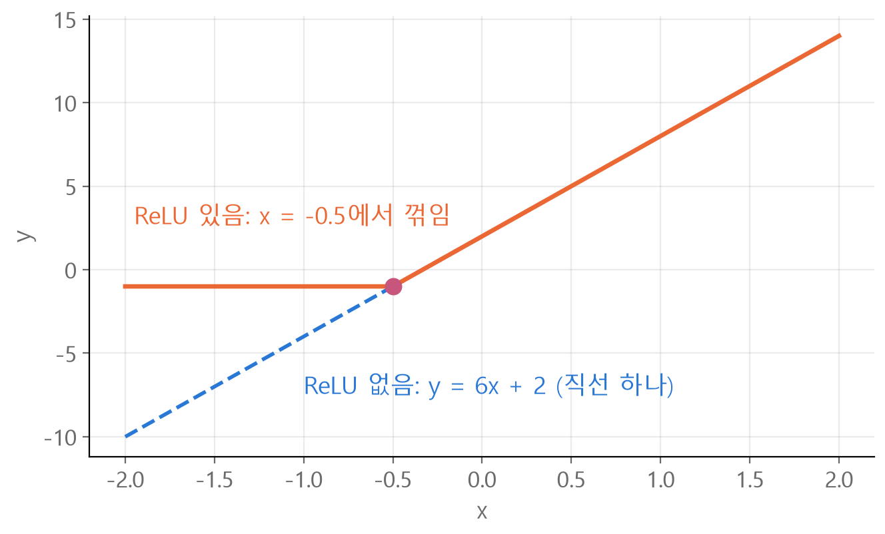
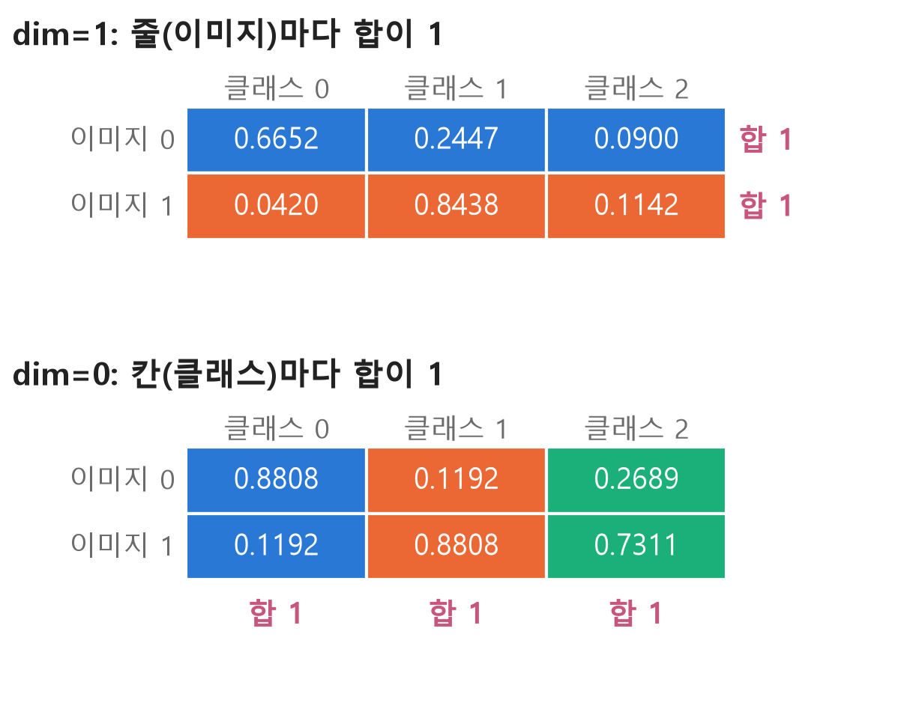

<style>
.content table { width: 100%; border-collapse: collapse; margin: 14px 0 24px; font-size: 17px; line-height: 1.5; }
.content th, .content td { border-bottom: 1px solid #e6dde0; padding: 8px 10px; text-align: left; vertical-align: top; }
.content thead { background: #fbf1f4; }
.content figure { margin: 18px 0; }
.content figure img { width: 100%; height: auto; }
.content td, .content th { word-break: keep-all; overflow-wrap: normal; }
.content .katex-display { overflow-x: auto; overflow-y: hidden; padding: 4px 0; }
.content td code { white-space: normal; overflow-wrap: anywhere; }
@media (max-width: 560px) { .content th, .content td { padding: 7px 5px; font-size: 16px; } }
</style>
<link rel="stylesheet" href="https://cdn.jsdelivr.net/npm/katex@0.16.11/dist/katex.min.css">
<script defer src="https://cdn.jsdelivr.net/npm/katex@0.16.11/dist/katex.min.js"></script>
<script defer src="https://cdn.jsdelivr.net/npm/katex@0.16.11/dist/contrib/auto-render.min.js" onload="renderMathInElement(document.querySelector('.content')||document.body,{delimiters:[{left:'\\[',right:'\\]',display:true},{left:'\\(',right:'\\)',display:false}]})"></script>

<div class="wc"><p><b>nn.Module은 왜 배울까요?</b><br>
nn.Module은 PyTorch에서 모든 신경망 모듈의 <a href="https://docs.pytorch.org/docs/2.14/generated/torch.nn.Module.html">기본 클래스</a>예요.<br>
층 하나도, 층을 모은 모델 전체도 이 클래스를 바탕으로 만들어요.<br>
클래스 구조와 shape를 읽을 수 있으면 모델 코드를 따라가기 쉽고, shape 에러의 원인도 빨리 찾을 수 있어요. (2026년 11월 4일 기준)</p></div>

nn.Module 클래스를 만들고, 층을 지날 때마다 shape가 어떻게 바뀌는지 일곱 가지로 정리했어요. 결과값은 모두 torch 2.11에서 직접 실행한 값이에요.

<div class="keyline">28×28 이미지 3장이 들어가는 모델로 시작할게요.</div>

## <span class="no">1</span> \_\_init\_\_과 forward의 역할

`__init__`에는 쓸 층을 만들어 두고, `forward`에는 데이터가 지나가는 순서를 써요.

```python
import torch
from torch import nn

class MLP(nn.Module):
    def __init__(self):
        super().__init__()
        self.flatten = nn.Flatten()
        self.layers = nn.Sequential(
            nn.Linear(784, 128),
            nn.ReLU(),
            nn.Linear(128, 64),
            nn.ReLU(),
            nn.Linear(64, 10),
        )

    def forward(self, x):
        x = self.flatten(x)
        return self.layers(x)
```

`nn.Sequential`은 넣은 순서대로 층을 실행하는 묶음이에요.

```python
model = MLP()
images = torch.rand(3, 28, 28)
logits = model(images)
print(logits.shape)
```
→ `torch.Size([3, 10])` : 이미지 3장마다 클래스 10개의 점수(logits)가 나와요.

층을 지날 때마다 shape는 이렇게 바뀌어요.

| 지나간 층 | shape |
|---|---|
| 입력 | `(3, 28, 28)` |
| `nn.Flatten()` | `(3, 784)` |
| `nn.Linear(784, 128)` | `(3, 128)` |
| `nn.ReLU()` | `(3, 128)` |
| `nn.Linear(128, 64)` | `(3, 64)` |
| `nn.ReLU()` | `(3, 64)` |
| `nn.Linear(64, 10)` | `(3, 10)` |

모델은 `forward`를 직접 부르지 않고 객체를 함수처럼 불러요.

```python
# ❌ hook이 실행되지 않아요
logits = model.forward(images)

# ✅
logits = model(images)
```

`forward`를 직접 불러도 계산은 돼요. 다만 [등록된 hook](https://docs.pytorch.org/docs/2.14/generated/torch.nn.Module.html)(실행 전후에 끼어드는 함수)을 건너뛰어요.

## <span class="no">2</span> dim은 shape의 자리 번호

`dim`은 shape에서 몇 번째 자리인지 가리키는 번호이고, 0부터 세요.

```
shape:  (2, 3)
dim:     0  1
```

`sum`으로 확인해 볼게요. 식으로 쓰면 `dim=1`은 줄 $$i$$를 고정하고 칸 $$j$$만 바꿔 가며 더해요.

$$s_i = \sum_{j} t_{ij}$$

$$t_{ij}$$는 $$i$$번 줄 $$j$$번 칸의 값이에요.

```python
t = torch.tensor([[2., 1., 0.],
                  [0., 3., 1.]])
print(t.sum(dim=0))
print(t.sum(dim=1))
```
→ `tensor([2., 4., 1.])` : 0번 자리(줄)만 바뀌는 값끼리 더해요. 2+0, 1+3, 0+1<br>
→ `tensor([3., 4.])` : 1번 자리(칸)만 바뀌는 값끼리 더해요. 2+1+0, 0+3+1

| 형식 | shape 예시 | 쓸 수 있는 dim | 읽는 법 |
|---|---|---|---|
| 리스트 모양 | `(3,)` | 0 | 전체가 한 묶음 |
| 표 모양 | `(2, 3)` | 0, 1 | 0은 세로, 1은 가로로 보여요 |
| 이미지 묶음 | `(3, 28, 28)` | 0, 1, 2 | 자리 번호로 읽어요 |

가로·세로는 표 모양에서만 맞아요. 자리 번호로 읽으면 모양이 바뀌어도 그대로 쓸 수 있어요.

**값의 위치와 헷갈리기 쉬워요.** `dim`은 shape의 자리이고, 대괄호 속 번호는 값의 위치예요.

```python
v = torch.tensor([10., 20., 30.])
# 값의 위치 1
print(v[1])
# shape의 0번 자리
print(v.sum(dim=0))
v.sum(dim=1)
```
→ `tensor(20.)`<br>
→ `tensor(60.)`<br>
→ `IndexError: Dimension out of range (expected to be in range of [-1, 0], but got 1)` : `(3,)`에는 1번 자리가 없어요.

## <span class="no">3</span> Flatten이 (3, 784)인 이유

`nn.Flatten()`은 기본값이 `start_dim=1`이라 0번 자리(이미지 장 수)는 두고 1번 자리부터 펴요.

$$(N, H, W) \rightarrow (N, H \times W)$$

$$N$$은 이미지 장 수(batch size), $$H$$와 $$W$$는 세로와 가로 크기예요. 28×28이면 $$H \times W = 784$$예요.

<figure></figure>

```python
imgs = torch.tensor([[[5, 1], [7, 2]],
                     [[4, 8], [9, 3]],
                     [[6, 0], [1, 7]]])
print(imgs.flatten().shape)
print(nn.Flatten()(imgs).shape)
```
→ `torch.Size([12])` : 숫자만 이어져서 이미지 경계가 사라져요.<br>
→ `torch.Size([3, 4])` : 줄 번호가 곧 이미지 번호예요.

모델은 이미지마다 답을 하나씩 내야 해서 이미지 구분이 남아 있어야 해요. 28×28 이미지 3장을 전부 펴서 넣으면 에러가 나요.

```python
# ❌ 에러가 나요. (2352,)
x = torch.rand(3, 28, 28).flatten()
nn.Linear(784, 128)(x)

# ✅ (3, 784)
x = nn.Flatten()(torch.rand(3, 28, 28))
nn.Linear(784, 128)(x)
```
→ `RuntimeError: mat1 and mat2 shapes cannot be multiplied (1x2352 and 784x128)`

## <span class="no">4</span> Linear는 입력 @ W.T + b

`nn.Linear`는 뒤쪽 숫자만 바꾸고 맨 앞의 이미지 장 수는 그대로 둬요.

$$y = xW^{T} + b$$

$$x$$는 입력, $$W$$는 가중치(weight), $$W^{T}$$는 행과 열을 뒤집은 전치, $$b$$는 편향(bias)이에요.

<figure></figure>

```python
layer = nn.Linear(784, 128)
flat = torch.rand(3, 784)
print(layer.weight.shape)
print(layer(flat).shape)
```
→ `torch.Size([128, 784])` : 가중치는 (출력, 입력) 순서로 저장돼요.<br>
→ `torch.Size([3, 128])`

저장 모양이 (128, 784)라서 그대로 곱하면 안쪽 숫자가 안 맞아요. 전치가 필요한 이유예요.

```python
# ❌ 에러가 나요
flat @ layer.weight

# ✅ layer(flat)과 같은 값
flat @ layer.weight.T + layer.bias
```
→ `RuntimeError: mat1 and mat2 shapes cannot be multiplied (3x784 and 128x784)`

이 계산은 `layer(flat)`이 알아서 해요. 코드를 쓸 때 직접 챙길 것은 **앞 층의 출력 수와 다음 층의 입력 수를 맞추는 일**이에요.

```python
# ❌ 128이 나오는데 64를 받으려고 해요
nn.Sequential(nn.Linear(784, 128), nn.ReLU(), nn.Linear(64, 10))

# ✅
nn.Sequential(nn.Linear(784, 128), nn.ReLU(), nn.Linear(128, 10))
```
→ `torch.rand(3, 784)`를 넣는 순간 `RuntimeError: mat1 and mat2 shapes cannot be multiplied (3x128 and 64x10)`

## <span class="no">5</span> ReLU가 층 사이에 필요한 이유

`nn.ReLU`는 음수를 0으로 바꾸고 양수는 그대로 둬요. shape는 바뀌지 않아요.

$$\text{ReLU}(x) = \max(0, x)$$

```python
print(nn.ReLU()(torch.tensor([-0.5, 0.3, 0.0, 1.2])))
```
→ `tensor([0.0000, 0.3000, 0.0000, 1.2000])`

ReLU가 없으면 층을 쌓아도 하나로 합쳐져요. 입력 1개, 출력 1개인 두 층 $$u = 2x + 1$$, $$y = 3u - 1$$을 이어 볼게요.

$$y = 3(2x + 1) - 1 = 6x + 2$$

두 층이 $$y = 6x + 2$$ 한 층과 같아졌어요. 가운데에 ReLU를 넣으면 합쳐지지 않아요.

$$y = 3\,\text{ReLU}(2x + 1) - 1$$

| x | ReLU 없음 | ReLU 있음 |
|---|---|---|
| -1 | 3×(-1) - 1 = -4 | 3×0 - 1 = -1 |
| 1 | 3×3 - 1 = 8 | 3×3 - 1 = 8 |

<figure></figure>

꺾이는 곳이 생겨야 직선 하나로 못 푸는 문제를 풀 수 있어요. [XOR](/2026/11/03/xor-forward-backprop/)이 대표적인 예예요.

마지막 `nn.Linear` 뒤에는 ReLU를 넣지 않아요. logits는 음수도 가질 수 있어야 하는데, ReLU를 넣으면 음수 점수가 모두 0이 돼요.

## <span class="no">6</span> Softmax의 dim=1과 dim=0

`nn.Softmax(dim=1)`은 줄마다, 즉 이미지마다 확률의 합이 1이 되게 만들어요.

$$p_i = \frac{e^{z_i}}{\sum_j e^{z_j}}$$

$$z_i$$는 $$i$$번 클래스의 점수, $$p_i$$는 확률이에요. 분모의 합을 어느 방향으로 구할지 정하는 값이 `dim`이에요.

2절의 `t`를 이미지 2장, 클래스 3개의 점수로 보고 그대로 적용해 볼게요.

<figure></figure>

```python
print(nn.Softmax(dim=1)(t))
print(nn.Softmax(dim=0)(t))
```
→ `tensor([[0.6652, 0.2447, 0.0900], [0.0420, 0.8438, 0.1142]])`<br>
→ `tensor([[0.8808, 0.1192, 0.2689], [0.1192, 0.8808, 0.7311]])`

코드로 풀면 차이는 합을 구하는 방향 하나예요.

```python
e = torch.exp(t)
# Softmax(dim=1)과 같아요
print(e / e.sum(dim=1, keepdim=True))
# Softmax(dim=0)과 같아요
print(e / e.sum(dim=0, keepdim=True))
```

첫 줄로 계산해 보면 $$e^2 = 7.389$$, 줄의 합은 $$7.389 + 2.718 + 1 = 11.107$$이고 $$7.389 / 11.107 = 0.665$$예요. `keepdim=True`는 합을 구한 뒤에도 차원 수를 유지해서 칸을 맞춰 나눌 수 있게 해요.

**`dim=0`은 에러가 나지 않아서 놓치기 쉬워요.** shape도 같아요. 하지만 값을 보면 이미지 0의 합이 0.8808 + 0.1192 + 0.2689 = 1.2689라서 이미지 0의 확률 분포가 아니에요. 게다가 다른 이미지의 점수와 나눠 가진 값이라, 함께 넣은 이미지가 바뀌면 값도 바뀌어요.

예측 번호만 필요하면 Softmax 없이 `logits.argmax(dim=1)`로 충분해요. Softmax는 크기 순서를 바꾸지 않아요. `t`로 해 보면 전후 모두 `tensor([0, 1])`이에요.

학습할 때는 모델에 Softmax를 넣지 않아요. [`nn.CrossEntropyLoss`](https://docs.pytorch.org/docs/2.14/generated/torch.nn.modules.loss.CrossEntropyLoss.html)는 정규화하지 않은 logits를 입력으로 받아요.

## <span class="no">7</span> parameters로 가중치 확인하기

`nn.Module`은 `self`에 등록한 층의 가중치를 자동으로 찾아서 `named_parameters()`로 보여 줘요. 1절의 `model`로 확인해 볼게요.

```python
for name, p in model.named_parameters():
    print(name, p.shape)
print(sum(p.numel() for p in model.parameters()))
```

| 이름 | shape | 개수 |
|---|---|---|
| `layers.0.weight` | `(128, 784)` | 100,352 |
| `layers.0.bias` | `(128,)` | 128 |
| `layers.2.weight` | `(64, 128)` | 8,192 |
| `layers.2.bias` | `(64,)` | 64 |
| `layers.4.weight` | `(10, 64)` | 640 |
| `layers.4.bias` | `(10,)` | 10 |
| 합계 | | 109,386 |

`nn.Linear` 한 층의 파라미터 개수는 이렇게 계산해요.

$$\text{입력} \times \text{출력} + \text{출력}$$

첫 층이면 $$784 \times 128 + 128 = 100{,}480$$개예요.

번호가 0, 2, 4뿐인 이유는 1번과 3번이 ReLU라 학습할 값이 없기 때문이에요. `flatten`도 같은 이유로 목록에 없어요. 학습은 이 숫자들을 조금씩 고치는 일이고, 옵티마이저에는 `model.parameters()`로 넘겨요.

**층을 파이썬 리스트에 담으면 자동으로 찾지 못해요.** 그 층의 가중치는 목록에서 빠져요.

```python
# ❌ __init__ 안에 쓰면 파라미터 0개
self.layers = [nn.Linear(2, 2), nn.Linear(2, 1)]

# ✅ __init__ 안에 쓰면 파라미터 9개
self.layers = nn.ModuleList([nn.Linear(2, 2), nn.Linear(2, 1)])
```

<div class="done">🎉 shape를 왼쪽부터 0, 1, 2로 읽으면 Flatten도 Softmax도 argmax도 같은 말로 읽혀요!</div>
