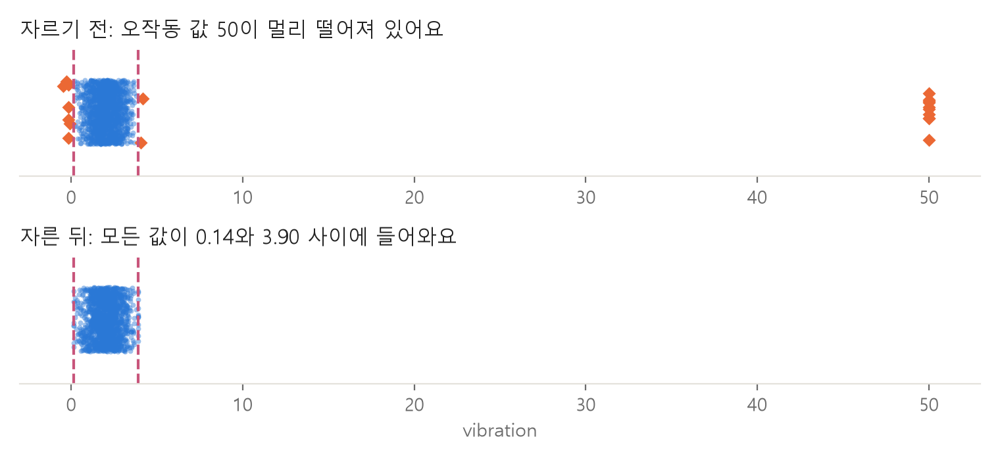
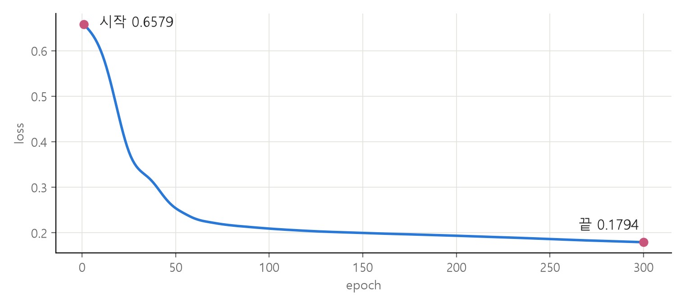
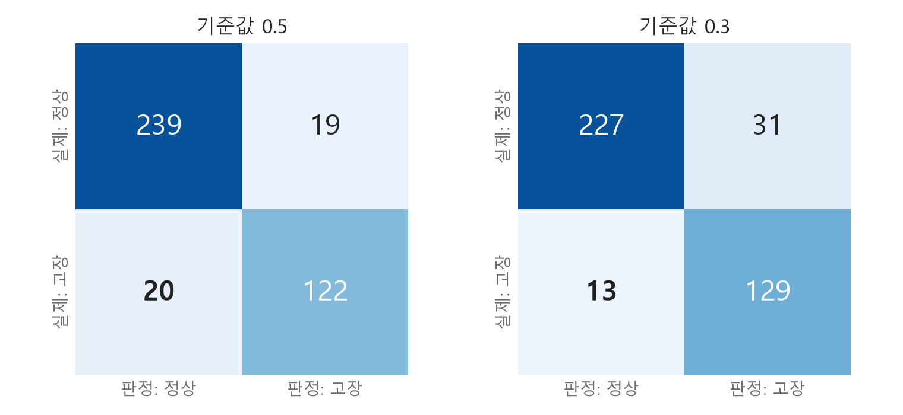

<style>
.content table { width: 100%; border-collapse: collapse; margin: 14px 0 24px; font-size: 17px; line-height: 1.5; }
.content th, .content td { border-bottom: 1px solid #e6dde0; padding: 8px 10px; text-align: left; vertical-align: top; }
.content thead { background: #fbf1f4; }
.content figure { margin: 18px 0; }
.content figure img { width: 100%; height: auto; }
.content td, .content th { word-break: keep-all; overflow-wrap: normal; }
.content .katex-display { overflow-x: auto; overflow-y: hidden; padding: 4px 0; }
.content td code { white-space: nowrap; }
h1 { word-break: keep-all; }
.content pre .nb { padding: 0; border: 0; border-radius: 0; background: none; }
@media (max-width: 560px) { .content th, .content td { padding: 7px 5px; font-size: 16px; } }
</style>
<link rel="stylesheet" href="https://cdn.jsdelivr.net/npm/katex@0.16.11/dist/katex.min.css">
<script defer src="https://cdn.jsdelivr.net/npm/katex@0.16.11/dist/katex.min.js"></script>
<script defer src="https://cdn.jsdelivr.net/npm/katex@0.16.11/dist/contrib/auto-render.min.js" onload="renderMathInElement(document.querySelector('.content')||document.body,{delimiters:[{left:'\\[',right:'\\]',display:true},{left:'\\(',right:'\\)',display:false}]})"></script>

<div class="wc"><p><b>이진 분류는 왜 실습해 볼까요?</b><br>
이진 분류(binary classification)는 입력을 보고 두 가지 답 중 하나를 고르는 문제예요. 정상과 고장, 진짜와 가짜가 그런 예예요.<br>
PyTorch의 <a href="https://docs.pytorch.org/docs/2.15/generated/torch.nn.BCELoss.html">BCELoss</a>는 정답과 입력 확률 사이의 Binary Cross Entropy를 재는 손실 함수이고, 이번 실습에서 학습의 기준으로 써요.<br>
데이터 정리, 모델, 학습, 평가를 한 번 끝까지 쳐 보면 다른 분류 코드를 읽을 때 각 줄이 어느 단계인지 보여요. (2026년 11월 4일 기준)</p></div>

모터 센서 데이터를 직접 만들어 고장을 판별하는 모델을 끝까지 만들어요. 17칸을 순서대로 실행하고, 그중 9칸은 직접 쳐요.

**준비 → 데이터 만들기 → 데이터 정리 → 모델 → 학습 → 평가와 판별**

<div class="keyline">📋 칸은 그대로 붙여 넣고, ✍️ 칸은 틀을 붙여 넣은 뒤 ①②③만 표를 보고 직접 쳐요.</div>

## <span class="no">1</span> VS Code 노트북 준비

노트북을 만들고 커널(코드를 실행하는 Python)을 고르면 준비가 끝나요.

1. [Python](https://www.python.org/downloads/)과 [VS Code](https://code.visualstudio.com/)를 설치하고, VS Code 왼쪽 확장(Extensions) 메뉴에서 `Python`과 `Jupyter`를 설치해요.
2. `File` → `Open Folder`로 실습에 쓸 빈 폴더를 열어요.
3. `Ctrl + Shift + P`를 누르고 `Create: New Jupyter Notebook`을 골라요.
4. `Ctrl + S`로 `motor_fault.ipynb`라는 이름으로 저장해요. 뒤에서 만드는 CSV 파일이 이 파일과 같은 폴더에 생겨요.
5. 오른쪽 위 `Select Kernel` → `Python Environments`를 눌러 Python을 골라요.

**칸을 실행하는 법:** 칸 안을 클릭하고 `Shift + Enter`를 한 번 눌러요. 마지막 칸에서 누르면 아래에 새 칸이 생겨요. `ipykernel` 설치를 묻는 창이 뜨면 `Install`을 눌러요.

**설치 칸 · 📋 복사해서 실행**

```python
%pip install torch pandas scikit-learn matplotlib
```

고른 Python에 바로 설치돼요. 처음에는 몇 분 걸릴 수 있어요. 끝에 `Successfully installed`나 `Requirement already satisfied`가 보이면 성공이에요.

| 칸 왼쪽 표시 | 뜻 |
|---|---|
| `[*]` | 실행 중이에요 |
| `[3]` | 세 번째로 실행했어요. 앞 칸보다 숫자가 커지면 순서대로 된 거예요 |

칸 번호는 위에서부터 차례로 붙였어요. 다른 칸을 먼저 실행하면 이름을 찾지 못한다는 에러가 나니, 건너뛰지 말고 순서대로 실행해요. 결과값은 Python 3.13, torch 2.11 CPU에서 실행한 값이에요. 지금 설치하면 더 새 버전이 깔리고, 환경이 다르면 소수 끝자리가 조금 다를 수 있어요.

## <span class="no">2</span> 모터 데이터 만들고 문제 찾기

모터 2000대의 센서 값을 코드로 만들고, 실제 데이터처럼 문제 세 가지를 일부러 넣어요.

**칸 1 · 📋 복사해서 실행**

```python
import numpy as np
import pandas as pd

rng = np.random.default_rng(7)
# 난수 고정. 누가 돌려도 같은 데이터가 나와요
n = 2000

temperature = rng.normal(60, 10, n)
current = rng.normal(5, 1.2, n)
vibration = rng.normal(2, 0.7, n)
speed = rng.normal(3000, 300, n)
# 평균 근처로 흩어진 센서 값 네 가지

t = (temperature - 60) / 10
c = (current - 5) / 1.2
v = (vibration - 2) / 0.7
s = (speed - 3000) / 300
risk = t + c + t * v - 0.5 * s
# 온도와 진동이 함께 높으면 위험이 더 커져요
risk = risk + rng.normal(0, 0.3, n)
# 센서로 다 설명되지 않는 우연도 더해요
is_fault = (risk > 0.6).astype(int)
# 위험이 0.6보다 크면 고장(1), 아니면 정상(0)

df = pd.DataFrame({
    "temperature": temperature.round(2),
    "current": current.round(2),
    "vibration": vibration.round(2),
    "speed": speed.round(0),
    "is_fault": is_fault,
})

for col in ["temperature", "current", "vibration", "speed"]:
    empty = rng.choice(n, 100, replace=False)
    df.loc[empty, col] = np.nan
# 문제 1: 칸마다 100개를 빈 값으로

df.loc[rng.choice(n, 16, replace=False), "temperature"] = 999.0
df.loc[rng.choice(n, 16, replace=False), "vibration"] = 50.0
# 문제 2: 센서 오작동으로 튀는 값

again = df.sample(40, random_state=7)
df = pd.concat([df, again], ignore_index=True)
# 문제 3: 같은 측정이 또 들어간 줄 40개

df = df.sample(frac=1, random_state=7).reset_index(drop=True)
df.insert(0, "motor_id", range(1001, 1001 + len(df)))
# 줄을 섞고 측정 번호를 붙여요

df.to_csv("motor.csv", index=False)
print(df.shape)
```

아래처럼 나오면 성공이고, 왼쪽 파일 목록에 `motor.csv`가 생겨요. `(줄 수, 칸 수)`라는 뜻이에요.

```text
(2040, 6)
```

**칸 2 · 📋 복사해서 실행**

```python
df = pd.read_csv("motor.csv")
# CSV 파일을 표로 읽어요
df.head()
# 앞의 5줄을 보여 줘요
```

```text
   motor_id  temperature  current  vibration   speed  is_fault
0      1001        52.62     4.45       1.56  3140.0         0
1      1002        54.64     3.38       1.80  3443.0         0
2      1003        77.10     5.34       2.34  3159.0         1
3      1004        57.42     5.99       1.96     NaN         1
4      1005        75.24     5.64       2.36  3413.0         1
```

`is_fault`가 맞혀야 할 정답이고, `NaN`은 값이 비어 있다는 뜻이에요.

**칸 3 · 📋 복사해서 실행**

```python
print(df.isnull().sum())
# 칸마다 빈 값의 개수
df.describe().loc[["min", "50%", "max"]]
# 칸마다 최솟값, 가운데 값, 최댓값
```

```text
motor_id         0
temperature    102
current        101
vibration      101
speed          102
is_fault         0
dtype: int64

     motor_id  temperature  current  vibration   speed  is_fault
min    1001.0       27.490     0.61      -0.47  2086.0       0.0
50%    2020.5       59.515     5.00       2.01  2994.0       0.0
max    3040.0      999.000     8.83      50.00  4129.0       1.0
```

100개를 비웠는데 102개로 나온 칸이 있는 건, 다시 넣은 40줄에도 빈 값이 있기 때문이에요. `temperature`의 가운데 값은 59.5인데 최댓값이 999예요. 오작동 값이 눈에 보여요.

**칸 4 · ✍️ 직접 치기**

```python
features = ["temperature", "current", "vibration", "speed"]
check = features + ["is_fault"]
# motor_id를 뺀 칸으로 비교해요

print(df.duplicated(subset=①).sum())
# 앞 줄과 값이 같은 줄의 개수
df = df.②(subset=check)
# 그런 줄을 지운 표를 다시 담아요
print(df.shape)
```

| 빈칸 | 넣을 코드 | 뜻 |
|---|---|---|
| ① | `check` | 비교할 칸 이름 목록 |
| ② | `drop_duplicates` | 처음 나온 줄만 남기고 지워요 |

```text
40
(2000, 6)
```

`motor_id`는 측정마다 달라서 비교에서 빼야 중복을 찾을 수 있어요. 중복을 그대로 두면 같은 줄이 학습용과 시험용에 갈라져 들어가 시험 점수가 실제보다 좋게 나올 수 있어요.

## <span class="no">3</span> 학습용 기준으로 데이터 정리

빈 값을 채우고 튀는 값을 자르는 기준은 학습용에서만 구해요. 시험용은 처음 보는 모터 역할이라, 시험용 값으로 기준을 구하면 답을 미리 엿본 셈이 돼요. 이것을 data leakage라고 해요.

**칸 5 · 📋 복사해서 실행**

```python
from sklearn.model_selection import train_test_split

X = df[features]
# X: 모델이 보는 센서 값
y = df["is_fault"]
# y: 맞혀야 할 정답

X_train, X_test, y_train, y_test = train_test_split(
    X, y, test_size=0.2, random_state=42, stratify=y
)
# 20%를 시험용으로 떼어요
# stratify=y: 양쪽의 고장 비율을 같게 맞춰요

print(X_train.shape, X_test.shape)
print(y_train.mean(), y_test.mean())
```

```text
(1600, 4) (400, 4)
0.355 0.355
```

0과 1의 평균은 곧 1의 비율이에요. 양쪽 다 고장이 35.5%예요.

**칸 6 · ✍️ 직접 치기**

튀는 값의 기준으로 IQR(가운데 50%가 차지하는 폭)을 써요.

$$ \text{IQR} = Q_3 - Q_1 $$

$$ \text{정상 범위} = [\,Q_1 - 1.5\,\text{IQR},\; Q_3 + 1.5\,\text{IQR}\,] $$

$$Q_1$$은 작은 쪽에서 25% 위치의 값, $$Q_3$$은 75% 위치의 값이에요. `vibration`에 넣으면 $$Q_1 = 1.55$$, $$Q_3 = 2.49$$라서 IQR은 0.94이고, 정상 범위는 0.14와 3.90 사이예요.

```python
medians = X_train.①()
# 칸마다 가운데 값. 빈 값을 채울 때 써요

q1 = X_train.quantile(②)
q3 = X_train.quantile(③)
iqr = q3 - q1

lower = q1 - 1.5 * iqr
upper = ④
# 칸마다 정상 범위의 양 끝

print(pd.DataFrame({"median": medians, "lower": lower, "upper": upper}))
```

| 빈칸 | 넣을 코드 | 뜻 |
|---|---|---|
| ① | `median` | 가운데 값을 구해요 |
| ② | `0.25` | 작은 쪽에서 25% 위치 |
| ③ | `0.75` | 작은 쪽에서 75% 위치 |
| ④ | `q3 + 1.5 * iqr` | 정상 범위의 위 끝 |

```text
              median       lower       upper
temperature    59.61    33.10250    86.80250
current         5.01     1.71625     8.28625
vibration       2.01     0.14000     3.90000
speed        2991.00  2183.00000  3783.00000
```

평균 대신 가운데 값을 쓰는 이유는 튀는 값에 덜 끌려가기 때문이에요. 값이 1, 2, 3, 4, 90이면 평균은 20이고 가운데 값은 3이에요.

<figure></figure>

**칸 7 · 📋 복사해서 실행**

세 가지 정리를 함수 하나로 묶어요. 학습용, 시험용, 새 모터에 같은 기준을 그대로 쓰게 돼요. 마지막 단계인 표준화 식은 이래요.

$$ z = \frac{x - \mu}{\sigma} $$

$$x$$는 원래 값, $$\mu$$는 학습용 평균, $$\sigma$$는 학습용 표준편차예요. 평균 10, 표준편차 2인 칸에서 14는 $$(14 - 10) / 2 = 2$$가 돼요. 칸마다 값의 크기가 달라도 비슷한 범위로 맞춰져요. `speed`는 3000 근처이고 `current`는 5 근처인 데이터에 필요해요.

```python
import torch
import torch.nn as nn
from sklearn.preprocessing import StandardScaler

scaler = StandardScaler()
scaler.fit(X_train.fillna(medians).clip(lower, upper, axis=1))
# 학습용의 평균과 표준편차만 기억해요

def prepare(data):
    data = data.fillna(medians)
    # 1. 빈 값을 학습용 가운데 값으로 채워요
    data = data.clip(lower, upper, axis=1)
    # 2. 범위 밖 값을 범위 끝으로 옮겨요
    data = scaler.transform(data)
    # 3. 학습용 기준으로 표준화해요
    return torch.tensor(data, dtype=torch.float32)
    # 4. PyTorch가 쓰는 Tensor로 바꿔요

print(prepare(X_train)[:2])
```

```text
tensor([[-1.6566,  1.7886,  1.2233, -0.1358],
        [ 0.6331, -1.1129,  1.4249, -0.1287]])
```

**칸 8 · ✍️ 직접 치기**

```python
X_train_t = prepare(①)
X_test_t = prepare(②)
# 센서 값 준비

y_train_t = torch.tensor(y_train.values, dtype=torch.float32).reshape(③)
y_test_t = torch.tensor(y_test.values, dtype=torch.float32).reshape(-1, 1)
# 정답을 소수 Tensor로 바꾸고 세로로 세워요

print(X_train_t.shape, y_train_t.shape)
print(X_test_t.shape, y_test_t.shape)
```

| 빈칸 | 넣을 코드 | 뜻 |
|---|---|---|
| ① | `X_train` | 학습용 센서 값 |
| ② | `X_test` | 시험용 센서 값 |
| ③ | `-1, 1` | 칸은 1개로, 줄 수는 알아서 계산해요 |

```text
torch.Size([1600, 4]) torch.Size([1600, 1])
torch.Size([400, 4]) torch.Size([400, 1])
```

`reshape(-1, 1)`은 `[0, 1, 1]`을 `[[0], [1], [1]]`로 바꿔요. 모델의 출력이 모터마다 값 1개인 `(N, 1)` 모양이라, 정답도 같은 모양으로 맞춰요.

## <span class="no">4</span> nn.Module로 모델 만들기

센서 값 4개를 받아 고장 확률 1개를 내는 모델을 만들어요. 은닉층 두 개를 거쳐요.

**칸 9 · ✍️ 직접 치기**

```python
class MotorNet(①):
    def __init__(self):
        super().__init__()
        # nn.Module의 준비 작업을 먼저 실행해요
        self.fc1 = ②
        self.fc2 = ③
        self.fc3 = ④
        self.relu = nn.ReLU()
        self.sigmoid = nn.Sigmoid()

    def forward(self, x):
        x = self.relu(self.fc1(x))
        x = self.relu(self.fc2(x))
        x = ⑤
        return x
```

| 빈칸 | 넣을 코드 | 뜻 |
|---|---|---|
| ① | `nn.Module` | PyTorch 모델의 기본 클래스 |
| ② | `nn.Linear(4, 16)` | 값 4개를 받아 16개로 내보내요 |
| ③ | `nn.Linear(16, 8)` | 값 16개를 받아 8개로 내보내요 |
| ④ | `nn.Linear(8, 1)` | 값 8개를 받아 1개로 내보내요 |
| ⑤ | `self.sigmoid(self.fc3(x))` | 마지막 값을 0과 1 사이 확률로 바꿔요 |

앞 층이 내보내는 수와 다음 층이 받는 수는 같아야 해요. 모터 1600대를 넣으면 모양이 이렇게 바뀌어요.

```text
입력           (1600, 4)
fc1 + ReLU     (1600, 16)
fc2 + ReLU     (1600, 8)
fc3 + Sigmoid  (1600, 1)
```

정의만 하는 칸이라 아무것도 출력되지 않아요. 왼쪽 숫자만 바뀌면 성공이에요.

**칸 10 · ✍️ 직접 치기**

```python
torch.manual_seed(42)
# 시작 가중치를 고정해 결과를 재현해요
model = ①
print(model)
```

| 빈칸 | 넣을 코드 | 뜻 |
|---|---|---|
| ① | `MotorNet()` | 설계도로 실제 모델을 만들어요 |

```text
MotorNet(
  (fc1): Linear(in_features=4, out_features=16, bias=True)
  (fc2): Linear(in_features=16, out_features=8, bias=True)
  (fc3): Linear(in_features=8, out_features=1, bias=True)
  (relu): ReLU()
  (sigmoid): Sigmoid()
)
```

## <span class="no">5</span> BCELoss와 Adam으로 학습

손실 함수로 틀린 정도를 재고, 옵티마이저로 가중치를 고치는 일을 300번 반복해요. BCELoss의 식은 이래요.

$$ L = -\frac{1}{N}\sum_{i=1}^{N}\left[ y_i \log p_i + (1-y_i)\log(1-p_i) \right] $$

$$y_i$$는 정답(0 또는 1), $$p_i$$는 모델이 낸 고장 확률, $$N$$은 모터 수예요. 정답이 1인 모터 한 대의 값을 넣어 보면 틀린 쪽으로 확신할수록 벌점이 커져요.

| 고장 확률 | loss | 뜻 |
|---|---|---|
| 0.9 | 0.105 | 맞고 확신해요 |
| 0.5 | 0.693 | 모르겠다는 수준이에요 |
| 0.1 | 2.303 | 틀리고 확신해요 |

**칸 11 · ✍️ 직접 치기**

```python
criterion = ①
# 틀린 정도를 재는 도구
optimizer = torch.optim.Adam(②, lr=③)
# 가중치를 고치는 도구
```

| 빈칸 | 넣을 코드 | 뜻 |
|---|---|---|
| ① | `nn.BCELoss()` | 이진 분류용 손실 함수 |
| ② | `model.parameters()` | 이 모델의 가중치 전부 |
| ③ | `0.01` | 학습률. 한 번에 고치는 크기 |

아무것도 출력되지 않으면 성공이에요.

**칸 12 · ✍️ 직접 치기**

```python
losses = []

for epoch in range(300):
    model.train()
    # 학습 모드. 이 모델은 결과가 같지만 습관으로 써요

    y_hat = ①
    # 모델에 넣어 예측값을 구해요
    loss = ②
    # 예측값과 정답의 차이를 재요

    ③
    # 지난번 기울기를 지워요
    ④
    # 이번 기울기를 계산해요
    ⑤
    # 가중치를 고쳐요

    losses.append(loss.item())
    if (epoch + 1) % 50 == 0:
        print(epoch + 1, round(loss.item(), 4))
```

| 빈칸 | 넣을 코드 | 뜻 |
|---|---|---|
| ① | `model(X_train_t)` | 학습용 센서 값을 넣어요 |
| ② | `criterion(y_hat, y_train_t)` | 예측값, 정답 순서예요 |
| ③ | `optimizer.zero_grad()` | 기울기 지우기 |
| ④ | `loss.backward()` | 기울기 계산 |
| ⑤ | `optimizer.step()` | 가중치 고치기 |

```text
50 0.2541
100 0.2094
150 0.1998
200 0.1937
250 0.1865
300 0.1794
```

**칸 13 · 📋 복사해서 실행**

```python
import matplotlib.pyplot as plt

plt.plot(losses)
# 기록한 loss를 선으로 그려요
plt.xlabel("epoch")
plt.ylabel("loss")
plt.show()
```

<figure></figure>

시작값 0.6579는 "모르겠다" 수준인 0.693과 가까워요. 이 곡선은 학습용 데이터의 결과라서, 처음 보는 모터를 잘 맞히는지는 다음 칸에서 따로 확인해요.

## <span class="no">6</span> 혼동행렬로 평가하고 새 모터 판별

맞힌 비율만 보지 말고, 어떤 쪽으로 틀렸는지까지 봐요.

**칸 14 · ✍️ 직접 치기**

```python
model.eval()
# 평가 모드
with torch.no_grad():
    # 기울기 계산에 쓸 기록을 남기지 않아요
    train_prob = model(X_train_t)
    test_prob = ①

train_label = (train_prob >= 0.5).float()
test_label = (test_prob >= ②).float()
# 확률을 1 또는 0으로 바꿔요

train_acc = (train_label == y_train_t).float().mean().item()
test_acc = (③ == y_test_t).float().mean().item()
# 맞으면 1, 틀리면 0의 평균이 정확도예요

print("train", round(train_acc, 4))
print("test ", round(test_acc, 4))
```

| 빈칸 | 넣을 코드 | 뜻 |
|---|---|---|
| ① | `model(X_test_t)` | 시험용 센서 값을 넣어요 |
| ② | `0.5` | 이 값 이상이면 고장으로 판정해요 |
| ③ | `test_label` | 시험용 판정 |

```text
train 0.9206
test  0.9025
```

두 값이 비슷하면 학습용만 외운 정도는 크지 않다고 볼 수 있어요. 비교할 기준도 같이 봐요.

| 방법 | 시험 정확도 |
|---|---|
| 전부 정상으로 찍기 | 64.5% |
| 은닉층 없는 모델(`Linear(4, 1)`, 시드 10개) | 87.25%와 87.75% 사이 |
| 이번 모델(시드 42) | 90.25% |

이번 모델은 시드를 30개로 바꿔 돌렸을 때 90.0%와 92.5% 사이였어요.

**칸 15 · 📋 복사해서 실행**

```python
from sklearn.metrics import confusion_matrix, ConfusionMatrixDisplay

cm = confusion_matrix(y_test_t.numpy(), test_label.numpy())
# 정답과 판정의 네 가지 경우를 세요
print(cm)

ConfusionMatrixDisplay(cm, display_labels=["normal", "fault"]).plot(cmap="Blues")
plt.show()
```

```text
[[239  19]
 [ 20 122]]
```

| | 판정: 정상 | 판정: 고장 |
|---|---|---|
| **실제: 정상** | 239 | 19 (괜히 점검) |
| **실제: 고장** | 20 (고장을 놓침) | 122 |

맞힌 수는 $$239 + 122 = 361$$이고, $$361 / 400 = 0.9025$$가 앞의 정확도예요. 틀린 39대의 비용은 서로 달라요. 정상 모터를 한 번 더 점검하는 것보다 고장을 놓치는 쪽이 더 큰 문제일 수 있어요.

**칸 16 · ✍️ 직접 치기 (한번 해 보세요!)**

고장으로 판정하는 기준값을 낮춰 봐요.

```python
label_low = (test_prob >= ①).float()
# 기준값을 낮춰 판정을 다시 해요

cm_low = confusion_matrix(y_test_t.numpy(), label_low.numpy())
print(cm_low)
```

| 빈칸 | 넣을 코드 | 뜻 |
|---|---|---|
| ① | `0.3` | 고장 확률이 30%만 넘어도 고장으로 판정해요 |

```text
[[227  31]
 [ 13 129]]
```

<figure></figure>

놓친 고장은 20대에서 13대로 줄고, 괜히 점검하는 모터는 19대에서 31대로 늘어요. 기준값은 모델이 정해 주지 않아요. 어느 쪽 실수가 더 비싼지 보고 사람이 정해요.

**칸 17 · 📋 복사해서 실행**

새 모터 5대를 판별해 CSV로 저장해요. 정답이 없는 데이터이고, 일부러 빈 값과 오작동 값을 넣었어요.

```python
new_motors = pd.DataFrame({
    "temperature": [55.0, 72.5, np.nan, 999.0, 64.0],
    "current": [4.2, 6.8, 5.1, 5.0, 5.5],
    "vibration": [1.5, 3.1, 2.0, 2.2, np.nan],
    "speed": [3100.0, 2750.0, 3000.0, 2900.0, 3050.0],
})

model.eval()
with torch.no_grad():
    new_prob = model(prepare(new_motors))
    # 칸 7에서 만든 함수로 똑같이 정리해요

new_motors["fault_prob"] = new_prob.flatten().numpy().round(3)
new_motors["is_fault"] = (new_prob >= 0.5).int().flatten().numpy()
# flatten으로 (5, 1)을 (5,)로 펴서 표의 칸에 넣어요

print(new_motors)
new_motors.to_csv("motor_result.csv", index=False)
```

```text
   temperature  current  vibration   speed  fault_prob  is_fault
0         55.0      4.2        1.5  3100.0       0.011         0
1         72.5      6.8        3.1  2750.0       0.970         1
2          NaN      5.1        2.0  3000.0       0.165         0
3        999.0      5.0        2.2  2900.0       0.776         1
4         64.0      5.5        NaN  3050.0       0.881         1
```

빈 값과 999가 있어도 `prepare`가 학습용 기준으로 정리해 에러 없이 판별해요. 폴더에 `motor_result.csv`가 생겼으면 끝이에요. `Ctrl + S`로 노트북도 저장해요.

## <span class="no">7</span> 자주 하는 실수와 함수 정리

에러가 나지 않는 실수가 더 찾기 어려워요. 숫자가 위의 결과와 크게 다르면 아래부터 확인해요.

**괄호를 빼면 실행되지 않아요.** 에러 없이 지나가지만 기울기가 계속 쌓여요.

```python
# ❌ 괄호가 없어요
optimizer.zero_grad

# ✅
optimizer.zero_grad()
```

이 실수로 돌리면 loss가 0.53, 0.67, 0.33, 0.45처럼 오르내리고 시험 정확도는 72.25%까지 떨어져요.

**정답을 세우지 않으면 에러가 나요.** `reshape(-1, 1)`을 빼면 칸 12에서 이런 에러가 나요.

```text
ValueError: Using a target size (torch.Size([1600])) that is different to the input size (torch.Size([1600, 1])) is deprecated. Please ensure they have the same size.
```

**편 값과 세운 값을 비교하면 점수가 틀려요.** 에러 없이 정확도만 틀리게 나와요.

```python
# ❌ (400,)과 (400, 1)은 모양이 달라요
(test_label.flatten() == y_test_t).float().mean()

# ✅ 둘 다 (400, 1)이에요
(test_label == y_test_t).float().mean()
```

모양이 다르면 PyTorch가 `(400, 400)`으로 늘려서 모든 판정을 모든 정답과 비교해요. 결과는 54.28%로 나와요.

**모델만 새로 만들면 loss가 멈춰요.** 옵티마이저는 예전 모델의 가중치를 계속 붙잡고 있어요. 칸 10만 다시 실행하고 칸 12로 가면 loss가 0.6579에서 움직이지 않아요. 칸 10, 11, 12를 차례로 실행해요.

**칸 12만 다시 실행하면 이어서 학습해요.** 다시 300번을 돌리면 loss가 0.1793에서 시작해 0.1499까지 내려가요. 처음부터 하려면 역시 칸 10부터 실행해요. 이때 학습용 정확도는 92.875%로 오르지만 시험용은 89.75%로 내려가요. 학습용 loss가 줄어도 처음 보는 데이터의 점수는 떨어질 수 있어요.

### 이 글에서 쓴 함수

| 단계 | 함수 | 하는 일 |
|---|---|---|
| 살펴보기 | `isnull().sum()` | 빈 값 세기 |
| 살펴보기 | `describe()` | 칸별 통계 |
| 정리 | `drop_duplicates()` | 중복 줄 지우기 |
| 정리 | `train_test_split()` | 학습용과 시험용 나누기 |
| 정리 | `fillna()` | 빈 값 채우기 |
| 정리 | `clip()` | 범위 밖 값 옮기기 |
| 정리 | `StandardScaler` | 표준화 |
| 정리 | `reshape(-1, 1)` | 세로로 세우기 |
| 모델 | `nn.Linear` | 값을 받아 내보내는 층 |
| 모델 | `nn.Sigmoid` | 0과 1 사이로 바꾸기 |
| 학습 | `nn.BCELoss` | 이진 분류 손실 |
| 학습 | `torch.optim.Adam` | 가중치 고치기 |
| 평가 | `torch.no_grad()` | 기울기 계산 끄기 |
| 평가 | `confusion_matrix()` | 네 가지 경우 세기 |
| 평가 | `flatten()` | 한 줄로 펴기 |

<div class="done">🎉 정리부터 판별까지 끝났어요. 학습용으로 정한 기준을 새 데이터에도 그대로 쓰는 것이 이 흐름의 핵심이에요.</div>
