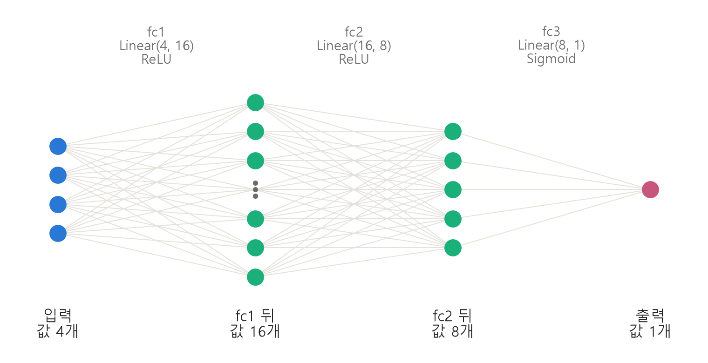
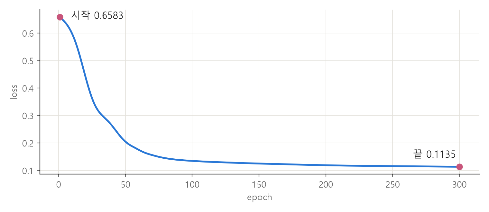
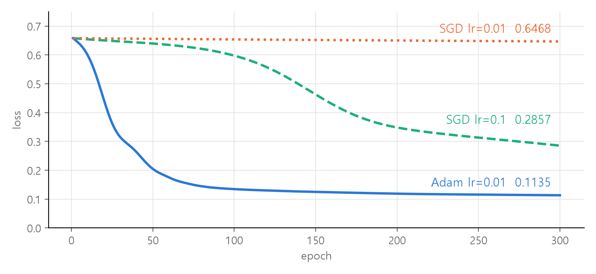

<style>
.content table { width: 100%; border-collapse: collapse; margin: 14px 0 24px; font-size: 17px; line-height: 1.5; }
.content th, .content td { border-bottom: 1px solid #e6dde0; padding: 8px 10px; text-align: left; vertical-align: top; }
.content thead { background: #fbf1f4; }
.content figure { margin: 18px 0; }
.content figure img { width: 100%; height: auto; }
.content td, .content th { word-break: keep-all; overflow-wrap: normal; }
.content .katex-display { overflow-x: auto; overflow-y: hidden; padding: 4px 0; }
.content td code { white-space: nowrap; }
.content pre .nb { padding: 0; border: 0; border-radius: 0; background: none; }
h1 { word-break: keep-all; }
.codewrap { position: relative; margin: 1em 0; }
.codewrap pre { margin: 0; padding-top: 44px; }
.codecopy { position: absolute; top: 8px; right: 8px; font: inherit; font-size: 14px; font-weight: 700; color: #c8557b; background: #fff; border: 1px solid #c8557b; border-radius: 99px; padding: 3px 13px; cursor: pointer; }
.codecopy:focus-visible { outline: 2px solid #c8557b; outline-offset: 2px; }
a.databtn { display: inline-block; margin: 6px 0 14px; padding: 9px 20px; border-radius: 99px; background: #c8557b; color: #fff; font-weight: 700; text-decoration: none; }
@media (max-width: 560px) { .content th, .content td { padding: 7px 5px; font-size: 16px; } }
</style>
<link rel="stylesheet" href="https://cdn.jsdelivr.net/npm/katex@0.16.11/dist/katex.min.css">
<script defer src="https://cdn.jsdelivr.net/npm/katex@0.16.11/dist/katex.min.js"></script>
<script defer src="https://cdn.jsdelivr.net/npm/katex@0.16.11/dist/contrib/auto-render.min.js" onload="renderMathInElement(document.querySelector('.content')||document.body,{delimiters:[{left:'\\[',right:'\\]',display:true},{left:'\\(',right:'\\)',display:false}]})"></script>
<script>
document.addEventListener('DOMContentLoaded', function () {
  document.querySelectorAll('pre').forEach(function (pre) {
    var code = pre.querySelector('code');
    var isPython = pre.closest('.language-python') || (code && code.classList.contains('language-python'));
    if (!isPython || pre.textContent.indexOf('❌') !== -1) return;
    var wrap = document.createElement('div');
    wrap.className = 'codewrap';
    pre.parentNode.insertBefore(wrap, pre);
    wrap.appendChild(pre);
    var btn = document.createElement('button');
    btn.type = 'button';
    btn.className = 'codecopy';
    btn.textContent = '복사';
    btn.addEventListener('click', function () {
      var txt = pre.textContent.replace(/\s+$/, '') + '\n';
      var ok = function () {
        btn.textContent = '복사됨';
        setTimeout(function () { btn.textContent = '복사'; }, 1600);
      };
      var old = function () {
        var t = document.createElement('textarea');
        t.value = txt;
        document.body.appendChild(t);
        t.select();
        try { document.execCommand('copy'); ok(); } catch (e) {}
        document.body.removeChild(t);
      };
      if (navigator.clipboard && navigator.clipboard.writeText) {
        navigator.clipboard.writeText(txt).then(ok, old);
      } else {
        old();
      }
    });
    wrap.appendChild(btn);
  });
});
</script>

<div class="wc"><p><b>PyTorch 모델은 왜 직접 쳐 봐야 할까요?</b><br>
<a href="https://docs.pytorch.org/docs/2.15/generated/torch.nn.Module.html">nn.Module</a>은 PyTorch 신경망의 기본 클래스이고, <a href="https://docs.pytorch.org/docs/2.15/generated/torch.optim.Adam.html">Adam</a>은 가중치를 고치는 옵티마이저 중 하나예요.<br>
모델 클래스, 손실 함수, 옵티마이저, 학습 반복문은 신경망 코드의 뼈대라서 다른 모델을 읽을 때도 계속 만나요.<br>
읽을 때는 알 것 같아도 빈 칸 앞에서는 막히기 쉬워서, 틀의 빈칸부터 직접 쳐 보면 손에 익어요. (2026년 11월 4일 기준)</p></div>

센서 값으로 모터 고장을 판별하는 모델을 VS Code에서 처음부터 끝까지 코드로 쳐요. 12칸 중 9칸은 직접 치고, 데이터 준비와 그래프는 복사해요.

**준비 → 데이터를 Tensor로 → nn.Module 모델 → Adam으로 학습 → 평가 → SGD로 바꿔 보기**

<div class="keyline">📋 칸은 복사 버튼으로 붙여 넣고, ✍️ 칸은 틀을 붙여 넣은 뒤 ①②③만 표를 보고 직접 쳐요.</div>

## <span class="no">1</span> VS Code 노트북 준비

노트북을 만들고 커널(코드를 실행하는 Python)을 고른 뒤, 데이터 파일을 같은 폴더에 넣으면 준비가 끝나요.

1. [Python](https://www.python.org/downloads/)과 [VS Code](https://code.visualstudio.com/)를 설치하고, VS Code 왼쪽 확장(Extensions) 메뉴에서 `Python`과 `Jupyter`를 설치해요.
2. `File` → `Open Folder`로 실습에 쓸 빈 폴더를 열어요.
3. `Ctrl + Shift + P`를 누르고 `Create: New Jupyter Notebook`을 골라요.
4. `Ctrl + S`로 `motor_fault.ipynb`라는 이름으로 저장해요.
5. 오른쪽 위 `Select Kernel` → `Python Environments`를 눌러 Python을 골라요.
6. 아래 버튼을 누르면 `motor.csv`가 보통 `다운로드` 폴더에 저장돼요. 그 파일을 VS Code 왼쪽 파일 목록으로 끌어다 놓거나, 파일 탐색기에서 실습 폴더로 복사해요.

<a class="databtn" href="/assets/downloads/pytorch-model-coding/motor.csv" download="motor.csv">motor.csv 받기</a>

`motor.csv`는 이 글을 위해 코드로 만든 가상 데이터예요. 모터 2000대의 값이 들어 있고, 빈 값은 없어요.

**칸을 실행하는 법:** 칸 안을 클릭하고 `Shift + Enter`를 한 번 눌러요. 마지막 칸에서 누르면 아래에 새 칸이 생겨요. `ipykernel` 설치를 묻는 창이 뜨면 `Install`을 눌러요.

**설치 칸 · 📋 복사해서 실행**

```python
%pip install torch pandas scikit-learn matplotlib
```

고른 Python에 바로 설치돼요. 처음에는 몇 분 걸릴 수 있어요. 끝에 `Successfully installed`나 `Requirement already satisfied`가 보이면 성공이에요.

칸 왼쪽의 `[*]`는 실행 중이라는 뜻이고, `[3]`처럼 숫자가 앞 칸보다 커지면 순서대로 실행된 거예요. 칸은 건너뛰지 말고 위에서부터 실행해요. 결과값은 Python 3.13, torch 2.11에서 GPU 없이 CPU로 계산한 값이에요. 지금 설치하면 더 새 버전이 깔리고, 환경이 다르면 소수 값이 다를 수 있어요.

## <span class="no">2</span> 데이터를 Tensor로 바꾸기

PyTorch 모델은 Tensor를 입력으로 받아요. 표로 읽은 데이터를 학습용과 시험용으로 나눠 Tensor로 바꿔요.

**칸 1 · 📋 복사해서 실행**

```python
import pandas as pd

df = pd.read_csv("motor.csv")
print(df.shape)
df.head()
```

`(2000, 6)`은 글자로, 그 아래는 노트북이 그린 표로 나와요.

```text
(2000, 6)
   motor_id  temperature  current  vibration  speed  is_fault
0      1001        60.01     4.56       2.53   2661         0
1      1002        62.99     5.41       2.75   3053         1
2      1003        57.26     4.80       1.31   3616         0
3      1004        51.09     3.93       2.89   2572         0
4      1005        55.45     5.95       1.67   3186         0
```

온도, 전류, 진동, 회전 속도로 `is_fault`를 맞혀요. 0은 정상, 1은 고장이에요. `FileNotFoundError`가 나면 `motor.csv`가 노트북과 같은 폴더에 있는지 확인해요.

**칸 2 · 📋 복사해서 실행**

```python
from sklearn.model_selection import train_test_split
from sklearn.preprocessing import StandardScaler

features = ["temperature", "current", "vibration", "speed"]
X = df[features]
# X: 모델이 보는 값
y = df["is_fault"]
# y: 맞혀야 할 정답

X_train, X_test, y_train, y_test = train_test_split(
    X, y, test_size=0.2, random_state=42, stratify=y
)
# 20%를 시험용으로 떼어요

scaler = StandardScaler()
X_train_scaled = scaler.fit_transform(X_train)
# 학습용의 평균과 표준편차를 기억하고 변환해요
X_test_scaled = scaler.transform(X_test)
# 시험용은 학습용의 기준으로 변환만 해요

print(X_train_scaled.shape, X_test_scaled.shape)
```

```text
(1600, 4) (400, 4)
```

`speed`는 3000 근처이고 `current`는 5 근처라서, 칸마다 평균 0, 표준편차 1 근처로 맞춰요(표준화).

**칸 3 · ✍️ 직접 치기**

```python
import torch
import torch.nn as nn

X_train_t = torch.tensor(①, dtype=②)
X_test_t = torch.tensor(X_test_scaled, dtype=torch.float32)
# 입력값을 Tensor로

y_train_t = torch.tensor(③, dtype=torch.float32).reshape(④)
y_test_t = torch.tensor(y_test.values, dtype=torch.float32).reshape(-1, 1)
# 정답을 Tensor로 바꾸고 세로로 세워요

print(X_train_t.shape, y_train_t.shape)
print(X_test_t.shape, y_test_t.shape)
```

| 빈칸 | 넣을 코드 | 뜻 |
|---|---|---|
| ① | `X_train_scaled` | 표준화한 학습용 입력값 |
| ② | `torch.float32` | 신경망 계산에 쓰는 소수 형식 |
| ③ | `y_train.values` | 학습용 정답에서 값만 꺼내요 |
| ④ | `-1, 1` | 칸은 1개로, 줄 수는 알아서 계산해요 |

```text
torch.Size([1600, 4]) torch.Size([1600, 1])
torch.Size([400, 4]) torch.Size([400, 1])
```

`reshape(-1, 1)`은 `[0, 1, 1]`을 `[[0], [1], [1]]`로 바꿔요. 모델의 출력이 모터마다 값 1개인 `(N, 1)` 모양이라, 정답도 같은 모양으로 맞춰요.

## <span class="no">3</span> nn.Module로 모델 클래스 만들기

모델은 `nn.Module`을 물려받아 만들고, 층은 `__init__`에, 데이터가 지나가는 순서는 `forward`에 써요. 이번 모델은 값 4개를 받아 고장 확률 1개를 내요.

<figure></figure>

**칸 4 · ✍️ 직접 치기**

앞에 띄어 쓴 칸은 그대로 두고 빈칸만 바꿔요.

```python
class MotorNet(①):
    def __init__(self):
        super().__init__()
        # nn.Module 준비 작업을 먼저 실행

        self.fc1 = ②
        self.fc2 = ③
        self.fc3 = ④
        # 가중치가 들어 있는 층 세 개
        self.relu = nn.ReLU()
        self.sigmoid = nn.Sigmoid()
        # 값을 바꾸기만 하는 함수 두 개

    def forward(self, x):
        x = self.relu(self.fc1(x))
        x = ⑤
        x = ⑥
        return x
```

| 빈칸 | 넣을 코드 | 뜻 |
|---|---|---|
| ① | `nn.Module` | PyTorch 모델의 기본 클래스 |
| ② | `nn.Linear(4, 16)` | 값 4개를 받아 16개로 내보내요 |
| ③ | `nn.Linear(16, 8)` | 값 16개를 받아 8개로 내보내요 |
| ④ | `nn.Linear(8, 1)` | 값 8개를 받아 1개로 내보내요 |
| ⑤ | `self.relu(self.fc2(x))` | 두 번째 층을 지나요 |
| ⑥ | `self.sigmoid(self.fc3(x))` | 마지막 값을 0과 1 사이로 바꿔요 |

정의만 하는 칸이라 아무것도 출력되지 않아요. 앞 층이 내보내는 수와 다음 층이 받는 수는 같아야 해요. ③을 `nn.Linear(8, 8)`로 잘못 치면 칸 6에서 이런 에러가 나요.

```text
RuntimeError: mat1 and mat2 shapes cannot be multiplied (3x16 and 8x8)
```

**칸 5 · ✍️ 직접 치기**

```python
torch.manual_seed(42)
# 시작 가중치를 고정해 결과를 재현해요
model = ①
# 설계도로 실제 모델을 만들어요
print(model)
```

| 빈칸 | 넣을 코드 | 뜻 |
|---|---|---|
| ① | `MotorNet()` | 괄호까지 쳐야 모델이 만들어져요 |

```text
MotorNet(
  (fc1): Linear(in_features=4, out_features=16, bias=True)
  (fc2): Linear(in_features=16, out_features=8, bias=True)
  (fc3): Linear(in_features=8, out_features=1, bias=True)
  (relu): ReLU()
  (sigmoid): Sigmoid()
)
```

`in_features`는 들어오는 값의 수, `out_features`는 나가는 값의 수예요.

**칸 6 · ✍️ 직접 치기**

학습 전에 모터 3대를 넣어 모양부터 확인해요.

```python
with torch.no_grad():
    # 기울기 계산에 쓸 기록을 남기지 않아요
    out = ①

print(out.shape)
print(out)
```

| 빈칸 | 넣을 코드 | 뜻 |
|---|---|---|
| ① | `model(X_train_t[:3])` | 앞의 3대를 넣어요. `forward`가 실행돼요 |

```text
torch.Size([3, 1])
tensor([[0.4117],
        [0.4002],
        [0.4002]])
```

3대마다 값 1개씩 나오면 모델이 제대로 연결된 거예요. 아직 학습 전이라 값에는 뜻이 없어요.

## <span class="no">4</span> Adam과 학습 반복문 쓰기

학습은 틀린 정도를 재고 가중치를 고치는 일의 반복이에요. 틀린 정도는 BCELoss로 재요.

$$ L = -\frac{1}{N}\sum_{i=1}^{N}\left[ y_i \log p_i + (1-y_i)\log(1-p_i) \right] $$

$$y_i$$는 정답(0 또는 1), $$p_i$$는 모델이 낸 고장 확률, $$N$$은 모터 수예요. 정답이 1인 모터 한 대의 값을 넣어 보면 이래요.

| 고장 확률 | loss | 뜻 |
|---|---|---|
| 0.9 | 0.105 | 맞고 확신해요 |
| 0.5 | 0.693 | 모르겠다는 수준이에요 |
| 0.1 | 2.303 | 틀리고 확신해요 |

가중치를 고치는 기본 식은 이래요.

$$ \theta_{new} = \theta_{old} - \eta \, g $$

$$\theta$$는 가중치, $$\eta$$는 학습률, $$g$$는 기울기예요. 기본 SGD는 이 식 그대로이고, Adam은 기울기의 평균과 크기를 따로 기억해 가중치마다 고치는 크기를 조절해요.

**칸 7 · ✍️ 직접 치기**

```python
criterion = ①
# 틀린 정도를 재는 도구
optimizer = torch.optim.②(③, lr=④)
# 가중치를 고치는 도구
```

| 빈칸 | 넣을 코드 | 뜻 |
|---|---|---|
| ① | `nn.BCELoss()` | 0과 1 사이 확률에 쓰는 손실 함수 |
| ② | `Adam` | 대문자로 시작해요 |
| ③ | `model.parameters()` | 이 모델의 가중치 전부 |
| ④ | `0.01` | 학습률 |

아무것도 출력되지 않으면 성공이에요.

**칸 8 · ✍️ 직접 치기**

이 다섯 줄이 이 글에서 가장 중요해요. 모델이 달라져도 순서는 같아요.

```python
losses = []

for epoch in range(300):
    model.train()
    # 학습 모드(이 모델은 없어도 결과가 같아요)

    y_hat = ①
    # 1. 모델에 넣어 예측값을 구해요
    loss = ②
    # 2. 예측값과 정답의 차이를 재요

    ③
    # 3. 지난번 기울기를 지워요
    ④
    # 4. 이번 기울기를 계산해요
    ⑤
    # 5. 가중치를 고쳐요

    losses.append(loss.item())
    if (epoch + 1) % 50 == 0:
        print(epoch + 1, round(loss.item(), 4))
```

| 빈칸 | 넣을 코드 | 뜻 |
|---|---|---|
| ① | `model(X_train_t)` | 학습용 입력값을 넣어요 |
| ② | `criterion(y_hat, y_train_t)` | 예측값, 정답 순서예요 |
| ③ | `optimizer.zero_grad()` | 기울기 지우기 |
| ④ | `loss.backward()` | 기울기 계산 |
| ⑤ | `optimizer.step()` | 가중치 고치기 |

```text
50 0.205
100 0.1349
150 0.1252
200 0.119
250 0.1159
300 0.1135
```

**칸 9 · 📋 복사해서 실행**

```python
import matplotlib.pyplot as plt

plt.plot(losses)
# 기록한 loss를 선으로 그려요
plt.xlabel("epoch")
plt.ylabel("loss")
plt.show()
```

<figure></figure>

## <span class="no">5</span> 학습한 모델 평가하고 써 보기

loss는 학습용 데이터의 결과예요. 처음 보는 모터를 맞히는지는 시험용으로 따로 재요.

**칸 10 · ✍️ 직접 치기**

```python
model.eval()
# 평가 모드
with torch.no_grad():
    train_label = (model(X_train_t) >= 0.5).float()
    test_label = (① >= ②).float()
# 확률이 0.5 이상이면 1, 아니면 0

train_acc = (train_label == y_train_t).float().mean().item()
test_acc = (③ == y_test_t).float().mean().item()
# 맞으면 1, 틀리면 0의 평균이 정확도예요

print("train", round(train_acc, 4))
print("test ", round(test_acc, 4))
```

| 빈칸 | 넣을 코드 | 뜻 |
|---|---|---|
| ① | `model(X_test_t)` | 시험용 입력값을 넣어요 |
| ② | `0.5` | 고장으로 판정하는 기준 |
| ③ | `test_label` | 시험용 판정 |

```text
train 0.95
test  0.9325
```

전부 정상으로 찍어도 64.5%는 맞는 데이터라서, 93.25%는 그보다 훨씬 높아요. 시드를 30개로 바꿔 돌려도 시험 정확도는 93.0%와 94.75% 사이였어요.

**칸 11 · ✍️ 직접 치기**

새 모터 3대의 고장 확률을 구해요. 새 값도 학습용 기준으로 표준화해야 해요.

```python
new_motors = pd.DataFrame({
    "temperature": [55.0, 72.5, 64.0],
    "current": [4.2, 6.8, 5.5],
    "vibration": [1.5, 3.1, 2.4],
    "speed": [3100, 2750, 3050],
})

new_t = torch.tensor(scaler.①(new_motors), dtype=torch.float32)
# 학습용의 평균과 표준편차로 변환해요

model.eval()
with torch.no_grad():
    prob = ②

print(prob.flatten().round(decimals=3))
```

| 빈칸 | 넣을 코드 | 뜻 |
|---|---|---|
| ① | `transform` | `fit_transform`은 쓰지 않아요 |
| ② | `model(new_t)` | 새 모터를 모델에 넣어요 |

```text
tensor([0.0000, 1.0000, 0.9200])
```

첫 번째는 정상, 나머지 둘은 고장 쪽으로 판단했어요. 학습에 쓰지 않은 값도 같은 코드로 판단할 수 있어요.

## <span class="no">6</span> Adam을 SGD로 바꿔 보기 (한번 해 보세요!)

옵티마이저 이름만 바꿔도 같은 300번의 결과가 크게 달라져요. 모델을 새로 만들어야 같은 출발선에서 비교돼요.

**칸 12 · ✍️ 직접 치기**

```python
torch.manual_seed(42)
model = MotorNet()
optimizer = torch.optim.①(model.parameters(), lr=②)
# 모델과 옵티마이저를 함께 새로 만들어요

for epoch in range(300):
    model.train()
    y_hat = model(X_train_t)
    loss = criterion(y_hat, y_train_t)

    optimizer.zero_grad()
    loss.backward()
    optimizer.step()

model.eval()
with torch.no_grad():
    test_label = (model(X_test_t) >= 0.5).float()

print("loss", round(loss.item(), 4))
print("test", round((test_label == y_test_t).float().mean().item(), 4))
```

| 빈칸 | 넣을 코드 | 뜻 |
|---|---|---|
| ① | `SGD` | 다른 옵티마이저 |
| ② | `0.01` | 처음에는 Adam과 같은 학습률로 |

```text
loss 0.6468
test 0.645
```

SGD에 학습률 0.01을 주면 300번으로는 loss가 거의 줄지 않아요. 시험 정확도 64.5%는 전부 정상으로 찍은 것과 같아요. ②를 `0.1`로 바꿔 다시 실행해 보세요.

| 옵티마이저 | 학습률 | 마지막 loss | 시험 정확도 |
|---|---|---|---|
| Adam | 0.01 | 0.1135 | 93.25% |
| SGD | 0.01 | 0.6468 | 64.5% |
| SGD | 0.1 | 0.2857 | 89.75% |

<figure></figure>

이 데이터, 이 모델, 300번 학습에서 나온 결과예요. SGD가 항상 못한다는 뜻은 아니고, 학습률과 반복 횟수를 바꾸면 결과도 달라져요.

## <span class="no">7</span> 자주 하는 실수와 함수 정리

에러가 나지 않는 실수가 더 찾기 어려워요. 숫자가 위의 결과와 크게 다르면 아래부터 확인해요.

**괄호를 빼면 실행되지 않아요.** 에러 없이 지나가지만 기울기가 계속 쌓여요.

```python
# ❌ 괄호가 없어요
optimizer.zero_grad

# ✅
optimizer.zero_grad()
```

이 실수로 돌리면 loss가 0.52, 0.86, 0.67, 0.54처럼 오르내리고 시험 정확도는 76.25%에 그쳐요.

**`super().__init__()`을 빼면 층을 만들 때 에러가 나요.**

```text
AttributeError: cannot assign module before Module.__init__() call
```

**정답을 세우지 않으면 에러가 나요.** `reshape(-1, 1)`을 빼면 칸 8에서 이런 에러가 나요.

```text
ValueError: Using a target size (torch.Size([1600])) that is different to the input size (torch.Size([1600, 1])) is deprecated. Please ensure they have the same size.
```

**편 값과 세운 값을 비교하면 점수가 틀려요.** 에러 없이 정확도만 틀리게 나와요.

```python
# ❌ (400,)과 (400, 1)은 모양이 달라요
(test_label.flatten() == y_test_t).float().mean()

# ✅ 둘 다 (400, 1)이에요
(test_label == y_test_t).float().mean()
```

모양이 다르면 PyTorch가 `(400, 400)`으로 늘려서 모든 판정을 모든 정답과 비교해요. 결과는 53.70%로 나와요.

**모델만 새로 만들면 loss가 멈춰요.** 옵티마이저는 예전 모델의 가중치를 계속 붙잡고 있어요. 칸 5만 다시 실행하고 칸 8로 가면 loss가 0.6583에서 움직이지 않아요. 칸 5, 7, 8을 차례로 실행해요.

**칸 8만 다시 실행하면 이어서 학습해요.** 칸 8 바로 다음에 다시 300번을 돌리면 loss가 0.1135에서 시작해 0.1021까지 내려가요. 칸 12를 실행한 뒤라면 `model`이 SGD 모델로 바뀌어 있어요. 처음부터 하려면 칸 5부터 실행해요.

### 이 글에서 쓴 함수

| 단계 | 함수 | 하는 일 |
|---|---|---|
| 데이터 | `StandardScaler` | 표준화 |
| 데이터 | `torch.tensor()` | Tensor로 바꾸기 |
| 데이터 | `reshape(-1, 1)` | 세로로 세우기 |
| 모델 | `nn.Module` | 모델의 기본 클래스 |
| 모델 | `nn.Linear` | 값을 받아 내보내는 층 |
| 모델 | `nn.ReLU` | 음수를 0으로 바꾸기 |
| 모델 | `nn.Sigmoid` | 0과 1 사이로 바꾸기 |
| 학습 | `nn.BCELoss` | 틀린 정도 재기 |
| 학습 | `torch.optim.Adam` | 가중치 고치기 |
| 학습 | `zero_grad()` | 기울기 지우기 |
| 학습 | `backward()` | 기울기 계산 |
| 학습 | `step()` | 가중치 고치기 |
| 평가 | `torch.no_grad()` | 기울기 기록 끄기 |

### 틀 없이 다시 쳐 보기 (한번 해 보세요!)

새 칸 두 개를 만들고 이 글을 보지 않은 채 칸 4의 클래스와 칸 8의 반복문을 다시 쳐 봐요. 새 클래스 칸 → 칸 5 → 칸 7 → 새 반복문 칸 순서로 실행해서 마지막 loss가 0.1135로 나오면 성공이에요. 막히면 그 줄만 보고 다시 쳐요.

<div class="done">🎉 모델 클래스부터 학습 반복문까지 직접 쳤어요. 다음 모델도 층만 바뀌고 이 다섯 줄은 그대로예요.</div>
