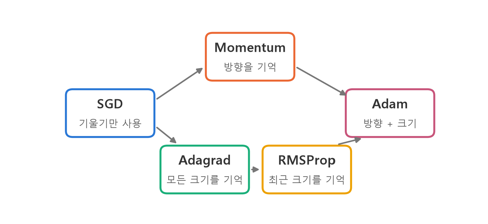
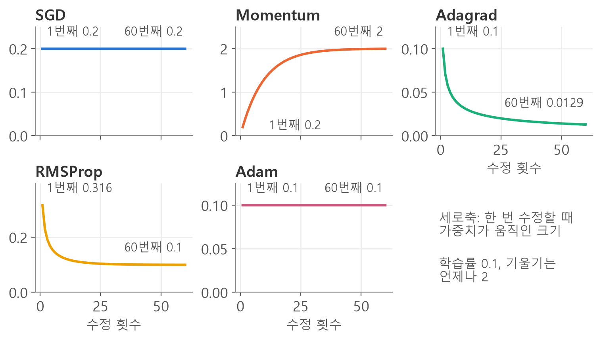
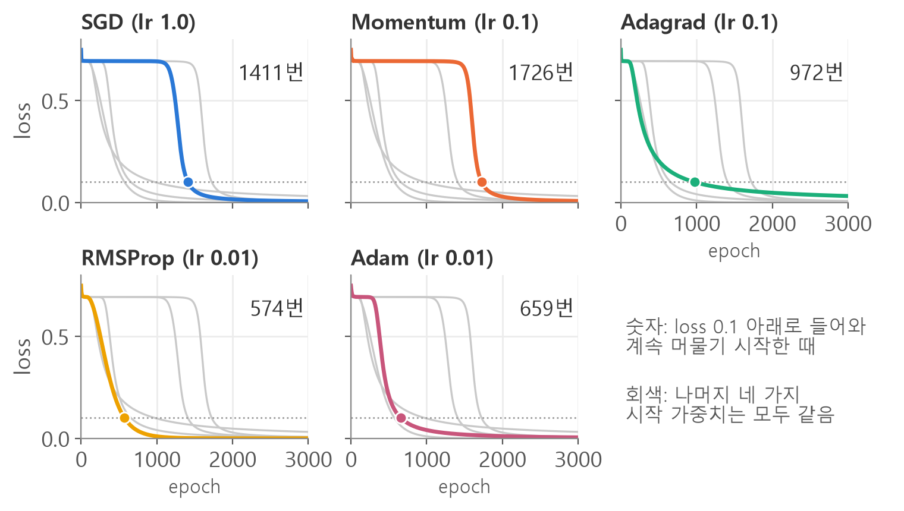
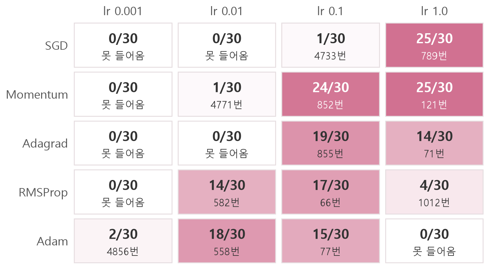
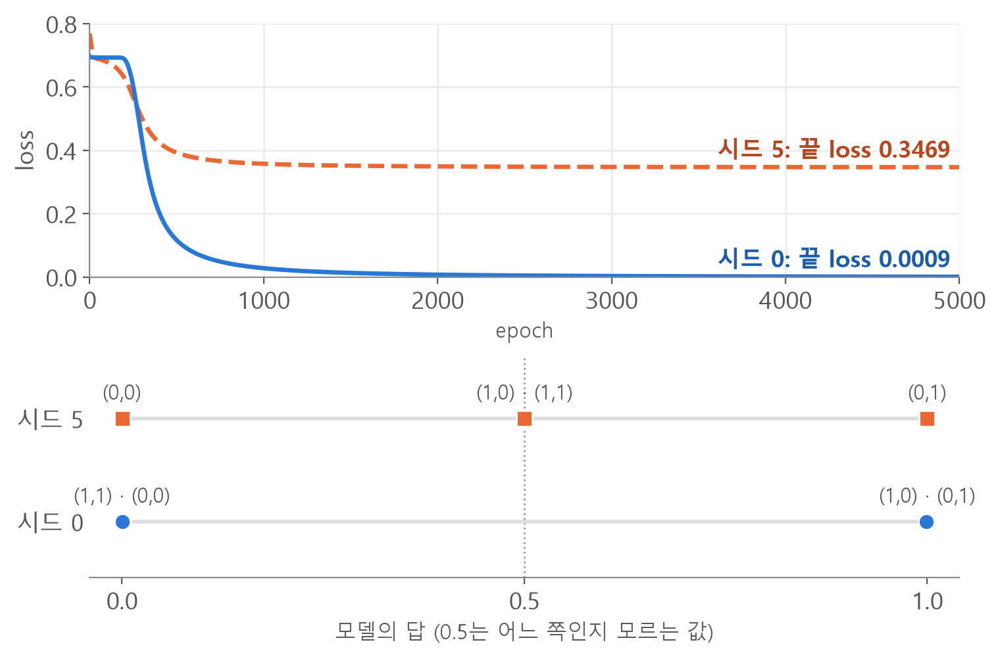
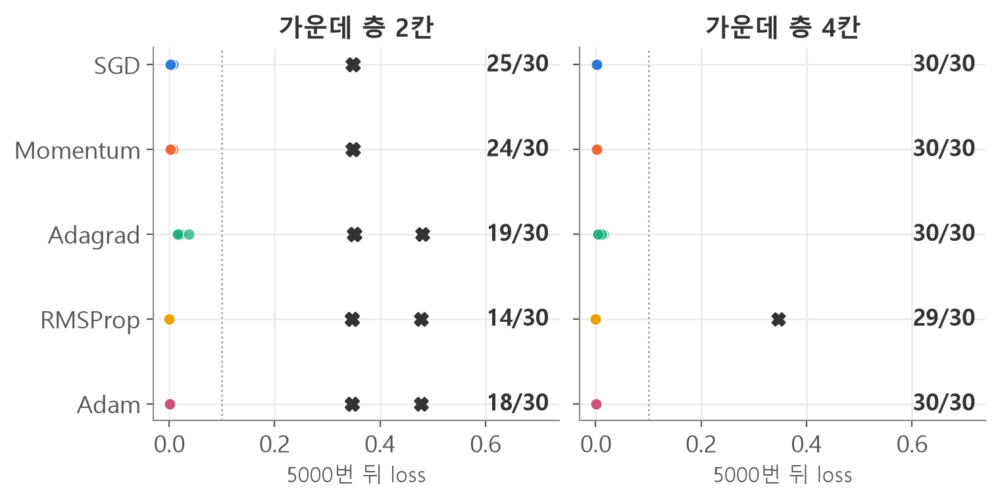

<style>
.content table { width: 100%; border-collapse: collapse; margin: 14px 0 24px; font-size: 17px; line-height: 1.5; }
.content th, .content td { border-bottom: 1px solid #e6dde0; padding: 8px 10px; text-align: left; vertical-align: top; }
.content thead { background: #fbf1f4; }
.content figure { margin: 18px 0; }
.content figure img { width: 100%; height: auto; }
.content td, .content th { word-break: keep-all; overflow-wrap: normal; }
.content .katex-display { overflow-x: auto; overflow-y: hidden; padding: 4px 0; }
.content td code { white-space: nowrap; }
.content pre .nb { padding: 0; border: 0; border-radius: 0; background: none; }
@media (max-width: 560px) { .content th, .content td { padding: 7px 5px; font-size: 16px; } }
</style>
<link rel="stylesheet" href="https://cdn.jsdelivr.net/npm/katex@0.16.11/dist/katex.min.css">
<script defer src="https://cdn.jsdelivr.net/npm/katex@0.16.11/dist/katex.min.js"></script>
<script defer src="https://cdn.jsdelivr.net/npm/katex@0.16.11/dist/contrib/auto-render.min.js" onload="renderMathInElement(document.querySelector('.content')||document.body,{delimiters:[{left:'\\[',right:'\\]',display:true},{left:'\\(',right:'\\)',display:false}]})"></script>

<div class="wc"><p><b>optimizer는 왜 알아야 할까요?</b><br>
optimizer는 loss가 줄어드는 쪽으로 모델 안의 숫자를 고치는 도구이고, PyTorch에서는 <a href="https://docs.pytorch.org/docs/stable/optim.html"><code>torch.optim</code></a>에 모여 있어요.<br>
PyTorch의 <a href="https://docs.pytorch.org/tutorials/intermediate/reinforcement_q_learning.html">강화학습 튜토리얼(DQN)</a>도 <code>optim.AdamW</code>로 만든 optimizer로 신경망을 학습시켜요.<br>
코드 몇 줄의 뜻을 알면 어떤 학습 코드에서든 가중치를 고치는 자리를 찾고, 학습이 안 될 때 어디를 볼지 알 수 있어요. (2026년 11월 4일 기준)</p></div>

코드가 낯선 사람도 읽을 수 있게 optimizer 코드를 조각마다 풀고, 다섯 가지 optimizer를 같은 문제로 돌려 비교했어요. 결과값은 모두 torch 2.11에서 직접 실행한 값이에요(CPU 계산).

**optimizer란 → 코드 읽기 → 학습 반복문 → 다섯 가지 식과 코드 → 비교 → 시작 가중치 → 실수**

<div class="keyline">먼저 optimizer가 하는 일부터 볼게요.</div>

## <span class="no">1</span> optimizer가 하는 일

optimizer는 **기울기를 보고 가중치를 고치는** 일을 맡아요. 용어 네 개만 먼저 잡을게요.

| 용어 | 뜻 |
|---|---|
| 가중치(weight) | 모델 안에서 학습으로 고치는 숫자 |
| loss | 모델이 틀린 정도. 작을수록 좋아요 |
| 기울기(gradient) | 가중치를 늘릴 때 loss가 얼마나 변하는지 |
| learning rate(lr) | 기울기를 얼마나 반영해 고칠지 정하는 값 |

가장 기본이 되는 수정 식은 이거예요.

$$w_{new} = w_{old} - \eta \, g$$

$$w$$는 가중치, $$\eta$$(에타)는 learning rate, $$g$$는 기울기예요. $$w=10$$, $$g=2$$, $$\eta=0.1$$이면 $$10 - 0.1 \times 2 = 9.8$$이에요.

여러 optimizer는 **이 빼는 양을 어떻게 정하느냐**가 달라요. 기울기의 방향을 기억하는 갈래와 크기를 기억하는 갈래가 있고, Adam이 둘을 합쳤어요.

<figure></figure>

이론을 더 자세히 보고 싶다면 [경사하강법 정리](/2026/10/26/gradient-descent-init/)를 보세요. 이 글은 코드에 집중해요.

## <span class="no">2</span> XOR 문제와 optimizer 코드 읽기

문제는 두 숫자가 다르면 1, 같으면 0을 답하는 XOR이에요. 설치가 안 됐다면 터미널에서 `pip install torch`를 먼저 실행하세요.

```python
import torch           # 텐서 계산 도구
import torch.nn as nn  # 모델 부품 모음

# 입력 4줄, 줄마다 숫자 2개
X = torch.tensor(
    [[0., 0.], [0., 1.],
     [1., 0.], [1., 1.]])
# 정답 4줄
y = torch.tensor(
    [[0.], [1.], [1.], [0.]])
```

모델을 만드는 코드를 함수로 묶어 둘게요.

```python
def make_model(hidden=2):
    return nn.Sequential(
        nn.Linear(2, hidden),
        nn.Sigmoid(),
        nn.Linear(hidden, 1),
        nn.Sigmoid(),
    )

torch.manual_seed(42)  # 난수 고정
model = make_model()
n = 0
for p in model.parameters():
    n += p.numel()  # 개수 더하기
print(n)
```
→ `9` : 이 모델에서 학습으로 고칠 숫자는 9개예요.

| 코드 | 뜻 |
|---|---|
| `def` | 아래 줄들에 이름을 붙여 둬요. 이름을 부를 때 실행돼요 |
| `return` | 뒤의 값을 돌려줘요 |
| `hidden=2` | 가운데 층의 칸 수예요. 안 적으면 2예요 |
| `nn.Sequential` | 안의 부품을 위에서 아래로 차례로 통과시켜요 |
| `nn.Linear` | 숫자에 가중치를 곱해 더하는 부품이에요 |
| `nn.Sigmoid` | 숫자를 0과 1 사이로 바꾸는 부품이에요 |
| `manual_seed` | 시작 가중치를 정하는 난수를 고정해요 |

`manual_seed`에 넣는 숫자를 **시드**라고 불러요. 시드가 같으면 시작 가중치도 같아요.

이제 이 글의 핵심 한 줄이에요. 폭이 좁아 세 줄로 나눴지만 괄호 안은 한 문장이에요.

```python
optimizer = torch.optim.SGD(
    model.parameters(),
    lr=1.0,
)
```

| 코드 조각 | 뜻 |
|---|---|
| `optimizer =` | 오른쪽에서 만든 것에 `optimizer`라는 이름을 붙여요 |
| `torch.optim.SGD` | 점은 "안에 있는"이에요. torch 안의 optim 안의 SGD |
| `( ... )` | 괄호는 "실행해"예요. 재료를 쉼표로 나눠 넣어요 |
| `model.parameters()` | 모델이 가진 가중치 9개를 꺼내 줘요 |
| `lr=1.0` | 옵션 이름과 값이에요 |

**왜 모델의 가중치를 넘겨줄까요?** optimizer는 만들 때 받은 숫자만 고치기 때문이에요. 그래서 `make_model()`로 모델을 새로 만들면 optimizer도 다시 만들어야 해요.

## <span class="no">3</span> 학습 반복문에서 쓰는 세 줄

optimizer를 쓰는 줄은 `zero_grad()`와 `step()`이고, 그 사이에 `loss.backward()`가 들어가요. 세 줄이 무엇을 바꾸는지 가중치 하나를 찍어 볼게요.

```python
# 0 또는 1이 정답일 때 쓰는 채점 방법
criterion = nn.BCELoss()
# 첫 부품의 가중치
w = model[0].weight

def show(name):
    g = w.grad
    if g is not None:
        g = round(g[0, 0].item(), 4)
    print(name, g,
          round(w[0, 0].item(), 4))

# 예측
y_pred = model(X)
# 채점
loss = criterion(y_pred, y)
show("처음")
# 기울기 지우기
optimizer.zero_grad()
# 기울기 계산
loss.backward()
show("backward 뒤")
# 가중치 수정
optimizer.step()
show("step 뒤")
optimizer.zero_grad()
show("zero_grad 뒤")
```

| 시점 | 가중치 하나 | 기울기 하나 |
|---|---|---|
| 처음 | 0.5406 | `None` |
| `backward()` 뒤 | 0.5406 | −0.004 |
| `step()` 뒤 | 0.5446 | −0.004 |
| `zero_grad()` 뒤 | 0.5446 | `None` |

`show`는 확인용이라 뜻만 보고 넘어가도 돼요. `None`은 값이 없다는 뜻이에요. **`backward()`는 기울기만 채우고 가중치는 안 바꿔요. 가중치를 바꾸는 줄은 `step()`이에요.** 값을 넣어 보면 $$0.5406 - 1.0 \times (-0.004) = 0.5446$$으로 식과 맞아요.

이제 전체 반복문이에요.

```python
torch.manual_seed(42)
model = make_model()
optimizer = torch.optim.SGD(
    model.parameters(), lr=1.0)

for epoch in range(2000):
    y_pred = model(X)
    loss = criterion(y_pred, y)
    optimizer.zero_grad()
    loss.backward()
    optimizer.step()
    if epoch % 500 == 0:
        print(epoch,
              round(loss.item(), 4))

with torch.no_grad():  # 계산 기록 끄기
    print(model(X).flatten())
```
→ `0 0.7482`, `500 0.6931`, `1000 0.6917`, `1500 0.0573`<br>
→ `tensor([0.0181, 0.9862, 0.9862, 0.0149])` : 정답 0, 1, 1, 0에 가까워졌어요.

처음 보는 표현만 풀게요.

| 코드 | 뜻 |
|---|---|
| `for epoch in range(2000):` | 들여쓰기한 줄들을 2000번 반복해요. `epoch`는 0, 1, 2로 세요 |
| `epoch % 500 == 0` | 500으로 나눈 나머지가 0일 때만, 즉 500번마다 |
| `loss.item()` | 텐서에서 숫자 하나만 꺼내요 |
| `torch.no_grad()` | 확인만 할 때 기울기용 계산 기록을 꺼요 |
| `.flatten()` | 세로로 선 4줄을 한 줄로 펴요 |

## <span class="no">4</span> optimizer 다섯 가지의 식과 코드

**코드에서 바뀌는 곳은 `optimizer =` 한 줄뿐이에요.** 식이 무슨 일을 하는지 보려고, 기울기가 언제나 2인 가중치 하나로 3번씩 고쳐 볼게요. `loss = 2 * w`이면 기울기는 항상 2예요.

```python
def three_steps(w, optimizer):
    for step in range(3):
        loss = 2 * w
        optimizer.zero_grad()
        loss.backward()
        optimizer.step()
        print(round(w.item(), 4))

def new_w():
    return torch.tensor(
        10.0, requires_grad=True)
```

`requires_grad=True`는 이 숫자의 기울기를 계산하라는 표시예요. 아래 코드의 `[w]`는 고칠 숫자 목록이에요.

### SGD: 기울기만 써요

$$w \leftarrow w - \eta \, g$$

```python
w = new_w()
three_steps(w, torch.optim.SGD(
    [w], lr=0.1))
```
→ `9.8`, `9.6`, `9.4` : 매번 0.2씩 움직여요.

### Momentum: 방향을 이어받아요

$$v \leftarrow \mu v + g, \qquad w \leftarrow w - \eta \, v$$

$$v$$는 지금까지의 기울기를 누적한 값, $$\mu$$(뮤)는 지난 값을 얼마나 이어받을지예요. 보통 0.9를 써요. $$v$$는 2, $$0.9 \times 2 + 2 = 3.8$$, $$0.9 \times 3.8 + 2 = 5.42$$로 커져요.

```python
w = new_w()
three_steps(w, torch.optim.SGD(
    [w], lr=0.1, momentum=0.9))
```
→ `9.8`, `9.42`, `8.878` : 같은 방향이 이어지면 수정 폭이 커져요.

기울기가 +2 다음 −2로 뒤집히면 $$v$$는 $$0.9 \times 2 - 2 = -0.2$$로 작아져요. 그래서 왔다 갔다 하는 움직임이 줄어요. Momentum은 이름이 따로 없고 SGD의 옵션이에요.

### Adagrad: 기울기 크기를 전부 기억해요

$$s \leftarrow s + g^2, \qquad w \leftarrow w - \frac{\eta}{\sqrt{s}+\epsilon} \, g$$

$$s$$는 기울기 제곱의 누적 합, $$\epsilon$$(엡실론)은 0으로 나누지 않게 더하는 아주 작은 수예요. $$\epsilon$$을 빼고 보면 첫 수정 폭은 $$\frac{\eta}{\sqrt{g^2}} g$$라서 기울기가 10이든 0.1이든 $$\eta$$와 같아요. 기울기 크기 차이가 줄어드는 거예요.

```python
w = new_w()
three_steps(w, torch.optim.Adagrad(
    [w], lr=0.1))
```
→ `9.9`, `9.8293`, `9.7716` : $$s$$가 4, 8, 12로 커져서 수정 폭이 0.1, 0.0707, 0.0577로 줄어요.

### RMSProp: 최근 크기 위주로 기억해요

$$s \leftarrow \rho s + (1-\rho) g^2, \qquad w \leftarrow w - \frac{\eta}{\sqrt{s}+\epsilon} \, g$$

$$\rho$$(로)는 옛 값을 얼마나 남길지 정하는 비율이에요. 0.9면 옛 값의 90%에 새 기울기 제곱의 10%를 더해요. PyTorch에서는 이 값을 `alpha`라고 불러요. 철자는 `RMSprop`이고 기본값은 0.99예요.

```python
w = new_w()
three_steps(w, torch.optim.RMSprop(
    [w], lr=0.1, alpha=0.9))
```
→ `9.6838`, `9.4544`, `9.2623` : $$s$$가 0.4, 0.76, 1.084로 커지지만 4 근처에서 멈춰요.

### Adam: 방향과 크기를 합쳐요

$$m \leftarrow \beta_1 m + (1-\beta_1) g, \qquad v \leftarrow \beta_2 v + (1-\beta_2) g^2$$

$$\hat m = \frac{m}{1-\beta_1^t}, \qquad \hat v = \frac{v}{1-\beta_2^t}, \qquad w \leftarrow w - \frac{\eta}{\sqrt{\hat v}+\epsilon} \, \hat m$$

$$m$$은 최근 기울기 위주의 평균, $$v$$는 최근 기울기 제곱 위주의 평균, $$t$$는 수정 횟수예요. 기본값은 $$\beta_1=0.9$$, $$\beta_2=0.999$$예요. $$m$$과 $$v$$는 0에서 시작해 초반 값이 작아서 $$\hat m$$, $$\hat v$$로 보정해요. 첫 번째는 $$m=0.2$$인데 $$0.2 \div 0.1 = 2$$로 돌아와요.

```python
w = new_w()
three_steps(w, torch.optim.Adam(
    [w], lr=0.1))
```
→ `9.9`, `9.8`, `9.7` : 기울기가 일정하면 $$\hat m / \sqrt{\hat v}$$가 1이라 수정 폭이 learning rate와 같아요.

60번까지 이어 보면 차이가 더 잘 보여요.

<figure></figure>

Adagrad는 $$s$$가 커지기만 해서 수정 폭이 계속 줄고, RMSProp은 0.1에서 멈춰요. RMSProp이 Adagrad와 다른 점이 이거예요.

## <span class="no">5</span> 같은 시작 가중치에서 비교하기

XOR에 다섯 가지를 돌려 볼게요. 먼저 이름으로 optimizer를 고르는 함수와 학습 함수를 만들어요.

```python
def make_opt(name, params, lr):
    if name == "SGD":
        return torch.optim.SGD(
            params, lr=lr)
    if name == "Momentum":
        return torch.optim.SGD(
            params, lr=lr,
            momentum=0.9)
    if name == "Adagrad":
        return torch.optim.Adagrad(
            params, lr=lr)
    if name == "RMSprop":
        return torch.optim.RMSprop(
            params, lr=lr,
            alpha=0.9)
    if name == "Adam":
        return torch.optim.Adam(
            params, lr=lr)

def train(name, lr, seed, hidden=2,
          epochs=5000):
    torch.manual_seed(seed)
    model = make_model(hidden)
    optimizer = make_opt(
        name, model.parameters(), lr)
    losses = []
    for epoch in range(epochs):
        y_pred = model(X)
        loss = criterion(y_pred, y)
        optimizer.zero_grad()
        loss.backward()
        optimizer.step()
        losses.append(loss.item())
    return model, losses

# loss 0.1 아래에 머물기 시작한 때
def stay_time(losses):
    last = -1
    for i, v in enumerate(losses):
        if v >= 0.1:
            last = i
    return last + 1

for name, lr in [("SGD", 1.0),
                 ("Momentum", 0.1),
                 ("Adagrad", 0.1),
                 ("RMSprop", 0.01),
                 ("Adam", 0.01)]:
    model, losses = train(
        name, lr, 42)
    print(name, stay_time(losses),
          round(losses[-1], 4))
```

| 코드 | 뜻 |
|---|---|
| `if name == "SGD":` | 이름이 SGD일 때만 아래 줄을 실행해요. `==`는 같은지 비교해요 |
| `train` | 앞에서 본 반복문을 묶은 함수예요. `losses`에 loss를 모아요 |
| `enumerate` | 번호와 값을 같이 꺼내요 |
| `for name, lr in [...]` | 이름과 lr 짝을 하나씩 꺼내요 |

`train`은 시작할 때마다 시드를 고정하니 다섯 번 모두 같은 시작 가중치예요.

| optimizer | lr | 0.1 아래에 머물기 시작 | 마지막 loss |
|---|---|---|---|
| SGD | 1.0 | 1411번 | 0.0026 |
| Momentum | 0.1 | 1726번 | 0.0029 |
| Adagrad | 0.1 | 972번 | 0.0189 |
| RMSProp | 0.01 | 574번 | 0.0000 |
| Adam | 0.01 | 659번 | 0.0013 |

<figure></figure>

0.69 근처의 평평한 구간은 모델이 네 입력 모두 0.5쯤으로 답하는 상태예요. [BCELoss에서 0.5로 답하면 loss가 0.693](/2026/11/04/xor-training-loop/)이에요.

**이 표로 순위를 매기면 안 돼요.** learning rate가 다르고, 시드도 하나뿐이에요. Momentum이 SGD보다 늦은 것도 learning rate가 0.1과 1.0으로 달라서예요. 같은 시드에서 Momentum을 lr 1.0으로 바꾸면 159번이에요. 그래서 다섯 가지 모두 learning rate 네 가지와 시드 30개(0부터 29)로 5000번씩 다시 돌렸어요.

<figure></figure>

칸의 위 숫자는 시드 30개 중 5000번 안에 loss 0.1 아래로 들어와 머문 횟수, 아래 숫자는 그 시점의 중앙값(줄 세웠을 때 가운데 값)이에요. RMSProp의 `alpha`는 0.9예요.

- **같은 learning rate에서는 Momentum이 SGD보다 빨라요.** lr 1.0에서 둘 다 25번 성공인데, 중앙값이 SGD 789번, Momentum 121번이에요. lr 0.1에서는 SGD가 1번, Momentum이 24번이에요.
- **잘 맞는 learning rate가 optimizer마다 달라요.** SGD는 네 값 중 lr 1.0에서 가장 많이 성공했고, Adam은 lr 1.0에서 한 번도 성공하지 못했어요.
- **learning rate를 안 적으면 기본값이 쓰여요.** 기본값은 SGD 0.001, Adagrad 0.01, RMSprop 0.01, Adam 0.001이에요. lr 0.001의 Adam은 30번 중 2번만 5000번 안에 들어왔어요.

그래서 **optimizer 이름을 바꿀 때는 learning rate도 같이 다시 정해야 해요.** 이 표는 작은 XOR 모델의 결과라서 다른 문제의 순위로 읽으면 안 돼요.

## <span class="no">6</span> 시작 가중치에 따른 학습 결과 비교

똑같은 코드도 시작 가중치가 다르면 결과가 달라요. Adam, lr 0.01에서 시드만 바꿔 볼게요.

```python
for seed in [5, 0]:
    model, losses = train(
        "Adam", 0.01, seed)
    with torch.no_grad():
        p = model(X).flatten()
    print(seed, round(losses[-1], 4))
    print(p)
```
→ `5 0.3469`<br>
→ `tensor([4.3269e-04, 9.9952e-01, 4.9992e-01, 5.0011e-01])`<br>
→ `0 0.0009`<br>
→ `tensor([1.0516e-03, 9.9910e-01, 9.9910e-01, 8.2465e-04])`

`e-04`는 소수점을 왼쪽으로 네 칸 옮기라는 뜻이에요. 풀어 쓰면 이래요.

| 입력 | 정답 | 시드 5의 답 | 시드 0의 답 |
|---|---|---|---|
| 0, 0 | 0 | 0.00043 | 0.00105 |
| 0, 1 | 1 | 0.99952 | 0.99910 |
| 1, 0 | 1 | 0.49992 | 0.99910 |
| 1, 1 | 0 | 0.50011 | 0.00082 |
| 0.5 기준 | 0 1 1 0 | 0 1 0 1 | 0 1 1 0 |

<figure></figure>

**시드 5의 loss는 왜 0.3466 근처일까요?** 두 입력은 거의 맞히고 두 입력은 0.5로 답하니 $$(0 + 0 + 0.693 + 0.693) \div 4 = 0.3466$$이에요. 0.5 언저리의 답은 0.5보다 조금 크냐 작냐로 0과 1이 갈려요. **0과 1로 바꾼 값만 보면 이 차이가 안 보이니, 실제 값을 찍어 보세요.**

**왜 멈출까요?** 틀렸는데도 기울기가 거의 0인 평평한 자리에 들어갔기 때문이에요. 시드 5에서 기울기 9개를 한 덩어리로 본 크기는 처음 0.243이었는데 5000번째에는 0.00016이에요. 이 근처는 가중치를 조금 옮겨도 loss가 거의 변하지 않아서 더 돌려도 잘 내려가지 않아요.

다른 optimizer도 마찬가지예요. 알맞은 learning rate로 시드 30개를 돌리고, 가운데 층을 4칸으로 넓혀 다시 돌렸어요.

<figure></figure>

X 표시가 막힌 시드예요. 0.48 근처는 한 입력만 확실히 답하고, 나머지 세 입력에는 똑같은 값(모두 $$\frac{2}{3}$$ 또는 모두 $$\frac{1}{3}$$)을 내는 경우예요. 이때 loss는 $$(0 + 0.405 + 0.405 + 1.099) \div 4 = 0.477$$이에요.

| 막혔을 때 할 일 | 코드 |
|---|---|
| 실제 값을 찍어 보기 | `print(model(X).flatten())` |
| 시작 가중치 바꾸기 | `torch.manual_seed` 숫자 바꾸기 |
| 가운데 층 넓히기 | `nn.Linear(2, 4)`, `nn.Linear(4, 1)` |

4칸에서도 RMSProp은 30개 중 1개가 막혔어요. 넓히면 줄어들지만 항상 해결되는 건 아니에요.

## <span class="no">7</span> 자주 하는 실수와 함수 정리

**실수 1. `zero_grad`의 괄호를 빠뜨리기.** 에러가 안 나서 찾기 어려워요.

```python
# ❌
torch.manual_seed(3)
model = make_model()
optimizer = torch.optim.SGD(
    model.parameters(), lr=1.0)
for epoch in range(1000):
    y_pred = model(X)
    loss = criterion(y_pred, y)
    optimizer.zero_grad
    loss.backward()
    optimizer.step()
    if epoch % 200 == 0:
        print(epoch,
              round(loss.item(), 4))
print(round(loss.item(), 4))
```
→ `0 0.7112`, `200 0.4883`, `400 0.4934`, `600 0.4977`, `800 0.5005`, 마지막 `0.4978` : 200번 뒤로는 0.49와 0.50 사이를 오르내리고 더 내려가지 않아요.

괄호가 없으면 함수 이름만 적고 실행하지 않은 거예요. 기울기가 안 지워져 지난 값에 계속 더해지고 수정 폭이 커져요. 고치면 `optimizer.zero_grad()`예요.

같은 시드로 괄호를 넣으면 끝 loss가 0.0349예요. 다만 항상 나빠지는 건 아니에요. 시드 30개로 1000번씩 돌려 보니 네 입력을 모두 맞힌 시드는 18개에서 12개로 줄었지만, 끝 loss만 보면 19개 시드에서 오히려 낮았어요. loss만 봐서는 알아채기 어려우니 코드를 확인하세요.

**실수 2. 대소문자 틀리기.**

```python
# ❌
torch.optim.adagrad(
    model.parameters(), lr=0.1)
```
→ `AttributeError: module 'torch.optim' has no attribute 'adagrad'`

`AttributeError`는 그런 이름이 없다는 뜻이에요. Python은 대문자와 소문자를 다른 이름으로 봐요. 맞는 이름은 `SGD`, `Adagrad`, `RMSprop`, `Adam`이에요.

**실수 3. optimizer에 다른 모델 넘기기.** 새 모델을 만들고 optimizer를 안 만들거나, `model_a`를 학습하면서 `model.parameters()`를 넘기면 에러 없이 loss가 그대로예요. [세 방식 비교 글](/2026/11/04/batch-sgd-mini-batch/)에서도 다뤘어요.

### 이 글에서 쓴 함수

| 함수 | 하는 일 |
|---|---|
| `torch.manual_seed(42)` | 시작 가중치의 난수 고정 |
| `model.parameters()` | 고칠 가중치 꺼내기 |
| `torch.optim.SGD(...)` | optimizer 만들기, `momentum=`은 옵션 |
| `torch.optim.Adagrad(...)` | 크기를 전부 기억 |
| `torch.optim.RMSprop(...)` | 크기를 최근 위주로 기억, `alpha=`는 옵션 |
| `torch.optim.Adam(...)` | 방향과 크기를 함께 사용 |
| `optimizer.zero_grad()` | 쌓인 기울기 지우기 |
| `loss.backward()` | 기울기 계산 |
| `optimizer.step()` | 가중치 수정 |
| `loss.item()` | 숫자 하나 꺼내기 |
| `torch.no_grad()` | 기울기용 계산 기록 끄기 |

<div class="done">🎉 이제 <code>optimizer =</code> 한 줄을 읽고, 학습이 안 될 때 어디를 볼지 알 수 있어요.</div>
