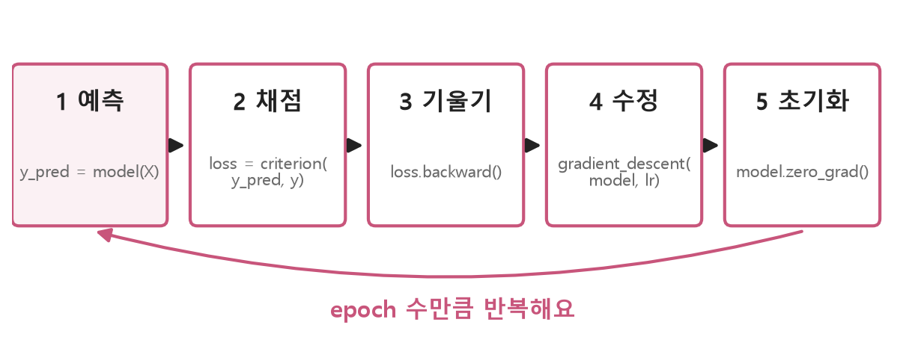
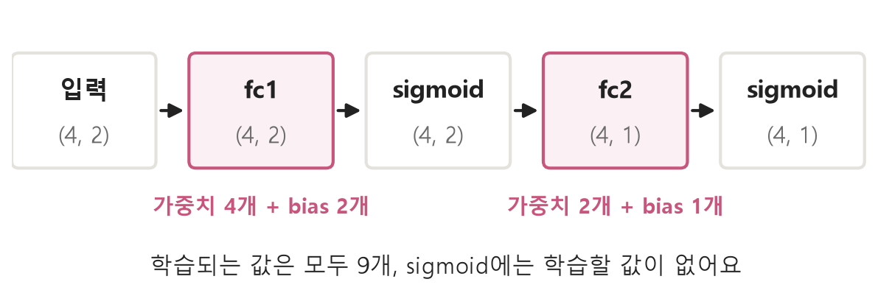
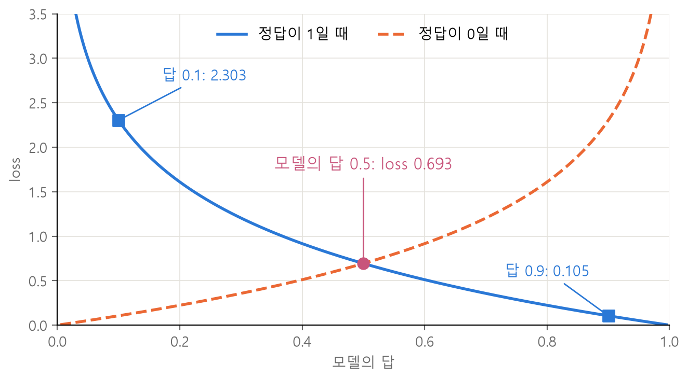
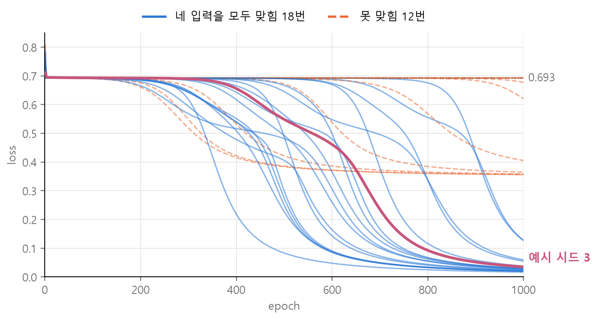
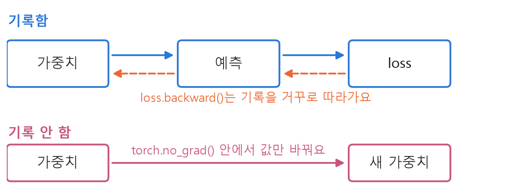

<style>
.content table { width: 100%; border-collapse: collapse; margin: 14px 0 24px; font-size: 17px; line-height: 1.5; }
.content th, .content td { border-bottom: 1px solid #e6dde0; padding: 8px 10px; text-align: left; vertical-align: top; }
.content thead { background: #fbf1f4; }
.content figure { margin: 18px 0; }
.content figure img { width: 100%; height: auto; }
.content td, .content th { word-break: keep-all; overflow-wrap: normal; }
.content .katex-display { overflow-x: auto; overflow-y: hidden; padding: 4px 0; }
.content td code { white-space: normal; overflow-wrap: anywhere; }
.content pre .nb { padding: 0; border: 0; border-radius: 0; background: none; }
@media (max-width: 560px) { .content th, .content td { padding: 7px 5px; font-size: 16px; } }
</style>
<link rel="stylesheet" href="https://cdn.jsdelivr.net/npm/katex@0.16.11/dist/katex.min.css">
<script defer src="https://cdn.jsdelivr.net/npm/katex@0.16.11/dist/katex.min.js"></script>
<script defer src="https://cdn.jsdelivr.net/npm/katex@0.16.11/dist/contrib/auto-render.min.js" onload="renderMathInElement(document.querySelector('.content')||document.body,{delimiters:[{left:'\\[',right:'\\]',display:true},{left:'\\(',right:'\\)',display:false}]})"></script>

<div class="wc"><p><b>학습 반복문은 왜 먼저 익힐까요?</b><br>
학습 반복문은 예측, loss 계산, 기울기 계산, 가중치 수정을 되풀이해 모델을 학습시키는 코드예요.<br>
PyTorch의 <a href="https://docs.pytorch.org/tutorials/intermediate/reinforcement_q_learning.html">강화학습 튜토리얼(DQN)</a>도 같은 <code>backward</code>와 <code>step</code>으로 가중치를 고쳐요.<br>
이 흐름을 알면 강화학습 코드에서도 학습이 일어나는 곳을 찾을 수 있어요. (2026년 11월 4일 기준)</p></div>

코드가 낯선 사람이 XOR을 `nn.Module`로 풀 때 챙길 포인트를 일곱 가지로 정리했어요. 결과값은 모두 torch 2.11에서 직접 실행한 값이에요.

<div class="keyline">코드를 다 외우지 않아도 돼요. 흐름 5단계부터 잡을게요.</div>

## <span class="no">1</span> 먼저 잡을 흐름 5단계

학습은 예측, 채점, 기울기, 수정, 초기화를 반복하는 일이에요.

<figure></figure>

코드를 안 보고 이 다섯 단계를 순서대로 말할 수 있으면 흐름을 잡은 거예요.

코드는 세 가지로 나눠서 대하면 돼요.

| 구분 | 어떤 코드 | 이유 |
|---|---|---|
| 직접 치기 | 모델 클래스, 학습 반복문 | 어떤 모델 코드를 읽어도 계속 나와요 |
| 붙여 넣기 | 경사하강 함수, 확인용 `print` | 흐름 뒤에 뜻만 봐도 돼요 |
| 찾아보기 | `nn.BCELoss` 같은 이름 | 외우지 말고 문서에서 찾으면 돼요 |

빈 칸에서 시작하기 어려우면 틀을 붙여 넣고 `____`만 치세요.

## <span class="no">2</span> 데이터에서 자주 틀리는 네 곳

입력 `X`와 정답 `y`는 실수 텐서로 만들고, 각각 shape가 `(4, 2)`와 `(4, 1)`이어야 해요.

```python
# ❌
X = tensor([0,0], [0,1], [1,0], [1,1]).float
y = tensor(0, 1, 1, 0).float

# ✅
import torch
import torch.nn as nn

X = torch.tensor([[0,0], [0,1], [1,0], [1,1]]).float()
y = torch.tensor([[0], [1], [1], [0]]).float()
print(X.shape, y.shape)
```
→ `torch.Size([4, 2]) torch.Size([4, 1])` : 4줄에 입력 2개씩, 4줄에 정답 1개씩

| 틀린 곳 | 고치는 법 | 이유 |
|---|---|---|
| `tensor(...)` | `torch.tensor(...)` | `tensor`는 `torch` 안에 있어요 |
| 쉼표로 나눈 값 | 바깥 대괄호로 묶기 | 데이터를 덩어리 하나로 받아요 |
| `.float` | `.float()` | 괄호가 없으면 변환을 실행하지 않아요 |
| `[0, 1, 1, 0]` | `[[0], [1], [1], [0]]` | 정답 shape를 모델 출력 `(4, 1)`과 맞춰요 |

## <span class="no">3</span> MLP 클래스와 in_features

`__init__`에는 쓸 층을 만들어 두고, `forward`에는 데이터가 지나가는 순서를 써요. 클래스 구조는 [nn.Module 정리](/2026/11/04/nn-module-shape-dim/)에서 더 자세히 다뤘어요.

**직접 치기**: 틀을 붙여 넣고 빈칸 다섯 개를 채워 보세요.

```python
class MLP(____):
    def __init__(self):
        super().__init__()
        self.fc1 = nn.Linear(____)
        self.fc2 = nn.Linear(2, 1)
        self.sigmoid = ____

    def forward(self, x):
        x = self.fc1(x)
        x = self.sigmoid(x)
        x = ____
        x = ____
        return x
```

| 순서 | 넣을 코드 |
|---|---|
| 1 | `nn.Module` |
| 2 | `2, 2` |
| 3 | `nn.Sigmoid()` |
| 4 | `self.fc2(x)` |
| 5 | `self.sigmoid(x)` |

```python
torch.manual_seed(0)
model = MLP()
print(model)
print(model(X).shape)
```
→ `(fc1): Linear(in_features=2, out_features=2, bias=True)`<br>
→ `(fc2): Linear(in_features=2, out_features=1, bias=True)`<br>
→ `(sigmoid): Sigmoid()`<br>
→ `torch.Size([4, 1])` : 데이터 4줄마다 답이 1개씩 나와요.

`in_features`는 데이터 한 줄당 들어오는 숫자 수, `out_features`는 나가는 숫자 수예요. `X`의 shape `(4, 2)`에서 뒤의 2가 `in_features`예요. 앞의 4는 줄 수라 층을 만들 때 적지 않아요.

`bias=True`는 bias(더해 주는 값)를 함께 학습한다는 뜻이에요. 나가는 숫자 하나는 이렇게 계산돼요.

$$\text{출력} = w_1 x_1 + w_2 x_2 + b$$

$$w$$는 가중치, $$x$$는 입력, $$b$$는 bias예요. $$w=(0.5, -0.3)$$, $$b=0.1$$, 입력 $$(0, 1)$$이면 $$0.5 \times 0 - 0.3 \times 1 + 0.1 = -0.2$$예요.

<figure></figure>

## <span class="no">4</span> BCELoss와 0.693

`nn.BCELoss`는 정답이 0 또는 1일 때 모델의 답이 얼마나 틀렸는지 점수로 계산해요. BCE는 Binary Cross Entropy의 줄임말이에요.

$$l = -[\,y \log p + (1 - y) \log (1 - p)\,]$$

$$L = \frac{1}{N}\sum_{n=1}^{N} l_n$$

$$y$$는 정답, $$p$$는 모델의 답, $$l$$은 한 줄의 점수, $$N$$은 데이터 수예요. $$\log$$는 자연로그예요. 모델의 답은 0과 1 사이여야 해서 `forward` 끝에 sigmoid를 둬요.

정답이 1이고 답이 0.5면 $$-\log 0.5 = 0.693$$이에요. 정답이 0이어도 값은 같아요. **모든 입력에 0.5로 답하면 loss는 0.693이에요.**

<figure></figure>

**직접 치기**: 첫 줄만 치면 돼요.

```python
criterion = nn.BCELoss()
print(criterion(model(X), y))
```
→ `tensor(0.6977, grad_fn=<BinaryCrossEntropyBackward0>)`

학습 전이라 0.693 근처예요. `grad_fn`은 이 값까지의 계산 기록이 있다는 표시이고, 다음 단계의 `loss.backward()`가 이 기록을 써요. 식을 손으로 구현해 보려면 [XOR 직접 짜 보기](/2026/11/03/xor-forward-backprop/)를 보세요.

## <span class="no">5</span> 학습 반복문과 zero_grad

학습 반복문은 그림의 5단계를 코드 다섯 줄로 쓴 거예요. 먼저 가중치를 고치는 함수를 만들어요.

$$\theta_{new} = \theta_{old} - \eta \nabla L$$

$$\theta$$는 가중치와 bias, $$\eta$$는 learning rate, $$\nabla L$$은 기울기예요. 가중치 0.5, 기울기 0.2, learning rate 1.0이면 $$0.5 - 1.0 \times 0.2 = 0.3$$이에요.

**붙여 넣기**: 실제 코드에서는 `optimizer.step()`이 이 일을 대신해요.

```python
def gradient_descent(model, lr):
    with torch.no_grad():
        for param in model.parameters():
            param -= lr * param.grad
```

**직접 치기**: 이 글에서 가장 중요한 칸이에요.

```python
torch.manual_seed(3)
model = MLP()
model.train()

for epoch in range(1000):
    y_pred = ____
    loss = ____
    ____
    ____
    ____

    if (epoch + 1) % 100 == 0:
        print(epoch + 1, round(loss.item(), 4))
```

| 순서 | 넣을 코드 | 하는 일 |
|---|---|---|
| 1 | `model(X)` | 예측 |
| 2 | `criterion(y_pred, y)` | 채점 |
| 3 | `loss.backward()` | 기울기 계산 |
| 4 | `gradient_descent(model, 1.0)` | 가중치 수정 |
| 5 | `model.zero_grad()` | 기울기 지우기 |

| epoch | loss | 상태 |
|---|---|---|
| 100, 200, 300 | 0.6933, 0.6927, 0.69 | 0.693 근처 |
| 400, 500, 600 | 0.6559, 0.5486, 0.4613 | 내려가기 시작 |
| 700, 800 | 0.2351, 0.0924 | 빠르게 내려감 |
| 900, 1000 | 0.0516, 0.0349 | 0에 가까워짐 |

**zero_grad가 필요한 이유**: PyTorch의 기울기는 [기본으로 누적](https://docs.pytorch.org/tutorials/beginner/basics/optimization_tutorial.html)돼요. 지우지 않으면 지난번 기울기에 이번 기울기가 더해져요.

```python
w = torch.tensor(2.0, requires_grad=True)
(3 * w).backward()
print(w.grad)
(3 * w).backward()
print(w.grad)
```
→ `tensor(3.)`<br>
→ `tensor(6.)` : $$3w$$의 기울기는 3인데 6이 됐어요.

**코드가 맞아도 학습이 멈출 수 있어요.** 시드만 0부터 29까지 바꿔 lr 1.0, epoch 1000으로 돌려 봤어요.

<figure></figure>

| 결과 | 횟수 | 마지막 loss |
|---|---|---|
| 네 입력을 모두 맞힘 | 18번 | 0.017에서 0.127 사이 |
| 못 맞힘 | 12번 | 0.356에서 0.693 사이 |

바뀐 것은 처음 가중치뿐이에요. loss가 0.35에서 0.7 사이에 머물면 `torch.manual_seed` 줄의 숫자를 바꿔 다시 실행해 보세요.

## <span class="no">6</span> no_grad와 eval로 결과 보기

`torch.no_grad()`는 계산 기록을 잠시 꺼요. 가중치 수정과 예측 확인에는 기울기가 필요 없어서 써요.

<figure></figure>

기록만 건너뛰고 계산은 실행돼서 가중치 값은 실제로 바뀌어요. `no_grad` 없이 고치면 이런 에러가 나요.

```python
# ❌
param -= lr * param.grad
```
→ `RuntimeError: a leaf Variable that requires grad is being used in an in-place operation.` : 기울기를 추적 중인 가중치를 그 자리에서 바꿨다는 뜻이에요.

**직접 치기**: 학습이 끝나면 평가 모드로 바꾸고 기록을 끈 채 예측해요.

```python
model.eval()
with torch.no_grad():
    y_pred = model(X)
print(y_pred.flatten())
print((y_pred > 0.5).float().flatten())
```
→ `tensor([0.0241, 0.9694, 0.9692, 0.0511])`<br>
→ `tensor([0., 1., 1., 0.])`

| 입력 | 모델의 답 | 0.5 기준 판단 | 정답 |
|---|---|---|---|
| `[0, 0]` | 0.0241 | 0 | 0 |
| `[0, 1]` | 0.9694 | 1 | 1 |
| `[1, 0]` | 0.9692 | 1 | 1 |
| `[1, 1]` | 0.0511 | 0 | 0 |

이 모델은 `train`과 `eval`의 결과가 같아요. 모드는 [Dropout, BatchNorm 같은 일부 층](https://docs.pytorch.org/docs/stable/generated/torch.nn.Module.html)에만 영향을 주고, 이 모델에는 그런 층이 없어요. 습관으로 넣어요.

## <span class="no">7</span> 강화학습에서 바뀌는 것

강화학습 코드에서도 기울기를 구해 가중치를 고치는 줄은 그대로이고, 데이터와 모델과 loss가 바뀌어요.

먼저 경사하강 함수는 `torch.optim`으로 바꿀 수 있어요.

```python
torch.manual_seed(3)
model = MLP()
optimizer = torch.optim.SGD(model.parameters(), lr=1.0)

for epoch in range(1000):
    y_pred = model(X)
    loss = criterion(y_pred, y)
    loss.backward()
    optimizer.step()
    optimizer.zero_grad()
print(loss.item())
```
→ `0.034896522760391235` : 직접 쓴 함수로 돌린 1000번째 loss와 소수점 끝까지 같아요.

[PyTorch DQN 튜토리얼](https://docs.pytorch.org/tutorials/intermediate/reinforcement_q_learning.html)과 비교하면 자리가 이렇게 대응돼요.

| 자리 | 이 글의 XOR | DQN 튜토리얼 |
|---|---|---|
| 데이터 | 고정된 4줄 | replay memory에서 뽑은 128개 |
| 정답 | `y` | reward와 `target_net`이 구한 다음 상태 값으로 계산 |
| 모델의 답 | `model(X)` | 실제로 했던 행동에 `policy_net`이 매긴 값 |
| loss | `BCELoss` | `SmoothL1Loss` |
| 수정 | SGD로 `step` | 기울기 제한 뒤 AdamW로 `step` |

튜토리얼은 `zero_grad`를 `loss.backward()` 바로 앞에 두는데, `backward`와 `step` 사이만 피하면 [어디에 둬도 돼요](https://discuss.pytorch.org/t/where-should-i-place-zero-grad/101886).

처음 보는 강화학습 코드도 `loss.backward()`를 먼저 찾으면 위로는 데이터와 loss, 아래로는 가중치 수정이 보여요.

<div class="done">🎉 예측, 채점, 기울기, 수정, 초기화. 이 순서면 학습 반복문을 잡은 거예요.</div>
