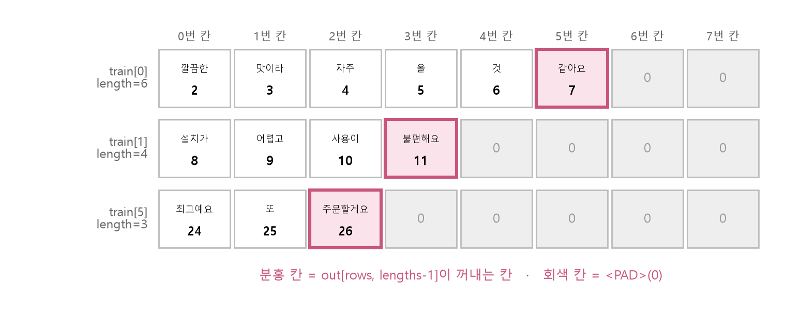
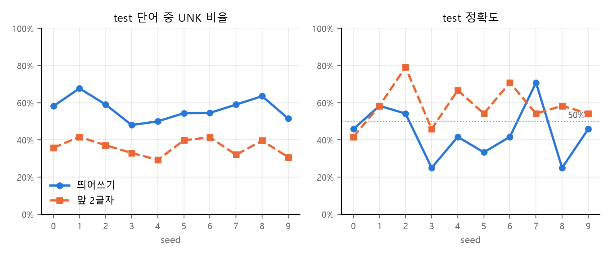

<style>
.content table { width: 100%; border-collapse: collapse; margin: 14px 0 24px; font-size: 17px; line-height: 1.5; }
.content th, .content td { border-bottom: 1px solid #e6dde0; padding: 8px 10px; text-align: left; vertical-align: top; }
.content thead { background: #fbf1f4; }
.content figure { margin: 18px 0; }
.content figure img { width: 100%; height: auto; }
.content td, .content th { word-break: keep-all; overflow-wrap: normal; }
.content .katex-display { overflow-x: auto; overflow-y: hidden; padding: 4px 0; }
.content td code { white-space: nowrap; }
.content pre .nb { padding: 0; border: 0; border-radius: 0; background: none; }
@media (max-width: 560px) { .content th, .content td { padding: 7px 5px; font-size: 16px; } }
</style>
<link rel="stylesheet" href="https://cdn.jsdelivr.net/npm/katex@0.16.11/dist/katex.min.css">
<script defer src="https://cdn.jsdelivr.net/npm/katex@0.16.11/dist/katex.min.js"></script>
<script defer src="https://cdn.jsdelivr.net/npm/katex@0.16.11/dist/contrib/auto-render.min.js" onload="renderMathInElement(document.querySelector('.content')||document.body,{delimiters:[{left:'\\[',right:'\\]',display:true},{left:'\\(',right:'\\)',display:false}]})"></script>

<div class="wc"><p><b>감성분석은 왜 직접 짜 볼까요?</b><br>
감성분석(sentiment analysis)은 문장이 긍정인지 부정인지 나누는 자연어 처리(NLP) 작업이에요.<br>
문장을 단어로 자르고 번호로 바꿔 모델에 넣는 과정은 번역·챗봇 같은 다른 NLP 모델에도 똑같이 들어가요.<br>
토큰화부터 <a href="https://docs.pytorch.org/docs/stable/generated/torch.nn.LSTM.html">LSTM</a>까지 한 번 손으로 짜 보면, 라이브러리가 한 줄로 대신하는 일과 결과가 나쁠 때 볼 곳이 보여요. (2026년 11월 9일 기준)</p></div>

직접 쓴 한국어 리뷰 120개로 감성분석 모델을 끝까지 만들고, 정확도가 낮은 원인을 찾아 고친 뒤 헷갈리는 개념 여섯 가지를 정리했어요.

코드는 위에서부터 셀 하나씩 실행하면 이어져요. `pip install torch`로 설치하거나 Google Colab에서 바로 돌릴 수 있어요. ❌ 표시가 붙은 블록은 일부러 에러를 내는 코드예요. 결과값은 torch 2.11 CPU에서 실행한 값이고, 환경에 따라 소수 값은 조금 다를 수 있어요.

**문장 → 단어 → 번호 → 길이 맞추기 → 모델 → 학습 → 평가 → 예측**

<div class="keyline">식당·카페·숙소·물건 리뷰를 긍정과 부정으로 나누는 모델을 만들어 볼게요.</div>

## <span class="no">1</span> 리뷰 데이터와 토큰화

### Corpus: 문장과 라벨

코퍼스(corpus)는 모델이 배울 문장 모음이에요. 문장마다 정답 라벨(긍정 1, 부정 0)을 붙여 `(문장, 라벨)`로 묶어요.

```python
import random   # 섞기
import torch    # 텐서 계산 도구
from torch import nn  # 층과 모델 도구
# 텐서 묶기 · 배치로 나누기
from torch.utils.data import TensorDataset, DataLoader
```

리뷰는 긍정 60개, 부정 60개를 직접 썼어요. 아래 상자를 열어 복사하세요.

<details markdown="1"><summary>리뷰 120개 코드 펼치기</summary>

```python
pos = [
    "음식이 정말 맛있어요 또 올게요", "직원분들이 친절하고 분위기도 좋았어요",
    "커피 향이 진하고 맛있었다", "배송이 빨라서 기분이 좋네요",
    "가격 대비 양이 많아서 만족합니다", "방이 깨끗하고 침대가 편했어요",
    "디저트가 달지 않고 맛있어서 좋았다", "사장님이 친절해서 또 가고 싶어요",
    "포장이 꼼꼼하고 상태가 완벽했어요", "재질이 부드럽고 착용감이 좋아요",
    "국물이 진해서 정말 맛있었어요", "뷰가 예쁘고 조용해서 쉬기 좋았다",
    "설명대로 작동하고 튼튼해요", "아이가 너무 좋아해서 만족해요",
    "생각보다 훨씬 맛있네요 추천합니다", "청소가 잘 되어 있어서 깨끗했어요",
    "빵이 촉촉하고 고소해요", "응대가 빠르고 친절했습니다",
    "사이즈가 딱 맞고 예뻐요", "분위기가 아늑해서 오래 있고 싶었다",
    "가성비 최고 재구매 의사 있어요", "고기가 부드럽고 양념이 맛있었다",
    "위치가 좋아서 이동이 편했어요", "품질이 좋아서 선물용으로 추천해요",
    "매장이 넓고 깔끔해서 좋았어요", "소리가 깨끗하고 배터리도 오래가요",
    "친구들이 다 맛있다고 했어요", "직원이 친절하게 설명해 줘서 좋았다",
    "기대 이상이라 정말 만족스러웠어요", "향이 은은하고 오래가서 좋아요",
    "주차가 편하고 음식도 맛있어요", "조식이 다양하고 맛있었습니다",
    "색감이 예쁘고 마감이 깔끔해요", "처음 와 봤는데 너무 좋았어요",
    "면이 쫄깃하고 국물이 시원해요", "직원분이 웃으며 맞아 줘서 기분 좋았다",
    "화면이 선명하고 반응이 빨라요", "침구가 포근해서 푹 잤어요",
    "커피가 고소하고 디저트도 훌륭했다", "배송도 빠르고 포장도 좋았어요",
    "다시 방문하고 싶은 곳이에요", "맛도 좋고 가격도 착해요",
    "조용하고 깨끗해서 공부하기 좋아요", "설치가 쉽고 사용이 편리해요",
    "반찬이 정갈하고 맛있었어요", "생일에 갔는데 서비스가 훌륭했다",
    "신선한 재료라 맛이 좋아요", "오래 써도 튼튼하고 좋네요",
    "친절한 안내 덕분에 편하게 이용했어요", "전망이 멋지고 방도 넓었어요",
    "양이 넉넉하고 맛있어서 배불렀다", "가볍고 튼튼해서 들고 다니기 좋아요",
    "부모님도 만족하셨어요 추천합니다", "따뜻한 분위기라 마음이 편했어요",
    "디자인이 예쁘고 실용적이에요", "바삭하고 고소해서 계속 먹게 돼요",
    "친절하고 꼼꼼하게 챙겨 주셨어요", "깔끔한 맛이라 자주 올 것 같아요",
    "기능이 많고 쓰기 편해서 만족했다", "최고예요 또 주문할게요",
]
neg = [
    "음식이 너무 짜고 맛없어요", "직원이 불친절해서 기분이 나빴다",
    "커피가 밍밍하고 비싸요", "배송이 늦어서 짜증났어요",
    "가격에 비해 양이 적어서 실망했어요", "방이 더럽고 냄새가 났어요",
    "디저트가 너무 달아서 별로였다", "사장님이 무뚝뚝해서 다시 안 갈래요",
    "포장이 찢어져서 왔어요", "재질이 거칠고 금방 늘어나요",
    "국물이 싱거워서 맛이 없었어요", "시끄러워서 잠을 못 잤다",
    "설명과 다르게 작동이 안 돼요", "아이가 쓰다가 바로 고장났어요",
    "생각보다 훨씬 별로네요 비추합니다", "청소가 안 되어 있어서 지저분했어요",
    "빵이 딱딱하고 퍽퍽해요", "응대가 느리고 불친절했습니다",
    "사이즈가 작고 핏이 이상해요", "분위기가 어수선해서 빨리 나왔다",
    "돈이 아까워요 재구매 안 합니다", "고기가 질기고 양념이 짰다",
    "위치가 외져서 찾기 힘들었어요", "품질이 나빠서 환불했어요",
    "매장이 좁고 지저분해서 불편했어요", "소리가 지직거리고 배터리가 금방 닳아요",
    "친구들도 다 별로라고 했어요", "직원이 대충 설명해서 답답했다",
    "기대 이하라 정말 실망스러웠어요", "향이 독하고 금방 날아가요",
    "주차가 불편하고 음식도 늦게 나와요", "조식이 부실하고 차가웠습니다",
    "색이 사진과 다르고 마감이 엉망이에요", "처음 와 봤는데 너무 별로였어요",
    "면이 불어 있고 국물이 미지근해요", "직원분이 인사도 안 해서 기분 나빴다",
    "화면이 흐리고 반응이 느려요", "침구가 눅눅해서 잠을 설쳤어요",
    "커피가 쓰기만 하고 디저트도 별로였다", "배송도 늦고 포장도 엉망이었어요",
    "다시는 방문하고 싶지 않아요", "맛도 없고 가격도 비싸요",
    "시끄럽고 더러워서 공부하기 힘들어요", "설치가 어렵고 사용이 불편해요",
    "반찬이 성의 없고 맛없었어요", "생일에 갔는데 서비스가 엉망이었다",
    "재료가 상한 것 같아서 불안해요", "며칠 만에 부서져서 화가 나요",
    "안내가 엉망이라 이용하기 힘들었어요", "창밖이 벽이고 방도 좁았어요",
    "양이 적고 맛없어서 배고팠다", "무겁고 약해서 들고 다니기 불편해요",
    "부모님도 실망하셨어요 비추합니다", "차가운 분위기라 마음이 불편했어요",
    "디자인이 촌스럽고 쓸모없어요", "눅눅하고 기름져서 남겼어요",
    "대충대충 챙겨 줘서 불쾌했어요", "느끼한 맛이라 다시 안 올 것 같아요",
    "기능이 부족하고 쓰기 불편해서 후회했다", "최악이에요 다시는 안 시킬게요",
]
```

</details>

```python
# 긍정은 1, 부정은 0을 붙여 한 목록으로
corpus = [(s, 1) for s in pos] + [(s, 0) for s in neg]
print(len(corpus))
print(corpus[0])
print(corpus[60])
```
→ `120`<br>
→ `('음식이 정말 맛있어요 또 올게요', 1)`<br>
→ `('음식이 너무 짜고 맛없어요', 0)`

### Tokenization: 띄어쓰기로 자르기

토큰화(tokenization)는 문장을 모델이 다룰 조각(토큰)으로 자르는 일이에요. 여기서는 가장 단순하게 띄어쓰기로 잘라요.

```python
def tokenize(sentence):     # 문장 → 단어 목록
    return sentence.split()  # 띄어쓰기 기준

# (문장, 라벨) → ([단어들], 라벨)
data = [(tokenize(s), y) for s, y in corpus]
print(data[0])
```
→ `(['음식이', '정말', '맛있어요', '또', '올게요'], 1)`

### train/test 8:2 분리

학습에 쓰지 않은 문장으로 시험해야 처음 보는 리뷰도 맞히는지 알 수 있어요. 섞은 뒤 앞 80%를 train, 뒤 20%를 test로 써요.

```python
random.seed(0)        # 섞는 순서 고정
random.shuffle(data)  # 긍정·부정 섞기
n = int(len(data) * 0.8)  # 120 × 0.8 = 96
train, test = data[:n], data[n:]
print(len(train), len(test))
# 라벨 합 = 긍정 개수
print(sum(y for _, y in train), sum(y for _, y in test))
```
→ `96 24`<br>
→ `49 11`

## <span class="no">2</span> 사전과 인코딩

### Vocabulary: 단어 → 번호

모델은 글자를 계산하지 못해서 단어마다 번호를 붙인 사전(vocabulary)을 만들어요. **사전은 train으로만 만들어요.** test 단어까지 사전에 넣으면 시험 문제를 미리 본 셈이 되는데, 이것을 데이터 누수(data leakage)라고 해요.

```python
vocab = {}
for words, label in train:  # train만 봐요
    for w in words:
        if w not in vocab:
            # 지금 개수 = 다음 번호
            vocab[w] = len(vocab)
print(len(vocab))
print(list(vocab.items())[:4])
```
→ `308`<br>
→ `[('깔끔한', 0), ('맛이라', 1), ('자주', 2), ('올', 3)]`

`len(vocab)`은 지금까지 들어간 단어 수라서, 첫 단어가 0번, 다음 단어가 1번이 돼요. 번호를 세는 변수가 따로 필요 없어요.

### 특수 토큰: `<PAD>`=0, `<UNK>`=1

번호 0과 1은 특별한 자리로 비워 두고, 기존 단어 번호는 모두 2씩 밀어요.

| 토큰 | 번호 | 쓰는 곳 |
|---|---|---|
| `<PAD>` | 0 | 짧은 문장의 빈칸 채우기 |
| `<UNK>` | 1 | 사전에 없는 단어(unknown) |
| 일반 단어 | 2부터 | train에 나온 단어 |

```python
# 기존 번호 + 2 → 0과 1이 비어요
vocab = {w: i + 2 for w, i in vocab.items()}
vocab["<PAD>"] = 0  # 빈칸용
vocab["<UNK>"] = 1  # 모르는 단어용
print(len(vocab))
print(list(vocab.items())[:4])
```
→ `310`<br>
→ `[('깔끔한', 2), ('맛이라', 3), ('자주', 4), ('올', 5)]`

### Encoding: 사전에 없으면 1

인코딩(encoding)은 단어 목록을 번호 목록으로 바꾸는 일이에요. `dict.get(키, 기본값)`은 키가 없을 때 에러 대신 기본값을 돌려줘요.

```python
def encode(words):
    # 사전에 없는 단어는 1(<UNK>)
    return [vocab.get(w, 1) for w in words]

print(train[0][0], encode(train[0][0]))
print(test[0][0], encode(test[0][0]))
```
→ `['깔끔한', '맛이라', '자주', '올', '것', '같아요'] [2, 3, 4, 5, 6, 7]`<br>
→ `['분위기가', '어수선해서', '빨리', '나왔다'] [160, 1, 1, 1]`

## <span class="no">3</span> 패딩과 DataLoader

### Padding: 길이 맞추기

문장마다 단어 수가 달라서, 모두 `MAX_LEN` 칸으로 맞춰요. 짧으면 뒤를 0으로 채우고, 길면 잘라요. 빈칸을 채우기 전 **진짜 길이**는 `lengths`에 따로 저장해요. 모델이 마지막 진짜 단어 위치를 찾을 때 써요.

```python
MAX_LEN = 8  # 문장 하나를 8칸으로

def pad(ids):
    ids = ids[:MAX_LEN]  # 길면 자르기
    # 짧으면 0(<PAD>)으로 채우기
    return ids + [0] * (MAX_LEN - len(ids))

def to_tensors(rows):
    X, L, Y = [], [], []
    for words, label in rows:
        ids = encode(words)[:MAX_LEN]
        L.append(len(ids))  # 진짜 길이
        X.append(pad(ids))
        Y.append(label)
    # 세 개를 돌려주면 튜플 하나로 묶여요
    return torch.tensor(X), torch.tensor(L), torch.tensor(Y)

X_train, L_train, y_train = to_tensors(train)
X_test, L_test, y_test = to_tensors(test)
print(X_train.shape, L_train.shape, y_train.shape)
print(X_train[0], L_train[0])
```
→ `torch.Size([96, 8]) torch.Size([96]) torch.Size([96])`<br>
→ `tensor([2, 3, 4, 5, 6, 7, 0, 0]) tensor(6)`

### Tensor → TensorDataset → DataLoader

`TensorDataset`은 같은 줄 번호의 문장·길이·라벨을 한 묶음으로 꺼내 주고, `DataLoader`는 그 묶음을 32개씩 섞어서 나눠 줘요.

```python
train_ds = TensorDataset(X_train, L_train, y_train)
train_dl = DataLoader(train_ds, batch_size=32,
                      shuffle=True)  # 매 epoch 섞기
print(len(train_ds), len(train_dl))  # 문장 수, 배치 수
print(train_ds[0])  # (문장, 길이, 라벨)
```
→ `96 3`<br>
→ `(tensor([2, 3, 4, 5, 6, 7, 0, 0]), tensor(6), tensor(1))`

## <span class="no">4</span> LSTM 모델과 shape

모델은 **Embedding → LSTM → 진짜 마지막 단어 위치 출력 → Linear(2)** 순서예요.

LSTM(Long Short-Term Memory)은 단어를 왼쪽부터 하나씩 읽으면서 지금까지 읽은 내용을 hidden state(은닉 상태) $$h_t$$에 담아 넘기는 층이에요.

$$ h_t,\ c_t = \mathrm{LSTM}(x_t,\ h_{t-1},\ c_{t-1}) $$

$$x_t$$는 t번째 단어의 벡터, $$h_{t-1}$$과 $$c_{t-1}$$은 앞 단어까지 읽은 기억이에요. 그래서 마지막 진짜 단어 위치의 $$h_t$$에 문장 전체 내용이 모여요.

```python
class SentimentLSTM(nn.Module):
    def __init__(self, vocab_size, embed_size,
                 hidden_size, num_classes):
        super().__init__()
        # 번호 → embed_size개 숫자, 0번은 빈칸
        self.embedding = nn.Embedding(
            vocab_size, embed_size, padding_idx=0)
        # batch_first: [배치, 길이, 벡터] 순서
        self.lstm = nn.LSTM(embed_size, hidden_size,
                            batch_first=True)
        self.fc = nn.Linear(hidden_size, num_classes)

    def forward(self, x, lengths):
        e = self.embedding(x)  # [B, 8] → [B, 8, 16]
        out, _ = self.lstm(e)  # → [B, 8, 32]
        rows = torch.arange(x.size(0))  # 0, 1, …, B-1
        # 줄마다 (진짜 길이 - 1)번 칸
        last = out[rows, lengths - 1]  # → [B, 32]
        return self.fc(last)  # → [B, 2]

torch.manual_seed(0)  # 시작 가중치 고정
model = SentimentLSTM(len(vocab), 16, 32, 2)
```

배치 하나(32문장)를 넣어 shape이 바뀌는 모습을 확인해요.

```python
xb, lb = X_train[:32], L_train[:32]
e = model.embedding(xb)
out, _ = model.lstm(e)
last = out[torch.arange(32), lb - 1]
print(xb.shape)    # 번호
print(e.shape)     # 단어마다 16개 숫자
print(out.shape)   # 칸마다 32개 숫자
print(last.shape)  # 줄마다 한 칸만
print(model(xb, lb).shape)  # 긍정·부정 점수
```
→ `torch.Size([32, 8])`<br>
→ `torch.Size([32, 8, 16])`<br>
→ `torch.Size([32, 8, 32])`<br>
→ `torch.Size([32, 32])`<br>
→ `torch.Size([32, 2])`

`out`에는 8칸 모두의 출력이 있어요. 4단어 문장이라면 5번째부터 8번째 칸은 `<PAD>`를 읽은 뒤의 출력이에요. `out[rows, lengths - 1]`은 줄마다 다른 칸을 골라요.

<figure></figure>

## <span class="no">5</span> 학습·평가·새 문장 예측

### 학습 루프

배치마다 **예측 → loss → zero_grad → backward → step** 다섯 단계를 반복해요. loss는 분류에 쓰는 cross entropy예요.

$$ L = -\log p_{\text{정답}} $$

$$p_{\text{정답}}$$은 모델이 정답 라벨에 준 확률이에요. 정답 확률이 1에 가까울수록 loss는 0에 가까워져요.

```python
loss_fn = nn.CrossEntropyLoss()
optimizer = torch.optim.Adam(model.parameters(),
                             lr=0.01)

for epoch in range(30):
    model.train()
    total = 0
    for xb, lb, yb in train_dl:  # 3개를 나눠 받기
        pred = model(xb, lb)      # 1 예측
        loss = loss_fn(pred, yb)  # 2 loss
        optimizer.zero_grad()     # 3 지난 기울기 지우기
        loss.backward()           # 4 기울기 계산
        optimizer.step()          # 5 가중치 수정
        total += loss.item()
    if epoch % 10 == 9:  # 10번마다 평균 loss
        print(epoch + 1, round(total / len(train_dl), 4))
```
→ `10 0.0304`<br>
→ `20 0.0005`<br>
→ `30 0.0002`

### 평가: eval, no_grad, argmax

평가할 때는 `model.eval()`로 평가 모드로 바꾸고, `torch.no_grad()` 안에서 기울기 계산을 꺼요. 점수 2개 중 큰 쪽의 번호(`argmax`)가 예측 라벨이에요.

```python
def accuracy(X, L, y):
    model.eval()  # 평가 모드
    with torch.no_grad():  # 기울기 계산 끄기
        pred = model(X, L).argmax(dim=1)  # 큰 점수 번호
    return round((pred == y).float().mean().item(), 3)

print(accuracy(X_test, L_test, y_test))
```
→ `0.458`

### 새 문장 예측

새 문장도 같은 길을 지나요. 토큰화 → 인코딩 → 패딩 → 모델 → softmax로 긍정 확률을 구해요.

```python
def predict(sentence):
    ids = encode(tokenize(sentence))[:MAX_LEN]
    x = torch.tensor([pad(ids)])  # [1, 8]
    l = torch.tensor([len(ids)])  # [1]
    model.eval()
    with torch.no_grad():
        # 점수 → 확률, [0]은 첫 문장
        p = torch.softmax(model(x, l), dim=1)[0]
    label = "긍정" if p[1] > 0.5 else "부정"
    return label, round(p[1].item(), 3), ids

for s in ["직원이 친절하고 음식이 맛있어요",
          "배송이 늦고 포장이 엉망이에요",
          "맛있었어요 또 갈게요"]:
    print(s, predict(s))
```

```text
직원이 친절하고 음식이 맛있어요 ('부정', 0.185, [290, 242, 233, 38])
배송이 늦고 포장이 엉망이에요 ('부정', 0.0, [16, 13, 77, 248])
맛있었어요 또 갈게요 ('긍정', 0.996, [99, 25, 1])
```

첫 문장은 네 단어가 모두 사전에 있는데도 부정으로 틀렸어요. 셋째 문장의 `갈게요`는 사전에 없어서 1번이 됐어요. loss는 0.0002까지 내려갔는데 test는 절반도 못 맞혀요.

## <span class="no">6</span> 정확도 45.8%의 원인 찾고 고치기

test 정확도 45.8%는 24문장 중 11개를 맞힌 값이에요. 긍정·부정 중 아무거나 찍는 수준(50%)보다도 낮아요. 원인을 두 숫자로 좁혀 봐요.

### 진단 1: test 단어 중 `<UNK>` 비율

$$ \text{UNK 비율} = \frac{\text{사전에 없는 test 단어 수}}{\text{전체 test 단어 수}} $$

```python
test_words = [w for words, _ in test for w in words]
unk = [w for w in test_words if w not in vocab]
print(len(test_words), len(unk),
      round(len(unk) / len(test_words), 3))
```
→ `98 57 0.582`

### 진단 2: train 정확도

```python
print(accuracy(X_train, L_train, y_train))
```
→ `1.0`

| 진단 | 결과 | 뜻 |
|---|---|---|
| test UNK 비율 | 58.2% (98개 중 57개) | test 단어 절반 이상을 모델이 1번으로만 봐요 |
| train 정확도 | 1.0 (100%) | 학습한 문장은 다 외웠어요 |

두 숫자가 함께 말하는 원인은 **띄어쓰기 토큰화의 한계 + 과적합(overfitting)**이에요. 과적합은 train에만 맞춰져서 처음 보는 문장을 못 맞히는 상태예요.

한국어는 낱말 뒤에 어미·조사가 붙어서 모양이 계속 바뀌어요. 띄어쓰기로 자르면 뜻이 같은 단어도 모두 다른 번호가 돼요.

```python
for w in unk:
    # train 사전에서 앞 2글자가 같은 단어
    same = [v for v in vocab if v[:2] == w[:2]]
    if same:
        print(w, "→ 사전에는", same)
```

```text
설명대로 → 사전에는 ['설명과', '설명해서']
작동하고 → 사전에는 ['작동이']
튼튼해요 → 사전에는 ['튼튼하고']
빨라요 → 사전에는 ['빨라서']
친절했습니다 → 사전에는 ['친절한', '친절하고', '친절해서']
가격에 → 사전에는 ['가격', '가격도']
실망했어요 → 사전에는 ['실망하셨어요', '실망스러웠어요']
친절하게 → 사전에는 ['친절한', '친절하고', '친절해서']
… (모두 22줄)
```

`친절하고`도 문제예요. 뒤의 `하고`는 긍정·부정 어디에나 붙는 중립 조각인데, 덩어리째 한 단어가 되어서 `친절하고`가 나온 문장의 라벨로만 학습돼요.

### 개선: 단어 앞 2글자만 쓰기

어미가 주로 뒤에 붙으니, 단어의 앞 2글자(`word[:2]`)만 토큰으로 써 봐요. 앞의 1단계부터 5단계까지를 함수 하나로 묶어 두 토큰화를 같은 조건으로 비교해요.

```python
def tokenize2(sentence):
    return [w[:2] for w in sentence.split()]  # 앞 2글자

print(tokenize2("직원이 불친절해서 기분이 나빴다"))

def run_all(tok, seed=0):
    # encode·accuracy가 새 사전과 모델을 쓰게
    global vocab, model
    data = [(tok(s), y) for s, y in corpus]
    random.seed(seed)
    random.shuffle(data)
    train, test = data[:96], data[96:]
    vocab = {}
    for words, _ in train:
        for w in words:
            if w not in vocab:
                vocab[w] = len(vocab)
    vocab = {w: i + 2 for w, i in vocab.items()}
    vocab["<PAD>"], vocab["<UNK>"] = 0, 1
    Xtr, Ltr, ytr = to_tensors(train)
    Xte, Lte, yte = to_tensors(test)
    torch.manual_seed(seed)
    model = SentimentLSTM(len(vocab), 16, 32, 2)
    opt = torch.optim.Adam(model.parameters(), lr=0.01)
    dl = DataLoader(TensorDataset(Xtr, Ltr, ytr),
                    batch_size=32, shuffle=True)
    for epoch in range(30):
        model.train()
        for xb, lb, yb in dl:
            loss = loss_fn(model(xb, lb), yb)
            opt.zero_grad()
            loss.backward()
            opt.step()
    ws = [w for words, _ in test for w in words]
    unk = sum(w not in vocab for w in ws) / len(ws)
    return (round(unk, 3), accuracy(Xtr, Ltr, ytr),
            accuracy(Xte, Lte, yte))

print("띄어쓰기", run_all(tokenize))   # UNK, train, test
print("앞 2글자", run_all(tokenize2))
```
→ `['직원', '불친', '기분', '나빴']`<br>
→ `띄어쓰기 (0.582, 1.0, 0.458)`<br>
→ `앞 2글자 (0.357, 1.0, 0.417)`

### 결과 읽기: 한 번의 시험은 흔들려요

test는 24문장이라 한 문장을 더 맞히면 정확도가 4.2%p(1/24) 움직여요. 섞는 순서(seed)를 10가지로 바꿔 같은 비교를 반복해요.

```python
for seed in range(10):
    a = run_all(tokenize, seed)
    b = run_all(tokenize2, seed)
    print(seed, a, b)
# 뒤에서 쓸 사전·모델을 처음 조건으로 되돌리기
_ = run_all(tokenize, 0)
```

```text
0 (0.582, 1.0, 0.458) (0.357, 1.0, 0.417)
1 (0.677, 1.0, 0.583) (0.417, 1.0, 0.583)
2 (0.59, 1.0, 0.542) (0.371, 1.0, 0.792)
3 (0.48, 1.0, 0.25) (0.33, 1.0, 0.458)
4 (0.5, 1.0, 0.417) (0.292, 1.0, 0.667)
5 (0.544, 1.0, 0.333) (0.398, 1.0, 0.542)
6 (0.545, 1.0, 0.417) (0.414, 1.0, 0.708)
7 (0.59, 1.0, 0.708) (0.32, 1.0, 0.542)
8 (0.635, 1.0, 0.25) (0.396, 1.0, 0.583)
9 (0.515, 1.0, 0.458) (0.307, 1.0, 0.542)
```

<figure></figure>

| 토큰화 | UNK 평균 | test 평균 | test 최저 | test 최고 |
|---|---|---|---|---|
| 띄어쓰기 | 56.6% | 44.2% | 25.0% | 70.8% |
| 앞 2글자 | 36.0% | 58.3% | 41.7% | 79.2% |

1. **UNK는 확실히 줄었어요.** 10개 seed 모두에서 낮아졌어요.
2. **정확도는 평균이 올랐지만 흔들림이 커요.** seed 0과 7에서는 오히려 떨어져서, test 한 번으로 "좋아졌다"고 말하기 어려워요.
3. **train 정확도는 20번 모두 1.0이에요.** 96문장은 모델이 통째로 외울 수 있을 만큼 적어요. 근본 원인은 코퍼스 부족이에요.

실무에서는 이렇게 풀어요.

- **큰 데이터:** 네이버 영화 리뷰 데이터셋(NSMC)은 리뷰 20만 개예요.
- **사전학습 모델:** 많은 글로 미리 학습한 BERT 계열 한국어 모델을 감성분석에 맞게 조금 더 학습(fine-tuning)해요.
- **더 나은 토크나이저:** 형태소 분석기(KoNLPy의 Okt·Mecab 등)는 `친절하고`를 `친절 / 하고`처럼 뜻 단위로 나누고, 서브워드(subword) 토크나이저(SentencePiece, WordPiece)는 자주 나오는 조각 단위로 나눠요.

## <span class="no">7</span> 헷갈리기 쉬운 개념 여섯 가지

### Padding이 왜 필요한가

텐서(tensor)는 모든 줄의 길이가 같은 직사각형이어야 해요.

```python
# ❌ 길이 3과 2
torch.tensor([[5, 6, 7], [8, 9]])
```
→ `ValueError: expected sequence of length 3 at dim 1 (got 2)`

빈칸을 채우면 "빈칸을 무시하게 만드는 장치"가 같이 따라와요.

| 장치 | 하는 일 |
|---|---|
| `<PAD>` = 0번 | 빈칸이 늘 같은 번호 |
| `padding_idx=0` | 0번 벡터를 0으로 두고 학습에서 고치지 않음 |
| `lengths` | 마지막 진짜 단어 칸을 골라 빈칸 뒤 출력을 쓰지 않음 |

```python
print(model.embedding.weight[0][:4])  # 0번 = PAD
print(model.embedding.weight[2][:4])  # 일반 단어
```
→ `tensor([0., 0., 0., 0.], grad_fn=<SliceBackward0>)`<br>
→ `tensor([-0.8075,  0.2139, -0.4970,  0.0481], grad_fn=<SliceBackward0>)`

### Embedding이 왜 필요한가

단어 번호의 크기에는 뜻이 없어요. 10번 단어가 5번 단어보다 두 배 좋은 단어는 아니에요. 그런데 번호를 그대로 넣으면 모델은 10을 5의 두 배인 값으로 계산해요.

Embedding은 번호마다 학습 가능한 숫자 `embed_size`개를 붙여 주는 표예요. 학습하면서 비슷하게 쓰이는 단어의 벡터가 비슷해져요.

$$ \text{Embedding 가중치 수} = \text{vocab\_size} \times \text{embed\_size} $$

`embed_size`는 단어 하나를 나타내는 좌표 개수예요. 지도에서 장소 하나를 위도·경도 두 숫자로 나타내는 것과 같은 구조예요.

| embed_size | 가중치 수 (vocab 310개) | 특징 |
|---|---|---|
| 2 | 620 | 단어 차이를 담을 칸이 적어요 |
| 16 | 4,960 | 이 글의 값 |
| 64 | 19,840 | 표현 여유가 크지만 채울 데이터도 많이 필요해요 |

embed_size가 클수록 학습할 숫자가 늘어서, 96문장처럼 데이터가 적으면 외우기만 쉬워져요.

### 하이퍼파라미터와 데이터가 정하는 값

| 값 | 이 글 | 누가 정하나 |
|---|---|---|
| `embed_size` | 16 | 사람이 고르는 하이퍼파라미터 |
| `hidden_size` | 32 | 사람이 고르는 하이퍼파라미터 |
| `vocab_size` | `len(vocab)` | 데이터(사전 크기)가 정해요 |
| `num_classes` | 2 | 데이터(라벨 종류 수)가 정해요 |

하이퍼파라미터는 바꿔 가며 실험하는 값이고, 데이터가 정하는 값은 틀리면 에러가 나요. 예를 들어 `vocab_size`를 사전보다 작게 주면 큰 번호에서 `IndexError`가 나요.

### `for a, b in 목록`과 튜플

목록의 항목이 `(단어들, 라벨)`처럼 두 개짜리 묶음이면 `for words, label in train`으로 바로 나눠 받아요. 함수가 `return a, b, c`로 여러 개를 돌려주면 튜플 하나로 묶여 나와요.

```python
words, label = train[0]  # 두 개로 나눠 받기
print(label)
r = to_tensors(train[:2])  # 세 개를 돌려주는 함수
print(type(r), len(r))
out, (h, c) = model.lstm(model.embedding(xb))
print(out.shape, h.shape)  # LSTM도 튜플을 돌려줘요
```
→ `1`<br>
→ `<class 'tuple'> 3`<br>
→ `torch.Size([32, 8, 32]) torch.Size([1, 32, 32])`

`out, _ = self.lstm(e)`의 `_`는 받긴 하지만 쓰지 않는 값 `(h, c)` 자리예요.

### backward와 optimizer.step

`loss.backward()`는 역전파(backpropagation)로 가중치마다 기울기(gradient)를 계산해서 `.grad`에 저장만 해요. 가중치를 실제로 바꾸는 건 `optimizer.step()`이에요. optimizer는 경사하강법(gradient descent)의 종류(SGD, Adam 등)이고, 가장 기본인 SGD의 수정 식은 아래와 같아요.

$$ \theta_{new} = \theta_{old} - \eta \nabla L(\theta_{old}) $$

$$\theta$$는 가중치, $$\eta$$는 learning rate(학습률), $$\nabla L$$은 backward가 계산한 기울기예요. Adam은 이 식에 기울기 평균과 크기 조절을 더한 방법이에요.

```python
w = model.fc.weight
before = w[0, 0].item()
loss = loss_fn(model(X_train[:32], L_train[:32]),
               y_train[:32])
optimizer = torch.optim.Adam(model.parameters(),
                             lr=0.01)
optimizer.zero_grad()
loss.backward()
print(w.grad is not None, w[0, 0].item() == before)
optimizer.step()
print(w[0, 0].item() == before)
```
→ `True True`<br>
→ `False`

backward 뒤에는 가중치가 그대로이고, step 뒤에 바뀌어요.

### 실무에서 직접 짜는 것과 라이브러리가 하는 것

| 단계 | 실무 |
|---|---|
| 토큰화 → 사전 → 인코딩 → 패딩 | 사전학습 모델의 토크나이저가 한 줄로 해요 |
| 모델 class | 직접 짜거나, 사전학습 모델을 불러와 끝에 층을 붙여요 |
| 학습 루프, 평가 | 직접 짜요 (Trainer 같은 도구를 쓰기도 해요) |

Hugging Face transformers의 토크나이저는 이 글의 1단계부터 3단계까지를 한 번에 해요. 아래는 형태를 보여 주는 예시이고, 이 글에서는 실행하지 않았어요.

```py
from transformers import AutoTokenizer
tok = AutoTokenizer.from_pretrained("klue/bert-base")
batch = tok(["직원이 친절해요", "배송이 늦어요"],
            padding=True, truncation=True,
            max_length=8, return_tensors="pt")
# batch["input_ids"]: 번호 텐서
# batch["attention_mask"]: 진짜 칸 1, 빈칸 0
```

`attention_mask`는 이 글의 `lengths`처럼 진짜 칸과 빈칸을 구분하는 정보예요.

## <span class="no">8</span> 자주 하는 실수와 함수 정리

### 마지막 칸을 그냥 `-1`로 꺼내기

```python
# ❌ 모든 줄의 8번째 칸 = PAD를 읽은 뒤
wrong = out[:, -1]
# ✅ 줄마다 진짜 마지막 단어 칸
right = out[torch.arange(32), lb - 1]
print(lb[0].item(), torch.allclose(wrong[0], right[0]))
```
→ `5 False`

길이 8이 아닌 문장은 `out[:, -1]`이 빈칸까지 읽은 뒤의 출력이에요. 에러가 나지 않아서 찾기 어려워요.

### 사전을 전체 데이터로 만들기

```python
# ❌ train + test로 사전 만들기 = 데이터 누수
leak = {w for words, _ in data for w in words}
print(sum(w not in leak for w in test_words))
```
→ `0`

test 단어가 모두 사전에 들어가서 UNK가 0개로 나와요. 실제로 들어올 새 리뷰에는 처음 보는 단어가 섞여 있으니, 6번 같은 진단도 틀리게 돼요.

### 사전에 없는 단어를 `vocab[w]`로 찾기

```python
# ❌ 없는 키는 에러
vocab["처음보는단어"]
```
→ `KeyError: '처음보는단어'`

```python
# ✅ 없으면 1(<UNK>)
print(vocab.get("처음보는단어", 1))
```
→ `1`

### 함수 정리

| 함수 | 하는 일 |
|---|---|
| `split()` | 띄어쓰기로 자르기 |
| `random.shuffle` | 목록 섞기 |
| `dict.get(키, 기본값)` | 없으면 기본값 |
| `torch.tensor` | 직사각형 목록 → 텐서 |
| `TensorDataset` | 같은 줄끼리 묶기 |
| `DataLoader` | 배치(32개)로 나누기 |
| `nn.Embedding` | 번호 → 숫자 embed_size개 |
| `nn.LSTM` | 단어를 차례로 읽기 |
| `out[rows, lengths-1]` | 줄마다 다른 칸 꺼내기 |
| `nn.CrossEntropyLoss` | 분류 loss |
| `loss.backward()` | 기울기 계산 |
| `optimizer.step()` | 가중치 수정 |
| `torch.no_grad()` | 기울기 계산 끄기 |
| `argmax(dim=1)` | 큰 점수의 번호 |
| `torch.softmax` | 점수 → 확률 |

<div class="done">🎉 문장을 번호로 바꿔 LSTM으로 분류하고, UNK 비율과 train 정확도로 원인을 찾는 흐름을 완성했어요!</div>
