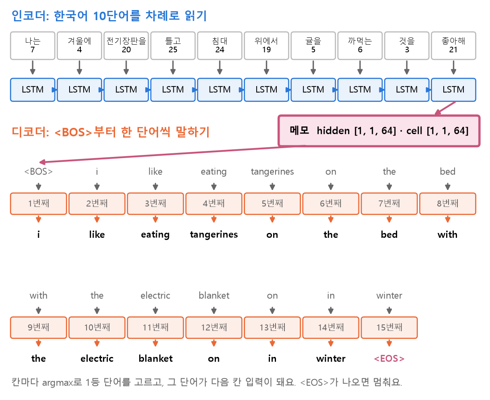
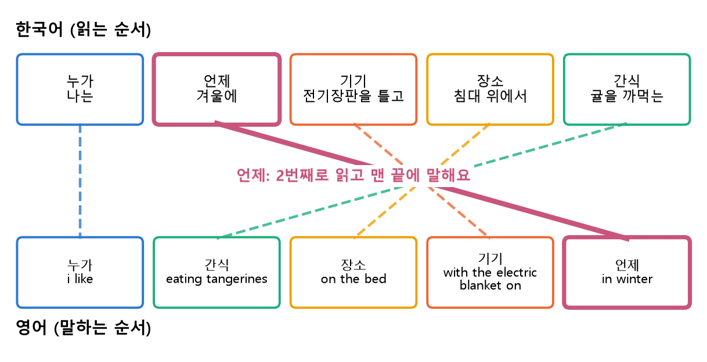
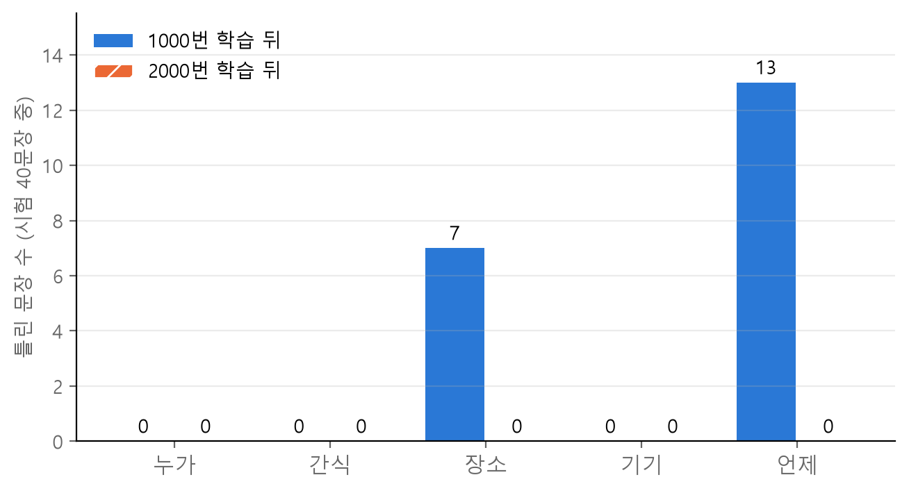

<style>
.content table { width: 100%; border-collapse: collapse; margin: 14px 0 24px; font-size: 17px; line-height: 1.5; }
.content th, .content td { border-bottom: 1px solid #e6dde0; padding: 8px 10px; text-align: left; vertical-align: top; }
.content thead { background: #fbf1f4; }
.content figure { margin: 18px 0; }
.content figure img { width: 100%; height: auto; }
.content td, .content th { word-break: keep-all; overflow-wrap: normal; }
.content .katex-display { overflow-x: auto; overflow-y: hidden; padding: 4px 0; }
.content td code { white-space: nowrap; }
.content pre .nb { padding: 0; border: 0; border-radius: 0; background: none; }
@media (max-width: 560px) { .content th, .content td { padding: 7px 5px; font-size: 16px; } }
</style>
<link rel="stylesheet" href="https://cdn.jsdelivr.net/npm/katex@0.16.11/dist/katex.min.css">
<script defer src="https://cdn.jsdelivr.net/npm/katex@0.16.11/dist/katex.min.js"></script>
<script defer src="https://cdn.jsdelivr.net/npm/katex@0.16.11/dist/contrib/auto-render.min.js" onload="renderMathInElement(document.querySelector('.content')||document.body,{delimiters:[{left:'\\[',right:'\\]',display:true},{left:'\\(',right:'\\)',display:false}]})"></script>

<div class="wc"><p><b>Seq2Seq는 왜 직접 짜 볼까요?</b><br>
Seq2Seq(sequence to sequence)는 문장을 받아 다른 문장을 내놓는 모델 구조예요. 인코더 LSTM이 입력 문장을 고정 크기 벡터로 읽고, 디코더 LSTM이 그 벡터에서 출력 문장을 만들어요(<a href="https://arxiv.org/abs/1409.3215">Sutskever 외, 2014</a>).<br>
길이와 단어 순서가 다른 문장을 내놓는 번역이 대표적인 쓰임이고, 이 구조의 한계를 풀려고 나온 것이 <a href="https://arxiv.org/abs/1409.0473">Attention</a>이에요.<br>
인코더가 디코더에 무엇을 넘기는지 손으로 짜 보면, Attention이 무엇을 고쳤는지가 바로 보여요. (2026년 11월 9일 기준)</p></div>

「나는 겨울에 전기장판을 틀고 침대 위에서 귤을 까먹는 것을 좋아해」를 영어로 옮기는 Seq2Seq 모델을 만들고, 처음 보는 문장에서 틀린 자리를 찾아 고쳐 봤어요.

**한눈에 보기:** 이 글에서 만든 모델이 귤 문장을 번역하는 모습이에요. 인코더는 한국어 10단어를 읽고 메모(hidden, cell) 하나만 디코더에 넘겨요. 디코더는 `<BOS>`부터 한 단어씩 말하고 `<EOS>`에서 멈춰요.

<figure></figure>

코드는 위에서부터 칸 하나씩 실행하면 이어지고, 결과는 칸 바로 아래 출력 상자에 있어요. `pip install torch`로 설치하거나 Google Colab에서 바로 돌릴 수 있어요. ❌ 표시가 붙은 칸은 일부러 에러를 내는 코드예요. 결과값은 torch 2.11 CPU에서 실행한 값이고, 환경에 따라 소수 값은 조금 다를 수 있어요.

<div class="keyline">한국어·영어 문장 432쌍을 만들어 번역 모델을 학습시켜 볼게요.</div>

## <span class="no">1</span> 번역할 문장을 패턴으로 만들기

문장 하나만으로는 번역을 배울 수 없어요. 모델은 여러 예문을 보며 「`귤을 까먹는`은 `eating tangerines`」처럼 조각의 짝과 그 조각이 영어 몇 번째 자리에 오는지를 배워요. 그래서 귤 문장을 다섯 자리로 나누고, 자리마다 후보를 넣어 문장을 늘려요.

| 자리 | 한국어 후보 | 영어 |
|---|---|---|
| 누가 | 나는, 너는, 우리는 | i, you, we |
| 언제 | 겨울에, 여름에, 밤에, 주말에 | in winter … |
| 기기 | 전기장판을·에어컨을·선풍기를 틀고 | with the … on |
| 장소 | 침대 위에서, 소파 위에서, 책상 앞에서 | on the bed … |
| 간식 | 귤을 까먹는, 수박·팝콘·라면을 먹는 | eating … |

```python
import itertools  # 모든 조합 만들기
import random     # 섞기
import torch      # 텐서 계산 도구
from torch import nn  # 층과 모델 도구

torch.manual_seed(0)  # 결과 재현
BOS, EOS = 1, 2       # 문장 시작·끝 번호
```

```python
who = {"나는": "i", "너는": "you",
       "우리는": "we"}
when = {"겨울에": "in winter",
        "여름에": "in summer",
        "밤에": "at night",
        "주말에": "on weekends"}
device = {
    "전기장판을 틀고":
        "with the electric blanket on",
    "에어컨을 틀고":
        "with the air conditioner on",
    "선풍기를 틀고":
        "with the electric fan on",
}
where = {"침대 위에서": "on the bed",
         "소파 위에서": "on the sofa",
         "책상 앞에서": "at the desk"}
snack = {"귤을 까먹는": "eating tangerines",
         "수박을 먹는": "eating watermelon",
         "팝콘을 먹는": "eating popcorn",
         "라면을 먹는": "eating ramen"}
```

다섯 자리 후보를 모두 조합하면 3 × 4 × 3 × 3 × 4 = 432문장이에요. 한국어는 「누가 → 언제 → 기기 → 장소 → 간식」, 영어는 「누가 → 간식 → 장소 → 기기 → 언제」 순서라 단어 순서가 거의 거꾸로예요.

```python
pairs = []
for a, b, c, d, e in itertools.product(
        who.items(), when.items(),
        device.items(), where.items(),
        snack.items()):
    # a = ("나는", "i")처럼 (한국어, 영어) 한 쌍
    kor = f"{a[0]} {b[0]} {c[0]} {d[0]} {e[0]} 것을 좋아해"
    eng = f"{a[1]} like {e[1]} {d[1]} {c[1]} {b[1]}"
    pairs.append((kor, eng))

print(len(pairs))
print(pairs[0])
```

```text
432
('나는 겨울에 전기장판을 틀고 침대 위에서 귤을 까먹는 것을 좋아해', 'i like eating tangerines on the bed with the electric blanket on in winter')
```

`pairs[0]`이 번역하고 싶은 귤 문장이에요. 이 문장은 학습에서 빼고, 다른 39문장과 함께 시험용으로 둬요. 학습에 넣으면 외운 문장을 맞히는 것이라 번역을 배웠는지 알 수 없어요.

```python
target = pairs[0]     # 번역하고 싶은 문장
rest = pairs[1:]
random.seed(0)        # 섞는 순서 고정
random.shuffle(rest)
test = [target] + rest[:39]  # 처음 볼 40문장
train = rest[39:]            # 학습할 문장
print(len(train), len(test))
print(target in train)
```

```text
392 40
False
```

## <span class="no">2</span> 단어 사전과 숫자 텐서

`nn.Embedding`은 단어 대신 번호를 받아요. 한국어와 영어 사전을 따로 만들고, 번호는 3부터 매겨요. 0·1·2는 `<PAD>`(빈칸 채우기)·`<BOS>`(문장 시작)·`<EOS>`(문장 끝) 자리로 비워 둬요. 이 글은 문장 길이가 모두 같아 `<PAD>`는 자리만 비워 두고 쓰지 않아요.

```python
def make_vocab(sentences):
    # 띄어쓰기로 자른 단어를 겹침 없이 정렬
    words = sorted({w for s in sentences
                    for w in s.split()})
    # 0·1·2는 PAD·BOS·EOS 자리
    return {w: i + 3 for i, w in enumerate(words)}

kor2idx = make_vocab([k for k, e in pairs])
eng2idx = make_vocab([e for k, e in pairs])
# 번호 → 영어 단어 (번역 결과 읽기용)
idx2eng = {i: w for w, i in eng2idx.items()}

kor_vocab_size = len(kor2idx) + 3
eng_vocab_size = len(eng2idx) + 3
print(kor_vocab_size, eng_vocab_size)
print(eng2idx)
```

```text
27 29
{'air': 3, 'at': 4, 'bed': 5, 'blanket': 6, 'conditioner': 7, 'desk': 8, 'eating': 9, 'electric': 10, 'fan': 11, 'i': 12, 'in': 13, 'like': 14, 'night': 15, 'on': 16, 'popcorn': 17, 'ramen': 18, 'sofa': 19, 'summer': 20, 'tangerines': 21, 'the': 22, 'watermelon': 23, 'we': 24, 'weekends': 25, 'winter': 26, 'with': 27, 'you': 28}
```

사전은 시험 문장까지 포함한 `pairs` 전체로 만들어요. 시험 문장의 단어가 사전에 없으면 번역할 때 번호를 찾지 못해 에러가 나요(7절). 학습 데이터 `X`, `y`는 `train`만으로 만들어요.

정답 `y`의 끝에는 `<EOS>`(2)를 붙여요. 디코더가 「여기서 문장 끝」도 한 단어처럼 배워야 번역할 때 멈출 수 있어요.

```python
def to_ids(sentence, vocab):
    return [vocab[w] for w in sentence.split()]

X = torch.tensor([to_ids(k, kor2idx)
                  for k, e in train])
y = torch.tensor([to_ids(e, eng2idx) + [EOS]
                  for k, e in train])
print(X.shape, y.shape)
print(train[0][0], X[0])
print(train[0][1], y[0])
```

```text
torch.Size([392, 10]) torch.Size([392, 15])
우리는 주말에 에어컨을 틀고 침대 위에서 귤을 까먹는 것을 좋아해 tensor([18, 22, 16, 25, 24, 19,  5,  6,  3, 21])
we like eating tangerines on the bed with the air conditioner on on weekends tensor([24, 14,  9, 21, 16, 22,  5, 27, 22,  3,  7, 16, 16, 25,  2])
```

## <span class="no">3</span> 인코더와 디코더

인코딩은 문장을 숫자 메모로 바꾸는 일, 디코딩은 그 메모를 다시 문장으로 푸는 일이에요. 인코더는 한국어 10단어를 차례로 읽고 마지막 hidden·cell만 돌려줘요. 디코더는 이 메모와 바로 앞 단어만 받아 영어를 한 단어씩 만들어요. 번역할 때 한국어 원문을 다시 보는 길은 이 메모 하나뿐이에요.

$$ (h, c) = \text{Encoder}(x_1, x_2, \dots, x_{10}) $$

$$x_t$$는 한국어 $$t$$번째 단어 번호, $$h$$·$$c$$는 LSTM의 hidden·cell(각 64칸)이에요.

```python
class Encoder(nn.Module):
    def __init__(self, vocab, emb, hid):
        super().__init__()
        self.embedding = nn.Embedding(vocab, emb)
        self.lstm = nn.LSTM(emb, hid,
                            batch_first=True)

    def forward(self, x):
        x = self.embedding(x)  # 번호 → 벡터
        # 단어별 출력은 버리고 마지막 메모만
        _, (hidden, cell) = self.lstm(x)
        return hidden, cell
```

디코더는 한 번 부를 때 한 단어만 처리해요. 앞 단어 번호와 메모를 받아, 영어 사전 29칸(단어 26개 + PAD·BOS·EOS) 각각의 점수와 고쳐 쓴 메모를 돌려줘요.

$$ \hat{y}_t = \arg\max_k \, s_{t,k} $$

$$s_{t,k}$$는 $$t$$번째 자리에서 $$k$$번 단어의 점수, $$\hat{y}_t$$는 점수가 가장 큰 단어 번호예요. `argmax`는 가장 큰 값이 있는 **자리 번호**를 돌려줘요. 점수 29개의 자리 번호가 곧 단어 번호예요.

```python
class Decoder(nn.Module):
    def __init__(self, vocab, emb, hid):
        super().__init__()
        self.embedding = nn.Embedding(vocab, emb)
        self.lstm = nn.LSTM(emb, hid,
                            batch_first=True)
        self.fc = nn.Linear(hid, vocab)

    def forward(self, x, hidden, cell):
        # [문장 수] → [문장 수, 1, 16]: 길이 1
        x = self.embedding(x).unsqueeze(1)
        out, (hidden, cell) = self.lstm(
            x, (hidden, cell))
        # [문장 수, 1, 64] → [문장 수, 29]
        pred = self.fc(out.squeeze(1))
        return pred, hidden, cell
```

모델 둘을 만들고 shape를 한 번 따라가 볼게요.

```python
encoder = Encoder(kor_vocab_size, 16, 64)
decoder = Decoder(eng_vocab_size, 16, 64)

hidden, cell = encoder(X)
print(hidden.shape, cell.shape)
start = torch.full((len(X),), BOS)
pred, hidden, cell = decoder(start, hidden, cell)
print(start.shape, pred.shape)
```

```text
torch.Size([1, 392, 64]) torch.Size([1, 392, 64])
torch.Size([392]) torch.Size([392, 29])
```

메모 `[1, 392, 64]`의 1은 LSTM 층 수(1층), 392는 문장 수, 64는 메모 칸 수예요. 디코더 출력 `[392, 29]`는 문장마다 사전 29칸의 점수예요.

## <span class="no">4</span> Teacher forcing으로 학습하기

학습은 디코더가 말하는 칸마다 정답과 비교해 채점하고, 15칸 점수를 더해 두 모델을 함께 고쳐요.

$$ L = \sum_{t=1}^{15} \text{CE}(s_t, y_t) $$

$$\text{CE}$$는 392문장의 평균 CrossEntropyLoss, $$y_t$$는 $$t$$번째 정답 단어예요. 출력에서는 칸당 평균을 보려고 15로 나눠 보여 줘요.

디코더의 다음 입력으로 정답 단어 $$y_t$$를 넣어 주는 것을 teacher forcing이라고 해요. 이 글은 칸마다 동전을 던져 절반은 정답을, 절반은 자기 예측을 넣어요(teacher forcing 비율 0.5).

$$ \text{다음 입력} = \begin{cases} y_t & \text{확률 } 0.5 \\ \hat{y}_t & \text{확률 } 0.5 \end{cases} $$

정답 $$y_t$$를 넣으면 앞 칸에서 틀려도 뒤 칸을 제대로 배울 수 있어요. 자기 예측 $$\hat{y}_t$$를 넣으면 정답이 없는 실제 번역 상황을 연습해요.

틀린 이유가 메모를 잘못 쓴 인코더에 있을 수도, 메모를 잘못 읽은 디코더에 있을 수도 있어요. 그래서 두 모델의 파라미터를 한 optimizer에 함께 넣어요.

```python
criterion = nn.CrossEntropyLoss()
params = (list(encoder.parameters())
          + list(decoder.parameters()))
optimizer = torch.optim.Adam(params, lr=0.001)

def train_model(epochs, start=0):
    for epoch in range(epochs):
        optimizer.zero_grad()
        hidden, cell = encoder(X)  # 메모 쓰기
        dec_in = torch.full((len(X),), BOS)
        loss = 0
        for t in range(y.size(1)):  # 15칸
            pred, hidden, cell = decoder(
                dec_in, hidden, cell)
            loss += criterion(pred, y[:, t])
            if torch.rand(1).item() < 0.5:
                dec_in = y[:, t]  # 정답 넣기
            else:
                dec_in = pred.argmax(dim=1)
        loss.backward()
        optimizer.step()
        n = start + epoch + 1
        if n % 200 == 0:
            print(n, round(loss.item() / 15, 4))

train_model(1000)
```

```text
200 0.6852
400 0.4948
600 0.192
800 0.1034
1000 0.0614
```

## <span class="no">5</span> 처음 보는 문장 번역하기

번역할 때는 정답이 없어서 teacher forcing 없이 항상 자기 예측을 다음 입력으로 넣어요. `<EOS>`가 나오면 멈추고, 혹시 안 나와도 20단어에서 멈추게 해요.

```python
def translate(kor):
    x = torch.tensor([to_ids(kor, kor2idx)])
    with torch.no_grad():  # 학습 안 함
        hidden, cell = encoder(x)
        dec_in = torch.tensor([BOS])
        words = []
        for _ in range(20):
            pred, hidden, cell = decoder(
                dec_in, hidden, cell)
            dec_in = pred.argmax(dim=1)
            if dec_in.item() == EOS:
                break
            words.append(idx2eng[dec_in.item()])
    return " ".join(words)

print("한국어 :", target[0])
print("정답 :", target[1])
print("예측 :", translate(target[0]))
```

```text
한국어 : 나는 겨울에 전기장판을 틀고 침대 위에서 귤을 까먹는 것을 좋아해
정답 : i like eating tangerines on the bed with the electric blanket on in winter
예측 : i like eating tangerines on the bed with the electric blanket on in winter
```

귤 문장은 맞혔어요. 시험 문장 40개를 모두 번역해, 틀린 문장이 어느 자리에서 틀렸는지 세 볼게요. 영어 단어 위치로 다섯 자리를 나누고, 「언제」가 틀린 예를 두 개 보여 줘요.

```python
slots = {"누가": [0], "간식": [2, 3],
         "장소": [4, 5, 6],
         "기기": [7, 8, 9, 10, 11],
         "언제": [12, 13]}

def check(pairs_to_test, show=2):
    right = 0
    wrong = {name: 0 for name in slots}
    for kor, eng in pairs_to_test:
        out = translate(kor).split()
        ans = eng.split()
        if out == ans:
            right += 1
            continue
        bad = []  # 이 문장에서 틀린 자리
        for name, pos in slots.items():
            a, b = pos[0], pos[-1] + 1
            if out[a:b] != ans[a:b]:
                bad.append(name)
                wrong[name] += 1
        if "언제" in bad and show > 0:
            print("한국어 :", kor)  # 예시 보기
            print("예측 :", " ".join(out))
            show -= 1
    print("맞힌 문장 :", right, "/", len(pairs_to_test))
    print("틀린 자리 :", wrong)

check(test)
```

```text
한국어 : 너는 여름에 에어컨을 틀고 침대 위에서 수박을 먹는 것을 좋아해
예측 : you like eating watermelon on the bed with the air conditioner on in winter
한국어 : 나는 여름에 선풍기를 틀고 책상 앞에서 팝콘을 먹는 것을 좋아해
예측 : i like eating popcorn at the desk with the electric fan on in winter
맞힌 문장 : 20 / 40
틀린 자리 : {'누가': 0, '간식': 0, '장소': 7, '기기': 0, '언제': 13}
```

## <span class="no">6</span> 「언제」 자리를 많이 틀린 까닭

40문장 중 20문장을 틀렸고, 가장 많이 틀린 자리는 「언제」(13문장)였어요. 틀린 13문장은 모두 in summer와 in winter를 서로 바꿔 말했고, at night와 on weekends는 한 번도 틀리지 않았어요.

「겨울에」·「여름에」는 한국어에서 2번째로 읽지만 영어에서는 맨 마지막에 말해요. 인코더가 남은 8단어를 더 읽고 디코더가 앞의 12단어를 말하는 동안, 이 정보는 64칸 메모 안에서 가장 오래 버텨야 해요.

<figure></figure>

| 자리 | 한국어에서 읽는 순서 | 영어에서 말하는 순서 |
|---|---|---|
| 누가 | 1번째 | 1번째 |
| 언제 | 2번째 | 13·14번째 (맨 끝) |
| 기기 | 3·4번째 | 8~12번째 |
| 장소 | 5·6번째 | 5~7번째 |
| 간식 | 7·8번째 | 3·4번째 |

「언제」는 읽은 뒤 말할 때까지 가장 멀리 가야 하는 자리라, 옮기는 동안 비슷한 후보인 summer와 winter가 흐려진 것으로 보여요. 다만 거리만으로 다 설명되지는 않아요. 「장소」는 「기기」보다 가까운데도 7문장을 틀렸고, 모두 sofa를 bed로 말했어요. seed 하나와 시험 40문장으로 본 결과라 원인을 확정한 분석은 아니에요.

같은 모델을 1000번 더 학습시켜 볼게요.

```python
train_model(1000, start=1000)
check(test)
```

```text
1200 0.0312
1400 0.0092
1600 0.0057
1800 0.004
2000 0.003
맞힌 문장 : 40 / 40
틀린 자리 : {'누가': 0, '간식': 0, '장소': 0, '기기': 0, '언제': 0}
```

<figure></figure>

학습을 늘리자 40문장을 모두 맞혔어요. 다만 문장이 길어질수록 고정 크기 메모 하나에 모든 정보를 담는 방식은 한계가 커져요. 원래 Seq2Seq 논문은 입력 문장을 거꾸로 넣었어요. 평균 거리는 그대로지만 앞쪽 단어끼리 가까워져 학습이 쉬워진다고 설명했어요. Attention은 디코더가 말할 때마다 인코더의 단어별 출력을 다시 들여다보게 해서, 메모 하나에만 기대는 문제를 풀었어요.

## <span class="no">7</span> 자주 하는 실수와 함수 정리

### ❌ 사전에 없는 단어 넣기

모델은 사전에 있는 단어만 번호로 바꿀 수 있어요. 「봄에」는 432문장 어디에도 없어서 번호를 찾지 못해요.

```python
# ❌ 일부러 에러: 사전에 없는 「봄에」
translate("나는 봄에 전기장판을 틀고 침대 위에서 귤을 까먹는 것을 좋아해")
```

```text
KeyError: '봄에'
```

✅ 새 단어를 쓰려면 그 단어가 들어간 문장을 데이터에 넣고, 사전을 다시 만들어 다시 학습해요.

### ❌ 설계도 칸을 실행하지 않고 모델 만들기

주피터에서 `class Decoder` 칸을 실행하지 않은 채 `decoder = Decoder(...)` 칸만 실행하면 `NameError: name 'Decoder' is not defined`가 나요. 파이썬은 칸을 실행하는 순간 이름이 생겨요. ✅ 설계도 칸을 먼저 실행해요.

### 함수 정리

| 함수 | 하는 일 |
|---|---|
| `itertools.product` | 자리별 후보의 모든 조합 |
| `nn.Embedding` | 단어 번호 → 벡터 |
| `nn.LSTM` | 단어를 차례로 읽고 hidden·cell 갱신 |
| `unsqueeze(1)` | 길이 1짜리 문장 모양으로 |
| `nn.Linear` | 64칸 → 사전 29칸 점수 |
| `argmax(dim=1)` | 점수가 가장 큰 단어 번호 |
| `torch.no_grad()` | 번역할 때 학습 계산 끄기 |

<div class="done">🎉 인코더가 메모를 쓰고, 디코더가 그 메모로 한 단어씩 말하는 Seq2Seq 번역 모델을 완성했어요.</div>
