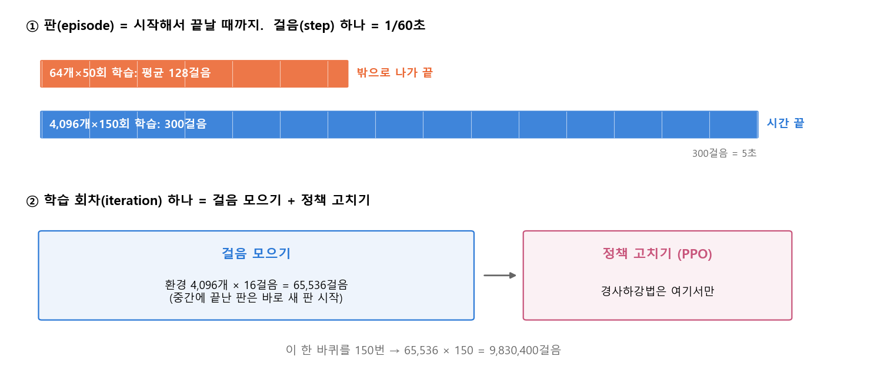
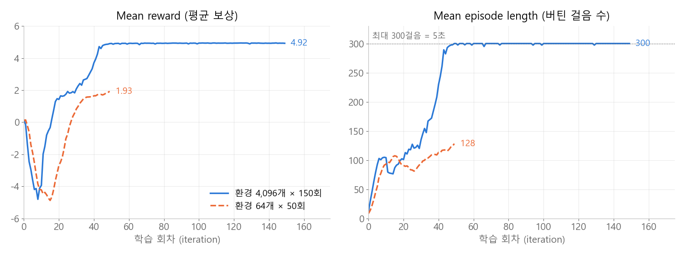

<style>
.content table { width: 100%; border-collapse: collapse; margin: 14px 0 24px; font-size: 17px; line-height: 1.5; }
.content th, .content td { border-bottom: 1px solid #e6dde0; padding: 8px 10px; text-align: left; vertical-align: top; }
.content thead { background: #fbf1f4; }
.content figure { margin: 18px 0; }
.content figure img, .content figure video { width: 100%; height: auto; }
.content td, .content th { word-break: keep-all; overflow-wrap: normal; }
.content .katex-display { overflow-x: auto; overflow-y: hidden; padding: 4px 0; }
.content td code { white-space: nowrap; }
.content pre .nb { padding: 0; border: 0; border-radius: 0; background: none; }
.content .vpair { display: grid; grid-template-columns: 1fr 1fr; gap: 10px; }
.content .vpair figcaption { font-size: 16px; text-align: center; margin-top: 4px; }
@media (max-width: 560px) { .content th, .content td { padding: 7px 5px; font-size: 16px; } .content .vpair { grid-template-columns: 1fr; } }
</style>
<link rel="stylesheet" href="https://cdn.jsdelivr.net/npm/katex@0.16.11/dist/katex.min.css">
<script defer src="https://cdn.jsdelivr.net/npm/katex@0.16.11/dist/katex.min.js"></script>
<script defer src="https://cdn.jsdelivr.net/npm/katex@0.16.11/dist/contrib/auto-render.min.js" onload="renderMathInElement(document.querySelector('.content')||document.body,{delimiters:[{left:'\\[',right:'\\]',display:true},{left:'\\(',right:'\\)',display:false}]})"></script>

<div class="wc"><p><b>Isaac Lab은 왜 배울까요?</b><br>
Isaac Lab은 NVIDIA가 만든 <a href="https://github.com/isaac-sim/IsaacLab">오픈소스 로봇 학습 프레임워크</a>로, Isaac Sim(PhysX)이나 Newton 물리 엔진 위에서 돌아가요.<br>
같은 환경을 GPU에서 수천 개 동시에 돌려 강화학습·모방학습으로 로봇 정책을 학습시키는 데 써요.<br>
Cartpole로 명령과 로그 읽는 법을 익혀 두면, 로봇팔·보행 로봇 과제도 같은 명령에서 과제 이름만 바꿔 학습할 수 있어요. (2026년 11월 10일 기준, Isaac Lab 3.0)</p></div>

Cartpole 과제로 학습 전 모습부터 학습 결과까지 따라가고, 헷갈리기 쉬운 숫자 세 가지(걸음·판·학습 회차)를 정리했어요.

명령은 Windows PowerShell에서 Isaac Lab 폴더로 이동한 뒤 한 줄씩 실행해요. 결과 숫자와 시간은 RTX 5070 Ti 노트북 GPU에서 실행한 값이에요.

**과제 찾기 → 학습 전 기준선 → 짧은 학습 → 기본 학습 → 로그 읽기**

<div class="keyline">카트를 좌우로 밀어 막대를 세우는 Cartpole을 학습시켜 볼게요.</div>

## <span class="no">1</span> Cartpole의 관찰·행동·보상

강화학습은 정답 대신 보상(reward)만 주고, 보상을 많이 받는 행동을 정책(policy)이 스스로 찾게 하는 방법이에요. Cartpole에서는 이렇게 정해져 있어요.

| 칸 | Cartpole에서 | 숫자 개수 |
|---|---|---|
| 관찰 (observation) | 카트 위치·속도, 막대 각도·각속도 | 4개 |
| 행동 (action) | 카트를 미는 힘 | 1개 |
| 보상 (reward) | 버티면 +, 막대가 기울면 −, 레일 밖으로 나가면 − | 걸음마다 1개 |
| 끝나는 조건 | 5초가 지남(`time_out`), 카트가 ±3m 밖(`cart_out_of_bounds`) | 2개 |

보상은 항목 6개에 가중치(weight)를 곱해 더해요. 학습에 크게 쓰이는 항목은 `alive`(살아 있으면 가중치 1.0), `terminating`(밖으로 나가 끝나면 가중치 −2.0), `pole_pos`(막대 각도², 가중치 −1.0)예요. 나머지는 카트 속도·막대 각속도에 주는 작은 벌점과 기록용 항목이에요.

$$R = \sum_{t=1}^{T} \sum_{i} w_i \, r_i(t) \, \Delta t$$

$$R$$은 한 판에서 받은 보상 합, $$w_i$$는 항목의 가중치, $$r_i(t)$$는 $$t$$번째 걸음에서 그 항목의 값, $$\Delta t$$는 걸음 하나의 시간(1/60초)이에요.

## <span class="no">2</span> Isaac Lab 준비와 과제 찾기

Isaac Lab에는 미리 만들어 둔 과제가 들어 있어서, 과제 이름만 알면 바로 학습시킬 수 있어요. 설치는 [공식 설치 문서](https://docs.nvidia.com/isaaclab/isaac-lab/installation)를 따르고, 설치가 끝나면 Cartpole이 목록에 있는지 확인해요.

```powershell
.\isaaclab.bat list_envs | Select-String Cartpole
```

표가 넓어서 과제 이름 칸만 남겼어요.

```text
Isaac-Cartpole-Direct
Isaac-Cartpole-Camera-Direct
Isaac-Cartpole
Isaac-Cartpole-Camera
```

이 글은 `Isaac-Cartpole`을 써요. 설정을 관찰·행동·보상 같은 부품(manager)으로 나눠 적은 버전이라 보상 항목을 찾기 쉬워요. `-Direct`는 같은 과제를 클래스 하나에 몰아 쓴 버전이고, `-Camera`는 숫자 대신 카메라 이미지를 보고 배우는 버전이에요.

Windows의 스마트 앱 컨트롤(Smart App Control)이 켜져 있으면 기본 물리 엔진(Newton)의 파일이 막힐 수 있어요. 이때는 명령 끝에 `physics=isaacsim_physx`를 붙여 Isaac Sim에 들어 있는 PhysX 엔진으로 실행해요. 이 글의 명령은 모두 이 옵션을 붙였어요.

## <span class="no">3</span> 학습 전 기준선: zero·random agent

학습시키기 전에 아무것도 배우지 않은 상태를 먼저 보면, 나중에 학습 결과와 비교할 기준선(baseline)이 생겨요. zero agent는 항상 0(안 밀기)을, random agent는 무작위 힘을 내는 가짜 정책이에요.

```powershell
.\isaaclab.bat zero_agent --task Isaac-Cartpole --num_envs 16 --max_steps 300 --visualizer kit physics=isaacsim_physx
```

```text
[INFO]: Gym observation space: Dict('policy': Box(-inf, inf, (16, 4), float32))
[INFO]: Gym action space: Box(-inf, inf, (16, 1), float32)
[INFO] Zero agent is running, press Ctrl+C to exit...
```

`(16, 4)`는 카트폴 16개가 각자 관찰 숫자 4개를 낸다는 뜻이고, `(16, 1)`은 각자 미는 힘 1개를 받는다는 뜻이에요. `--max_steps 300`이라 300걸음(시뮬레이션 시간 5초) 뒤 창이 저절로 닫혀요.

안 밀면 막대가 쓰러져 아래로 늘어진 채 흔들려요. 막대가 쓰러져도 판이 끝나지 않는 이유는 끝나는 조건이 `time_out`과 `cart_out_of_bounds` 두 개뿐이기 때문이에요. `random_agent`로 바꿔 실행하면 밀 때마다 막대가 더 세게 흔들리지만 서지는 않아요. 둘 다 신경망을 고치지 않으니 학습이 아니에요.

## <span class="no">4</span> 걸음·판·학습 회차는 서로 달라요

로그를 읽기 전에 시간 단위 세 가지를 구분해야 해요. 걸음(step)은 시뮬레이션 시간 한 칸, 판(episode)은 시작부터 끝날 때까지, 학습 회차(iteration)는 걸음을 모은 뒤 정책을 고치는 묶음이에요.

<figure></figure>

Cartpole은 물리 계산 한 번이 1/120초이고, 행동 한 번에 물리 계산을 2번 해요(decimation 2). 그래서 판 하나의 최대 걸음 수는 이렇게 나와요.

$$T_{max} = \frac{5}{\frac{1}{120} \times 2} = 300$$

5는 판 하나의 시간(초), $$\frac{1}{120} \times 2$$는 걸음 하나의 시간(1/60초)이에요.

학습 회차 하나는 환경마다 16걸음씩 모은 뒤 PPO로 정책을 고쳐요. 정책을 고치는 단계에서는 모은 데이터로 경사하강법 갱신을 20번(5 epoch × 미니배치 4개) 해요. 걸음을 모을 때는 경사하강법이 돌지 않아요. 중간에 끝난 판은 그 자리에서 새 판을 시작해 16걸음을 채우기 때문에, 총 걸음 수는 학습이 잘되든 못되든 같아요.

$$\text{총 걸음} = N_{env} \times 16 \times N_{iter}$$

$$N_{env}$$는 동시에 돌리는 환경 수, 16은 회차마다 환경 하나가 걷는 걸음, $$N_{iter}$$는 학습 회차 수예요.

## <span class="no">5</span> 64개×50회와 4,096개×150회 비교

환경 수와 회차를 줄여 짧게 학습한 뒤, 기본값으로 다시 학습해 비교해요. `--visualizer none`은 창 없이 빠르게 학습하라는 뜻이에요.

```powershell
.\isaaclab.bat train --rl_library rsl_rl --task Isaac-Cartpole --num_envs 64 --max_iterations 50 --seed 42 --run_name short --visualizer none physics=isaacsim_physx
```

```text
                       Learning iteration 49/50
                            Mean reward: 1.93
                    Mean episode length: 128.18
           Episode_Termination/time_out: 0.0156
 Episode_Termination/cart_out_of_bounds: 0.9844
Training time: 24.18 seconds
```

`--num_envs`와 `--max_iterations`를 빼면 과제의 기본값(환경 4,096개, 150회)으로 학습해요.

```powershell
.\isaaclab.bat train --rl_library rsl_rl --task Isaac-Cartpole --run_name baseline --visualizer none physics=isaacsim_physx
```

```text
                      Learning iteration 149/150
                            Mean reward: 4.92
                    Mean episode length: 300.00
           Episode_Termination/time_out: 1.0000
 Episode_Termination/cart_out_of_bounds: 0.0000
Training time: 62.01 seconds
```

<figure></figure>

| | 64개 × 50회 | 4,096개 × 150회 |
|---|---|---|
| 총 걸음 | 51,200 | 9,830,400 (192배) |
| 학습 시간 | 24초 | 62초 (약 2.6배) |
| Mean episode length | 128 | 300 |
| 밖으로 나가 끝난 비율 | 98% | 0% |

걸음은 192배인데 시간은 약 2.6배만 늘었어요. GPU가 환경 수천 개를 한 번에 계산하기 때문이에요. 같은 걸음 수를 실제 로봇 한 대로 모으려면 걸음 하나가 1/60초라 약 45시간이 걸려요.

## <span class="no">6</span> 로그 숫자 읽기와 재생

마지막 회차 블록의 네 줄로 학습 결과를 먼저 판단해요.

| 줄 | 뜻 | 좋은 방향 |
|---|---|---|
| `Mean reward` | 최근에 끝난 판 100개의 보상 합 $$R$$ 평균 | 클수록 |
| `Mean episode length` | 같은 판들의 버틴 걸음 수 평균 (최대 300) | 300에 가깝게 |
| `time_out` | 가장 최근 판이 5초 제한으로 끝난 환경의 비율 | 1에 가깝게 |
| `cart_out_of_bounds` | 가장 최근 판이 카트가 밖으로 나가 끝난 환경의 비율 | 0에 가깝게 |

Mean reward가 5 근처에서 멈추는 이유는 1번 식에 값을 넣어 보면 보여요. 300걸음을 다 버티면 `alive`만으로 300 × 1.0 × 1/60 = 5.0이에요. 막대가 잘 서 있으면 벌점 항목은 0에 가까워서, 4.92처럼 5보다 조금 작게 끝나요.

숫자를 확인했으면 `play`로 학습한 정책을 창에서 재생해 봐요. 결과 폴더 이름의 시각이 가장 늦은 학습(여기서는 방금 한 baseline)을 불러오고, 창을 닫거나 터미널에서 `Ctrl + C`를 누를 때까지 계속 재생해요.

```powershell
.\isaaclab.bat play --rl_library rsl_rl --task Isaac-Cartpole --num_envs 16 --visualizer kit physics=isaacsim_physx
```

아래는 같은 시작 상태(seed 7)에서 5초 동안 녹화한 영상이에요. 왼쪽은 학습을 시작하기 전 0회차 정책(`model_0.pt`), 오른쪽은 150회 학습한 정책(`model_149.pt`)이에요.

<div class="vpair">
<figure><video src="/assets/img/isaaclab-cartpole/before-model0.mp4" autoplay loop muted playsinline width="960" height="540" aria-label="학습 전: 0회차 정책은 막대를 세우지 못해 막대가 쓰러져요"></video><figcaption>학습 전 (0회차)</figcaption></figure>
<figure><video src="/assets/img/isaaclab-cartpole/after-play.mp4" autoplay loop muted playsinline width="960" height="540" aria-label="학습 후: 카트가 움직여 막대 16개를 모두 세우고 멈춰요"></video><figcaption>학습 후 (4,096개 × 150회)</figcaption></figure>
</div>

기울어진 채 시작한 막대 밑으로 카트가 움직여 받치고, 막대가 반대쪽으로 넘어왔다가 조금씩 덜 흔들리며 똑바로 서서 멈춰요. 마지막에 멈추는 모습에는 카트 속도와 막대 각속도에 주는 벌점도 영향을 줘요.

## <span class="no">7</span> 자주 하는 실수

**물리 엔진 옵션을 빠뜨린 경우.** 스마트 앱 컨트롤이 켜진 Windows에서 `physics=isaacsim_physx` 없이 실행하면 기본 물리 엔진(Newton)이 쓰는 MuJoCo 파일이 막혀요.

```text
ImportError: DLL load failed while importing _specs: 애플리케이션 제어 정책에서 이 파일을 차단했습니다.
ImportError: MuJoCo backend not installed.
```

```powershell
# ❌ 기본 물리 엔진
.\isaaclab.bat train --rl_library rsl_rl --task Isaac-Cartpole --visualizer none
# ✅ PhysX로 실행
.\isaaclab.bat train --rl_library rsl_rl --task Isaac-Cartpole --visualizer none physics=isaacsim_physx
```

**Warp 파일이 막힌 경우.** 같은 보안 기능 때문에 아래 에러가 나면 물리 엔진 옵션으로는 해결되지 않아요. `warp.dll`은 Isaac Lab이 어떤 엔진으로 실행하든 계산에 쓰는 Warp 라이브러리 파일이에요.

```text
OSError: [WinError 4551] 애플리케이션 제어 정책에서 이 파일을 차단했습니다
RuntimeError: Failed to load the shared library '...\warp\bin\warp.dll'
```

이 글의 환경에서는 pip로 받은 서명 없는 `warp.dll`이 막혀서, Isaac Sim에 들어 있는 같은 버전(1.17.0)의 서명된 파일로 바꾼 뒤 실행했어요.

**명령이 두 줄로 끊긴 경우.** PDF나 웹 화면에서 꺾인 줄을 그대로 복사하면 명령이 중간에서 나뉘어요.

```text
Error parsing override 'physi'
missing EQUAL at '<EOF>'
```

`physics=isaacsim_physx`가 `physi`와 `cs=isaacsim_physx`로 나뉘어 각각 실행된 거예요. 붙여 넣은 줄 앞에 `>>`가 보이면 `Ctrl + C`로 취소하고 한 줄로 다시 붙여 넣어요.

**`.\`를 빠뜨린 경우.** PowerShell은 현재 폴더의 실행 파일을 이름만으로 실행하지 않아요. `isaaclab.bat`이 아니라 `.\isaaclab.bat`으로 써요.

| 명령 | 하는 일 |
|---|---|
| `list_envs` | 등록된 과제 목록 |
| `zero_agent`, `random_agent` | 학습 없이 0·무작위 행동으로 움직이기 |
| `train` | 학습 |
| `play` | 학습한 정책 재생 |
| `--task` | 과제 이름 |
| `--num_envs` | 동시에 돌릴 환경 수 |
| `--max_iterations` | 학습 회차 수 |
| `--run_name` | 결과 폴더 이름 끝에 붙는 이름 |
| `--visualizer kit`, `none` | 창으로 보기, 창 없이 |
| `physics=isaacsim_physx` | PhysX 물리 엔진으로 실행 |

<div class="done">🎉 기준선 → 짧은 학습 → 기본 학습 → 재생, 이 순서가 Isaac Lab 강화학습의 기본 흐름이에요!</div>
