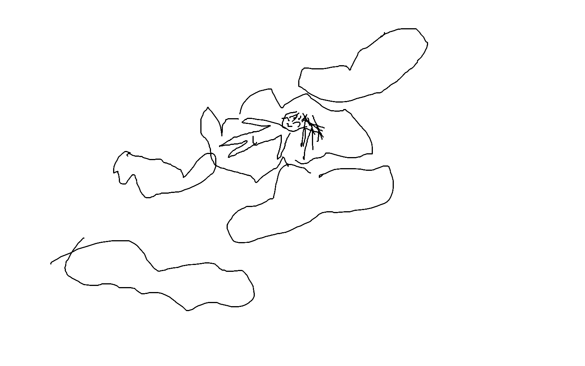
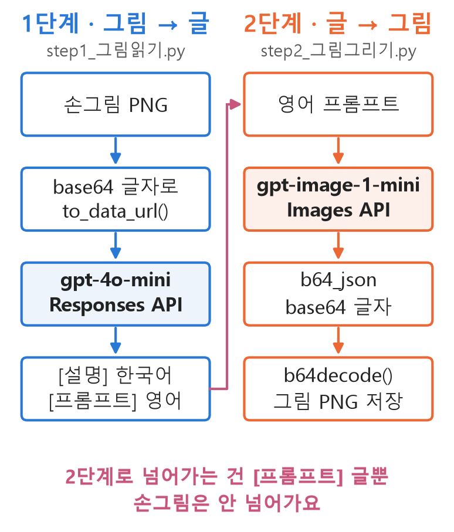

<style>
.content table { width: 100%; border-collapse: collapse; margin: 14px 0 24px; font-size: 17px; line-height: 1.5; }
.content th, .content td { border-bottom: 1px solid #e6dde0; padding: 8px 10px; text-align: left; vertical-align: top; }
.content thead { background: #fbf1f4; }
.content figure { margin: 18px 0; }
.content figure img { width: 100%; height: auto; }
.content td, .content th { word-break: keep-all; overflow-wrap: normal; }
.content td code { white-space: nowrap; }
.content pre .nb { padding: 0; border: 0; border-radius: 0; background: none; }
.content .trio { display: grid; grid-template-columns: 1.6fr 1fr 1.62fr; gap: 10px; align-items: end; margin: 18px 0; }
.content .trio figure { margin: 0; }
.content .trio img { border: 1px solid #e6dde0; }
.content .trio figcaption { font-size: 16px; text-align: center; margin-top: 4px; }
.content figure.pipe img { max-width: 480px; display: block; margin: 0 auto; }
.content div.language-text pre, .content div.language-text code { white-space: pre-wrap; overflow-wrap: anywhere; }
@media (max-width: 560px) {
  .content th, .content td { padding: 7px 5px; font-size: 16px; }
  .content .trio { grid-template-columns: 1fr; }
}
</style>

<div class="wc"><p><b>멀티모달 API는 왜 두 개를 이어 쓸까요?</b><br>
멀티모달(multimodal)은 글·그림·소리처럼 여러 종류의 데이터를 함께 다루는 AI예요.<br>
이 글에서는 그림을 보고 글로 답하는 데 OpenAI <a href="https://developers.openai.com/api/docs/guides/images-vision">Responses API</a>를, 그림을 새로 만드는 데 <a href="https://developers.openai.com/api/reference/resources/images/methods/generate">Images API</a>를 썼어요.<br>
두 API를 어떻게 잇는지 알면, 그림을 받아 그림을 돌려주는 앱의 뼈대를 직접 짤 수 있어요. (2026년 11월 11일 기준)</p></div>

그림판 낙서 한 장을 그림으로 바꾸는 코드를 두 단계로 짜고, 프롬프트를 세 가지로 바꿔 가며 결과를 비교했어요. 마지막에는 같은 낙서를 GPT-6.1 Sol에 그대로 줘서 차이를 봤어요.

<div class="trio">
<figure><figcaption>① 그림판 낙서 「구름침대」</figcaption></figure>
<figure><figcaption>② 실습 코드 결과</figcaption></figure>
<figure><figcaption>③ GPT-6.1 Sol (낙서 첨부)</figcaption></figure>
</div>

<div class="keyline">낙서 한 장 → 응급환자 → 3D 드림코어, 어디서 달라졌는지 코드부터 볼게요.</div>

## <span class="no">1</span> 코드 구성: 그림 → 글 → 그림

1단계는 낙서를 보고 글을 쓰고, 2단계는 그 글만 보고 그림을 그려요. 실습 때는 그림처럼 파일 두 개로 나눴고, 이 글에서는 한 흐름으로 이어 붙였어요.

<figure class="pipe"></figure>

코드는 위에서부터 칸 하나씩 이어 붙이면 돌아가요. `pip install openai python-dotenv`로 설치하고, 같은 폴더의 `.env`에 `OPENAI_API_KEY=sk-...`를 넣어요. API 요금이 드는 코드라 이 글에서 다시 실행하지는 않았어요. 출력 상자는 실습 때 조건마다 한 번씩 실행해 실제로 나온 결과예요.

## <span class="no">2</span> 1단계: 낙서를 글로 읽기

내 컴퓨터의 그림 파일을 바로 보내려면 **base64 글자**로 바꿔요. base64는 0과 1로 된 파일을 영문자·숫자로 옮겨 적는 방식이에요.

```py
import base64  # 파일 ↔ 글자 변환
from pathlib import Path
from dotenv import load_dotenv
from openai import OpenAI

load_dotenv()  # .env의 키 읽기
client = OpenAI()  # OpenAI 연결


def to_data_url(path):
    # 파일을 바이트 그대로 읽기
    data = Path(path).read_bytes()
    # 바이트 → base64 글자
    b64 = base64.b64encode(data).decode()
    return f"data:image/png;base64,{b64}"
```

다음은 모델에게 주는 규칙이에요. 바꿔 볼 곳을 두 칸으로 나눴어요. `STYLE`은 **어떻게** 그릴지, 규칙 본문은 모델이 할 일과 답의 모양이에요.

```py
# 바꿔 볼 곳: 그리는 방식
STYLE = "인상주의 유화 (모네 느낌)"


def make_rules(style):
    return f"""
너는 손그림을 읽어 화가에게 의뢰서를
써 주는 미술 큐레이터다.
1. 그림에 있는 것(사물·위치·개수)을
   한국어로 설명한다.
2. 그 내용으로 이미지 생성 모델에게 줄
   영어 프롬프트를 쓴다.
   - 그림 속 배치를 유지한다.
   - 스타일: {style}
반드시 아래 모양으로만 답한다.
[설명] (한국어)
[프롬프트] (영어)
"""
```

규칙을 함수로 만든 이유가 있어요. f-string은 만드는 순간의 `STYLE`로 굳어서, 규칙을 변수에 한 번만 담아 두면 나중에 `STYLE`을 바꿔도 반영되지 않아요.

이제 Responses API에 보내요. 핵심은 `content` 배열 하나에 **글(`input_text`)과 그림(`input_image`)을 함께** 넣는 거예요.

```py
def read_sketch(path, hint, style):
    res = client.responses.create(
        model="gpt-4o-mini",
        instructions=make_rules(style),
        input=[{
            "role": "user",
            "content": [
                # 바꿔 볼 곳: 무엇을 그렸는지
                {"type": "input_text",
                 "text": hint},
                {"type": "input_image",
                 "image_url": to_data_url(path)},
            ],
        }],
    )
    text = res.output_text  # 답 전체
    # [프롬프트] 앞뒤로 나누기
    desc, prompt = text.split("[프롬프트]", 1)
    desc = desc.replace("[설명]", "").strip()
    return desc, prompt.strip()


desc, prompt = read_sketch(
    "구름침대.png",
    "이 손그림을 읽고 의뢰서를 써 줘.",
    STYLE)
print(desc)
print(prompt)
```

```text
그림 중앙에는 사람 형상이 그려져 있으며, 보통의 사람보다 큰 머리와 두 개의 팔을 가지고 있습니다. 그 주위에는 넓게 펼쳐진 물결 같은 형태의 두 개의 구름이나 잎사귀 같은 것이 위치하고 있습니다. 인물은 편안하게 누워 있는 듯 보이며, 얼굴에 미소를 띄고 있습니다.
A peaceful figure lying down in the center of the canvas with a large head and two outstretched arms, surrounded by two wide, wave-like clouds or leaves. The figure has a smiling face, evoking a sense of tranquility. Style: Impressionist oil painting, reminiscent of Monet, with soft brush strokes. No text, signatures, or frames.
```

사람과 미소는 읽었지만 구름 침대는 「구름이나 잎사귀」로 얼버무렸어요.

## <span class="no">3</span> 제목 한 줄을 넣으면

같은 낙서에 `hint`만 바꿨어요. 그림 제목을 알려 준 거예요.

```py
# ❌ 단서 없음
hint = "이 손그림을 읽고 의뢰서를 써 줘."
# ✅ 제목을 알려 줌
hint = ("이 손그림의 제목은 '구름침대'야. "
        "제목을 참고해서 손그림을 읽고 "
        "의뢰서를 써 줘.")

desc, prompt = read_sketch(
    "구름침대.png", hint, STYLE)
print(desc)
print(prompt)
```

```text
그림의 중앙에는 구름 위에 편안하게 누워 있는 한 아이의 모습이 그려져 있습니다. 아이는 머리를 바닥에 기대고 있으며, 웃고 있는 얼굴을 하고 있습니다. 아이의 팔은 양옆으로 펴져 있고, 몇 개의 나뭇가지나 머리카락처럼 보이는 선이 그려져 있습니다. 아이를 둘러싼 구름은 부드럽고 둥근 형태로, 각각의 구름은 흐릿하게 연결되어 있습니다. 전체적으로 따뜻하고 평화로운 느낌을 줍니다.
The scene depicts a soft, dreamy bed made of clouds. In the center, a child is comfortably lying on the clouds with a smiling face. The child has arms stretched out to the sides, and there are wispy lines suggesting hair. Surrounding the child are fluffy, rounded clouds, softly blending into one another. The overall atmosphere is warm and peaceful, in an Impressionist oil painting style reminiscent of Monet, with gentle brush strokes.
```

「구름이나 잎사귀」가 `a soft, dreamy bed made of clouds`로 바뀌었어요. 그림은 그대로이고 바뀐 건 문장 한 줄이에요.

## <span class="no">4</span> 2단계: 글을 그림으로 그리기

Images API는 그림 파일 대신 **base64 글자**(`b64_json`)를 돌려줘요. 1단계와 반대로 글자를 바이트로 되돌려 저장해요.

```py
def draw(prompt, out_path):
    res = client.images.generate(
        model="gpt-image-1-mini",
        prompt=prompt,
        size="1024x1024",
        quality="low",  # 가장 싼 화질
    )
    b64 = res.data[0].b64_json  # 그림 글자
    # 글자 → 바이트 → 파일
    Path(out_path).write_bytes(
        base64.b64decode(b64))
```

색을 입히려고 `STYLE`을 드림코어로 바꾸고, `hint`에 머리카락 단서를 더했어요. 내용(머리카락)은 `hint`에, 방식(색감)은 `STYLE`에 넣었어요.

```py
STYLE = ("몽환적인 드림코어 일러스트. "
         "분홍·노랑 파스텔 노을 하늘, "
         "솜사탕처럼 폭신하고 글리터가 "
         "반짝이는 구름")
hint = ("이 손그림의 제목은 '구름침대'야. "
        "누워 있는 사람 머리 옆의 가는 "
        "선들은 머리카락이야. 제목을 "
        "참고해서 의뢰서를 써 줘.")

desc, prompt = read_sketch(
    "구름침대.png", hint, STYLE)
print(prompt)
draw(prompt, "결과.png")
```

```text
A dreamcore illustration of a person lying on a fluffy cloud bed. The person has thin lines next to their head representing hair. The clouds are rounded and puffy, creating a serene atmosphere. The sky features a pastel sunset with pink and yellow hues, and soft, cotton candy-like clouds sparkle with glitter, radiating a gentle glow. No text or signatures present.
```

결과가 맨 위 ② 그림이에요. 하늘과 구름 색은 원한 대로 나왔어요. 그런데 사람이 색 없는 선화로, 차렷 자세로 누워 있어서 응급환자처럼 보여요.

원인으로 의심되는 건 프롬프트 속 `thin lines next to their head representing hair`예요. 1단계가 낙서의 「가는 선」을 그대로 옮겨 적었고, 2단계 모델이 받는 건 이 영어 글뿐이에요. 이 문구를 빼고 다시 그려 확인하지는 않았어요. 자세를 정하는 말이 없었던 것과 `quality="low"`도 함께 영향을 줬을 수 있어요.

## <span class="no">5</span> 같은 낙서를 GPT-6.1 Sol에 주면

같은 낙서를 첨부하고, 3D 렌더·클레이 질감·잠든 자세·「환자처럼 보이지 않게」를 적어 Codex의 GPT-6.1 Sol에 부탁했어요. 결과가 맨 위 ③ 그림이에요. 구름 다섯 덩이의 자리가 낙서와 거의 같아요.

| 다른 점 | ② 실습 코드 | ③ GPT-6.1 Sol |
|---|---|---|
| 그림 그리는 쪽이 받은 것 | 영어 프롬프트 글 | 영어 설명 + 원본 낙서 (Sol 설명) |
| 그림 모델 · 화질 | gpt-image-1-mini · low | 별도 이미지 생성 도구 |
| 캔버스 | 1024×1024 정사각형 | 가로로 긴 그림 |
| 프롬프트 | 드림코어 일러스트 | 3D 렌더 · 자세 · 하지 말 것 |

GPT-6.1 Sol 쪽 과정은 Sol이 직접 밝힌 설명이고, 도구 기록으로 확인하지는 않았어요. gpt-4o-mini로 낙서를 읽게 하고, 그림은 별도 이미지 생성 도구가 만들었고, 그 도구에 원본 낙서 파일도 함께 넘겼다고 해요. 네 가지가 한꺼번에 달라서 어느 것이 얼마나 효과가 있었는지는 이 비교만으로 나눌 수 없어요.

## <span class="no">6</span> 실습에서 얻은 세 가지

### ① 못 알아본 건 맥락이 부족해서

같은 낙서에 제목 한 줄을 넣자 「구름이나 잎사귀」가 「구름 위에 누운 아이」로 바뀌었어요(조건마다 한 번씩 실행한 결과). 사람도 제목 없는 낙서는 헷갈려요. 프롬프트 엔지니어링은 맥락을 건네주는 일이에요.

### ② 넣는 자리를 나누면 고치기 쉬워요

무엇을 그렸는지(구름침대, 머리카락)는 `hint`에, 어떻게 그릴지(드림코어, 분홍 노을, 글리터)는 `STYLE`에 넣었어요. 결과가 이상할 때 어느 칸을 고칠지 바로 보여요.

### ③ 무엇을 넘겨주느냐가 먼저일 수 있어요

②는 1단계가 쓴 프롬프트에 구름 위치가 담기지 않았고, 2단계는 그 글만 받았어요. ③은 Sol 설명대로라면 원본 낙서를 그림 도구에 함께 넘겼어요. 모델·화질·캔버스·프롬프트도 달라서 단정할 수는 없지만, 배치가 낙서와 같아진 건 원본 그림을 넘긴 덕분일 가능성이 커요. Images API에도 원본 그림을 함께 넘기는 [edit 기능](https://developers.openai.com/api/reference/python/resources/images/methods/edit)이 있어서, 같은 모델로 이 차이만 따로 비교해 볼 수 있어요.

## <span class="no">7</span> 함수 정리

| 함수 · 값 | 하는 일 |
|---|---|
| `base64.b64encode()` | 그림 파일(바이트) → 글자, 모델에 보낼 때 |
| `client.responses.create()` | 규칙 + 글·그림 → 글 답 (gpt-4o-mini) |
| `res.output_text` | 모델이 쓴 답 전체 |
| `client.images.generate()` | 프롬프트 → 그림 (gpt-image-1-mini) |
| `res.data[0].b64_json` | 그림이 담긴 base64 글자 |
| `base64.b64decode()` | 글자 → 바이트, 파일로 저장할 때 |

gpt-4o-mini와 gpt-image-1-mini는 OpenAI 모델 페이지에 지원 종료 예정(Deprecated)으로 표시돼 있어요. 실습한 2026년 11월 11일에는 둘 다 호출이 됐어요.

<div class="done">🎉 그림을 글로, 글을 그림으로 잇는 두 단계 코드를 완성했어요!</div>
