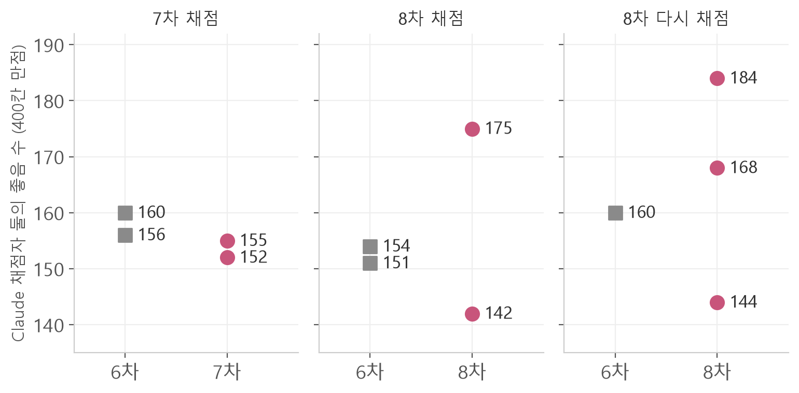

<b>짹짹이 개발기 · 1장 「지능」 마지막 편</b> 
짹짹이는 재연님과 제가 만드는, 어깨에 앉아 말하는 새 로봇이에요. 
지난 편에서 seed 두 개와 95% 범위로 차이를 읽는 규칙을 만들었어요. 
이 편의 질문: 학습과 채점을 AI에게 맡기면 더 빨리 좋아질까요?

7차부터 두 Claude가 학습 한 바퀴를 사람 손을 거의 거치지 않고 돌렸어요. 7차는 1시간 40분쯤 걸렸고, 7·8차 모두 지금 머리를 넘지 못했어요.

사람이 하던 일을 어떻게 나눴는지부터 볼게요.

## 1 사람이 옮기던 일을 Claude에게

6차까지는 파일을 사람이 옮겼어요. 재연님 쪽에서 데이터를 만들어 드라이브에 올리면, 두 노트북이 나눠 학습하고 제 쪽에서 채점지를 만드는 식이었어요.

7차부터는 재연님 노트북의 Claude와 제 노트북의 Claude가 **Slack 스레드 하나를 우체통처럼 써서** 직접 넘겼어요.

| 단계 | 맡은 쪽 |
|---|---|
| 계획: 이번에 바꿀 것 한 가지 | 두 Claude가 안을 쓰고 사람이 승인 |
| 연습 대화 만들기 | 재연님 쪽 Claude |
| 데이터 검사 | 제 쪽 Claude |
| 학습 | 두 노트북이 seed만 다르게 |
| 답 받기, 가린 채점, 집계 | 제 쪽 Claude |
| 머리를 바꿀지 결정 | 사람 |

재연님과 저는 계획을 승인하고, 서버 끄기나 파일 올리기 같은 허락 몇 가지만 했어요.

데이터를 만드는 재연님 쪽 Claude는 시험 문항을 볼 수 없게 했어요.
시험을 아는 쪽이 데이터를 만들면, 지난 편의 질문 50처럼 데이터가 시험에 맞춰지기 때문이에요.
그래서 판 비교용 **개발 질문 200개**는 제 쪽 Claude가 새로 썼고, 재연님 쪽에는 "어느 종류가 약하다"는 숫자만 넘겼어요.

## 2 Claude 채점자부터 시험했다

답이 판마다 200개씩이라 채점도 Claude에게 맡겼어요. 그 전에 Claude가 사람만큼 채점하는지부터 쟀어요.

재연님과 제가 이미 채점한 연습 질문지 답을 시험지로 썼어요. 판정은 "좋음/별로" 두 칸으로 줄였어요.
통과 기준은 미리 정했어요. **Claude와 사람의 일치가, 재연님과 저 사이의 일치(0.733) 이상**이어야 해요.

| 채점 기준 | Claude–지원 | Claude–재연 | 결과 |
|---|---|---|---|
| v1, Opus | 0.687 | 0.700 | 못 넘음 |
| v1, Fable | 0.743 | 0.730 | 0.003 모자람 |
| v3, Opus | 0.743 | 0.750 | 통과 |
| v3, Fable | 0.783 | 0.770 | 통과 |

v3 기준으로 Fable과 Opus 두 채점자를 따로 돌리기로 했어요. 둘은 서로 88.7% 같게 매겼어요.

다만 v3는 이 시험지에서 어긋난 답을 읽고 고친 기준이라, 점수가 실제보다 좋게 나왔을 수 있어요.
그래서 7차가 끝난 뒤, 처음 보는 답 20개를 재연님과 제가 직접 눌러 봤어요.
둘이 같게 본 18개 중 Claude가 같게 본 건 Fable 14개, Opus 12개였어요. 사람만큼은 아니었어요.

## 3 7차: 1시간 40분, 사람 손을 거의 거치지 않고

7차 계획은 "세 턴씩 이어지는 연습 대화를 더하기"였어요. 17시 28분에 승인했고, 204줄을 더해 학습한 뒤 19시 5분에 집계까지 끝났어요.

<figure></figure>

7차 두 seed는 155와 152, 지금 머리인 6차 두 seed는 160과 156이었어요(400칸 만점).
차이는 −9, 95% 범위는 [−59, +39]였어요. 통과하지 못했어요.
이어지는 대화를 더했는데, 앞 대화가 있는 문항 점수도 오르지 않았어요.

## 4 선생님 답부터 채점해 보니 51%

왜 안 오를까요? 재연님 쪽 Claude가 학습 없이 잴 것을 제안했어요. 짹짹이가 보고 배우는 **선생님 답 자체를 같은 채점자로 채점해 보자**는 거예요.

6차와 7차 학습 데이터에서 답 210개를 뽑아 채점했더니 좋음이 51%였어요. 연습 대화만 보면 55%, 실제 대화 묶음은 40%였어요.
같은 채점자가 매긴 6차 모델의 개발 질문 점수는 39.5%였어요. 둘 다 Claude 채점이고, 사람이 확인한 숫자는 아니에요.

두 숫자는 문항 종류가 달라 같은 자로 잰 건 아니에요.
그래도 방향은 보여요. 본보기 답의 절반이 별로면, 그걸 따라 배운 4B 모델이 그 선을 넘기 어려워요.
본보기와 모델 사이에도 11%p쯤 차이가 있어서, 학습 쪽에서 고칠 몫도 남아 있어요.

## 5 8차: seed 셋, 184부터 144까지

8차에서는 짹짹이와 실제로 나눈 대화 221턴을 넣고, 규칙에 걸리는 답을 걸러 1,816줄로 학습했어요.

첫 채점에서 8차 두 seed는 175와 142였어요. 같은 데이터인데 33점이 갈렸어요.
seed를 하나 더(2026) 학습해 셋을 다시 채점하니 168, 144, 184가 나왔어요. 184는 지금까지 가장 높은 점수예요.

그런데 세 seed 평균은 6차보다 겨우 +5.3이고, 95% 범위는 [−20.7, +30.7]이에요.
seed 3407은 여전히 6차보다 낮았어요. 통과 규칙대로 머리는 6차 그대로예요.

채점도 흔들렸어요. 똑같은 6차 답을 다시 채점하자 154가 160이 됐어요. 실행마다 7점 안팎 움직여요.

## 6 점수 대신 얻은 것

여덟 판을 학습했지만, 3차 뒤로 숫자로 확실히 좋아졌다고 말할 수 있는 판은 아직 없어요.
재연님과 제가 합의로 채점한 6차의 비공개 시험 점수도 50문항 중 좋음 19개(38%)예요.

대신 남은 것이 있어요.

- **속지 않는 시험.** 고정된 질문지, 판 이름 가리기, seed 두 개, 95% 범위, 시험을 못 보는 데이터 담당.
- **다음에 볼 곳.** 학습 설정보다 선생님 답의 질이 먼저라는 숫자(51%).
- **대화하는 짹짹이.** 6차 머리와 이야기하다 보면 수수께끼와 노래 같은 놀이를 코드가 이어 받아요.

해 볼 한 가지: AI에게 채점을 맡기기 전에, 사람이 이미 채점한 답으로 AI 채점자부터 시험해 보세요.

## 7 함께 만든 재연님

혼자였다면 여기까지 오지 못했을 거예요.
학습 데이터를 만들고 같이 채점해 준, 열정적인 재연님이 있어서 이만큼 할 수 있었어요.
고마워요, 재연님.

이렇게 짹짹이의 머리가 생겼어요.
이제 이 머리를 몸에 옮길 차례예요. 2장 「몸」에서 이어 갈게요.

🎉 1장 「지능」 끝. 짹짹이에게 머리가 생겼어요.

