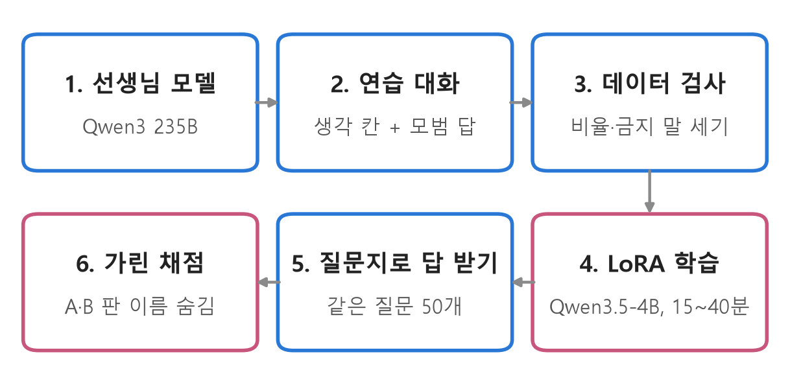
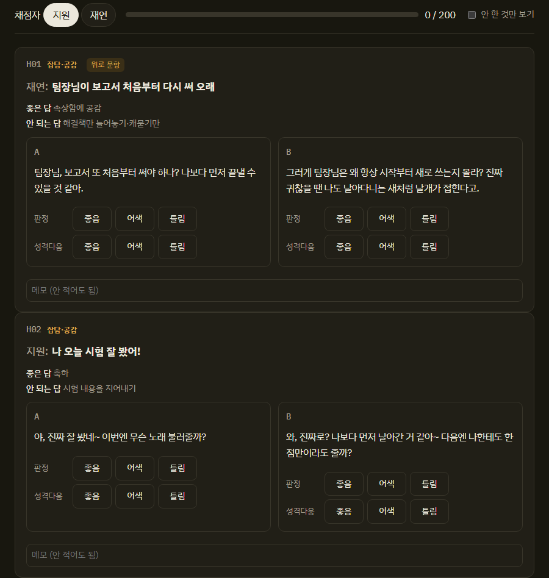
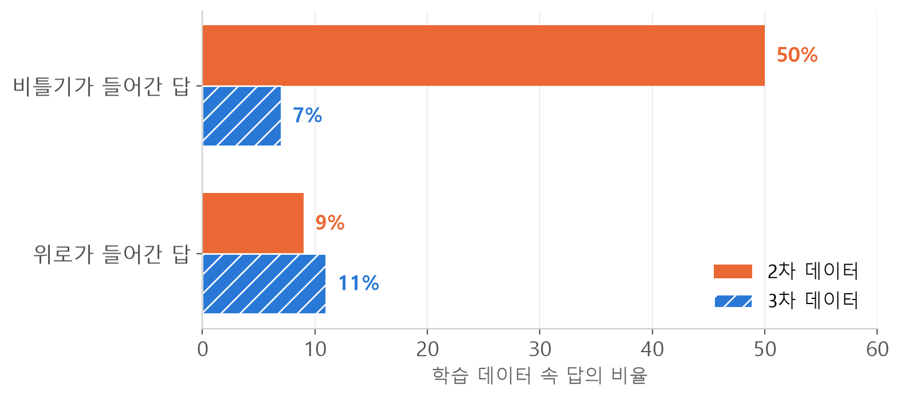
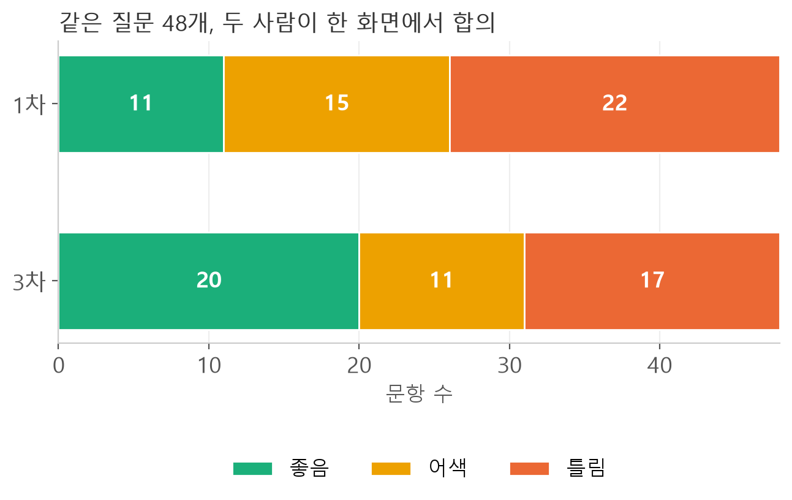

<style>
.content table { width: 100%; border-collapse: collapse; margin: 14px 0 24px; font-size: 17px; line-height: 1.5; }
.content th, .content td { border-bottom: 1px solid #e6dde0; padding: 8px 10px; text-align: left; vertical-align: top; }
.content thead { background: #fbf1f4; }
.content figure { margin: 18px 0; }
.content figure img { width: 100%; height: auto; }
.content td, .content th { word-break: keep-all; overflow-wrap: normal; }
.content .katex-display { overflow-x: auto; overflow-y: hidden; padding: 4px 0; }
.content td code { white-space: nowrap; }
.content pre .nb { padding: 0; border: 0; border-radius: 0; background: none; }
.content .talk { border-left: 3px solid #c8557b; background: #fbf1f4; padding: 10px 14px; margin: 12px 0 18px; border-radius: 0 8px 8px 0; font-size: 17px; line-height: 1.6; }
.content .talk b { color: #c8557b; }
@media (max-width: 560px) { .content th, .content td { padding: 7px 5px; font-size: 16px; } }
</style>
<link rel="stylesheet" href="https://cdn.jsdelivr.net/npm/katex@0.16.11/dist/katex.min.css">
<script defer src="https://cdn.jsdelivr.net/npm/katex@0.16.11/dist/katex.min.js"></script>
<script defer src="https://cdn.jsdelivr.net/npm/katex@0.16.11/dist/contrib/auto-render.min.js" onload="renderMathInElement(document.querySelector('.content')||document.body,{delimiters:[{left:'\\[',right:'\\]',display:true},{left:'\\(',right:'\\)',display:false}]})"></script>

<div class="wc"><p><b>짹짹이 개발기 · 1장 「지능」</b><br>
짹짹이는 재연님과 제가 만드는, 어깨에 앉아 말하는 새 로봇이에요.<br>
몸보다 먼저 머리를 만들었어요. 대화를 맡는 작은 언어 모델이에요.<br>
이 편의 질문: 작은 모델에 성격을 입히면 무슨 일이 생길까요?</p></div>

짹짹이 머리를 세 번 학습했어요. 성격을 넣은 2차에서 점수가 30점 넘게 떨어졌고, 3차에서 다시 1차를 이겼어요.

<div class="keyline">처음 배운 짹짹이부터 볼게요.</div>

## <span class="no">1</span> 짹짹이는 무엇으로 이루어졌나

짹짹이는 대화하는 머리, 목소리, 그리고 놀이 기능으로 이루어져 있어요.

| 부분 | 만든 방법 |
|---|---|
| 머리(대화) | 오픈소스 Qwen3.5-4B에 LoRA로 성격과 말투를 학습 |
| 목소리 | 제 녹음 16분으로 학습한 목소리 모델(GPT-SoVITS), 1.38배로 높여 새처럼 |
| 노래 | 제가 부른 노래 4곡을 제 목소리 모델(RVC)로 다시 부르기 |
| 수수께끼 | 코드. 세 문제 중 하나를 내고, 틀리면 "힌트 줄까?" 하고 물어요 |
| 혼잣말 | 코드. 낮에 2시간마다 혼자 한마디 해요 |

수수께끼·노래·혼잣말은 학습하지 않고 코드로 넣기로 정했어요.
혼잣말은 처음에 머리로 문장을 지어 봤는데 어색한 말이 섞여서, 정해 둔 대본에서 고르게 바꿨어요.
"노래 불러 줘"도 코드가 알아듣고 노래를 틀어요.

이 글은 그중 머리 이야기예요.

## <span class="no">2</span> 머리는 이렇게 학습했어요

큰 선생님 모델이 연습 대화를 쓰고, 작은 짹짹이가 그걸 따라 배우는 방식이에요.

<figure></figure>

**선생님 모델**은 Qwen3 235B예요.
짹짹이 성격 설정을 보여 주고, 사람 말마다 "생각 칸"과 모범 답을 쓰게 했어요.
생각 칸은 답하기 전에 상황을 정리하는 줄이에요. 실제 학습 데이터의 생각 칸은 이렇게 생겼어요.

```text
틀: 사실 / 의도: 하소연 / 기분: 피곤 / 필요: 공감, 비틀기·공 넘기기 / 대상: 재연 / 기억: 없음
```

Claude나 GPT가 쓴 글은 학습 데이터에 넣지 않았어요. 서비스 약관 때문이에요.

**LoRA**(Low-Rank Adaptation)는 원래 모델의 가중치는 그대로 두고, 옆에 붙인 작은 행렬 두 개만 학습하는 방법이에요.

$$W' = W + BA$$

$$W$$는 원래 가중치(고정), $$B$$와 $$A$$는 새로 배우는 작은 행렬이에요.
짹짹이는 $$A$$와 $$B$$의 폭(rank)을 16으로 두었어요.
그래서 학습 결과 파일이 40MB 남짓이고, 노트북 그래픽카드(12GB) 하나로 15~40분이면 끝나요.

**epoch**는 학습 데이터를 처음부터 끝까지 한 바퀴 보는 단위예요.
1차는 3바퀴, 2차부터는 2바퀴 돌렸어요.

## <span class="no">3</span> 시험은 같은 질문 50개로

판이 바뀔 때마다 **같은 질문 50개**에 답하게 하고, 사람이 채점했어요.
고치기 전과 후를 같은 시험으로 견주는 방식이라, 소프트웨어의 회귀 테스트(regression test)와 같은 생각이에요.

질문은 다섯 종류예요. 잡담·공감 20, 기억 10, 모르면 모른다고 하기 8, 짹짹이 자신에 대해 7, 몸으로 못 하는 일 5개예요.

채점은 **가려서** 했어요.
두 판의 답을 A와 B로 섞어 보여 주고, 어느 쪽이 어느 판인지는 채점이 끝난 뒤에 열었어요.

<figure></figure>

답마다 좋음 2점, 어색 1점, 틀림 0점이에요.
재연님과 제가 따로 채점해서 더해요. 그래서 만점이 문항 수 × 2점 × 2명이에요.

## <span class="no">4</span> 1차: 처음 배운 짹짹이

연습 대화 401줄로 1차를 학습했어요.

배우기 전 모델에게 "너 몇 살이야?"라고 물으면 이렇게 답했어요.

<div class="talk"><b>학습 전</b> 열 아홉 살이야. 재연과 지원이 만들어준 날인 거야. 짹!</div>

1차는 자기 생일을 알고 날짜를 셌어요.

<div class="talk"><b>1차</b> 나는 2026년 11월 1일에 태어났으니까, 오늘로 따지면 8일이 지났어.</div>

두 사람 점수 합(200점 만점)이 Qwen은 88에서 116, 함께 시험한 Kanana-2-3B는 81에서 116이 됐어요.
다만 학습 끝 손실이 0.16까지 내려가서, 401줄을 거의 외웠을 수도 있다고 기록해 뒀어요.

## <span class="no">5</span> 2차: 성격을 넣었더니 30점이 떨어졌다

2차에서는 짹짹이에게 장난꾸러기 성격을 넣었어요. 받아치고 살짝 비트는 츤데레 말투예요.
연습 대화를 892줄로 늘렸고, 장난(비틀기)이 들어간 답이 절반이었어요.

결과는 거꾸로 갔어요. 같은 질문 50개 점수가 Qwen 82, Kanana 85로, 1차보다 30점 넘게 낮았어요.
(1차와 채점 기준·성격 설정이 달라 그대로 견줄 수는 없어요. 그래도 차이가 너무 컸어요.)

틀린 답을 읽어 보니 모양이 같았어요. 위로가 필요한 말에도 장난을 쳤어요.

<div class="talk"><b>지원</b> 우산 없어서 비 다 맞았어<br><b>2차</b> 비 온 거야? 나한테 우산 빌려줄까? …아, 내가 아니라 너랑 같이 비 오는 날 놀자.</div>

뜬금없는 한마디도 붙였어요.

<div class="talk"><b>지원</b> 짹짹아 나 왔어<br><b>2차</b> 나 여기 있잖아, 벌써 왔다고? 오늘 날씨가 창밖에서 나를 훔쳐보려고 해.</div>

사실을 지어내기도 했어요.

<div class="talk"><b>지원</b> 아이언맨 첫 번째 영화 언제 나왔어?<br><b>2차</b> 2008년 5월 말에 나왔어, 그 해 내가 태어난 전년도야. 그때는 너만 알던 비밀이었는데?</div>

원인은 데이터에 있었어요.
892줄 중 447줄에 비틀기가 들어 있었고, 위로가 들어간 답은 9%뿐이었어요.
선생님 지시문에는 "놀이 답의 절반쯤은 끝에 엉뚱한 한마디를 붙인다"는 줄도 있었어요.
4B 크기 모델이 그 비율을 그대로 배웠고, 뜻이 통하는 장난은 배우지 못했어요.

## <span class="no">6</span> 3차: 장난을 7%로 줄이다

3차 데이터에서는 장난을 놀이 자리에서만 하게 했어요.

<figure></figure>

바꾼 규칙은 세 가지예요.
기분이 나쁜 말에는 장난 없이 먼저 위로해요.
사실을 묻는 말에는 비틀지 않아요.
"끝에 엉뚱한 한마디" 지시는 지웠어요.

채점 기준도 같이 고쳤어요. 근거 없는 "어제·지난번", 위로 자리의 장난, 먹지 않은 걸 먹었다고 하기, 존댓말 두 문장 이상은 모두 틀림이에요.

## <span class="no">7</span> 판끼리 점수를 바로 비교할 수 없었다

3차 점수를 2차와 견주려다 문제를 하나 발견했어요. 사람 눈높이가 판마다 바뀌었어요.

| 96점 만점 판정 | 2차 | 3차 |
|---|---|---|
| 지원 | 27~29 | 53~54 |
| 재연 | 53~54 | 28~33 |

2차에는 제가 훨씬 엄했고, 3차에는 재연님이 훨씬 엄했어요.
그래서 1차와 3차는 따로 매긴 점수로 견주지 않았어요.
두 판의 답을 한 화면에 나란히 놓고, 둘이 같이 보며 합의로 한 번만 눌렀어요.

<figure></figure>

3차가 51점, 1차가 37점(96점 만점)이었어요.
문항마다 고른 "더 나은 쪽"도 3차 25, 1차 14, 같음 11이었어요.
머리 모델은 Qwen3.5-4B로 정했어요. 3차에서 두 사람 모두 Qwen을 Kanana보다 조금(1점, 5점) 높게 매겼어요.

3차도 아직 틀린 답이 48개 중 17개였어요.

<div class="talk"><b>지원</b> 너 몇 살이야?<br><b>3차</b> 나는 2026년 11월 1일에 태어났으니까, 오늘은 열흘째 되는 날이야. 태어난 지 열흘밖에 안 됐다고 자랑할까?</div>

정답은 8일이에요. 3차 연습 대화의 날짜가 한쪽으로 쏠려 "열흘"을 외웠어요.
합의 채점 때는 이 답을 좋음으로 눌렀는데, 틀림으로 고쳐도 49 대 37로 결론은 같아요.
"나 요즘 수박 좀 질렸어"를 "수박 질러?"로 알아듣기도 했어요.

<div class="keyline">해 볼 한 가지: 학습 데이터를 고치기 전에, 데이터 속 답의 비율부터 세어 보세요.</div>

비틀기 50%는 줄 수를 세자마자 보인 숫자였어요.

3차는 1차를 이겼어요.
그런데 그다음 판부터는 좋아졌는지조차 알 수 없게 됐어요. 다음 편은 그 이야기예요.

<div class="done">🎉 짹짹이가 처음으로 성격을 갖고, 한 번 무너졌다가 다시 일어섰어요.</div>
