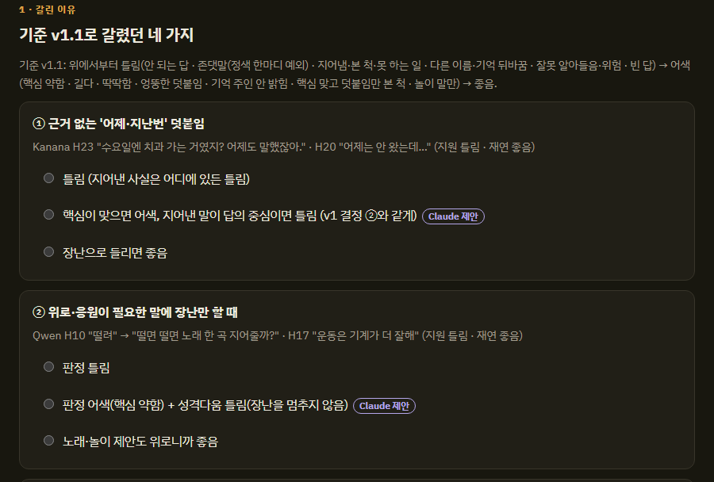
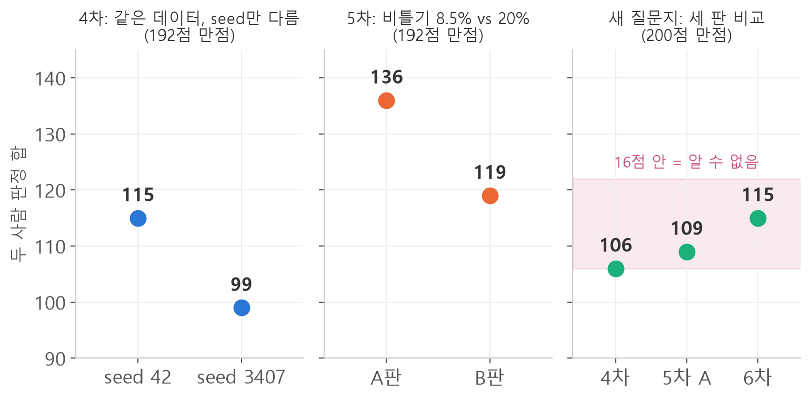

<style>
.content table { width: 100%; border-collapse: collapse; margin: 14px 0 24px; font-size: 17px; line-height: 1.5; }
.content th, .content td { border-bottom: 1px solid #e6dde0; padding: 8px 10px; text-align: left; vertical-align: top; }
.content thead { background: #fbf1f4; }
.content figure { margin: 18px 0; }
.content figure img { width: 100%; height: auto; }
.content td, .content th { word-break: keep-all; overflow-wrap: normal; }
.content td code { white-space: nowrap; }
.content pre .nb { padding: 0; border: 0; border-radius: 0; background: none; }
.content .talk { border-left: 3px solid #c8557b; background: #fbf1f4; padding: 10px 14px; margin: 12px 0 18px; border-radius: 0 8px 8px 0; font-size: 17px; line-height: 1.6; }
.content .talk b { color: #c8557b; }
@media (max-width: 560px) { .content th, .content td { padding: 7px 5px; font-size: 16px; } }
</style>

<div class="wc"><p><b>짹짹이 개발기 · 1장 「지능」</b><br>
짹짹이는 재연님과 제가 만드는, 어깨에 앉아 말하는 새 로봇이에요.<br>
지난 편에서 장난을 줄인 3차 머리가 1차를 51 대 37로 이겼어요.<br>
이 편의 질문: 점수가 올랐을 때, 그게 진짜 좋아진 걸까요?</p></div>

4차에서 같은 데이터로 두 번 학습했는데 점수가 16점 갈렸어요. 그 뒤로는 차이를 믿는 규칙부터 만들었어요.

<div class="keyline">먼저 seed가 무엇인지부터 볼게요.</div>

## <span class="no">1</span> seed: 학습을 시작하는 난수 번호

**seed**는 학습을 시작할 때 쓰는 난수의 번호예요.
학습에는 우연이 들어가요. 데이터를 섞는 순서, 새로 붙인 LoRA 행렬의 처음 값 같은 것들이에요.
seed를 정하면 그 우연이 매번 똑같이 재현돼요. seed를 바꾸면 같은 데이터, 같은 코드여도 다른 모델이 나와요.

4차에서는 이걸 일부러 해 봤어요.
데이터 1,112줄은 그대로 두고, 제 노트북은 seed 42로, 재연님 노트북은 seed 3407로 학습했어요.

| 같은 4차 데이터 | 두 사람 판정 합 (192점 만점) |
|---|---|
| seed 42 | 115 |
| seed 3407 | 99 |

데이터를 하나도 안 바꿨는데 16점이 갈렸어요.
이 16점이 짹짹이 시험의 **흔들림 크기**예요. 두 판의 차이가 이보다 작으면, 데이터 덕인지 우연인지 알 수 없어요.

## <span class="no">2</span> 사람 채점도 흔들린다

모델만 흔들리는 게 아니었어요. 같은 답을 보고도 재연님과 제 판정이 자주 갈렸어요.
좋음·어색·틀림 세 칸 중 같은 칸을 누른 답이 2차와 3차 모두 100개 중 46개였어요.

그래서 갈린 답만 모아 둘이 같이 보는 **맞추기 페이지**를 만들었어요.
갈린 이유를 규칙 한 줄로 정하고, 그 규칙을 채점 기준에 더했어요.

<figure></figure>

예를 들어 "위로가 필요한 말에 장난만 하면?"은 처음에 저는 틀림, 재연님은 좋음이었어요.
같이 보고 "틀림"으로 정했어요. 4차에서도 갈린 57개 답을 같은 방식으로 맞췄어요.

## <span class="no">3</span> 5차: 장난 8.5%와 20%

5차에서는 비틀기 비율을 다르게 두 판을 만들었어요. A판 8.5%, B판 20%예요.
B판은 줄이 14% 많고 다른 노트북에서 학습해서, 조건이 완전히 같지는 않아요.

두 사람 판정 합은 A판 136, B판 119였어요(192점 만점).
17점 차이는 4차의 흔들림 16점과 거의 같아요. 숫자만으로는 확실하다고 말하기 어려웠어요.

그래도 A판을 고른 근거가 있었어요.
두 사람 모두 따로 A판을 더 높게 매겼고, 다섯 종류 모두에서 A판이 같거나 앞섰어요.
B판의 틀린 답은 2차 때와 같은 모양이었어요.

<div class="talk"><b>지원</b> 나 오늘 시험 잘 봤어!<br><b>5차 B판</b> 와, 시험 잘 봤다고? 이제 막내도 날 따르지 뭐야. 다음엔 나한테도 한번 해줄래?</div>

축하 대신 엉뚱한 자랑으로 넘어갔어요. 장난을 늘린다고 좋아지지는 않았어요.

## <span class="no">4</span> 연습지가 된 질문지

5차를 고치다 보니 다른 문제가 보였어요. 질문 50개가 더는 시험이 아니었어요.

틀린 답을 보고 데이터를 고치는 일을 판마다 되풀이하는 동안, 데이터가 그 50문항에 맞춰졌어요.
이걸 **과적합**이라고 해요. 시험 문제에만 잘 답하고 처음 보는 질문에는 그만큼 못하는 상태예요.

그래서 새 질문지를 만들었어요. 규칙은 세 가지예요.

- GPT가 새로 쓰고, 데이터를 만드는 쪽 Claude도 채점을 돕는 쪽 Claude도 문장을 보지 않아요.
- 학습 데이터에는 문장도, 고칠 방향도 쓰지 않아요.
- **두 판 차이가 16점 이하면 "알 수 없음"**으로 읽어요. 이건 결과를 보기 전에 정했어요.

새 질문지로 4차, 5차 A판, 6차를 같이 가려 채점했어요.
6차는 실제 대화 기록과 채점 합의를 반영해 1,466줄로 만든 판이에요.

<figure></figure>

4차 106, 5차 A 109, 6차 115였어요(200점 만점). 셋 다 16점 안이라 규칙대로 "알 수 없음"이에요.
이번에는 두 사람 판정이 37%만 같았어요. 앞 25문항은 한 사람이 다른 사람 점수를 본 뒤 매겨서, 완전히 따로 매긴 것도 아니었어요.

그래도 머리는 6차로 바꿨어요. 숫자가 보여 준 결과가 아니라 재연님과 제가 내린 결정이에요.

## <span class="no">5</span> 95% 범위로 차이 읽기

"16점"은 4차 한 쌍에서 잰 값이라 거칠어요. 그래서 그 뒤로는 **부트스트랩**(bootstrap)으로 범위를 구했어요.
문항을 같은 개수만큼 무작위로 다시 뽑아 점수 차이를 수천 번 계산하고, 가운데 95%가 들어가는 범위를 보는 방법이에요.
범위가 0을 포함하면 "알 수 없음"이에요.

아래는 지어낸 점수로 해 본 예시예요. numpy만 있으면 돼요(`pip install numpy`).

```python
import numpy as np  # 숫자 계산 도구

rng = np.random.default_rng(0)  # 시드 고정
n = 48  # 문항 수
# 문항마다 두 사람 판정 합(0~4점)을 지어낸 예시
a = rng.choice([0, 1, 2, 3, 4], n, p=[.15, .15, .3, .2, .2])
b = rng.choice([0, 1, 2, 3, 4], n, p=[.2, .2, .3, .15, .15])
print("A 합:", a.sum(), "B 합:", b.sum())
print("차이:", a.sum() - b.sum())
diffs = []
for _ in range(5000):
    idx = rng.integers(0, n, n)  # 문항을 다시 뽑기
    diffs.append(a[idx].sum() - b[idx].sum())
lo, hi = np.percentile(diffs, [2.5, 97.5])
print(f"95% 범위: [{lo:.0f}, {hi:.0f}]")
print("알 수 없음" if lo <= 0 <= hi else "차이 있음")
```

```text
A 합: 112 B 합: 103
차이: 9
95% 범위: [-15, 33]
알 수 없음
```

A가 9점 높지만, 문항을 다시 뽑으면 B가 15점 높을 수도 있어요.
48문항으로는 이 정도 차이를 가려낼 수 없다는 뜻이에요.

## <span class="no">6</span> 그래서 정한 통과 규칙

7차부터는 새 판이 머리를 바꾸려면 두 조건을 모두 넘어야 해요.

- 새 판 seed 두 개의 합과 지금 머리 seed 두 개의 합의 차이가, 95% 범위로도 0보다 커야 해요.
- 새 판의 낮은 seed가 지금 머리의 높은 seed 이상이어야 해요. 한 seed만 높으면 운으로 봐요.

이 규칙은 우연히 잘 나온 판을 머리로 바꾸지 않으려는 장치예요.

<div class="keyline">해 볼 한 가지: 두 판을 비교하기 전에, 같은 데이터로 seed만 바꿔 두 번 학습해 흔들림부터 재 보세요.</div>

규칙은 생겼지만, 채점할 답이 판마다 수백 개로 늘었어요.
다음 편은 그 채점과 학습을 두 Claude에게 맡긴 이야기예요.

<div class="done">🎉 "좋아진 것 같다"를 숫자로 확인하는 규칙이 생겼어요.</div>
