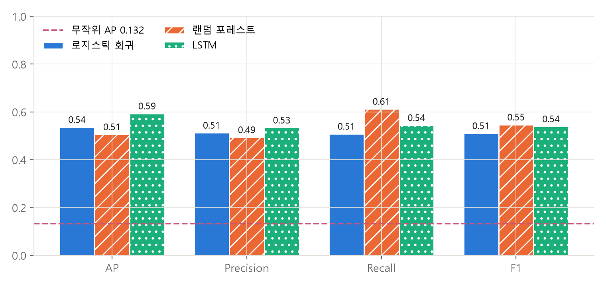
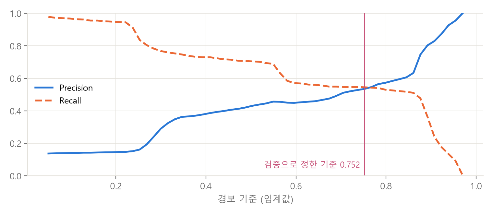
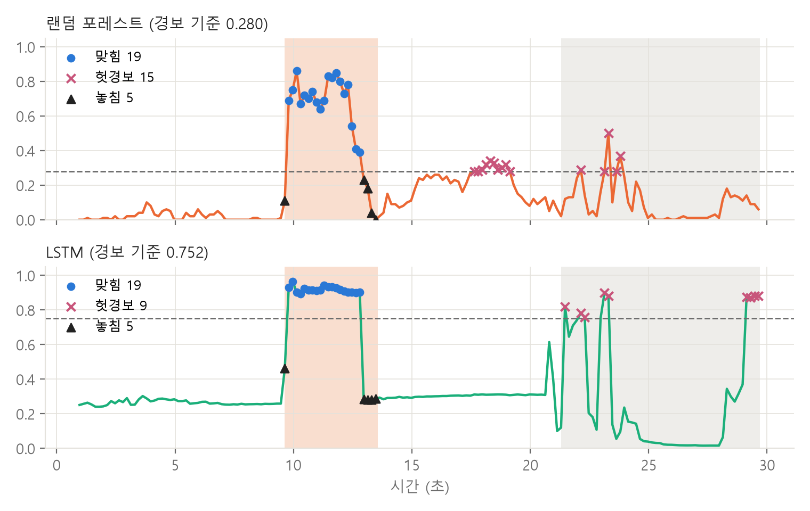

<style>
.content table { width: 100%; border-collapse: collapse; margin: 14px 0 24px; font-size: 17px; line-height: 1.5; }
.content th, .content td { border-bottom: 1px solid #e6dde0; padding: 8px 10px; text-align: left; vertical-align: top; }
.content thead { background: #fbf1f4; }
.content figure { margin: 18px 0; }
.content figure img { width: 100%; height: auto; }
.content td, .content th { word-break: keep-all; overflow-wrap: normal; }
.content .katex-display { overflow-x: auto; overflow-y: hidden; padding: 4px 0; }
.content td code { white-space: nowrap; }
.content pre .nb { padding: 0; border: 0; border-radius: 0; background: none; }
@media (max-width: 560px) { .content th, .content td { padding: 7px 5px; font-size: 16px; } }
</style>
<link rel="stylesheet" href="https://cdn.jsdelivr.net/npm/katex@0.16.11/dist/katex.min.css">
<script defer src="https://cdn.jsdelivr.net/npm/katex@0.16.11/dist/katex.min.js"></script>
<script defer src="https://cdn.jsdelivr.net/npm/katex@0.16.11/dist/contrib/auto-render.min.js" onload="renderMathInElement(document.querySelector('.content')||document.body,{delimiters:[{left:'\\[',right:'\\]',display:true},{left:'\\(',right:'\\)',display:false}]})"></script>

<div class="wc"><p><b>이상 탐지 성적표는 왜 따로 읽는 법을 알아야 할까요?</b><br>
이상 탐지는 정상이 대부분이고 이상이 드문 문제라, 정확도(accuracy) 하나로는 모델이 이상을 잡는지 알 수 없어요.<br>
그래서 <a href="https://scikit-learn.org/stable/modules/model_evaluation.html#precision-recall-and-f-measures">scikit-learn</a> 같은 도구는 Precision, Recall, F1, AP(average precision)를 따로 계산해 줘요.<br>
이 네 숫자와 "맞힘·헛경보·놓침" 개수를 연결해서 읽으면, 경보 기준을 어디에 둘지와 모델이 어디서 틀리는지가 보여요. (2026년 11월 16일 기준)</p></div>

로봇 힘 센서 이상 탐지 모델 세 개의 결과를 성적표 네 숫자, 경보 기준, 에피소드별 맞힘·헛경보·놓침 순서로 읽고, 헷갈리기 쉬운 지점 여섯 가지를 정리했어요.

이 글의 코드는 앞 글 「로봇 힘 센서 이상 탐지 실습: 데이터 읽기부터 LSTM까지」의 코드를 끝까지 실행한 상태에서 이어져요. 그 글에서 만든 `scores`(테스트 점수), `thresholds`(경보 기준), `test_y`(정답), `cache`(에피소드별 창)를 그대로 써요.

<div class="keyline">세 모델이 낸 점수를 정답과 맞춰 보면서, 숫자마다 무엇을 묻는지 볼게요.</div>

## <span class="no">1</span> 세 모델 성적표

테스트 에피소드 30개, 창 3561개에서 세 모델의 성적이에요.

```python
for name in ["LR", "RF", "LSTM"]:
    r = evaluate(test_y, scores[name], thresholds[name])
    print(name, {k: round(float(v), 3) for k, v in r.items()})
print("무작위 AP", round(float(test_y.mean()), 3))
```

```text
LR {'ap': 0.537, 'precision': 0.513, 'recall': 0.509, 'f1': 0.511}
RF {'ap': 0.506, 'precision': 0.494, 'recall': 0.613, 'f1': 0.547}
LSTM {'ap': 0.594, 'precision': 0.534, 'recall': 0.545, 'f1': 0.54}
무작위 AP 0.132
```

<figure></figure>

- 세 모델 모두 무작위(0.132)보다 4배쯤 높아요. 힘 기록만으로도 이상 신호를 어느 정도 잡아요.
- 그래도 모든 숫자가 0.5 근처예요. 경보 두 번 중 한 번은 헛경보이고, 이상 두 개 중 하나는 놓친다는 뜻이에요.
- AP는 LSTM, Recall과 F1은 랜덤 포레스트가 가장 높아요. 한 번의 분할에서 나온 0.01~0.10 차이라 "어느 모델이 낫다"고 결론 내리기는 어려워요.

## <span class="no">2</span> Precision, Recall, F1

세 숫자는 모두 **경보 기준을 하나 정한 뒤** 창마다 경보를 울렸는지로 계산해요. 먼저 창을 네 가지로 나눠요.

| | 경보 울림 | 경보 안 울림 |
|---|---|---|
| 정답 이상 | 맞힘 (TP, true positive) | 놓침 (FN, false negative) |
| 정답 정상 | 헛경보 (FP, false positive) | 맞게 조용함 (TN) |

LSTM의 테스트 결과로 세어 볼게요.

```python
alarm = scores["LSTM"] >= thresholds["LSTM"]
tp = int((alarm & (test_y == 1)).sum())
fp = int((alarm & (test_y == 0)).sum())
fn = int((~alarm & (test_y == 1)).sum())
print("경보", int(alarm.sum()), "맞힘", tp, "헛경보", fp, "놓침", fn)
p, r = tp / (tp + fp), tp / (tp + fn)
print(round(p, 3), round(r, 3), round(2 * p * r / (p + r), 3))
```

```text
경보 479 맞힘 256 헛경보 223 놓침 214
0.534 0.545 0.54
```

`~`는 True와 False를 뒤집어요. `~alarm`은 "경보 안 울림"이에요.

$$\text{Precision} = \frac{TP}{TP + FP} = \frac{256}{479} = 0.534$$

경보를 울린 것 중 진짜 이상의 비율이에요. 낮으면 헛경보가 많아요.

$$\text{Recall} = \frac{TP}{TP + FN} = \frac{256}{470} = 0.545$$

진짜 이상 중 잡아낸 비율이에요. 낮으면 놓친 이상이 많아요. 분모 470은 테스트의 이상 창 전체 수예요.

$$F_1 = \frac{2 \cdot \text{Precision} \cdot \text{Recall}}{\text{Precision} + \text{Recall}} = 0.540$$

둘의 조화평균이라, 한쪽만 높고 다른 쪽이 낮으면 F1도 낮게 나와요.

## <span class="no">3</span> AP는 경보 기준 없이 보는 점수

AP(average precision)는 경보 기준을 정하지 않고, **이상 창에 정상 창보다 높은 점수를 줬는지**를 봐요. 점수가 높은 순서로 창을 세우고, 이상 창을 하나 만날 때마다 그때까지의 Precision을 Recall이 늘어난 만큼 더해요.

$$AP = \sum_n (R_n - R_{n-1})\, P_n$$

$$P_n$$, $$R_n$$은 점수 순위 $$n$$번째까지를 경보로 쳤을 때의 Precision과 Recall이에요. 창 5개로 손으로 계산해 볼게요.

```python
toy_y = np.array([1, 0, 1, 0, 0])            # 정답
toy_s = np.array([0.9, 0.8, 0.7, 0.3, 0.1])  # 점수 (높은 순)
print(round(0.5 * 1 + 0.5 * (2 / 3), 3))
print(round(float(average_precision_score(toy_y, toy_s)), 3))
```

```text
0.833
0.833
```

| 순위 | 점수 | 정답 | 여기까지 Precision | Recall |
|---|---|---|---|---|
| 1 | 0.9 | 이상 | 1/1 = 1 | 1/2 = 0.5 |
| 2 | 0.8 | 정상 | 1/2 | 0.5 |
| 3 | 0.7 | 이상 | 2/3 = 0.667 | 2/2 = 1 |

Recall이 0.5 늘 때 Precision이 1, 다시 0.5 늘 때 0.667이라 AP = 0.5 × 1 + 0.5 × 0.667 = 0.833이에요. 정상 창(0.8)이 이상 창(0.7)보다 앞에 끼어서 1이 되지 못했어요.

무작위로 점수를 매기면 어디서 끊어도 Precision이 이상 비율과 비슷해서, AP도 이상 비율(테스트 0.132)과 비슷해져요.

## <span class="no">4</span> 경보 기준을 바꾸면

경보 기준(임계값)을 낮추면 경보가 늘어서 Recall이 오르고 Precision은 대체로 내려가요. 높이면 반대예요.

```python
for th in [0.3, 0.5, thresholds["LSTM"], 0.9]:
    pred = scores["LSTM"] >= th
    print(round(th, 3), int(pred.sum()),
          int((pred & (test_y == 1)).sum()),
          round(float(precision_score(test_y, pred, zero_division=0)), 3),
          round(float(recall_score(test_y, pred, zero_division=0)), 3))
```

```text
0.3 1239 361 0.291 0.768
0.5 774 332 0.429 0.706
0.752 479 256 0.534 0.545
0.9 168 139 0.827 0.296
```

| 기준 | 경보 수 | 맞힘 | Precision | Recall |
|---|---|---|---|---|
| 0.3 | 1239 | 361 | 0.291 | 0.768 |
| 0.5 | 774 | 332 | 0.429 | 0.706 |
| 0.752 (검증으로 정함) | 479 | 256 | 0.534 | 0.545 |
| 0.9 | 168 | 139 | 0.827 | 0.296 |

<figure></figure>

0.752는 **검증 데이터**에서 F1이 가장 높았던 기준이에요. 테스트에서 고르면 시험 답을 보고 기준을 맞춘 셈이라, 검증에서 정한 값을 테스트에 그대로 써요. 놓치면 안 되는 현장이면 기준을 낮추고, 헛경보가 비싼 현장이면 높여요. 어느 쪽이 맞는지는 모델이 아니라 현장의 비용으로 정해요.

## <span class="no">5</span> 149번: 맞힘, 헛경보, 놓침

성적표의 평균 숫자를 한 에피소드의 시간 위에 펼쳐 볼게요. 149번은 학습에 쓰지 않은 테스트 에피소드예요.

```python
def episode_scores(i):
    x, y, t = cache[i]
    s = {"LR": models["LR"].predict_proba(summarize(x))[:, 1],
         "RF": models["RF"].predict_proba(summarize(x))[:, 1],
         "LSTM": lstm_scores(x)}
    return x, y, t, s

x, y, t, s = episode_scores(149)
for name in ["RF", "LSTM"]:
    alarm = s[name] >= thresholds[name]
    print(name, "맞힘", int((alarm & (y == 1)).sum()),
          "헛경보", int((alarm & (y == 0)).sum()),
          "놓침", int((~alarm & (y == 1)).sum()))
    print("  헛경보 시각", [round(float(v), 1) for v in t[alarm & (y == 0)]])
    print("  놓침 시각", [round(float(v), 2) for v in t[~alarm & (y == 1)]])
```

```text
RF 맞힘 19 헛경보 15 놓침 5
  헛경보 시각 [17.6, 17.8, 18.0, 18.1, 18.3, 18.5, 18.6, 18.8, 19.0, 19.1, 22.1, 23.1, 23.3, 23.6, 23.8]
  놓침 시각 [9.63, 12.97, 13.13, 13.3, 13.47]
LSTM 맞힘 19 헛경보 9 놓침 5
  헛경보 시각 [21.5, 22.1, 22.3, 23.1, 23.3, 29.1, 29.3, 29.5, 29.6]
  놓침 시각 [9.63, 12.97, 13.13, 13.3, 13.47]
```

`t`는 numpy float32 배열이라 `float(v)` 없이 반올림하면 `np.float32(17.6)`처럼 찍혀요. `float(v)`로 바꾼 뒤 반올림하면 17.6으로 나와요.

<figure></figure>

정답 이상 창 24개 중 두 모델 모두 19개를 맞히고 5개를 놓쳤어요. 틀린 곳에는 이유가 있어요.

**놓침은 이상 구간의 처음과 끝이에요.** 9.63초 창은 끝 프레임이 이상 시작(289번)이라 정답은 이상이지만, 창 안의 1초는 대부분 충돌 전이에요. 12.97~13.47초는 큰 충격(10초 무렵 Fz 약 -9.6)이 이미 창 밖으로 나가고 약한 흔들림만 남은 구간이에요. 사람은 13.57초까지 이상이라고 표시했지만, 힘 신호만으로는 구분하기 어려운 구간이에요.

**헛경보는 서랍을 당기기 시작한 직후에 두 모델 모두 생겨요.** 랜덤 포레스트 5개(22.1~23.8초)와 LSTM 5개(21.5~23.3초)가 당기기 구간이 시작된 21.3초 직후예요. 당기기 시작할 때 힘이 갑자기 커지는 모양이 충돌과 비슷해서 헷갈린 것으로 보여요. 힘이 크다고 이상은 아니라서, 모델은 크기뿐 아니라 **언제, 어떤 모양**인지까지 배워야 해요.

**나머지 헛경보는 모델마다 달라요.** 랜덤 포레스트의 10개(17.6~19.1초)는 로봇이 거의 멈춰 있던 구간이에요. 주석 파일의 `anomaly → auto`가 "오래 멈춤" 후보로 찍은 세 구간(16.3~20.7초 사이)에 걸쳐 있고, 사람은 이상으로 표시하지 않았어요. 점수가 0.28 안팎이라 경보 기준 0.28에 아슬아슬하게 걸린 경보예요. LSTM의 4개(29.1~29.6초)는 기록이 끝나 가는 마지막 1초예요.

## <span class="no">6</span> 8번·17번과 한 에피소드의 함정

149번만 보면 두 모델이 비슷해 보여요. 이상이 없는 8번과 짧은 이상이 있는 17번도 같은 방식으로 세어 볼게요.

```python
for i in [8, 17]:
    x, y, t, s = episode_scores(i)
    line = [i, "이상 창", int(y.sum())]
    for name in ["RF", "LSTM"]:
        alarm = s[name] >= thresholds[name]
        line += [name, int((alarm & (y == 1)).sum()),
                 int((alarm & (y == 0)).sum()),
                 int((~alarm & (y == 1)).sum())]
    print(*line)
```

```text
8 이상 창 0 RF 0 0 0 LSTM 0 1 0
17 이상 창 9 RF 4 5 5 LSTM 6 16 3
```

출력 순서는 에피소드, 이상 창 수, 그다음 모델마다 맞힘·헛경보·놓침이에요.

| 에피소드 | 이상 창 | RF 맞힘/헛경보/놓침 | LSTM 맞힘/헛경보/놓침 |
|---|---|---|---|
| 149 | 24 | 19 / 15 / 5 | 19 / 9 / 5 |
| 8 | 0 | 0 / 0 / 0 | 0 / 1 / 0 |
| 17 | 9 | 4 / 5 / 5 | 6 / 16 / 3 |

17번에서 LSTM은 이상을 더 많이 잡지만 헛경보가 16번이에요. 149번에서는 LSTM의 헛경보가 더 적었는데, 17번에서는 반대예요. 에피소드 하나로 모델을 고르면 이런 차이를 놓쳐요. 그래서 테스트 30개 전체의 성적표와 에피소드별 결과를 같이 봐요.

### 경보가 곧 사람의 위험은 아니에요

모델의 경보는 "작업이 평소와 달랐다"는 신호예요. 그 순간 사람의 손이 서랍 근처에 있었는지, 방호 장치가 있었는지는 힘 기록에 없어요. 이 데이터만으로 작업자 위험등급을 매기면 근거 없는 판정이 돼요. 위험성평가로 이어 가려면 배치 도면, 작업자 개입 기록, 방호 상태 같은 현장 자료를 따로 모으고, 그 전까지는 등급을 **판정 보류**로 남겨요.

### 이 글에서 쓴 함수

- `precision_score`, `recall_score`, `f1_score`: 경보 기준 하나로 세 숫자 계산
- `average_precision_score`: 경보 기준 없이 점수 순서로 AP 계산
- `precision_recall_curve`: 기준을 바꿔 가며 Precision·Recall 계산 (기준 고르기)
- `&`, `~` (배열): 맞힘·헛경보·놓침 나누기

<div class="done">🎉 성적표 네 숫자를 맞힘·헛경보·놓침 개수로 바꿔 읽을 수 있게 됐어요!</div>
