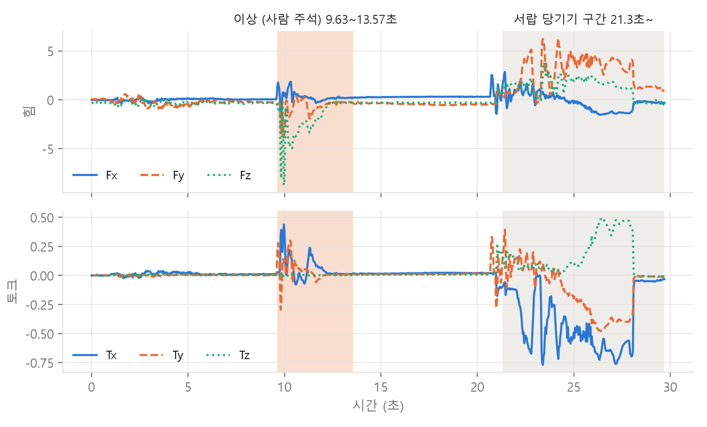
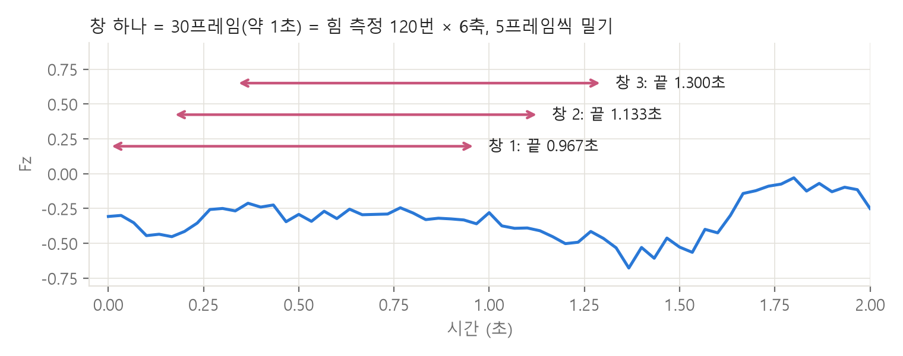
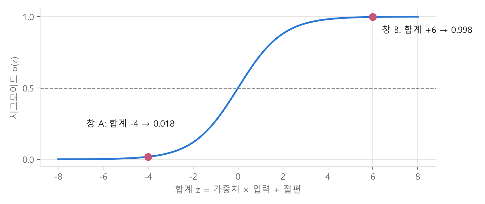
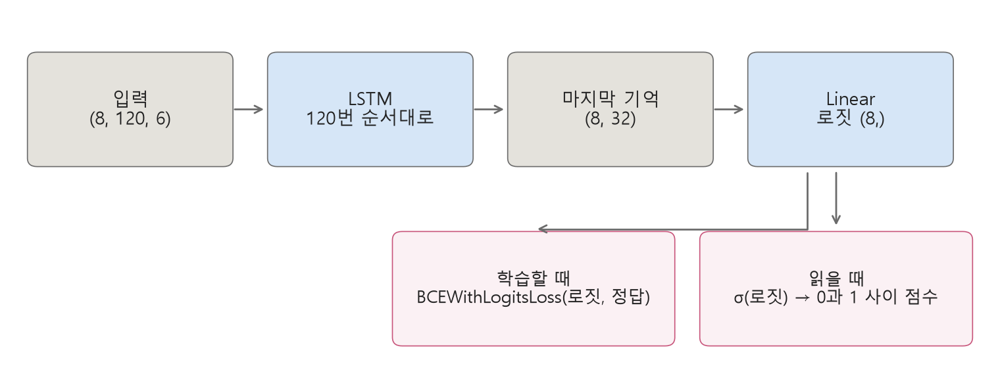

<style>
.content table { width: 100%; border-collapse: collapse; margin: 14px 0 24px; font-size: 17px; line-height: 1.5; }
.content th, .content td { border-bottom: 1px solid #e6dde0; padding: 8px 10px; text-align: left; vertical-align: top; }
.content thead { background: #fbf1f4; }
.content figure { margin: 18px 0; }
.content figure img { width: 100%; height: auto; }
.content td, .content th { word-break: keep-all; overflow-wrap: normal; }
.content .katex-display { overflow-x: auto; overflow-y: hidden; padding: 4px 0; }
.content td code { white-space: nowrap; }
.content pre .nb { padding: 0; border: 0; border-radius: 0; background: none; }
@media (max-width: 560px) { .content th, .content td { padding: 7px 5px; font-size: 16px; } }
</style>
<link rel="stylesheet" href="https://cdn.jsdelivr.net/npm/katex@0.16.11/dist/katex.min.css">
<script defer src="https://cdn.jsdelivr.net/npm/katex@0.16.11/dist/katex.min.js"></script>
<script defer src="https://cdn.jsdelivr.net/npm/katex@0.16.11/dist/contrib/auto-render.min.js" onload="renderMathInElement(document.querySelector('.content')||document.body,{delimiters:[{left:'\\[',right:'\\]',display:true},{left:'\\(',right:'\\)',display:false}]})"></script>

<div class="wc"><p><b>로봇 힘 센서로 왜 이상을 찾을까요?</b><br>
로봇팔 손목의 힘·토크 센서는 로봇이 물체를 밀고 당기는 힘을 아주 짧은 간격으로 기록하는 장치예요. 이 글의 데이터는 1초에 120번 기록했어요.<br>
서랍 열기·끼우기처럼 물체에 닿는 작업에서는 카메라로 잘 안 보이는 부딪힘·걸림이 힘 기록에 드러나요.<br>
공개 데이터 <a href="https://huggingface.co/datasets/Joringell/CRIA">CRIA</a>로 한 번 끝까지 해 보면, 시계열을 창으로 자르고 모델 셋을 같은 조건으로 비교하는 기본 흐름이 손에 익어요. (2026년 11월 16일 기준)</p></div>

로봇팔이 서랍을 당긴 실제 기록 150개로 이상 구간 탐지 모델 세 개를 만들고, 처음 보는 사람이 헷갈리기 쉬운 지점 일곱 가지를 코드와 숫자로 정리했어요.

**한눈에 보기:** 이 글에서 계속 쓰는 149번 기록이에요. 작업은 성공했지만 9.63초부터 4초 동안 사람이 "이상"이라고 표시한 구간이 있어요. 21.3초부터는 서랍을 당기는 작업 구간이라, 힘이 커도 사람은 이상으로 표시하지 않았어요.

<figure></figure>

흐름은 이 순서예요: 데이터 받기 → 프레임을 시간으로 → 1초 창 (120, 6) → 요약 숫자 24개 → 에피소드 단위 분할 → 로지스틱 회귀·랜덤 포레스트 → LSTM.

코드는 위에서부터 칸 하나씩 실행하면 이어져요. `pip install huggingface_hub polars numpy scikit-learn torch`로 설치해요. 결과값은 Python 3.13, torch 2.11 CPU에서 실행한 값이고, LSTM 숫자는 환경에 따라 조금 다를 수 있어요.

데이터 출처: [Joringell/CRIA](https://huggingface.co/datasets/Joringell/CRIA)의 `articulated/pull_drawer`, [CC BY 4.0](https://creativecommons.org/licenses/by/4.0/). 그림은 원본 센서 값을 이 글의 코드로 다시 그린 것이에요.

<div class="keyline">로봇이 서랍을 당기다 어딘가에 부딪힌 순간을, 손목 힘 기록만 보고 찾아볼게요.</div>

## <span class="no">1</span> 데이터 받고 주석 읽기

CRIA는 Franka FR3 로봇팔이 18가지 작업을 한 기록을 모은 데이터예요. 이 글은 그중 서랍 당기기(`pull_drawer`) 150개만 받아요. 영상은 빼고 센서 표와 주석만 받으면 약 42MB예요.

```python
from pathlib import Path
from huggingface_hub import snapshot_download

path = snapshot_download(
    "Joringell/CRIA", repo_type="dataset",
    revision="af288f2a470189c3991db73873f9d64171620a43",
    allow_patterns=["articulated/pull_drawer/data/*",
                    "articulated/pull_drawer/meta/*"],
    local_dir="cria")  # 지금 폴더 아래 cria에 저장
root = Path(path) / "articulated" / "pull_drawer"
print(len(list((root / "data").rglob("*.parquet"))))
```

```text
150
```

`revision`은 데이터 판을 고정하는 값이에요. 나중에 데이터가 바뀌어도 이 글과 같은 파일을 받아요.

사람이 표시한 정답은 `meta/annotation.json`에 있어요. 에피소드(episode)는 로봇이 작업을 처음부터 끝까지 한 번 한 기록이에요.

```python
import json
ann = json.loads((root / "meta" / "annotation.json")
                 .read_text(encoding="utf-8"))["episodes"]
ep = ann["000149"]
print(len(ann), ep["episode_label"], ep["num_frames"])
print(ep["anomaly"]["manual"]["ranges"])
print(ep["interaction"]["manual"])
```

```text
150 1 892
[[289, 407]]
{'onset_frame_index': 639, 'interaction_frame_count': 253}
```

- `episode_label` 1: 작업 전체는 성공이에요 (0이면 실패).
- `num_frames` 892: 이 기록은 892프레임이에요.
- `anomaly` 안의 `manual` 안의 `ranges`: 사람이 표시한 이상 구간, 289번부터 407번 프레임이에요.
- `interaction` 안의 `manual`: 서랍을 당기는 작업 구간이 639번 프레임에서 시작해 253프레임 이어져요. 이 구간은 이상으로 표시되지 않았어요.

`anomaly`에는 `auto` 항목도 있어요. 프로그램이 자동으로 찍은 후보라서, 이 글은 사람이 표시한 `manual`만 정답으로 써요.

### 프레임(frame)은 기록의 한 순간

프레임은 기록된 한 순간이에요. 이 데이터는 1초에 30프레임(30 Hz)이라, 프레임 번호를 30으로 나누면 대략 몇 초인지 나와요.

$$t \approx \frac{\text{frame}}{30}$$

$$t$$는 시작부터 지난 시간(초)이에요. 289번은 289 ÷ 30 = 9.633초예요. 실제 시각은 표의 `timestamp` 칸에서 읽어요.

```python
import numpy as np
import polars as pl
WRENCH = "observation.state.wrench_raw_chunk"   # 힘·토크 원본
VALID = "observation.state.wrench_chunk_valid_len"

def read_episode(e):
    return pl.read_parquet(root / e["parquet_path"], columns=[
        "frame_index", "timestamp", "frame_label",
        "episode_label", WRENCH, VALID])

table = read_episode(ep)
print(table.shape)
print(table.select("frame_index", "timestamp",
                   "episode_label", "frame_label").head(3))
```

```text
(892, 6)
shape: (3, 4)
┌─────────────┬───────────┬───────────────┬─────────────┐
│ frame_index ┆ timestamp ┆ episode_label ┆ frame_label │
│ ---         ┆ ---       ┆ ---           ┆ ---         │
│ i64         ┆ f32       ┆ i64           ┆ i64         │
╞═════════════╪═══════════╪═══════════════╪═════════════╡
│ 0           ┆ 0.0       ┆ 1             ┆ 1           │
│ 1           ┆ 0.033333  ┆ 1             ┆ 1           │
│ 2           ┆ 0.066667  ┆ 1             ┆ 1           │
└─────────────┴───────────┴───────────────┴─────────────┘
```

표 한 줄이 프레임 하나예요. 0.033초(1/30초)씩 늘어나요.

### for문으로 두 프레임의 시간 읽기

`for`문은 리스트의 값을 하나씩 꺼내 같은 일을 반복해요. 아래 코드는 `frame`에 289를 넣고 한 번 출력한 뒤, `frame`의 값을 407로 바꿔 한 번 더 출력해요.

```python
times = table["timestamp"].to_numpy()  # 프레임별 시각 배열
for frame in [289, 407]:
    print(frame, round(float(times[frame]), 2))
```

```text
289 9.63
407 13.57
```

`times[frame]`은 "frame번째 순간은 몇 초?"예요. 두 줄을 합치면 이상 구간이 9.63초부터 13.57초까지라는 뜻이에요.

같은 두 줄을 표에서 직접 고를 수도 있어요. `filter`는 조건에 맞는 줄만 남겨요.

```python
two = table.filter(pl.col("frame_index").is_in([289, 407]))
print(two.select("frame_index", "timestamp",
                 "episode_label", "frame_label"))
```

```text
shape: (2, 4)
┌─────────────┬───────────┬───────────────┬─────────────┐
│ frame_index ┆ timestamp ┆ episode_label ┆ frame_label │
│ ---         ┆ ---       ┆ ---           ┆ ---         │
│ i64         ┆ f32       ┆ i64           ┆ i64         │
╞═════════════╪═══════════╪═══════════════╪═════════════╡
│ 289         ┆ 9.633333  ┆ 1             ┆ 0           │
│ 407         ┆ 13.566667 ┆ 1             ┆ 0           │
└─────────────┴───────────┴───────────────┴─────────────┘
```

두 줄 모두 `episode_label`은 1, `frame_label`은 0이에요. 이 데이터에서 `frame_label`은 **0이 이상, 1이 정상**이에요. 작업은 성공했지만 이 순간들은 이상이었다는 뜻이에요. 성공한 작업 안에도 이상 구간이 있을 수 있어서, 작업 결과 하나만으로는 이 순간을 찾을 수 없어요.

## <span class="no">2</span> 1초 창 만들기: (120, 6)

모델은 프레임 하나가 아니라 **최근 1초 동안의 힘 기록**을 보고 지금이 이상인지 판단해요. 이 1초 묶음을 창(window)이라고 불러요.

먼저 프레임 한 줄에 힘이 어떻게 들어 있는지 볼게요. 손목 센서는 1초에 120번 재고, 데이터는 30 Hz 프레임마다 측정 4번을 묶어 둬요.

```python
one = np.asarray(table[WRENCH][0].to_list())
print(one.shape, table[VALID][0])
print(np.round(one[0], 3))  # 첫 측정의 6개 값
```

```text
(4, 6) 4
[-0.02   0.03  -0.3    0.     0.    -0.002]
```

`(4, 6)`은 측정 4번 × 6축이에요. 6축은 힘 Fx·Fy·Fz와 토크 Tx·Ty·Tz예요. 축 순서는 데이터의 `info.json`에 적혀 있어요. `VALID`는 4번 중 제대로 들어온 측정 개수예요.

창 하나는 30프레임이에요. 30프레임 × 측정 4번 = 120줄이고, 칸은 6축이라 창 하나의 모양이 `(120, 6)`이에요. 창은 5프레임(약 0.17초)씩 밀면서 만들어요.

<figure></figure>

```python
WINDOW, STRIDE = 30, 5  # 창 30프레임, 5프레임씩 밀기

def make_windows(e):
    t = read_episode(e)
    wrench = np.asarray(t[WRENCH].to_list(), dtype=np.float32)
    valid = t[VALID].to_numpy()
    labels = (t["frame_label"].to_numpy() == 0).astype(np.int64)
    ends = [end - 1 for end in range(WINDOW, len(t) + 1, STRIDE)
            if np.all(valid[end - WINDOW:end] == 4)]
    ends = np.array(ends, dtype=np.int64)
    if len(ends) == 0:
        return (np.empty((0, WINDOW * 4, 6), np.float32),
                labels[:0], t["timestamp"].to_numpy()[:0])
    x = np.stack([wrench[i + 1 - WINDOW:i + 1].reshape(-1, 6)
                  for i in ends])
    return x, labels[ends], t["timestamp"].to_numpy()[ends]

windows, labels, wtimes = make_windows(ep)
print(windows.shape, labels.shape)
print(round(float(wtimes[0]), 3), round(float(wtimes[1]), 3))
print(windows[0].shape)
```

```text
(173, 120, 6) (173,)
0.967 1.133
(120, 6)
```

- `labels = (... == 0)`: 이상(0)을 1로 바꿔요. 모델이 찾을 대상을 1로 두는 관례예요.
- `range(WINDOW, ..., STRIDE)`: 창의 끝 프레임을 29번, 34번, 39번…에 둬요.
- `valid == 4`: 측정이 4번 다 들어오지 않은 프레임이 섞인 창은 버려요.
- `reshape(-1, 6)`: (30, 4, 6)을 (120, 6)으로 펴요.
- `labels[ends]`: 창의 정답은 **창 끝 프레임**의 정답이에요.

`(173, 120, 6)`은 창 173개 × 측정 120번 × 6축이에요. 첫 창은 0번부터 29번 프레임이라 끝 시각이 29 ÷ 30 = 0.967초예요. 모델은 "지금까지 1초를 보고 지금 이 순간이 이상인가"를 판단해서, 판단 시점이 창의 맨 끝이에요.

`windows[0]`은 173개 중 첫 창 하나예요. 그래서 창 개수 자리가 빠지고 `(120, 6)`이 남아요.

## <span class="no">3</span> 요약 숫자 24개를 만드는 이유

로지스틱 회귀와 랜덤 포레스트는 창 하나를 **숫자 한 줄**로만 받을 수 있어요. 그래서 `(120, 6)` 표를 6축마다 숫자 4개로 줄여요.

| 요약 | 창 안에서 보는 것 |
|---|---|
| 평균 | 1초 동안 평균적으로 받은 힘 |
| 표준편차 | 얼마나 흔들렸나 |
| 절댓값 최대 | 가장 세게 받은 순간 |
| 끝 − 처음 | 마지막 측정 4번 평균 − 처음 측정 4번 평균 |

6축 × 4개 = 24개예요.

```python
def summarize(x):  # x 모양: (창 개수, 120, 6)
    return np.hstack([
        x.mean(axis=1),                 # 평균 6개
        x.std(axis=1),                  # 표준편차 6개
        np.abs(x).max(axis=1),          # 최대 6개
        x[:, -4:].mean(axis=1) - x[:, :4].mean(axis=1)])

print(round(float(windows[0, :, 0].mean()), 4))  # 첫 창 Fx 평균
print(summarize(windows[:1]).shape, summarize(windows).shape)
```

```text
-0.037
(1, 24) (173, 24)
```

`windows[0, :, 0]`은 [창, 시간, 축] 순서로 "첫 창, 시간 전부, 0번 축(Fx)"이에요. Fx 120개의 평균이 -0.037이에요.

`axis=1`은 시간 자리를 따라 계산하라는 뜻이라, `summarize`는 창 개수 자리가 있는 3차원 입력을 받아요. `windows[:1]`은 0번 창 하나를 **창 개수 자리를 남긴 채** 잘라서 `(1, 120, 6)`이에요. 그래서 결과가 `(1, 24)`예요.

### 120 × 6 = 720개를 그대로 펴서 넣으면 안 될까요?

넣을 수는 있어요. 다만 같은 충돌이 창의 10번째 줄에 있을 때와 80번째 줄에 있을 때 서로 다른 칸에 들어가요. 요약 숫자는 충돌이 창 어디에 있든 "최댓값 큼, 흔들림 큼"으로 같게 나와요. 대신 "툭 튀고 → 흔들리고 → 줄어드는" 순서는 사라져요. 순서까지 보는 모델이 6번의 LSTM이에요.

## <span class="no">4</span> 에피소드 단위로 나누기

학습·검증·테스트는 **창이 아니라 에피소드 단위로** 나눠요. 창은 5프레임씩 밀어서 옆 창과 1초 중 대부분이 겹쳐요. 같은 에피소드의 창이 학습과 테스트에 섞이면, 모델은 거의 같은 데이터를 이미 본 채로 시험을 봐요.

```python
from sklearn.model_selection import train_test_split
eps = list(ann.values())
strata = np.array([(e["source"], bool(e["anomaly"]["manual"]["ranges"]))
                   for e in eps], dtype=str)  # 사람 시연/정책 실행, 이상 유무
ids = np.arange(len(eps))
fit, test = train_test_split(ids, test_size=.2, random_state=42,
                             stratify=strata)
train, val = train_test_split(fit, test_size=.25, random_state=42,
                              stratify=strata[fit])
split = {name: {eps[i]["episode_index"] for i in part}
         for name, part in [("train", train), ("val", val), ("test", test)]}
print({k: len(v) for k, v in split.items()})
print(split["train"] & split["test"])
print({8, 17, 149} <= split["test"])
```

```text
{'train': 90, 'val': 30, 'test': 30}
set()
True
```

`stratify`는 사람 시연과 정책 실행, 이상 있음과 없음의 비율이 세 묶음에 고르게 들어가게 해요.

마지막 두 줄은 서로 다른 것을 확인해요.

- `train & test`: 학습과 테스트에 **겹치는** 에피소드가 있나? `&`는 교집합이에요. 결과 `set()`은 빈 모음이라 겹침이 없어요.
- `{8, 17, 149} <= test`: 세 에피소드가 테스트 안에 **다 들어 있나?** 모음끼리 쓴 `<=`는 크기 비교가 아니라 포함이에요. 결과는 `True`예요.

빈 모음은 `{}`가 아니라 `set()`으로 출력돼요. 파이썬에서 `{}`는 빈 딕셔너리라서예요. 149번이 테스트에 있으니, 다음 글에서 모델이 **처음 보는** 149번의 이상을 잡는지 확인할 수 있어요.

이제 150개 에피소드를 모두 창으로 바꾸고 묶음별로 모아요.

```python
cache = {e["episode_index"]: make_windows(e) for e in eps}

def gather(name):
    parts = [cache[i] for i in sorted(split[name])]
    return (np.concatenate([p[0] for p in parts]),
            np.concatenate([p[1] for p in parts]))

train_x, train_y = gather("train")
val_x, val_y = gather("val")
test_x, test_y = gather("test")
for name, y in [("train", train_y), ("val", val_y), ("test", test_y)]:
    print(name, len(y), int(y.sum()), round(float(y.mean()), 3))
```

```text
train 10116 1471 0.145
val 3546 494 0.139
test 3561 470 0.132
```

학습 창 10116개 중 이상은 1471개(14.5%)예요. 이상이 적어서 "전부 정상"이라고만 답해도 정확도가 85%를 넘어요. 그래서 정확도 대신 다음 글의 AP·F1로 비교해요.

## <span class="no">5</span> 로지스틱 회귀와 랜덤 포레스트

세 모델 모두 "이 1초 창이 이상인가"를 0과 1 사이 점수로 답하는 **분류** 모델이에요.

### 선형 회귀와 로지스틱 회귀의 차이

선형 회귀(linear regression)는 입력에 가중치를 곱해 더한 값을 그대로 답으로 써요. 힘이 몇 N일지 같은 **숫자**를 맞힐 때 써요.

$$\hat{y} = w_1x_1 + w_2x_2 + \dots + w_{24}x_{24} + b$$

$$x_i$$는 요약 숫자, $$w_i$$는 가중치, $$b$$는 절편이에요. 답이 -4나 6처럼 아무 숫자나 나와요.

로지스틱 회귀(logistic regression)는 같은 합계 $$z$$를 시그모이드(sigmoid) 함수에 넣어 0과 1 사이로 눌러요.

$$p = \sigma(z) = \frac{1}{1 + e^{-z}}, \quad z = w^\top x + b$$

$$p$$는 이상일 확률처럼 읽는 점수예요. 합계가 -4인 창은 $$\sigma(-4) = 0.018$$, +6인 창은 $$\sigma(6) = 0.998$$이에요. 이름에 "회귀"가 있지만 이진 분류에 쓰는 모델이에요.

<figure></figure>

### 랜덤 포레스트는 나무 100그루의 평균

랜덤 포레스트(random forest)는 "Fz 최댓값 > 5?" 같은 예/아니오 질문을 이어 가는 결정 트리를 여러 그루 만들어요. 나무마다 학습 창을 무작위로 다시 뽑고, 질문할 숫자도 무작위로 일부만 골라요. 점수는 나무들이 낸 확률의 평균이에요.

$$p = \frac{1}{T}\sum_{t=1}^{T} p_t(x)$$

$$T$$는 나무 수(100), $$p_t(x)$$는 나무 $$t$$가 낸 이상 확률이에요. 로지스틱 회귀는 숫자를 더하기로만 합치고, 랜덤 포레스트는 "A도 크고 B도 클 때" 같은 조합을 질문으로 잡을 수 있어요.

```python
from sklearn.ensemble import RandomForestClassifier
from sklearn.linear_model import LogisticRegression
from sklearn.metrics import (average_precision_score, f1_score,
                             precision_recall_curve, precision_score,
                             recall_score)
from sklearn.pipeline import make_pipeline
from sklearn.preprocessing import StandardScaler

def choose_threshold(y, s):  # 검증에서 F1이 가장 높은 경보 기준
    p, r, th = precision_recall_curve(y, s)
    f1 = 2 * p[:-1] * r[:-1] / np.maximum(p[:-1] + r[:-1], 1e-12)
    return float(th[f1.argmax()])

def evaluate(y, s, th):
    pred = s >= th
    return {"ap": average_precision_score(y, s),
            "precision": precision_score(y, pred, zero_division=0),
            "recall": recall_score(y, pred, zero_division=0),
            "f1": f1_score(y, pred, zero_division=0)}

models = {
    "LR": make_pipeline(StandardScaler(), LogisticRegression(
        class_weight="balanced", max_iter=1000, random_state=42)),
    "RF": RandomForestClassifier(
        n_estimators=100, class_weight="balanced_subsample",
        n_jobs=4, random_state=42)}
F = {"train": summarize(train_x), "val": summarize(val_x),
     "test": summarize(test_x)}
scores, thresholds = {}, {}
for name, m in models.items():
    m.fit(F["train"], train_y)
    thresholds[name] = choose_threshold(val_y, m.predict_proba(F["val"])[:, 1])
    scores[name] = m.predict_proba(F["test"])[:, 1]
    r = evaluate(test_y, scores[name], thresholds[name])
    print(name, round(thresholds[name], 3),
          {k: round(float(v), 3) for k, v in r.items()})
```

```text
LR 0.718 {'ap': 0.537, 'precision': 0.513, 'recall': 0.509, 'f1': 0.511}
RF 0.28 {'ap': 0.506, 'precision': 0.494, 'recall': 0.613, 'f1': 0.547}
```

- `StandardScaler`는 24개 숫자의 크기를 맞춰요. 힘과 토크는 단위와 크기가 달라서예요.
- `class_weight="balanced"`는 드문 이상 창을 더 무겁게 쳐요.
- `predict_proba(...)[:, 1]`은 창마다 이상(1)일 점수만 골라요.
- 0.718, 0.28은 **경보 기준(임계값)**이에요. 점수가 이 값 이상이면 경보를 울려요. 테스트가 아니라 **검증 데이터**로 정해요. 시험 문제를 보고 기준을 정하면 반칙이라서예요.

두 기준이 크게 다른 건 점수 매기는 방식이 달라서예요. 임계값 숫자끼리 비교해서 어느 모델이 낫다고 하지 않아요. 성적표 숫자는 다음 글에서 하나씩 읽어요.

## <span class="no">6</span> LSTM과 로짓(logit)

LSTM은 요약하지 않은 `(120, 6)` 창을 **120번 순서대로** 읽으면서 앞에서 본 내용을 기억해요. 다 읽은 뒤 남은 기억(은닉 상태, hidden state)을 선형층에 넣어 창마다 숫자 하나를 내요. 이 숫자가 로짓이에요.

<figure></figure>

```python
import torch
from torch import nn
torch.manual_seed(42)

class WrenchLSTM(nn.Module):
    def __init__(self, hidden=32):
        super().__init__()
        self.lstm = nn.LSTM(6, hidden, batch_first=True)  # 6축 입력
        self.out = nn.Linear(hidden, 1)                    # 기억 32개 → 1개
    def forward(self, x):
        _, (h, _) = self.lstm(x)          # h: 마지막 기억
        return self.out(h[-1]).squeeze(-1)

mean = train_x.mean(axis=(0, 1))   # 학습 데이터로만 구한 축별 평균
scale = train_x.std(axis=(0, 1))
batch = torch.from_numpy((train_x[:8] - mean) / scale)
model = WrenchLSTM()
logits = model(batch)
print(batch.shape, logits.shape)
print(logits[:3].detach().round(decimals=3))
print(logits.sigmoid()[:3].detach().round(decimals=3))
```

```text
torch.Size([8, 120, 6]) torch.Size([8])
tensor([0.0190, 0.0180, -0.0000])
tensor([0.5050, 0.5040, 0.5000])
```

| 출력 | 뜻 |
|---|---|
| `[8, 120, 6]` | 창 8개(배치) × 측정 120번 × 6축 |
| `[8]` | 창 8개마다 로짓 하나씩 |
| 0.0190 같은 로짓 | 시그모이드 **전** 합계. 음수도 나와요 |
| 0.5050 같은 점수 | 시그모이드를 거친 0과 1 사이 점수 |

아직 학습 전이라 점수가 모두 0.5 근처예요. 정규화(`mean`, `scale`)는 학습 데이터로만 구해요. 검증·테스트 값을 섞으면 시험 데이터 정보가 새어 들어가요.

### 학습할 때는 로짓 그대로

학습에서는 로짓을 `BCEWithLogitsLoss`에 그대로 넣어요. 이 손실 함수가 안에서 시그모이드를 함께 계산해요.

$$L = -\left[\, w_+\, y \log \sigma(z) + (1 - y) \log\big(1 - \sigma(z)\big) \right]$$

$$y$$는 정답(이상 1, 정상 0), $$z$$는 로짓이에요. $$w_+$$는 이상 창의 손실에 곱하는 무게예요. 이 글은 정상 창 수 ÷ 이상 창 수 = 8645 ÷ 1471 ≈ 5.88로 둬서 드문 이상을 놓칠 때 손실이 커지게 했어요. 사람이 점수로 읽을 때만 시그모이드를 한 번 붙여요.

```python
from torch.utils.data import DataLoader, TensorDataset
torch.set_num_threads(4)
torch.manual_seed(42)
X = torch.from_numpy((train_x - mean) / scale)
Y = torch.from_numpy(train_y.astype(np.float32))
loader = DataLoader(TensorDataset(X, Y), batch_size=128, shuffle=True,
                    generator=torch.Generator().manual_seed(42))
model = WrenchLSTM()
opt = torch.optim.Adam(model.parameters(), lr=1e-3)
pos_weight = torch.tensor((len(train_y) - train_y.sum()) / train_y.sum(),
                          dtype=torch.float32)
loss_fn = nn.BCEWithLogitsLoss(pos_weight=pos_weight)

@torch.inference_mode()
def lstm_scores(x):  # 창들 → 0과 1 사이 점수
    model.eval()
    z = torch.from_numpy((x - mean) / scale)
    return torch.cat([model(b).sigmoid() for b in z.split(256)]).numpy()

best_ap, best_state, best_epoch = -1, None, 0
for epoch in range(1, 31):
    model.train()
    for xb, yb in loader:
        opt.zero_grad()
        loss = loss_fn(model(xb), yb)   # 로짓 그대로
        loss.backward()
        opt.step()
    ap = average_precision_score(val_y, lstm_scores(val_x))
    if ap > best_ap:  # 검증 AP가 가장 높았던 순간을 저장
        best_ap, best_epoch = ap, epoch
        best_state = {k: v.clone() for k, v in model.state_dict().items()}
    if epoch % 5 == 0:
        print(epoch, round(ap, 3))
model.load_state_dict(best_state)
print("best", best_epoch, round(best_ap, 3))
```

```text
5 0.637
10 0.7
15 0.748
20 0.682
25 0.686
30 0.698
best 16 0.758
```

CPU에서 20초 안팎이 걸려요. 검증 AP가 에포크마다 0.6과 0.76 사이를 오르내려서, 마지막 모델 대신 검증 AP가 가장 높았던 16번째 모델을 골라 써요.

```python
thresholds["LSTM"] = choose_threshold(val_y, lstm_scores(val_x))
scores["LSTM"] = lstm_scores(test_x)
r = evaluate(test_y, scores["LSTM"], thresholds["LSTM"])
print("LSTM", round(thresholds["LSTM"], 3),
      {k: round(float(v), 3) for k, v in r.items()})
```

```text
LSTM 0.752 {'ap': 0.594, 'precision': 0.534, 'recall': 0.545, 'f1': 0.54}
```

세 모델의 테스트 점수가 모두 나왔어요. AP는 LSTM이, F1은 랜덤 포레스트가 가장 높아요. 차이가 0.01~0.09라 이 한 번의 분할로 순위를 정하기는 어려워요.

## <span class="no">7</span> 자주 하는 실수와 함수 정리

### frame_label을 거꾸로 읽기

이 데이터는 0이 이상이에요. 1을 이상으로 읽으면 에러 없이 비율만 뒤집혀요.

```python
fl = table["frame_label"].to_numpy()
print("❌", round(float((fl == 1).mean()), 3))  # 1을 이상으로 읽음
print("✅", round(float((fl == 0).mean()), 3))  # 0이 이상
```

```text
❌ 0.867
✅ 0.133
```

149번은 이상 구간이 892프레임 중 119프레임이라 0.133이 맞아요. 이 데이터에서는 이상 비율이 가장 높은 에피소드도 0.59라, 80%를 넘게 나오면 라벨을 거꾸로 읽은 거예요.

### 창 하나를 summarize에 바로 넣기

`windows[0]`은 2차원 `(120, 6)`이에요. `summarize`는 `axis=1`을 시간 자리로 쓰는데, 2차원에서는 `axis=1`이 6축 자리가 돼요. 측정마다 6축을 평균 내 버려서 에러 없이 엉뚱한 모양이 나와요.

```python
print("❌", summarize(windows[0]).shape)   # (120, 6)을 넣음
print("✅", summarize(windows[:1]).shape)  # (1, 120, 6)을 넣음
```

```text
❌ (480,)
✅ (1, 24)
```

모델에 넣기 전에 `.shape`가 `(창 개수, 24)`인지 확인하면 이 실수를 바로 잡아요.

### 시그모이드를 두 번 붙이기

`BCEWithLogitsLoss`에 시그모이드를 거친 점수를 넣어도 에러가 나지 않아요. 안에서 시그모이드가 한 번 더 적용돼 손실이 틀린 값이 돼요.

```python
y8 = torch.from_numpy(train_y[:8].astype(np.float32))
z8 = model(batch).detach()
plain = nn.BCEWithLogitsLoss()
print("❌", round(plain(z8.sigmoid(), y8).item(), 3))  # 시그모이드 두 번
print("✅", round(plain(z8, y8).item(), 3))            # 로짓 그대로
```

```text
❌ 0.821
✅ 0.276
```

같은 모델, 같은 창인데 손실이 세 배 가까이 달라요. 학습 코드에서는 모델 출력(로짓)을 그대로 넣었는지 확인해요.

### 이 글에서 쓴 함수

- `snapshot_download`: Hugging Face에서 필요한 폴더만 내려받기
- `pl.read_parquet`: 센서 표 읽기
- `filter`, `is_in`, `select`: 조건에 맞는 줄, 원하는 칸 고르기
- `np.stack`, `reshape`: 30프레임을 (120, 6) 창으로
- `mean`, `std`, `max` (`axis=1`): 창마다 요약 24개
- `train_test_split`: `stratify`로 비율을 맞춰 에피소드 나누기
- `&`, `<=`: 모음의 교집합, 포함
- `LogisticRegression`: 요약 24개의 가중치 합 → 시그모이드
- `RandomForestClassifier`: 결정 트리 여러 그루의 평균
- `nn.LSTM`: 창을 120번 순서대로 읽기
- `BCEWithLogitsLoss`: 로짓으로 손실 계산
- `precision_recall_curve`: 검증에서 경보 기준 고르기

<div class="done">🎉 공개 로봇 데이터로 1초 창을 만들고, 같은 분할에서 세 모델을 끝까지 학습했어요!</div>
