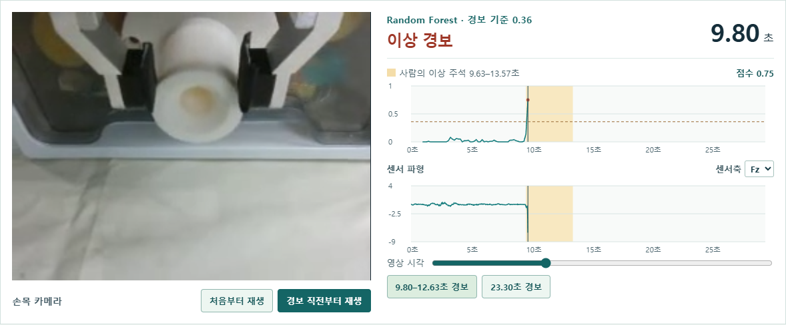

로봇이 서랍 열기에 성공해도 작업 중간에 이상 구간이 있을 수 있습니다.
이런 순간을 센서 데이터로 찾고, 작업 영상으로 확인하는 프로젝트입니다.

<a href="https://lifeschedule-dotcom.github.io/cria-drawer-anomaly-detection/">웹 데모 열기</a>
<a href="https://github.com/lifeschedule-dotcom/cria-drawer-anomaly-detection">코드·실습 노트북</a>

<figure class="project-shot">

</figure>

## 프로젝트 내용

**CRIA**는 실제 로봇 작업의 영상, 힘·토크(힘과 비트는 힘) 센서값, 이상 구간 표시를 함께 제공하는 공개 데이터셋입니다.
이번에는 그중 **서랍 열기 기록 150개**를 사용했습니다.

로지스틱 회귀, Random Forest, LSTM을 학습하고 비교했습니다.
웹 데모에서는 녹화 영상과 센서 기록을 함께 재생하며 모델이 경보를 낸 시점을 볼 수 있습니다.
‘실시간 탐지’ 탭에서 **CRIA 기록 재생**을 고르면, 재생 시점까지 받은 센서값으로 점수를 새로 계산합니다.

## 149번 작업의 경보

149번 기록은 서랍 열기에 성공한 작업입니다.
사람이 이상으로 표시한 구간은 **9.63~13.57초**이고, Random Forest는 **9.80초**에 첫 경보를 냈습니다.

모델은 사람이 표시한 구간 밖인 **23.30초**에도 경보를 냈습니다.
경보가 뜬 장면을 영상으로 다시 확인하는 이유입니다.

## 세 모델의 비교 결과

150개 작업을 학습 90개, 검증 30개, 테스트 30개로 나눴습니다.
아래는 테스트 작업에서 만든 **평가 구간 3,561개**의 결과입니다.

<table class="model-results">
<thead><tr><th>모델</th><th>F1</th><th>AP</th></tr></thead>
<tbody>
<tr><td>로지스틱 회귀</td><td>0.511</td><td><strong>0.537</strong></td></tr>
<tr><td>Random Forest</td><td><strong>0.543</strong></td><td>0.517</td></tr>
<tr><td>LSTM</td><td>0.535</td><td>0.509</td></tr>
</tbody>
</table>

F1은 경보의 정확성과 이상을 찾아낸 비율을 함께 보는 값입니다.
AP는 이상 구간에 높은 점수를 매겼는지 평가하는 값입니다.
이번 결과에서는 F1은 Random Forest, AP는 로지스틱 회귀가 가장 높았습니다.

## 손 끼임 상황의 현장 점검

서랍과 고정 프레임 사이에 **손가락이 끼일 수 있는 상황**을 가상 예시로 두었습니다.
SFOA 위험성평가의 네 가지 항목을 참고해 현장에서 확인할 내용을 정리했습니다.

- **상해 심각도:** 끼임 위치와 힘의 전달 경로, 예상되는 부상을 확인합니다.
- **노출 빈도와 시간:** 걸림 해소나 정비 중 손이 틈새에 접근하는 횟수와 시간을 확인합니다.
- **위험 사건 발생 가능성:** 손이 들어간 상태에서 서랍이 움직이거나 로봇이 다시 작동할 수 있는지 확인합니다.
- **회피·감소 가능성:** 손을 뺄 공간과 시간, 보호장치의 정지 기능 등을 확인합니다.

모델은 이상 구간을 찾는 역할까지 맡습니다.
실제로 사람이 다칠 위험이 있는지는 작업자의 위치와 보호장치를 함께 살펴 판단해야 합니다.

## 추가 개발과 활용

### 모방학습용 데이터 검수

로봇에게 동작을 가르칠 시연 데이터를 학습용으로 정리할 때, 이상이 의심되는 구간을 먼저 찾아주는 도구로 확장할 수 있습니다.
검토자는 해당 구간의 영상과 센서값을 보고 학습에 넣을지 결정합니다.

### 실제 작업현장의 실시간 위험 탐지

카메라와 힘·토크·압력 센서를 연결해 작업자의 접근이나 비정상 접촉을 실시간으로 감지하는 방향입니다.
현장을 SFOA 기준으로 평가해 위험 상황과 보호조치를 정리하고, 그 조건에 맞춰 경보 기준을 설계하고자 합니다.
실제 센서 연결과 현장 검증은 후속 과제입니다.

## 자료와 출처

- [웹 데모](https://lifeschedule-dotcom.github.io/cria-drawer-anomaly-detection/)
- [GitHub 코드·실습 노트북·모델 비교 결과](https://github.com/lifeschedule-dotcom/cria-drawer-anomaly-detection)
- [발표자료 PDF](/assets/files/cria-project.pdf) · [PPT·Word 보고서](https://github.com/lifeschedule-dotcom/cria-drawer-anomaly-detection/releases/tag/v1.0.0)
- [CRIA 원본 데이터](https://huggingface.co/datasets/Joringell/CRIA) · Yi Qiao 외, [CC BY 4.0](https://creativecommons.org/licenses/by/4.0/). 데모 화면은 원본 영상·센서값·주석에 경보와 파형을 함께 표시했습니다.
- [세이프틱스 SafetyDesigner 위험성평가 공개 가이드](https://doc.safetics.io/docs/ra-est-eval/)
