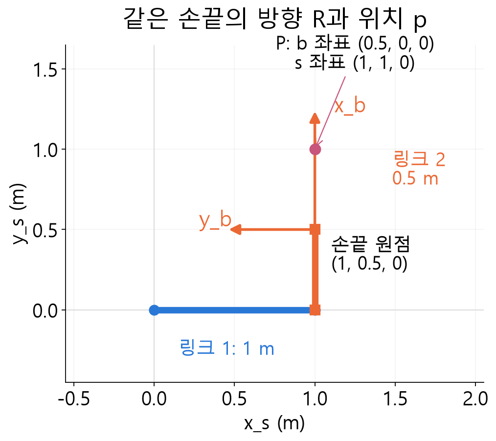
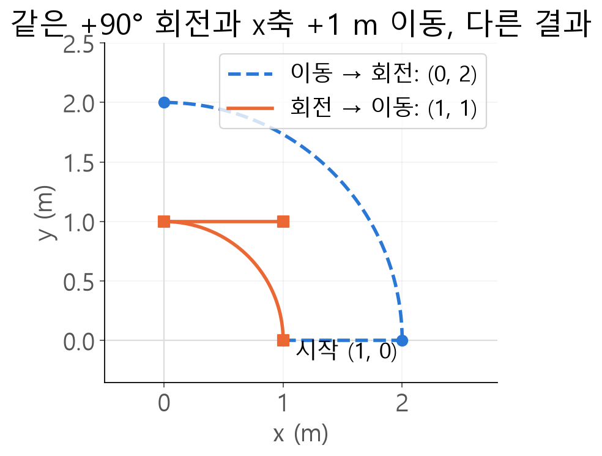

<link rel="stylesheet" href="https://cdn.jsdelivr.net/npm/katex@0.16.11/dist/katex.min.css">

<link rel="stylesheet" href="/assets/css/robotics-demos.css">

앞 글에서 90° 돌아간 물체의 앞쪽으로 0.5 m 떨어진 점을 구했습니다.
물체와 바닥의 원점이 같을 때, 그 점은 바닥 기준 (0,0.5,0)에 있었습니다.
이번에는 물체의 원점도 (1,0.5,0)으로 옮기겠습니다.
같은 점은 바닥에서 어디에 있을까요?

이 질문을 계산한 뒤, 그 계산을 4×4 행렬 하나로 묶겠습니다.

## 직접 비교해 보기

회전각과 이동량을 바꿔서 비교해 보세요.
원래 점은 (1,0)입니다. R은 이 점을 원점 중심으로 돌리고, T는 돌린 결과에 (x 이동, y 이동)을 더합니다.

2차원에서는 다음 식을 비교하는 것입니다.

$$R=\begin{bmatrix}\cos\theta&-\sin\theta\\\sin\theta&\cos\theta\end{bmatrix}$$

$$T=\begin{bmatrix}\cos\theta&-\sin\theta&p_x\\\sin\theta&\cos\theta&p_y\\0&0&1\end{bmatrix}$$

90° 회전한 뒤 x로 2, y로 3 이동하면 원점은 (2,3)으로 갑니다.
점 (1,0)은 먼저 (0,1)로 회전하고, 이동을 더해 (2,4)가 됩니다.
이제 같은 계산을 3차원 점 P에 적용해 보겠습니다.

## 1. 먼저 그림에서 점의 위치를 구하기

바닥 기준의 이름을 s, 물체에 붙은 기준의 이름을 b라고 하겠습니다.
b의 앞쪽 x축은 바닥의 위쪽을 향하고 있습니다.
b 원점은 바닥에서 오른쪽 1 m, 위쪽 0.5 m인 곳에 있습니다.
이 원점 위치를 p라고 적습니다.

$$p=\begin{bmatrix}1\\0.5\\0\end{bmatrix}$$

점 P는 **b 원점에서 b의 앞쪽으로 0.5 m** 떨어져 있습니다.
b 기준의 좌표는 다음과 같습니다.

$$x_b=\begin{bmatrix}0.5\\0\\0\end{bmatrix}$$

<figure></figure>

바닥에서 P를 찾아가 보겠습니다.
먼저 b 원점인 (1,0.5,0)으로 갑니다.
거기서 b의 앞쪽, 즉 바닥의 위쪽으로 0.5 m 더 갑니다.

$$x_s=\begin{bmatrix}1\\0.5\\0\end{bmatrix}+\begin{bmatrix}0\\0.5\\0\end{bmatrix}=\begin{bmatrix}1\\1\\0\end{bmatrix}$$

구하려던 답은 (1,1,0) m입니다.
이제 이 계산에서 어떤 부분이 회전이고 어떤 부분이 위치인지 구분하겠습니다.

## 2. 원점에서 점으로 향하는 벡터를 회전하기

b 기준 좌표 (0.5,0,0)은 b의 앞쪽으로 0.5만큼 향하는 벡터입니다.
b의 앞쪽이 바닥에서 위를 향하므로, 같은 벡터의 바닥 성분은 (0,0.5,0)입니다.
이 계산을 앞 글의 회전행렬이 합니다.

$$R_{sb}=\begin{bmatrix}0&-1&0\\1&0&0\\0&0&1\end{bmatrix}$$

$$R_{sb}x_b=\begin{bmatrix}0\times0.5-1\times0+0\times0\\1\times0.5+0\times0+0\times0\\0\end{bmatrix}=\begin{bmatrix}0\\0.5\\0\end{bmatrix}$$

이 결과는 b 원점에서 P까지의 방향과 거리입니다.
바닥 원점에서 본 P의 위치를 얻으려면 출발점인 b 원점의 위치 p를 더합니다.

$$\boxed{x_s=R_{sb}x_b+p}$$

**방향을 바꾼 뒤 원점 위치를 더한다.**
동차변환행렬은 이 계산 전체를 행렬곱 하나로 묶은 것입니다.

## 3. 숫자 계산을 4×4 하나에 넣기

지금 식은 행렬곱 Rx_b와 덧셈 p로 나뉘어 있습니다.
여러 변환을 이어 계산할 때는 곱 하나로 처리하면 편리합니다.
이를 위해 좌표 뒤에 1을 하나 붙이겠습니다.

$$\begin{bmatrix}0.5\\0\\0\end{bmatrix}\quad\longrightarrow\quad\begin{bmatrix}0.5\\0\\0\\1\end{bmatrix}$$

추가한 1에 p의 각 성분을 곱하면, 행렬곱의 합 안에서 p를 더할 수 있습니다.
앞서 쓴 회전행렬 오른쪽에 p를 놓아 곱해 보겠습니다.

$$\begin{bmatrix}0&-1&0&1\\1&0&0&0.5\\0&0&1&0\\0&0&0&1\end{bmatrix}\begin{bmatrix}0.5\\0\\0\\1\end{bmatrix}=\begin{bmatrix}1\\1\\0\\1\end{bmatrix}$$

첫 행은 가로 위치를 계산합니다.

$$0\times0.5-1\times0+0\times0+1\times1=1$$

둘째 행은 세로 위치를 계산합니다.

$$1\times0.5+0\times0+0\times0+0.5\times1=1$$

첫 세 항이 회전이고, 마지막 항이 원점 위치를 더하는 부분입니다.
셋째 행은 z 성분 0을 유지합니다.
마지막 행은 0×0.5+0×0+0×0+1×1=1이 되어, 추가한 1을 다음 변환에서도 그대로 쓸 수 있게 합니다.

결과의 첫 세 숫자가 (1,1,0)입니다.
그림에서 찾아간 점과 같습니다.
마지막 1은 새로운 공간 방향이 아니라, **위치의 덧셈을 행렬곱 안에 넣기 위해 붙인 성분**입니다.

## 4. 숫자 묶음에 이름 붙이기

이제 방금 만든 행렬을 묶어서 읽겠습니다.
왼쪽 위 아홉 칸은 R, 오른쪽 위 세 칸은 p입니다.
마지막 행은 (0,0,0,1)입니다.

$$\boxed{T_{sb}=\begin{bmatrix}R_{sb}&p\\0&1\end{bmatrix}}$$

이 4×4를 동차변환행렬(homogeneous transformation matrix)이라고 합니다.
숫자 예제에서 했던 계산을 기호로 쓰면 다음과 같습니다.

$$\begin{bmatrix}R&p\\0&1\end{bmatrix}\begin{bmatrix}x_b\\1\end{bmatrix}=\begin{bmatrix}Rx_b+p\\1\end{bmatrix}$$

왼쪽 아래의 0은 세 칸짜리 행입니다.
좌표 뒤에 1을 붙여 적는 방식을 동차좌표라고 합니다.
앞 글에서는 방향만 R에 담았고, 지금은 방향 R과 원점 위치 p를 T에 함께 담았습니다.
이런 강체변환행렬의 집합을 SE(3)라고 합니다.

방향벡터를 바꿀 때는 뒤에 0을 붙입니다.
예를 들어 두 점 사이의 차이를 구하면 똑같이 더했던 p가 서로 빠집니다.

$$(Rx_2+p)-(Rx_1+p)=R(x_2-x_1)$$

방향이나 변위에는 원점 위치가 영향을 주지 않으므로 다음처럼 계산합니다.

$$T\begin{bmatrix}d\\0\end{bmatrix}=\begin{bmatrix}Rd\\0\end{bmatrix}$$

점에는 1, 방향에는 0을 붙이는 이유가 이 덧셈의 차이입니다.

### 이해도 확인

물체는 그대로 90° 돌아 있고, 원점 위치만 바닥 기준 (2,1,0)이라고 하겠습니다.
물체 기준 점 (1,0,0)은 바닥에서 어디에 있을까요?

풀이 보기

앞쪽 1 m는 바닥의 위쪽 1 m입니다. 원점 위치에 이를 더합니다.

$$x_s=\begin{bmatrix}2\\1\\0\end{bmatrix}+\begin{bmatrix}0\\1\\0\end{bmatrix}=\begin{bmatrix}2\\2\\0\end{bmatrix}$$

여기까지 T로 점의 위치를 계산했습니다.
다음 트위스트 글에서는 이 물체의 점들이 지금 얼마나 빠르게 움직이는지 구하겠습니다.
아래는 반대 방향으로 바꾸거나 여러 좌표계를 잇는 계산입니다.

반대로 바꾸는 계산: 역변환의 −Rᵀp

s에서 찾은 점 (1,1,0)을 b 좌표로 되돌려 보겠습니다.
먼저 원점 위치 p=(1,0.5,0)을 빼면 (0,0.5,0)입니다.
이제 방향을 −90°로 되돌리면 (0.5,0,0)이 됩니다.

전치기호 T는 행과 열을 바꾸라는 뜻입니다.
회전행렬의 역행렬은 Rᵀ이므로 숫자로 쓰면 다음과 같습니다.

$$R^T=\begin{bmatrix}0&1&0\\-1&0&0\\0&0&1\end{bmatrix}$$

$$R^T\left(\begin{bmatrix}1\\1\\0\end{bmatrix}-\begin{bmatrix}1\\0.5\\0\end{bmatrix}\right)=\begin{bmatrix}0.5\\0\\0\end{bmatrix}$$

일반식 $$x_s=Rx_b+p$$에서도 같은 순서로 p를 빼고 Rᵀ을 곱합니다.

$$x_b=R^T(x_s-p)=R^Tx_s-R^Tp$$

따라서 역변환의 위치 열은 −Rᵀp입니다.
예제에서 Rᵀp=(0.5,−1,0)이므로 부호를 바꾸면 (−0.5,1,0)이 됩니다.

$$\boxed{T_{sb}^{-1}=T_{bs}=\begin{bmatrix}R^T&-R^Tp\\0&1\end{bmatrix}}$$

독립된 대문자 T는 변환행렬의 이름이고, 위첨자 T는 전치 기호입니다.
위치 열에 −p만 넣으면 방향을 되돌리는 계산이 빠지므로 원래 점을 얻을 수 없습니다.

여러 좌표계를 잇는 계산과 곱 순서

점 P에 좌표계 c를 하나 붙이고 방향은 b와 같게 두겠습니다.
c 원점은 b의 앞쪽 0.5 m에 있으므로 b에서 본 위치는 p_bc=(0.5,0,0)입니다.
앞에서 쓴 p는 s에서 본 b 원점 위치이므로 p_sb라고 적겠습니다.
p_sc는 s에서 본 c 원점 위치입니다.

c의 점을 b로 바꾸고, 다시 s로 바꾼다고 하겠습니다.

$$x_b=R_{bc}x_c+p_{bc}$$

$$x_s=R_{sb}(R_{bc}x_c+p_{bc})+p_{sb}$$

괄호를 풀어 좌표 x_c의 계수와 나머지 항을 나눕니다.

$$x_s=(R_{sb}R_{bc})x_c+(R_{sb}p_{bc}+p_{sb})$$

새 방향은 R_sb R_bc이고 새 원점 위치는 R_sb p_bc+p_sb입니다.
예제에서는 c 원점이 P이므로 다음 값이 나옵니다.

$$p_{sc}=\begin{bmatrix}0\\0.5\\0\end{bmatrix}+\begin{bmatrix}1\\0.5\\0\end{bmatrix}=\begin{bmatrix}1\\1\\0\end{bmatrix}$$

이를 동차좌표로 묶으면 $$T_{sc}=T_{sb}T_{bc}$$입니다.
오른쪽부터 작용하여 c→b→s를 계산합니다.

같은 기준에서 점 자체를 움직일 때도 순서는 중요합니다.
xy 평면 점 (1,0)을 x 방향으로 1 이동하는 D와, 원점 중심으로 90° 돌리는 Q를 보겠습니다.
여기서는 z를 생략하고 동차좌표 (x,y,1)를 사용합니다.

$$D=\begin{bmatrix}1&0&1\\0&1&0\\0&0&1\end{bmatrix},\quad Q=\begin{bmatrix}0&-1&0\\1&0&0\\0&0&1\end{bmatrix}$$

이동 후 회전은 (1,0)→(2,0)→(0,2)입니다.
회전 후 이동은 (1,0)→(0,1)→(1,1)입니다.

$$QD=\begin{bmatrix}0&-1&0\\1&0&1\\0&0&1\end{bmatrix},\quad DQ=\begin{bmatrix}0&-1&1\\1&0&0\\0&0&1\end{bmatrix}$$

두 행렬의 위치 열이 다릅니다.
같은 점에 곱해도 도착점이 달라지는 이유입니다.

<figure></figure>

## 책의 r=Pq+p를 숫자로 읽기

P는 s에서 본 b의 방향, p는 s에서 본 b 원점의 위치입니다. q는 b에서 본 c 원점의 위치이고, r은 같은 c 원점을 s에서 표현한 위치입니다.
서로 다른 기준으로 적힌 q와 p를 더하려면 먼저 q를 s 기준으로 바꿉니다.

$$P=\begin{bmatrix}0&-1\\1&0\end{bmatrix},\quad q=\begin{bmatrix}2\\0\end{bmatrix},\quad p=\begin{bmatrix}3\\1\end{bmatrix}$$

$$Pq=\begin{bmatrix}0\\2\end{bmatrix},\qquad r=Pq+p=\begin{bmatrix}0\\2\end{bmatrix}+\begin{bmatrix}3\\1\end{bmatrix}=\begin{bmatrix}3\\3\end{bmatrix}$$

방향도 이어서 바꾸면 R=PQ입니다. 이를 한꺼번에 묶은 곱은 다음과 같습니다.

$$\begin{bmatrix}P&p\\0&1\end{bmatrix}\begin{bmatrix}Q&q\\0&1\end{bmatrix}=\begin{bmatrix}PQ&Pq+p\\0&1\end{bmatrix}$$

좌표계 사이 관계를 합성하는 R=PQ, r=Pq+p와 실제 물체를 움직이는 R′=PR, r′=Pr+p는 식의 모양이 비슷하지만 해석이 다릅니다. 앞의 것은 기준 사이 관계를, 뒤의 것은 같은 기준에서 물체의 자세가 바뀌는 것을 계산합니다.

참고: [Modern Robotics 동차변환행렬](https://modernrobotics.northwestern.edu/nu-gm-book-resource/3-3-1-homogeneous-transformation-matrices/). 2026년 11월 18일 확인.
