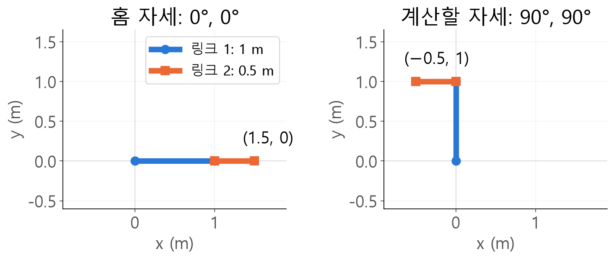
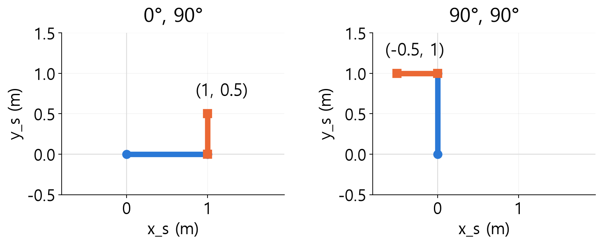

<link rel="stylesheet" href="https://cdn.jsdelivr.net/npm/katex@0.16.11/dist/katex.min.css">

## 1. 관절각에서 손끝 위치를 구하려면

지금까지는 물체의 위치와 방향을 T로 표현하고, 순간적인 운동을 트위스트로 표현했습니다.
이제 반대쪽에서 출발해 보겠습니다.

**로봇의 구조와 관절값을 알고 있다면 손끝의 위치와 방향을 어떻게 구할까요?**

이 문제를 순기구학(forward kinematics)이라고 합니다.
PoE(Product of Exponentials)는 각 관절의 운동을 행렬지수로 표현하고, 그 변환들을 곱해 손끝 자세를 구하는 방법입니다.
이를 이해하려면 먼저 트위스트에서 운동의 축과 속도를 분리해야 합니다.

## 2. 스크루 축과 움직인 양

한 관절만 움직이는 경우 트위스트는 다음과 같이 쓸 수 있습니다.

$$\mathcal V=S\dot\theta$$

S는 운동의 축이고, $$\dot\theta$$는 그 축을 따라 움직이는 속도입니다.
회전관절에서는 다음과 같습니다.

$$S=\begin{bmatrix}\hat\omega\\v_S\end{bmatrix},\qquad v_S=-\hat\omega\times q$$

$$\hat\omega$$는 단위 회전축 방향, q는 회전축 위의 한 점입니다.
이번에는 축 방향 이동이 없는 순수 회전관절을 다루므로 피치는 0입니다.

공간좌표계에서 표현한 일정한 축 S에 대해, 속도 대신 움직인 양 θ를 주면 변환은 다음과 같습니다.

$$\boxed{T(\theta)=e^{[S]\theta}T(0)}$$

$$T(0)$$는 θ를 0으로 정한 기준 자세입니다.
회전관절의 θ는 rad, 직동관절의 θ는 이동거리입니다.
축 S와 움직인 양 θ가 변환행렬로 연결되는 지점입니다.

회전축이 원점을 지나는 경우, 관절 변환의 회전 부분은 다음과 같습니다.

$$R=e^{[\hat\omega]\theta}$$

단위 회전축에 대해 로드리게스 공식으로 계산할 수 있습니다.

$$R=I+\sin\theta[\hat\omega]+(1-\cos\theta)[\hat\omega]^2$$

즉, 반대칭행렬과 각도를 행렬지수에 넣으면 유한한 회전을 나타내는 R이 나옵니다.

## 3. 실제 로봇의 M과 S 만들기

길이가 1 m와 0.5 m인 두 링크 로봇을 생각하겠습니다.
두 관절은 모두 +z축을 중심으로 회전하고, 바닥 좌표계 s의 원점은 첫 관절 중심에 둡니다.
+z에서 내려다보았을 때 반시계 방향이 양의 회전입니다.
둘째 관절각은 첫 링크에 대한 상대 회전각입니다.

두 관절각이 모두 0일 때 링크가 +x 방향으로 일직선이 되도록 정하겠습니다.
이를 홈 자세(home configuration)라고 합니다.
홈에서 손끝은 $$(1.5,0,0)$$에 있고, 손끝 좌표계의 방향은 s와 같습니다.
이때의 변환행렬을 M이라고 합니다.

$$M=\begin{bmatrix}1&0&0&1.5\\0&1&0&0\\0&0&1&0\\0&0&0&1\end{bmatrix}$$

<figure></figure>

이제 홈 자세에서 각 관절의 스크루 축을 s 기준으로 구합니다.

첫 관절은 원점을 지납니다.
따라서 $$q_1=(0,0,0)$$이고, $$v_1=-\hat\omega_1\times q_1=0$$입니다.

$$S_1=\begin{bmatrix}0\\0\\1\\0\\0\\0\end{bmatrix}$$

둘째 관절은 홈에서 $$(1,0,0)$$을 지납니다.
따라서 $$v_2=-(0,0,1)^T\times(1,0,0)^T=(0,-1,0)^T$$입니다.

$$S_2=\begin{bmatrix}0\\0\\1\\0\\-1\\0\end{bmatrix}$$

홈 자세 M과 두 관절축 S₁·S₂를 모두 만들었습니다.
이제 관절각을 넣어 계산할 수 있습니다.

## 4. PoE 공식에 관절각 넣기

두 관절 로봇의 Space Form PoE는 다음과 같습니다.

$$\boxed{T(\theta_1,\theta_2)=e^{[S_1]\theta_1}e^{[S_2]\theta_2}M}$$

각 관절의 변환을 관절 연결 순서대로 곱하고, 마지막에 홈 자세 M을 곱합니다.
첫 관절은 0°, 둘째 관절은 90°라고 하겠습니다.

$$\theta_1=0,\qquad \theta_2=\frac\pi2$$

첫 관절의 변환은 단위행렬이므로 둘째 관절만 계산하면 됩니다.
둘째 관절은 원점에서 떨어진 점 $$q=(1,0,0)$$을 중심으로 회전합니다.

점 x를 q 중심으로 회전시키는 식을 펼치면 다음과 같습니다.

$$x'=q+R(x-q)=Rx+(q-Rq)$$

따라서 둘째 관절의 변환은 다음과 같습니다.

$$e^{[S_2]\theta_2}=\begin{bmatrix}R&q-Rq\\0&1\end{bmatrix}$$

90° 회전에서는 $$Rq=(0,1,0)^T$$이므로 위치 부분은 $$(1,-1,0)^T$$입니다.
이 변환에 M을 곱하면 결과는 다음과 같습니다.

$$T(0,\pi/2)=\begin{bmatrix}0&-1&0&1\\1&0&0&0.5\\0&0&1&0\\0&0&0&1\end{bmatrix}$$

손끝의 위치는 $$(1,0.5,0)$$ m이고, 방향은 z축으로 +90° 회전한 상태입니다.
앞의 회전행렬·변환행렬 글에서 방향과 위치를 따로 넣어 만든 T와 같습니다.
이번에는 관절축과 관절각으로 그 값을 계산한 것입니다.

## 5. 두 관절을 모두 회전시키면

이번에는 두 관절을 각각 +90°로 놓겠습니다.

$$T(\pi/2,\pi/2)=e^{[S_1]\pi/2}e^{[S_2]\pi/2}M$$

$$T(\pi/2,\pi/2)=\begin{bmatrix}-1&0&0&-0.5\\0&-1&0&1\\0&0&1&0\\0&0&0&1\end{bmatrix}$$

최종 손끝 위치는 $$(-0.5,1,0)$$ m이고, 방향은 z축 기준 180°입니다.
첫 링크가 위로 1 m, 둘째 링크가 왼쪽으로 0.5 m 뻗은 모습과 일치합니다.

<figure></figure>

여기서 중요한 점은 첫 관절이 돌아도 공식에 넣는 S₂를 다시 고치지 않는다는 것입니다.
S₂는 홈에서 표현한 축으로 유지합니다.
앞의 첫 관절 변환이 뒤에서 만든 자세 전체를 움직이므로, 둘째 축이 함께 움직이는 효과도 포함됩니다.

행렬곱의 순서는 로봇의 관절 연결 구조를 반영합니다.
열벡터에는 오른쪽부터 작용하지만, 이 식이 실제 관절을 어떤 시간 순서로 움직이라는 뜻은 아닙니다.
주어진 관절값에 대응하는 최종 자세를 계산합니다.

## 6. Space Form과 Body Form

홈의 관절축을 공간좌표계 s에서 표현하면 Space Form입니다.
홈의 손끝 좌표계 b에서 표현하면 Body Form입니다.
같은 축의 표현 기준을 바꿀 때는 앞에서 배운 Adjoint를 사용합니다.

$$B_i=\operatorname{Ad}_{M^{-1}}S_i$$

그때의 PoE는 M이 맨 앞에 놓입니다.

$$\boxed{T=M e^{[B_1]\theta_1}e^{[B_2]\theta_2}}$$

두 공식은 같은 손끝 자세를 계산합니다.
차이는 관절축을 어느 좌표계에서 표현했는지와 그에 따른 곱의 배치입니다.
홈의 축을 바꿀 때는 M을, 현재 트위스트를 바꿀 때는 현재 T를 사용합니다.

지금까지의 연결은 다음과 같습니다.
회전행렬은 방향을, 동차변환행렬은 위치와 방향을 표현합니다.
트위스트는 순간 운동을, 렌치는 힘과 모멘트를 표현합니다.
그중 운동의 축을 행렬지수로 유한한 변환으로 바꾸고, 각 관절의 변환을 곱하면 PoE로 손끝의 T를 구할 수 있습니다.
렌치는 힘을 표현하는 쪽으로 연결되며 PoE의 입력에는 들어가지 않습니다.

참고: [Modern Robotics 강체운동의 지수좌표](https://modernrobotics.northwestern.edu/nu-gm-book-resource/3-3-3-exponential-coordinates-of-rigid-body-motion/), [Space Form PoE](https://modernrobotics.northwestern.edu/nu-gm-book-resource/4-1-1-product-of-exponentials-formula-in-the-space-frame/), [Body Form PoE](https://modernrobotics.northwestern.edu/nu-gm-book-resource/4-1-2-product-of-exponentials-formula-in-the-end-effector-frame/). 2026년 11월 18일 확인.
