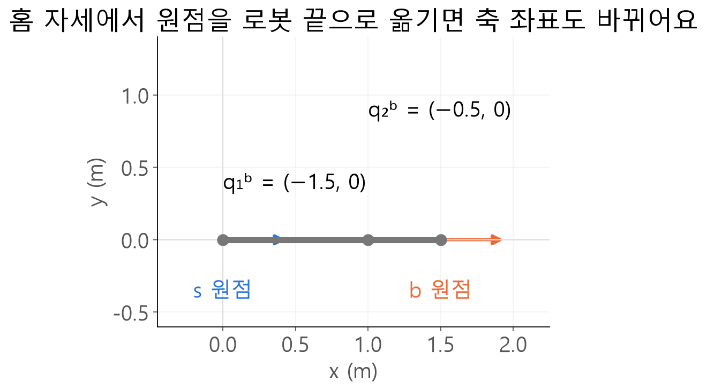

<style>
.content table { width:100%; border-collapse:collapse; margin:14px 0 24px; font-size:17px; line-height:1.5; }
.content th,.content td { border-bottom:1px solid #e6dde0; padding:8px 10px; text-align:left; vertical-align:top; word-break:keep-all; overflow-wrap:normal; }
.content thead { background:#fbf1f4; }
.content figure { margin:18px 0; }
.content figure img { width:100%; height:auto; }
.content .katex-display { overflow-x:auto; overflow-y:hidden; padding:4px 0; }
.content td code { white-space:nowrap; }
.content pre .nb { padding:0; border:0; border-radius:0; background:none; }
@media(max-width:560px){.content th,.content td { padding:7px 5px; font-size:16px; }}
</style>
<link rel="stylesheet" href="https://cdn.jsdelivr.net/npm/katex@0.16.11/dist/katex.min.css">
<script defer src="https://cdn.jsdelivr.net/npm/katex@0.16.11/dist/katex.min.js"></script>
<script defer src="https://cdn.jsdelivr.net/npm/katex@0.16.11/dist/contrib/auto-render.min.js" onload="renderMathInElement(document.querySelector('.content')||document.body,{delimiters:[{left:'\\[',right:'\\]',display:true},{left:'\\(',right:'\\)',display:false}]})"></script>

<div class="wc"><p><a href="https://modernrobotics.northwestern.edu/nu-gm-book-resource/4-1-1-product-of-exponentials-formula-in-the-space-frame/">순기구학(forward kinematics)</a>은 관절값으로 로봇 끝의 위치와 방향을 구하는 계산이에요.<br>
PoE(Product of Exponentials)는 관절의 변환행렬들을 곱해 이 자세를 구하는 방법이에요.<br>
홈 자세와 축을 직접 만들면 긴 공식을 실제 숫자로 계산할 수 있어요.</p></div>

두 관절 로봇팔의 모델을 정하는 것부터 결과 검산까지 일곱 단계로 정리해요.
실제 로봇을 연결하지 않고 파이썬으로 계산하는 예제예요.

<div class="keyline">로봇 구조 → 홈 자세 M → 축 S₁·S₂ → 행렬지수의 곱 → 끝 자세 T 순서예요.</div>

## <span class="no">1</span> 계산할 로봇팔

길이가 **1 m와 0.5 m인 두 링크**를 연결하고, 두 관절 모두 z축 둘레로 회전하게 할게요.
링크(link)는 관절 사이의 몸체예요.
로봇팔은 xy 평면에서 움직이고, z축은 화면 밖을 향해요.
관절의 양의 회전은 화면에서 반시계 방향이에요.

<figure></figure>

모든 관절값이 0일 때를 홈 자세(home configuration)로 정해요.
홈에서 두 링크는 +x 방향으로 일직선이고 끝은 $$(1.5,0,0)$$이에요.
고정 좌표계 $$\{s\}$$는 첫 관절에, 끝 좌표계 $$\{b\}$$는 로봇 끝에 붙여요.
홈에서 두 좌표계의 축 방향은 같게 정해요.

구할 것은 두 관절을 각각 +90° 돌렸을 때의 끝 자세 $$T_{sb}$$예요.
둘째 관절각은 첫 링크에 대한 상대 회전각이에요.
따라서 최종 끝 방향은 $$90°+90°=180°$$가 돼요.

## <span class="no">2</span> 홈 자세 M 만들기

M은 **관절값이 모두 0일 때 끝 좌표계의 위치와 방향**이에요.
홈에서 방향이 같으므로 회전 부분은 단위행렬이에요.
위치 열에는 $$(1.5,0,0)$$을 넣어요.

$$M=\begin{bmatrix}1&0&0&1.5\\0&1&0&0\\0&0&1&0\\0&0&0&1\end{bmatrix}$$

M에는 관절을 얼마나 돌릴지가 아직 들어 있지 않아요.
관절값을 바꿔도 **같은 홈 자세 M을 기준**으로 계산해요.

## <span class="no">3</span> 홈에서 스크루 축 구하기

Space Form에서는 **각 관절의 축을 홈 자세의 s 좌표로 표현**해요.
회전관절의 축은 다음 식으로 구해요.

$$S_i=\begin{bmatrix}\hat\omega_i\\v_i\end{bmatrix},\qquad v_i=-\hat\omega_i\times q_i$$

$$\hat\omega_i$$는 단위 회전축 방향, $$q_i$$는 그 축 위의 점이에요.
두 축은 모두 +z 방향이므로 $$\hat\omega_1=\hat\omega_2=(0,0,1)$$이에요.

첫 관절은 원점을 지나므로 $$q_1=(0,0,0)$$이에요.
홈에서 둘째 관절은 첫 링크의 끝에 있으므로 $$q_2=(1,0,0)$$이고요.

$$S_1=\begin{bmatrix}0\\0\\1\\0\\0\\0\end{bmatrix},\qquad S_2=\begin{bmatrix}0\\0\\1\\0\\-1\\0\end{bmatrix}$$

둘째 축의 −1은 $$-(0,0,1)\times(1,0,0)=(0,-1,0)$$에서 나와요.
이 값만 보고 로봇 끝의 이동 방향을 판단할 수는 없어요.

첫 관절이 돌면 실제 둘째 축의 위치도 움직여요.
**PoE 식에 넣는 S₂는 홈에서 구한 값으로 유지**해요.
앞 관절의 변환을 곱하는 과정에 축이 함께 움직이는 효과가 포함돼요.

## <span class="no">4</span> PoE를 파이썬으로 계산

Space Form의 PoE는 **각 관절의 행렬지수를 관절 순서로 곱하고 마지막에 M을 곱해요.**

$$T(\theta_1,\theta_2)=e^{[S_1]\theta_1}e^{[S_2]\theta_2}M$$

$$[S_i]$$는 6차원 축을 4×4 행렬로 바꾼 것이고, 각도는 rad로 넣어요.
코드는 `pip install numpy scipy`로 설치한 뒤 위에서부터 실행해요.

```python
import numpy as np
from scipy.linalg import expm

def skew(a):
    x, y, z = a
    return np.array([[0., -z, y],
                     [z, 0., -x],
                     [-y, x, 0.]])

def se3(S):
    A = np.zeros((4, 4))
    A[:3, :3] = skew(S[:3])
    A[:3, 3] = S[3:]
    return A

M = np.eye(4)
M[0, 3] = 1.5
w = np.array([0., 0., 1.])
q1 = np.zeros(3)
q2 = np.array([1., 0., 0.])
S1 = np.r_[w, -np.cross(w, q1)]
S2 = np.r_[w, -np.cross(w, q2)]
a, b = np.deg2rad([90., 90.])
E1 = expm(se3(S1) * a)
E2 = expm(se3(S2) * b)
T = E1 @ E2 @ M
print(np.round(T, 6) + 0.)
```

```text
[[-1.   0.   0.  -0.5]
 [ 0.  -1.   0.   1. ]
 [ 0.   0.   1.   0. ]
 [ 0.   0.   0.   1. ]]
```

오른쪽 위의 위치 열에는 $$(-0.5,1,0)$$ m가 들어 있어요.
왼쪽 위 회전행렬은 z축으로 180° 회전한 방향이에요.

열벡터에는 오른쪽 행렬부터 작용해요.
여기서 계산하는 것은 주어진 관절값의 최종 자세예요.
실제 관절을 어떤 시간 순서로 움직이는지는 이 식에 들어 있지 않아요.

## <span class="no">5</span> 도형으로 같은 답 확인

평면 두 관절 로봇팔에서는 링크의 벡터를 더해 **다른 방법으로 위치를 검산**할 수 있어요.
첫 링크의 방향은 a, 둘째 링크의 절대 방향은 a+b예요.

$$x=1\cos a+0.5\cos(a+b)$$

$$y=1\sin a+0.5\sin(a+b)$$

$$a=b=90°$$를 넣으면 x는 $$0-0.5=-0.5$$, y는 $$1+0=1$$이에요.
이 값이 PoE의 위치 열과 같아야 해요.

```python
xy = np.array([
    np.cos(a) + 0.5 * np.cos(a + b),
    np.sin(a) + 0.5 * np.sin(a + b)
])
print(np.round(xy, 6))
print(np.allclose(xy, T[:2, 3]))
T_wrong = E2 @ E1 @ M
print(np.round(T_wrong[:3, 3], 6) + 0.)
```

```text
[-0.5  1. ]
True
[-0.5 -1.   0. ]
```

셋째 줄은 행렬 순서를 뒤집어 계산한 위치예요.
관절값이 같아도 곱하는 순서를 바꾸면 이 로봇의 끝 자세를 표현하지 못해요.
또 코드의 `*`는 칸별 곱이고 `@`가 행렬곱이라는 점도 함께 확인하세요.

## <span class="no">6</span> Space와 Body 표현

Space Form과 Body Form은 **같은 끝 자세를 서로 다른 기준으로 표현한 축으로 계산**해요.
Body Form의 축 $$B_i$$는 홈 자세의 끝 좌표계 b에서 표현해요.

<figure></figure>

이 예제의 홈에서는 두 좌표계의 방향이 같아요.
b에서 본 축 위의 점은 $$q_1^b=(-1.5,0,0)$$, $$q_2^b=(-0.5,0,0)$$이에요.
같은 외적 식을 적용하면 아래 성분은 각각 $$(0,1.5,0)$$과 $$(0,0.5,0)$$이에요.

일반적으로 이 기준 변환을 해 주는 6×6 행렬을 Adjoint(어드조인트)라고 불러요.

$$\operatorname{Ad}_T=\begin{bmatrix}R&0\\[p]R&R\end{bmatrix}$$

여기서 각 블록은 3×3이고, $$[p]$$는 p의 외적 행렬이에요.
점의 좌표는 4×4인 T로, 6차원 축과 트위스트는 6×6인 Adjoint로 바꿔요.

$$B_i=\operatorname{Ad}_{M^{-1}}S_i$$

$$T=M e^{[B_1]\theta_1}e^{[B_2]\theta_2}$$

Body Form은 M이 맨 앞에 있어요.
축만 바꾼 뒤 Space Form과 같은 자리에 M을 두면 안 맞아요.

```python
def adjoint(H):
    R = H[:3, :3]
    p = H[:3, 3]
    Z = np.zeros((3, 3))
    return np.block([[R, Z],
                     [skew(p) @ R, R]])

Ad_inv = adjoint(np.linalg.inv(M))
B1, B2 = Ad_inv @ S1, Ad_inv @ S2
T_body = (M @ expm(se3(B1) * a)
          @ expm(se3(B2) * b))
print(B1)
print(B2)
print(np.allclose(T, T_body))
```

```text
[0.  0.  1.  0.  1.5 0. ]
[0.  0.  1.  0.  0.5 0. ]
True
```

지금은 원점만 옮긴 예제지만, Adjoint에는 축 방향이 다른 경우의 회전도 포함돼요.
현재 자세의 속도 표현은 $$\mathcal V_s=\operatorname{Ad}_{T_{sb}}\mathcal V_b$$로 연결돼요.
홈의 축을 바꿀 때는 M, 현재 트위스트를 바꿀 때는 현재 T를 사용해요.

## <span class="no">7</span> 자세·로봇 모델·힘의 역할

PoE는 관절값에서 **로봇 끝의 위치와 방향**을 구해요.
함께 등장하는 URDF와 렌치의 역할도 구분해 두면 좋아요.

**URDF(Unified Robot Description Format)**는 로봇의 link와 joint 구조를 XML로 기술하는 형식이에요.
링크 사이의 연결, 관절 종류와 축 등을 로봇 모델로 적어요.
위 예제에서는 로봇 구조를 직접 M과 S로 구성했어요.
URDF를 읽어 모델을 구성하는 소프트웨어도 관절의 기준 좌표와 홈을 일관되게 해석해야 해요.

**렌치(wrench)**는 모멘트와 힘을 묶은 6차원 표현이에요.
점 r에 작용하는 힘 f가 원점에 만드는 모멘트는 $$m=r\times f$$예요.

$$\mathcal F=\begin{bmatrix}m\\f\end{bmatrix}$$

예를 들어 $$r=(0.5,0,0)$$ m에서 $$f=(0,2,0)$$ N을 가하면, $$m=(0,0,1)$$ N·m예요.
관절 속도를 나타내는 트위스트와 차원은 같아도 성분의 뜻과 단위가 달라요.
렌치에는 힘과 모멘트가 들어 있어요.
질량·관성·힘과 가속도의 관계까지 계산하는 영역이 동역학(dynamics)이에요.
이번 PoE 계산의 출력 T에는 힘이나 모터 토크가 들어 있지 않아요.

<div class="done">홈 자세와 축을 만들면, 관절값에서 로봇 끝의 자세까지 직접 계산할 수 있어요.</div>

정의와 표기 확인: [Modern Robotics Space Form](https://modernrobotics.northwestern.edu/nu-gm-book-resource/4-1-1-product-of-exponentials-formula-in-the-space-frame/), [Body Form](https://modernrobotics.northwestern.edu/nu-gm-book-resource/4-1-2-product-of-exponentials-formula-in-the-end-effector-frame/), [Adjoint](https://modernrobotics.northwestern.edu/nu-gm-book-resource/3-3-2-twists-part-2-of-2/), [렌치](https://modernrobotics.northwestern.edu/nu-gm-book-resource/3-4-wrenches/), [ROS URDF 패키지 설명](https://index.ros.org/p/urdf/). 2026년 11월 18일 확인.
