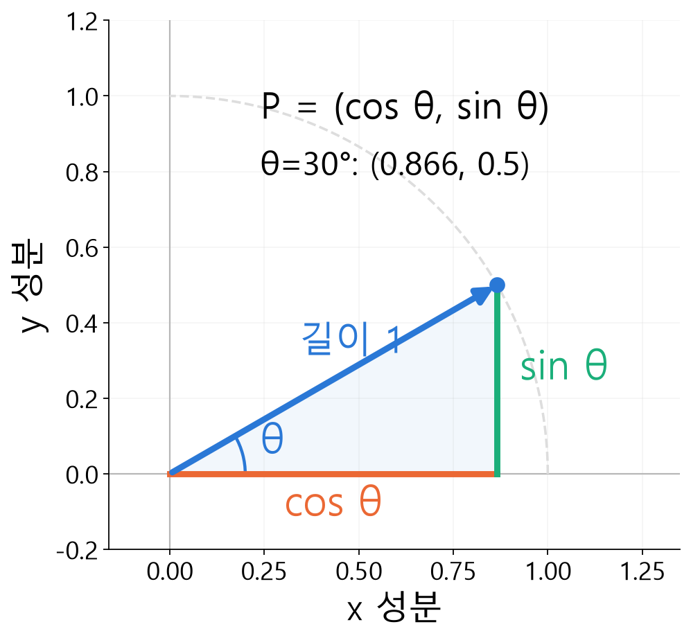
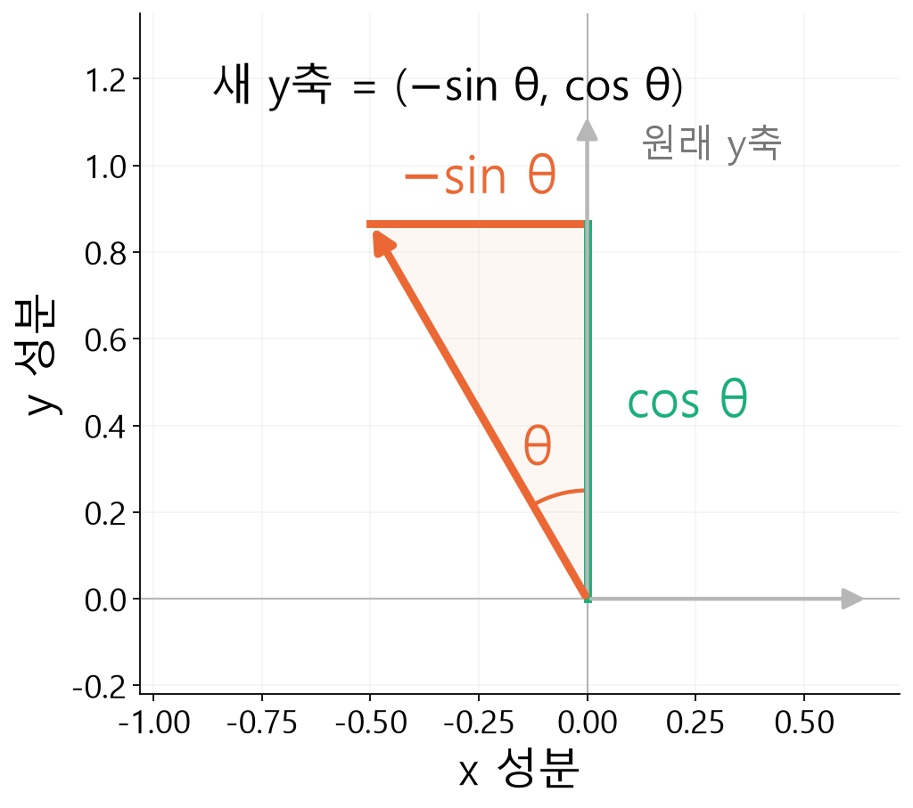
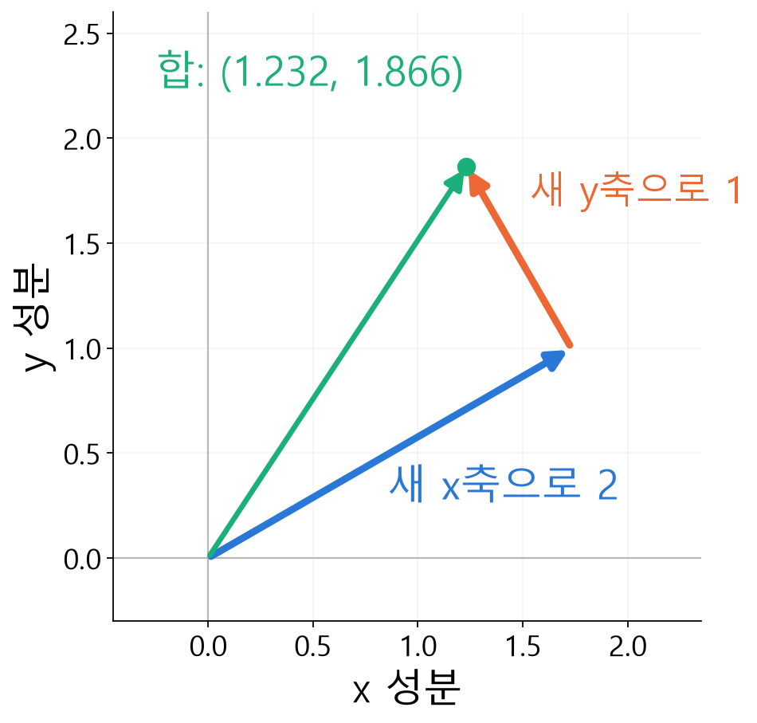

<link rel="stylesheet" href="https://cdn.jsdelivr.net/npm/katex@0.16.11/dist/katex.min.css">

물체를 돌리면 회전행렬에 왜 cosθ와 sinθ가 들어갈까요?
공식을 먼저 외우기보다, 화살표 하나를 돌려 보겠습니다.
그 화살표의 가로·세로 성분을 적고, 같은 일을 좌표계의 두 축에 적용하면 회전행렬이 만들어집니다.

## 1. 좌표는 가로·세로 성분입니다

원점에서 오른쪽으로 3, 위로 2만큼 향하는 화살표가 있다면 좌표를 (3,2)라고 적습니다.
첫 숫자는 가로 성분이고, 둘째 숫자는 세로 성분입니다.
화살표의 길이를 그대로 적은 것은 아닙니다.
길이는 $$\sqrt{3^2+2^2}=\sqrt{13}$$입니다.

이처럼 크기와 방향을 가진 화살표를 벡터라고 합니다.
좌표계의 축 방향도 벡터로 적을 수 있습니다.
오른쪽을 향하는 길이 1의 x축 화살표는 (1,0), 위를 향하는 y축 화살표는 (0,1)입니다.
길이가 1인 벡터를 단위벡터라고 합니다.

## 2. 화살표를 돌리면 cosθ·sinθ가 나오는 이유

길이 1인 화살표 (1,0)을 원점 중심으로 반시계 방향으로 θ만큼 돌리겠습니다.
θ는 세타라고 읽으며, 여기서는 원래 x축과 회전한 화살표 사이의 각도입니다.
먼저 0°와 90° 사이에서 생각하겠습니다.

화살표 끝에서 x축으로 수직선을 내리면 직각삼각형이 생깁니다.
빗변은 원래 화살표이므로 길이가 1입니다.

<figure></figure>

직각삼각형에서 코사인과 사인은 다음 비율입니다.

$$\cos\theta=\frac{\text{각도 옆의 가로 변}}{\text{빗변}}$$

$$\sin\theta=\frac{\text{각도 맞은편 세로 변}}{\text{빗변}}$$

빗변이 1이므로 가로 변의 길이는 cosθ, 세로 변의 길이는 sinθ가 됩니다.
따라서 회전한 화살표의 좌표는 다음과 같습니다.

$$\boxed{(\cos\theta,\ \sin\theta)}$$

cosθ와 sinθ는 회전한 화살표를 가로와 세로로 나누어 적은 값입니다.
회전행렬에 삼각함수가 들어가는 이유가 여기에서 시작됩니다.

예를 들어 θ=30°라면 다음과 같습니다.

$$\cos30^\circ=\frac{\sqrt3}{2}\approx0.866,\qquad\sin30^\circ=\frac12$$

즉, 오른쪽으로 약 0.866, 위로 0.5를 향합니다.
여기서 $$\sqrt3$$은 제곱하면 3이 되는 양수이며 약 1.732입니다.

화살표의 길이가 2라면 두 성분을 모두 2배 합니다.

$$(2\cos\theta,\ 2\sin\theta)$$

다른 사분면에서는 가로·세로의 방향까지 포함해 성분에 부호를 붙입니다.
이 정의를 단위원, 즉 반지름 1인 원 전체로 확장하면 모든 각도에서 같은 표현을 사용할 수 있습니다.

## 3. y축도 함께 돌리면 왜 −sinθ일까?

물체의 방향을 표현하려면 x축 하나뿐 아니라 y축도 함께 돌려야 합니다.
원래 y축은 위를 향하고, x축보다 90° 앞에 있습니다.
x축을 θ만큼 돌렸다면 y축도 θ만큼 돌아갑니다.

<figure></figure>

0°와 90° 사이의 θ에서 새 y축은 왼쪽 위를 향합니다.
이 화살표도 길이가 1입니다.
새 y축 끝에서 원래 y축으로 수평선을 그리면, 두 축 사이의 θ가 안쪽에 들어가는 직각삼각형이 생깁니다.
이번 삼각형에서는 θ가 원래 y축과 새 y축 사이에 있으므로, 세로 변이 θ 옆의 변이고 가로 변이 θ 맞은편 변입니다.

- 세로 변의 크기: cosθ
- 가로 변의 크기: sinθ
- 가로 방향: 왼쪽이므로 음수

따라서 새 y축의 성분은 다음과 같습니다.

$$\boxed{(-\sin\theta,\ \cos\theta)}$$

마이너스는 회전한 y축이 왼쪽 성분을 가진 데서 나옵니다.
각도를 x축에서 재어도 같은 결과입니다.

$$\cos(\theta+90^\circ)=-\sin\theta$$

$$\sin(\theta+90^\circ)=\cos\theta$$

이 식은 같은 화살표를 두 방식으로 읽은 것입니다.

## 4. 왜 이 벡터들을 행렬의 열에 놓을까?

이제 바닥에 고정한 좌표계를 s, 같이 돌아간 좌표계를 b라고 부르겠습니다.
두 원점은 아직 같은 위치에 둡니다.
s와 b는 좌표계의 이름입니다.

b에서 어떤 벡터의 좌표가 (2,1)이라면, 뜻은 다음과 같습니다.
**새 x축 방향으로 2만큼, 새 y축 방향으로 1만큼 더한 벡터**입니다.

앞에서 구한 축의 성분을 그대로 넣으면 다음과 같습니다.

$$2\begin{bmatrix}\cos\theta\\\sin\theta\end{bmatrix}+1\begin{bmatrix}-\sin\theta\\\cos\theta\end{bmatrix}$$

가로 성분끼리, 세로 성분끼리 더합니다.

$$x_s=2\cos\theta-\sin\theta$$

$$y_s=2\sin\theta+\cos\theta$$

일반적인 b 좌표를 $$(x_b,y_b)$$라고 쓰면 같은 계산은 다음과 같습니다.

$$x_s=x_b\cos\theta-y_b\sin\theta$$

$$y_s=x_b\sin\theta+y_b\cos\theta$$

이 두 식의 계수를 정리한 것이 행렬입니다.

$$\boxed{\begin{bmatrix}x_s\\y_s\end{bmatrix}=\begin{bmatrix}\cos\theta&-\sin\theta\\\sin\theta&\cos\theta\end{bmatrix}\begin{bmatrix}x_b\\y_b\end{bmatrix}}$$

행렬곱은 각 행의 숫자와 좌표의 숫자를 차례로 곱한 뒤 더합니다.
첫 행은 가로 성분 식, 둘째 행은 세로 성분 식을 계산합니다.
첫째 열에는 새 x축의 성분, 둘째 열에는 새 y축의 성분이 들어 있습니다.

**각 열에 새 축을 놓는 이유는, 좌표가 각 축 벡터에 곱하는 계수이기 때문입니다.**

## 5. 숫자를 넣어 같은 계산을 확인하기

θ=30°에서 b 좌표 (2,1)을 바꾸어 보겠습니다.

$$x_s=2\times0.866025-1\times0.5\approx1.232$$

$$y_s=2\times0.5+1\times0.866025\approx1.866$$

<figure></figure>

행렬은 화살표를 두 번 더하는 계산을 짧게 적은 형태입니다.
그림에서는 파란 화살표가 새 x축의 2배이고, 주황 화살표가 새 y축의 1배입니다.
두 화살표를 이어 붙인 결과가 초록 화살표입니다.

이제 θ=90°를 넣어 보겠습니다.

$$\cos90^\circ=0,\qquad\sin90^\circ=1$$

$$R(90^\circ)=\begin{bmatrix}0&-1\\1&0\end{bmatrix}$$

0·1·−1은 별도로 외워 넣은 숫자가 아닙니다.
앞에서 만든 일반식에 90°를 대입한 결과입니다.
(2,1)을 이 행렬로 바꾸면 (-1,2)가 됩니다.

## 6. 2×2에서 3×3으로 확장하기

지금까지는 xy 평면만 보았습니다.
z축을 중심으로 돌리면 z 방향은 그대로 유지됩니다.
따라서 새 세 축의 성분을 3차원으로 적으면 다음과 같습니다.

- 새 x축: $$(\cos\theta,\sin\theta,0)^T$$
- 새 y축: $$(-\sin\theta,\cos\theta,0)^T$$
- 새 z축: $$(0,0,1)^T$$

위첨자 T는 행과 열을 바꾸는 전치 표기입니다.
가로로 적은 세 숫자를 세로 열벡터로 읽으라는 뜻입니다.
세 축을 열로 놓으면 z축 회전행렬이 됩니다.

$$\boxed{R_z(\theta)=\begin{bmatrix}\cos\theta&-\sin\theta&0\\\sin\theta&\cos\theta&0\\0&0&1\end{bmatrix}}$$

숫자가 3×3인 이유는 **축이 세 개이고, 각 축을 x·y·z 세 성분으로 표현하기 때문**입니다.
$$R_{sb}$$라고 쓰면 b의 축 방향을 s 기준으로 적은 회전행렬이라는 뜻입니다.

θ=90°를 대입하면 다음과 같습니다.

$$R_z(90^\circ)=\begin{bmatrix}0&-1&0\\1&0&0\\0&0&1\end{bmatrix}$$

이 글의 행렬은 열벡터를 사용하고, 양의 회전은 +z 쪽에서 내려다볼 때 반시계 방향으로 정했습니다.
같은 물리적 방향이라도 어떤 좌표를 어느 기준으로 바꾸는지에 따라 역행렬을 쓸 수 있으므로 기준을 함께 읽어야 합니다.

## 7. 회전행렬이 지켜야 하는 조건

세 열벡터는 좌표축이므로 길이가 1이고 서로 수직입니다.
길이가 1인지는 내적으로 확인할 수 있습니다.
내적은 대응하는 성분끼리 곱한 값을 더하는 연산입니다.
첫 열을 a라고 하면 다음과 같습니다.

$$a\cdot a=\cos^2\theta+\sin^2\theta=1$$

이 등식은 앞의 직각삼각형에서 가로²+세로²=빗변²라는 관계와 같습니다.
첫 열과 둘째 열의 내적도 계산해 보겠습니다.

$$a\cdot b=\cos\theta(-\sin\theta)+\sin\theta\cos\theta=0$$

수직인 두 벡터의 내적은 0입니다.
세 열을 a, b, c라고 하면 전치행렬의 세 행은 각각 a, b, c를 가로로 놓은 것입니다.
따라서 행렬곱의 각 칸은 다음 내적이 됩니다.

$$R^TR=\begin{bmatrix}a\cdot a&a\cdot b&a\cdot c\\b\cdot a&b\cdot b&b\cdot c\\c\cdot a&c\cdot b&c\cdot c\end{bmatrix}$$

자기 자신과의 내적은 길이의 제곱이므로 대각선은 1입니다.
서로 다른 축은 수직이므로 나머지 칸은 0입니다.

$$R^TR=\begin{bmatrix}1&0&0\\0&1&0\\0&0&1\end{bmatrix}=I$$

I는 곱해도 좌표를 그대로 유지하는 단위행렬입니다.
R을 곱한 다음 $$R^T$$를 곱하면 I가 되어 원래 좌표로 돌아가므로, $$R^{-1}=R^T$$입니다.

지금 만든 $$R_z(\theta)$$는 z축을 고정한 회전이라 각도 θ 하나로 정해집니다.
이 경우의 자유도는 1입니다.
반면 임의의 3차원 방향을 표현할 때는 회전축 방향도 바뀔 수 있습니다.
일반적인 3×3 회전행렬에는 길이 조건 세 개와 수직 조건 세 개가 있어, 아홉 성분에 여섯 개의 독립 제약이 걸리고 회전 자유도는 세 개가 됩니다.

직교 조건만으로는 거울반사도 포함됩니다.
예를 들어 z 성분의 부호만 바꾸는 행렬도 세 축의 길이와 수직 조건을 만족합니다.
이를 구분할 때 쓰는 행렬식 det R은 부피의 배율과 좌표축의 오른손·왼손 방향을 판별하는 값입니다.
직교행렬의 행렬식은 +1 또는 −1이며, 순수 회전에는 $$\det R=1$$을 요구합니다.
이 조건을 만족하는 모든 3차원 회전행렬의 집합이 $$SO(3)$$입니다.
z축 회전행렬은 이 집합에 속하는 한 종류입니다.

이제 회전행렬의 각 칸이 무엇을 뜻하는지 알 수 있습니다.
하지만 두 좌표계의 원점이 서로 다른 곳에 있다면 방향만 바꾸어서는 점의 좌표를 구할 수 없습니다.
다음 글에서는 그 원점 차이를 위치벡터로 더하고, 동차변환행렬 T를 직접 만듭니다.

참고: [Modern Robotics 회전행렬의 정의와 성질](https://modernrobotics.northwestern.edu/nu-gm-book-resource/3-2-1-rotation-matrices-part-1-of-2/), [좌표 변환과 회전행렬의 사용](https://modernrobotics.northwestern.edu/nu-gm-book-resource/3-2-1-rotation-matrices-part-2-of-2/). 2026년 11월 18일 확인.
