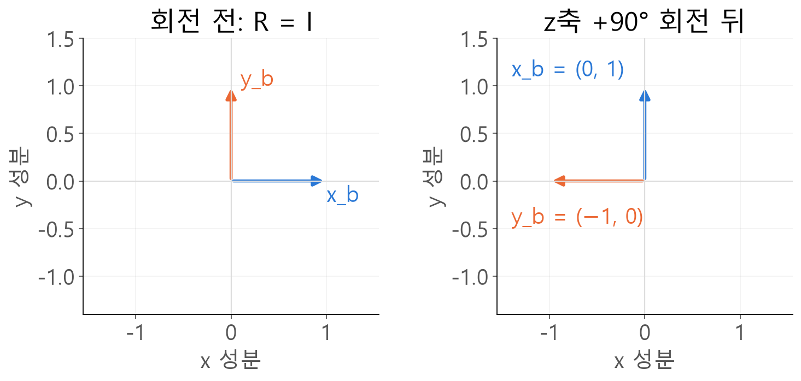
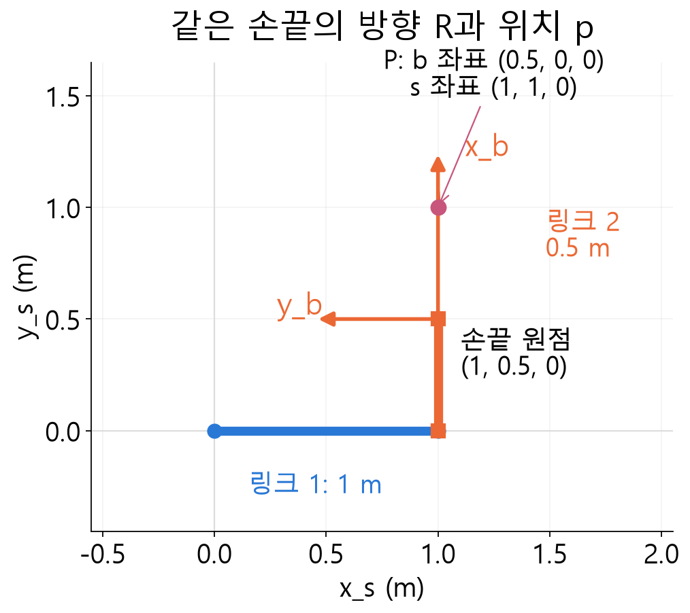

<link rel="stylesheet" href="https://cdn.jsdelivr.net/npm/katex@0.16.11/dist/katex.min.css">

로봇팔의 끝부분이 어디에 있고, 어느 방향을 향하는지 표현하려면 무엇이 필요할까요?
먼저 방향을 표현하는 회전행렬 R을 살펴보고, 여기에 위치를 더해 동차변환행렬 T를 만들어 보겠습니다.

## 1. 회전행렬 R이란?

회전행렬(rotation matrix)은 **물체의 방향을 표현하는 3×3 행렬**입니다.
물체에 좌표계를 하나 붙이면, 그 좌표계의 축이 어느 방향을 향하는지로 물체의 방향을 나타낼 수 있습니다.
좌표계는 원점과 x·y·z축으로 이루어진 기준입니다.

바닥에 고정한 좌표계를 $$\{s\}$$, 물체에 붙인 좌표계를 $$\{b\}$$라고 하겠습니다.
물체가 z축을 중심으로 +90° 회전한 상태를 생각해 보겠습니다.
+z 쪽에서 xy 평면을 내려다볼 때 반시계 방향이 양의 회전입니다.

이때 물체의 세 축을 바닥 기준으로 표현하면 다음과 같습니다.

- b의 x축: s의 +y 방향, $$(0,1,0)^T$$
- b의 y축: s의 −x 방향, $$(-1,0,0)^T$$
- b의 z축: s의 +z 방향, $$(0,0,1)^T$$

이 세 벡터를 열로 나란히 놓으면 회전행렬이 됩니다.

$$\boxed{R_{sb}=\begin{bmatrix}0&-1&0\\1&0&0\\0&0&1\end{bmatrix}}$$

첫 번째 열은 x축, 두 번째 열은 y축, 세 번째 열은 z축의 방향입니다.
아래첨자 sb는 **b의 방향을 s 기준으로 표현한다**는 뜻입니다.
앞의 s가 기준이고, 뒤의 b가 표현하려는 좌표계입니다.

<figure></figure>

## 2. 숫자는 아홉 개인데 자유도는 왜 세 개일까?

회전행렬에는 숫자가 아홉 개 있습니다.
하지만 그 아홉 숫자를 모두 마음대로 정할 수는 없습니다.
좌표계의 세 축은 길이가 1이어야 하고, 서로 수직이어야 하기 때문입니다.

세 열벡터를 a, b, c라고 하면 길이 조건이 세 개 있습니다.

$$a\cdot a=1,\qquad b\cdot b=1,\qquad c\cdot c=1$$

서로 수직이라는 조건도 세 개 있습니다.

$$a\cdot b=0,\qquad a\cdot c=0,\qquad b\cdot c=0$$

따라서 아홉 성분에 여섯 개의 독립적인 제약이 걸리고, 남는 회전 자유도는 세 개입니다.
자유도는 독립적으로 정할 수 있는 매개변수의 수를 뜻합니다.
행렬의 아무 세 칸이나 골라 자유롭게 넣을 수 있다는 뜻은 아닙니다.

이 조건들을 모으면 다음과 같이 쓸 수 있습니다.

$$R^TR=I,\qquad \det R=1$$

$$R^T$$는 행과 열을 바꾼 전치행렬이고, I는 단위행렬입니다.
행렬식 +1 조건은 직교행렬 중에서 오른손 좌표계의 회전을 선택합니다.
자유도를 하나 더 빼는 조건은 아닙니다.
이 조건을 만족하는 3×3 행렬들의 집합을 $$SO(3)$$라고 합니다.

## 3. 회전행렬에 빠져 있는 정보

방향이 같은 물체라도 공간의 서로 다른 곳에 놓일 수 있습니다.
따라서 R만으로는 **물체가 어디에 있는지** 알 수 없습니다.
이제 위치를 추가해야 합니다.

앞의 방향을 가진 물체의 원점이 바닥 기준으로 $$(1,0.5,0)$$ m에 있다고 하겠습니다.
이 위치를 벡터 p로 적습니다.

$$p=\begin{bmatrix}1\\0.5\\0\end{bmatrix}\ \mathrm m$$

이제 물체의 방향 R과 원점 위치 p를 모두 알게 되었습니다.
물체에 붙은 점의 좌표도 바닥 기준으로 바꿀 수 있습니다.

예를 들어 물체의 x축으로 0.5 m 앞에 점 P가 있다면, b에서 표현한 좌표는 다음과 같습니다.

$$x_b=\begin{bmatrix}0.5\\0\\0\end{bmatrix}$$

이 벡터의 방향을 R로 환산하고, 원점 위치 p를 더합니다.

$$\boxed{x_s=R_{sb}x_b+p}$$

$$x_s=\begin{bmatrix}0\\0.5\\0\end{bmatrix}+\begin{bmatrix}1\\0.5\\0\end{bmatrix}=\begin{bmatrix}1\\1\\0\end{bmatrix}\ \mathrm m$$

같은 점 P가 물체 기준에서는 $$(0.5,0,0)$$, 바닥 기준에서는 $$(1,1,0)$$으로 표현됩니다.
점이 움직인 것이 아니라, 좌표를 적은 기준이 달라진 것입니다.

## 4. 동차변환행렬 T란?

동차변환행렬(homogeneous transformation matrix)은 **위치와 방향을 함께 표현하는 4×4 행렬**입니다.
앞에서 따로 사용한 R과 p를 하나의 행렬로 묶습니다.

$$\boxed{T_{sb}=\begin{bmatrix}R_{sb}&p\\0&1\end{bmatrix}}$$

- 왼쪽 위 3×3: 방향을 나타내는 R
- 오른쪽 위 3×1: 원점 위치를 나타내는 p
- 마지막 행: $$(0,0,0,1)$$

예제의 숫자를 넣으면 다음과 같습니다.

$$T_{sb}=\begin{bmatrix}0&-1&0&1\\1&0&0&0.5\\0&0&1&0\\0&0&0&1\end{bmatrix}$$

점의 좌표 뒤에도 1을 붙이면, 회전과 위치 덧셈을 한 번의 행렬곱으로 계산할 수 있습니다.

$$\begin{bmatrix}x_s\\1\end{bmatrix}=T_{sb}\begin{bmatrix}x_b\\1\end{bmatrix}$$

이때 점 뒤에 붙인 1이 위치 p를 더해 주는 역할을 합니다.
방향벡터에는 0을 붙입니다.
방향벡터에는 원점의 위치를 더하지 않기 때문입니다.
이러한 강체변환행렬의 집합을 $$SE(3)$$라고 합니다.
강체는 움직이는 동안 모양과 크기가 유지되는 물체입니다.

<figure></figure>

## 5. 반대 방향으로 바꾸는 방법

s 좌표를 b 좌표로 되돌리려면, 먼저 p를 빼고 회전을 되돌립니다.

$$x_b=R_{sb}^T(x_s-p)$$

회전행렬은 $$R^{-1}=R^T$$이므로 전치행렬로 역회전을 계산할 수 있습니다.
이를 4×4 행렬로 쓰면 다음과 같습니다.

$$\boxed{T_{sb}^{-1}=T_{bs}=\begin{bmatrix}R_{sb}^T&-R_{sb}^Tp\\0&1\end{bmatrix}}$$

역변환의 위치 부분이 $$-R^Tp$$인 이유도 여기에서 나옵니다.
원점 차이를 빼는 일과, 그 벡터를 다른 축 기준으로 표현하는 일이 함께 필요하기 때문입니다.

좌표계를 여러 개 연결할 때는 다음과 같이 곱합니다.

$$T_{sc}=T_{sb}T_{bc}$$

c 좌표를 먼저 b 좌표로, 이어서 s 좌표로 바꿉니다.
열벡터에는 오른쪽 행렬부터 작용하므로 곱의 순서까지 함께 읽어야 합니다.

## 6. 위치와 방향 다음에 필요한 것

여기까지 정리하면 다음과 같습니다.

- R: 물체가 어느 방향을 향하는가?
- T: 물체가 어디에 있고, 어느 방향을 향하는가?

그런데 아직 한 가지 빠진 정보가 있습니다.

**물체가 지금 어떻게 움직이고 있는가?**

같은 위치와 방향을 지나가는 물체라도 속도는 서로 다를 수 있습니다.
T를 알면 현재 자세는 알 수 있지만, 얼마나 빠르게 움직이고 회전하는지는 알 수 없습니다.
이 정보를 표현하기 위해 다음에 등장하는 개념이 트위스트입니다.

참고: [Modern Robotics 회전행렬](https://modernrobotics.northwestern.edu/nu-gm-book-resource/3-2-1-rotation-matrices-part-1-of-2/), [동차변환행렬](https://modernrobotics.northwestern.edu/nu-gm-book-resource/3-3-1-homogeneous-transformation-matrices/). 2026년 11월 18일 확인.
