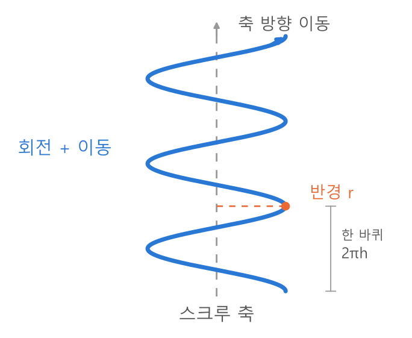
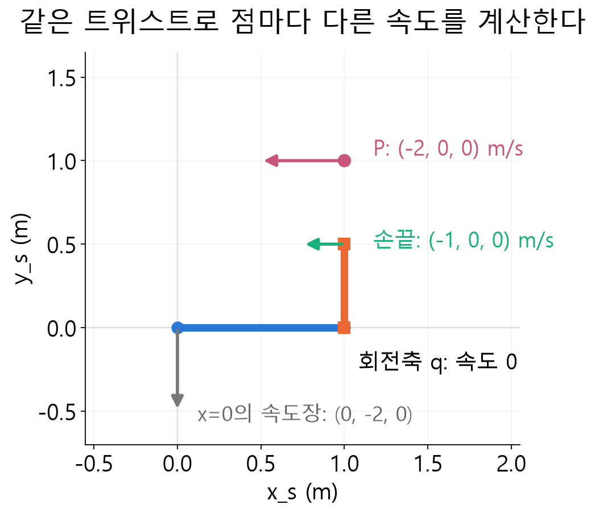

<link rel="stylesheet" href="https://cdn.jsdelivr.net/npm/katex@0.16.11/dist/katex.min.css">

## 1. 트위스트(Twist)란?

앞에서 배운 두 행렬을 복습하면 다음과 같습니다.

- 회전행렬 R: 물체의 방향
- 동차변환행렬 T: 물체의 위치와 방향

그런데 여기에는 한 가지 빠진 정보가 있습니다.

**물체가 지금 어떻게 움직이고 있는가?**

예를 들어 로봇팔의 끝부분이 현재 $$(2,3,1)$$에 있다고 하겠습니다.
동차변환행렬 T를 알면 위치와 방향은 알 수 있지만, 로봇팔이 얼마나 빠르게 움직이고 회전하는지는 알 수 없습니다.
이때 등장하는 것이 트위스트입니다.

$$\boxed{\mathcal V=\begin{bmatrix}\omega\\v\end{bmatrix}}$$

트위스트는 강체의 순간적인 운동을 나타내는 6차원 벡터입니다.
성분을 하나씩 펼치면 다음과 같습니다.

$$\mathcal V=\begin{bmatrix}\omega_x\\\omega_y\\\omega_z\\v_x\\v_y\\v_z\end{bmatrix}$$

- $$\omega$$: 각속도(angular velocity), rad/s
- $$v$$: 선운동 성분(linear velocity component), m/s

여기서 v가 항상 물체 원점의 실제 선속도와 같지는 않습니다.
어떤 좌표계를 기준으로 트위스트를 표현했는지에 따라 그 의미가 달라집니다.
뒤에서 Space Twist와 Body Twist를 구분하면서 확인하겠습니다.

## 2. 회전과 평행이동을 하나로 표현하기

관절을 중심으로 도는 운동은 회전 운동입니다.
물체의 방향을 유지한 채 위치를 옮기는 운동은 평행이동 운동입니다.
실제 로봇의 그리퍼는 회전하면서 동시에 이동할 수 있습니다.
트위스트는 이 두 운동을 하나로 표현합니다.

회전이 있는 강체의 순간 운동은, **어떤 축을 중심으로 회전하면서 동시에 그 축을 따라 이동하는 운동**으로 표현할 수 있습니다.
이를 스크루 운동(screw motion)이라고 합니다.

<figure></figure>

나사가 회전하면서 앞으로 나아가는 모습을 생각하면 이해하기 쉽습니다.
그림의 파란 경로는 일정한 스크루 축을 따라 회전과 이동을 함께 하는 점의 경로입니다.
축에서 점까지의 거리가 회전 반경이고, 축을 따라 나아가는 양은 피치와 관련됩니다.

여기서 말하는 축은 어느 한 순간의 운동을 표현하는 축입니다.
운동이 달라지면 이 축도 시간에 따라 달라질 수 있습니다.

## 3. 트위스트의 핵심 수식

스크루 운동에서 선운동 성분은 다음과 같이 표현됩니다.

$$\boxed{v=-\omega\times q+h\omega}$$

각 기호의 의미는 다음과 같습니다.

| 기호 | 의미 |
|---|---|
| $$\omega$$ | 축 방향을 가진 실제 각속도벡터 |
| $$q$$ | 회전축 위의 임의의 점 |
| $$h$$ | 피치: 회전 1 rad당 축 방향 이동량 |
| $$v$$ | 트위스트의 선운동 성분 |

이 글에서 위 식의 $$\omega$$는 실제 각속도입니다.
축의 방향만 나타내는 단위벡터는 뒤에서 $$\hat\omega$$로 구분합니다.

식의 두 항을 따로 보면 의미가 분명해집니다.

- $$-\omega\times q$$: 회전축이 원점에서 떨어져 있을 때 생기는 선운동 성분
- $$h\omega$$: 회전축 방향으로 이동하는 성분

### ① 순수 회전 운동

피치가 0이면 축 방향 이동이 없습니다.

$$h=0\quad\Rightarrow\quad v=-\omega\times q$$

축에서 떨어진 점은 회전하면서 실제 공간에서 이동합니다.
여기서 축 방향 이동이 없다는 말은, 회전축을 따라 미끄러져 나아가는 성분이 없다는 뜻입니다.

### ② 회전과 축 방향 이동

피치가 0이 아니면 회전과 동시에 축 방향으로 이동합니다.

$$v=-\omega\times q+h\omega$$

예를 들어 각속도의 크기가 2 rad/s이고 피치가 0.1 m/rad라면, 축 방향 이동속도의 크기는 0.2 m/s입니다.
한 바퀴는 $$2\pi$$ rad이므로 한 바퀴당 이동량은 $$2\pi h$$입니다.

### ③ 순수 평행이동

회전이 없으면 $$\omega=0$$입니다.
이때 트위스트는 다음과 같습니다.

$$\mathcal V=\begin{bmatrix}0\\v\end{bmatrix}$$

v는 평행이동 속도벡터입니다.
순수 평행이동은 위의 유한 피치 식에 $$\omega=0$$을 대입해서 얻는 경우와 구분해야 합니다.
회전이 없는 운동으로 별도 표현합니다.

## 4. 마이너스 부호가 붙는 이유

순수 회전에서 $$v=-\omega\times q$$가 되는 이유를 실제 속도로 확인해 보겠습니다.
공간좌표계에서 표현한 트위스트를 $$\mathcal V_s=(\omega,v_s)$$라고 하면, 강체 위의 점 x의 순간속도는 다음과 같습니다.

$$\boxed{\dot x=\omega\times x+v_s}$$

회전축 위의 점 q는 순수 회전에서는 움직이지 않아야 합니다.
따라서 x에 q를 넣었을 때 속도가 0이어야 합니다.

$$0=\omega\times q+v_s$$

이 식을 정리하면 마이너스 부호가 나옵니다.

$$v_s=-\omega\times q$$

예를 들어 다음과 같이 정하겠습니다.

$$\omega=\begin{bmatrix}0\\0\\2\end{bmatrix}\ \mathrm{rad/s},\qquad q=\begin{bmatrix}1\\0\\0\end{bmatrix}\ \mathrm m$$

그러면 $$v_s=(0,-2,0)^T$$ m/s입니다.
그렇다고 모든 점이 아래로 2 m/s 움직이는 것은 아닙니다.
점의 위치를 속도 식에 넣어야 합니다.

- 축 위의 점 $$(1,0,0)$$: 속도 $$(0,0,0)$$
- 손끝 $$(1,0.5,0)$$: 속도 $$(-1,0,0)$$ m/s
- 점 P $$(1,1,0)$$: 속도 $$(-2,0,0)$$ m/s

<figure></figure>

이것이 공간 트위스트의 아래 성분을 손끝의 실제 속도와 바로 같다고 놓을 수 없는 이유입니다.
$$v_s$$는 이 운동의 속도장을 공간 원점에서 평가한 값입니다.
바닥에 고정한 좌표계의 원점이 실제로 움직인다는 뜻은 아닙니다.

## 5. 트위스트를 행렬로 바꾸는 방법

트위스트는 지금까지 6×1 벡터로 표현했습니다.
이를 4×4 행렬로 바꾸면 다음과 같습니다.

$$\boxed{[\mathcal V]=\begin{bmatrix}0&-\omega_z&\omega_y&v_x\\\omega_z&0&-\omega_x&v_y\\-\omega_y&\omega_x&0&v_z\\0&0&0&0\end{bmatrix}}$$

왼쪽 위 3×3은 각속도벡터를 반대칭행렬로 바꾼 $$[\omega]$$입니다.
이 행렬은 외적을 행렬곱으로 계산하게 해 줍니다.

$$[\omega]x=\omega\times x$$

따라서 트위스트의 행렬 표현을 블록으로 쓰면 다음과 같습니다.

$$[\mathcal V]=\begin{bmatrix}[\omega]&v\\0&0\end{bmatrix}$$

이 행렬은 $$se(3)$$에 속합니다.
$$SE(3)$$는 강체의 자세를 나타내는 변환행렬의 집합이고, $$se(3)$$는 그 순간 운동을 나타내는 트위스트의 행렬 표현을 모은 공간입니다.
마지막 행도 구분해야 합니다.
T의 마지막 행은 $$(0,0,0,1)$$이고, $$[\mathcal V]$$의 마지막 행은 네 칸 모두 0입니다.

## 6. 트위스트와 T의 관계

트위스트를 알면 자세가 시간에 따라 어떻게 변하는지 계산할 수 있습니다.
**일정한 공간 트위스트를 시간에 대해 누적하면 강체의 자세 변화를 얻습니다.**

$$\boxed{T(t)=e^{[\mathcal V_s]t}T(0)}$$

- $$T(0)$$: 처음의 위치와 방향
- $$\mathcal V_s$$: 공간좌표계에서 표현한 일정한 트위스트
- $$t$$: 운동 시간
- $$e^{[\mathcal V_s]t}$$: 그동안의 운동을 나타내는 행렬지수

행렬지수(matrix exponential)는 순간 운동을 유한한 변환으로 연결하는 연산입니다.
각 행렬 성분에 따로 지수함수를 적용하는 연산과는 다릅니다.
행렬곱을 사용하는 급수로 정의됩니다.

$$e^A=I+A+\frac{A^2}{2!}+\frac{A^3}{3!}+\cdots$$

즉, 트위스트가 운동 속도를 담고 있다면, 행렬지수는 그 운동이 누적된 결과를 만들고, T는 최종 위치와 방향을 나타냅니다.
위 식에서는 공간 트위스트가 일정하다는 조건이 중요합니다.
시간에 따라 달라지는 트위스트를 현재 값 하나로 대신해서 그대로 대입할 수는 없습니다.

## 7. Space Twist와 Body Twist

같은 강체 운동도 어떤 좌표계에서 표현하느냐에 따라 성분이 달라집니다.

| Space Twist | Body Twist |
|---|---|
| 고정된 공간좌표계 기준 | 물체에 붙은 좌표계 기준 |
| $$\mathcal V_s$$ | $$\mathcal V_b$$ |

두 표현과 변환행렬의 관계는 다음과 같습니다.

$$\dot T=[\mathcal V_s]T$$

$$\dot T=T[\mathcal V_b]$$

Body Twist의 아래 성분은 물체 원점의 실제 선속도를 물체의 축 기준으로 표현한 값입니다.
Space Twist의 아래 성분은 앞의 속도 식에서 본 것처럼 원점 위치에 관한 회전 항까지 함께 고려해서 읽어야 합니다.

두 트위스트는 Adjoint(수반표현)라는 6×6 행렬로 연결됩니다.

$$\boxed{\mathcal V_s=\operatorname{Ad}_T\mathcal V_b}$$

$$\operatorname{Ad}_T=\begin{bmatrix}R&0\\{[p]}R&R\end{bmatrix}$$

각 블록은 3×3이고, $$[p]$$는 p와의 외적을 계산하는 행렬입니다.
점의 좌표를 바꿀 때는 4×4인 T를 사용했고, 트위스트의 기준을 바꿀 때는 6×6인 Adjoint를 사용합니다.

## 8. 트위스트와 스크루 축의 차이

마지막으로 운동의 축과 운동의 속도를 구분하겠습니다.

- 스크루 축 S: 어떤 축을 따라 운동하는가?
- 트위스트 $$\mathcal V$$: 그 축을 따라 얼마나 빠르게 움직이는가?

회전이 포함된 운동에서는 축 방향을 단위벡터 $$\hat\omega$$로 나타냅니다.
스크루 축은 다음과 같이 정규화해 적습니다.

$$S=\begin{bmatrix}\hat\omega\\v_S\end{bmatrix},\qquad v_S=-\hat\omega\times q+h\hat\omega$$

$$\hat\omega$$의 길이가 1이라는 뜻이며, S의 여섯 성분 전체의 길이가 1이라는 뜻은 아닙니다.
여기에 회전속도를 곱하면 실제 트위스트가 됩니다.

$$\boxed{\mathcal V=S\dot\theta}$$

$$\omega=\hat\omega\dot\theta,\qquad v=v_S\dot\theta$$

따라서 공간좌표계에서 표현한 일정한 스크루 축 S를 따라 회전량 θ만큼 움직이면 다음과 같이 쓸 수 있습니다.

$$\boxed{T(\theta)=e^{[S]\theta}T(0)}$$

이 식이 관절값에서 손끝 자세를 구하는 PoE 공식의 출발점입니다.
직동관절에서는 위의 각성분이 0이고 아래 성분이 단위 이동 방향이 됩니다.
이때 θ는 이동거리, $$\dot\theta$$는 이동속도입니다.

### 이해도 확인

다음 순수 회전축의 선운동 성분을 계산해 보겠습니다.

$$\hat\omega=\begin{bmatrix}0\\0\\1\end{bmatrix},\qquad q=\begin{bmatrix}1\\0\\0\end{bmatrix},\qquad h=0$$

$$v_S=-\hat\omega\times q$$

이 값은 얼마일까요?

계산 확인

외적은 $$\hat\omega\times q=(0,1,0)^T$$이므로 $$v_S=(0,-1,0)^T$$입니다.
각속도가 2 rad/s이면 실제 선운동 성분은 $$v=(0,-2,0)^T$$ m/s입니다.
축 위의 점 q를 속도 식에 넣었을 때 0이 되는지도 함께 확인할 수 있습니다.

참고: [Modern Robotics 트위스트](https://modernrobotics.northwestern.edu/nu-gm-book-resource/3-3-2-twists-part-1-of-2/), [행렬 표현과 Adjoint](https://modernrobotics.northwestern.edu/nu-gm-book-resource/3-3-2-twists-part-2-of-2/), [강체운동의 지수좌표](https://modernrobotics.northwestern.edu/nu-gm-book-resource/3-3-3-exponential-coordinates-of-rigid-body-motion/). 2026년 11월 18일 확인.
