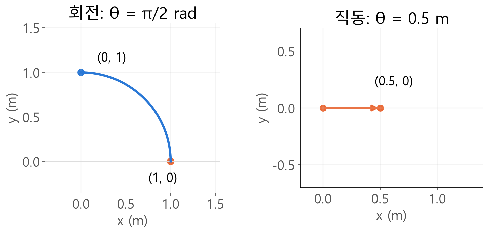

<style>
.content table { width:100%; border-collapse:collapse; margin:14px 0 24px; font-size:17px; line-height:1.5; }
.content th,.content td { border-bottom:1px solid #e6dde0; padding:8px 10px; text-align:left; vertical-align:top; word-break:keep-all; overflow-wrap:normal; }
.content thead { background:#fbf1f4; }
.content figure { margin:18px 0; }
.content figure img { width:100%; height:auto; }
.content .katex-display { overflow-x:auto; overflow-y:hidden; padding:4px 0; }
.content td code { white-space:nowrap; }
.content pre .nb { padding:0; border:0; border-radius:0; background:none; }
@media(max-width:560px){.content th,.content td { padding:7px 5px; font-size:16px; }}
</style>
<link rel="stylesheet" href="https://cdn.jsdelivr.net/npm/katex@0.16.11/dist/katex.min.css">
<script defer src="https://cdn.jsdelivr.net/npm/katex@0.16.11/dist/katex.min.js"></script>
<script defer src="https://cdn.jsdelivr.net/npm/katex@0.16.11/dist/contrib/auto-render.min.js" onload="renderMathInElement(document.querySelector('.content')||document.body,{delimiters:[{left:'\\[',right:'\\]',display:true},{left:'\\(',right:'\\)',display:false}]})"></script>

<div class="wc"><p><a href="https://modernrobotics.northwestern.edu/nu-gm-book-resource/3-3-2-twists-part-1-of-2/">스크루 축(screw axis)</a>은 강체의 회전·이동을 하나의 축으로 표현해요.<br>
관절의 움직임을 변환행렬로 바꾸는 순기구학에서 쓰여요.<br>
축·속도·움직인 양을 구분하면 행렬지수의 입력과 결과가 연결돼요.</p></div>

단위벡터 표기부터 회전·직동의 변환행렬까지 여섯 단계로 정리해요.
z 방향의 축이 점 $$(1,0,0)$$ m를 지나는 예제를 중심으로 볼게요.

<div class="keyline">축 방향 ω → 외적 행렬 [ω] → 스크루 축 S → 움직인 양 θ → 변환행렬 순서예요.</div>

## <span class="no">1</span> 오메가 햇과 각속도

햇(hat) 기호는 **이 글에서 무엇으로 정의했는지** 먼저 봐야 해요.
단위벡터를 표시할 때도, 벡터를 반대칭행렬로 바꾸는 연산을 표시할 때도 쓰여요.
이 글은 다음 표기로 통일할게요.

| 기호 | 이 글에서의 뜻 |
|---|---|
| $$\hat\omega$$ | 길이가 1인 회전축 방향벡터 |
| $$[\hat\omega]$$ | 그 벡터를 바꾼 3×3 반대칭행렬 |
| $$\Omega$$ | 실제 각속도벡터, 단위 rad/s |
| $$\dot\theta$$ | 축을 따라 도는 각속도, 단위 rad/s |

$$\Omega=\hat\omega\dot\theta$$

햇이 붙은 벡터 자체에는 “초당 얼마나 빠른지”가 들어 있지 않아요.
z축으로 초당 2 rad 돌면 $$\hat\omega=(0,0,1)$$, $$\Omega=(0,0,2)$$예요.
여기서 점이 붙은 $$\dot\theta$$는 각도 $$\theta$$의 시간 변화율이에요.

## <span class="no">2</span> 외적을 행렬로 바꾸기

반대칭행렬(skew-symmetric matrix)은 **벡터와의 외적을 행렬곱으로 계산하게 해 줘요.**
외적 $$a\times b$$는 두 벡터에 수직인 방향을 가지는 벡터 연산이에요.
회전하는 점의 순간속도를 계산할 때 등장해요.

$$[a]=\begin{bmatrix}0&-a_z&a_y\\a_z&0&-a_x\\-a_y&a_x&0\end{bmatrix}$$

$$[a]b=a\times b,\qquad [a]^T=-[a]$$

행과 열을 바꾸면 부호가 반대로 바뀌어서 ‘반대칭’이라고 불러요.
z축 방향 $$\hat\omega=(0,0,1)$$을 넣어 볼까요?

$$[\hat\omega]=\begin{bmatrix}0&-1&0\\1&0&0\\0&0&0\end{bmatrix}$$

아래 코드는 `pip install numpy scipy`로 설치한 환경에서 위부터 실행해요.

```python
import numpy as np
from scipy.linalg import expm  # 행렬지수

def skew(a):
    x, y, z = a
    return np.array([[0., -z, y],
                     [z, 0., -x],
                     [-y, x, 0.]])

w = np.array([0., 0., 1.])
q = np.array([1., 0., 0.])
W = skew(w)
print(W)
print(W @ q)
print(np.cross(w, q))  # 외적
```

```text
[[ 0. -1.  0.]
 [ 1.  0. -0.]
 [-0.  0.  0.]]
[0. 1. 0.]
[0. 1. 0.]
```

마지막 두 줄이 같아요.
출력의 `-0.`은 부동소수점에서 표시된 0이에요.
**이 행렬 자체는 회전행렬이 아니에요.**
반대칭행렬은 외적을 계산하고, 회전행렬은 유한한 각도만큼 돌린 결과를 표현해요.

## <span class="no">3</span> v의 마이너스 부호

순수 회전의 $$v=-\hat\omega\times q$$는 **회전축 위의 점이 정지하도록 만드는 항**이에요.
$$q$$는 회전축 위의 점 하나를 선택한 좌표예요.
여기서는 회전축이 $$(1,0,0)$$을 지나고 z 방향을 향해요.

회전축을 따라 이동하는 성분이 없는 회전을 생각해요.
각속도가 1 rad/s일 때, 공간의 점 x에 대응하는 순간속도장은 다음과 같아요.

$$\dot x=\hat\omega\times x+v$$

축 위의 점 q는 움직이지 않으므로 $$\dot q=0$$이어야 해요.

$$0=\hat\omega\times q+v$$

$$v=-\hat\omega\times q=(0,-1,0)$$

“v의 y 성분이 음수니까 로봇 끝이 아래로 가나?” 하고 읽기 쉬워요.
로봇 끝의 속도는 **그 점의 위치 x까지 넣어야** 알 수 있어요.

```python
v = -np.cross(w, q)
for x in [np.zeros(3), q,
          np.array([2., 0., 0.])]:
    dx = np.cross(w, x) + v
    print(dx)
```

```text
[ 0. -1.  0.]
[0. 0. 0.]
[0. 1. 0.]
```

<figure></figure>

세 줄은 원점, 축 위의 점, $$(2,0,0)$$의 순간속도예요.
단위는 m/s이고, 회전속도를 1 rad/s로 둔 결과예요.
원점은 **속도장을 평가하는 위치**로 넣었어요.
바닥에 고정된 좌표계 자체가 움직인다는 뜻은 아니에요.

## <span class="no">4</span> 스크루 축과 트위스트

스크루 축은 운동의 기하를, 트위스트(twist)는 **현재의 운동 속도**를 나타내요.
회전관절의 스크루 축을 6차원 열벡터로 적어요.

$$S=\begin{bmatrix}\hat\omega\\v\end{bmatrix},\qquad \mathcal V=S\dot\theta$$

위의 세 칸은 축 방향, 아래의 세 칸은 축 위치를 반영하는 선운동 성분이에요.
트위스트 $$\mathcal V$$는 이 축에 실제 속도 $$\dot\theta$$를 곱해요.
이 예제에서 2 rad/s로 돌면 다음과 같아요.

$$S=\begin{bmatrix}0\\0\\1\\0\\-1\\0\end{bmatrix},\qquad \mathcal V=\begin{bmatrix}0\\0\\2\\0\\-2\\0\end{bmatrix}$$

이번에는 이를 4×4 행렬로 포장해요.

$$[S]=\begin{bmatrix}[\hat\omega]&v\\0&0\end{bmatrix}$$

아래 행은 네 칸 모두 0이에요.
변환행렬 T의 오른쪽 아래 1과 구분하세요.
대괄호는 성분을 제곱하거나 목록으로 만든다는 뜻이 아니라, 여기서는 **정해진 행렬 형태로 바꾸는 표기**예요.

회전과 축 방향 이동을 함께 하는 일반 스크루에서는 $$v=-\hat\omega\times q+h\hat\omega$$예요.
피치(pitch) h는 회전 1 rad당 축 방향으로 이동하는 거리이고, 순수 회전관절은 h=0이에요.

## <span class="no">5</span> 행렬지수로 회전 만들기

행렬지수(matrix exponential)는 **고정된 축을 따라 움직인 양을 변환행렬로 바꿔요.**
원점을 지나는 단위 회전축만 먼저 보면 식은 다음과 같아요.

$$R=e^{[\hat\omega]\theta}$$

입력 $$\hat\omega\theta$$는 회전 방향과 각도를 담은 3차원 지수좌표예요.
반대칭행렬 $$[\hat\omega]\theta$$를 행렬지수에 넣으면 3×3 회전행렬이 나와요.
z축으로 90° 돌릴 때 $$\theta=\pi/2$$ rad를 넣어요.

**행렬지수는 각 칸에 지수를 취하는 연산과 달라요.**
단위행렬부터 시작하는 행렬곱의 급수로 정의돼요.

$$e^A=I+A+\frac{A^2}{2!}+\frac{A^3}{3!}+\cdots$$

단위 회전축에서는 이 식을 로드리게스 공식(Rodrigues' formula)으로 계산할 수 있어요.

$$R=I+\sin\theta[\hat\omega]+(1-\cos\theta)[\hat\omega]^2$$

```python
theta = np.pi / 2
R = (np.eye(3) + np.sin(theta) * W
     + (1 - np.cos(theta)) * W @ W)
print(np.round(R, 6) + 0.)
print(np.allclose(R, expm(W * theta)))
```

```text
[[ 0. -1.  0.]
 [ 1.  0.  0.]
 [ 0.  0.  1.]]
True
```

`expm`으로 구한 행렬지수와 로드리게스 공식이 같은 값을 만들었어요.
`np.exp`는 칸마다 지수를 취하므로 여기서 사용할 함수는 `expm`이에요.
반대로 회전행렬에서 지수좌표의 행렬 표현을 구하는 연산이 행렬로그(matrix logarithm)예요.
회전각 표현은 여러 개일 수 있어, 로그에서 어떤 각도 범위를 택했는지도 중요해요.

## <span class="no">6</span> 회전관절과 직동관절

회전관절과 직동관절은 **같은 행렬지수 틀에 다른 축과 다른 단위의 관절변수**를 넣어요.

| 관절 | 스크루 축의 구성 | θ의 뜻 |
|---|---|---|
| 회전 | 단위 축 방향과 축 위치 | 회전각, rad |
| 직동 | 위 3칸은 0, 아래는 단위 이동 방향 | 이동거리, m |

두 경우 모두 관절 하나의 변환은 $$e^{[S]\theta}$$예요.
원점을 지나는 z 회전축과 x 방향 직동축을 비교해 볼게요.

```python
def se3(S):
    A = np.zeros((4, 4))
    A[:3, :3] = skew(S[:3])
    A[:3, 3] = S[3:]
    return A

S_rot = np.array([0., 0., 1., 0., 0., 0.])
S_lin = np.array([0., 0., 0., 1., 0., 0.])
E_rot = expm(se3(S_rot) * (np.pi / 2))
E_lin = expm(se3(S_lin) * 0.5)
print(np.round(E_rot, 6) + 0.)
print(E_lin)
```

```text
[[ 0. -1.  0.  0.]
 [ 1.  0.  0.  0.]
 [ 0.  0.  1.  0.]
 [ 0.  0.  0.  1.]]
[[1.  0.  0.  0.5]
 [0.  1.  0.  0. ]
 [0.  0.  1.  0. ]
 [0.  0.  0.  1. ]]
```

<figure></figure>

회전 결과는 왼쪽 위 3×3이 바뀌었어요.
직동 결과는 오른쪽 위치 열이 바뀌었고요.
회전관절의 축 방향과 위치, 직동관절의 이동 방향은 S에 담아요.
**움직인 양은 θ, 움직임의 결과는 T**로 읽으면 연결돼요.

<div class="done">S는 축의 기하, Sθ는 움직인 양, Sθ̇는 순간속도를 담아요.</div>

정의와 표기 확인: [Modern Robotics 트위스트](https://modernrobotics.northwestern.edu/nu-gm-book-resource/3-3-2-twists-part-1-of-2/), [회전의 지수좌표](https://modernrobotics.northwestern.edu/nu-gm-book-resource/3-2-3-exponential-coordinates-of-rotation-part-2-of-2/), [강체운동의 지수좌표](https://modernrobotics.northwestern.edu/nu-gm-book-resource/3-3-3-exponential-coordinates-of-rigid-body-motion/). 2026년 11월 18일 확인.
