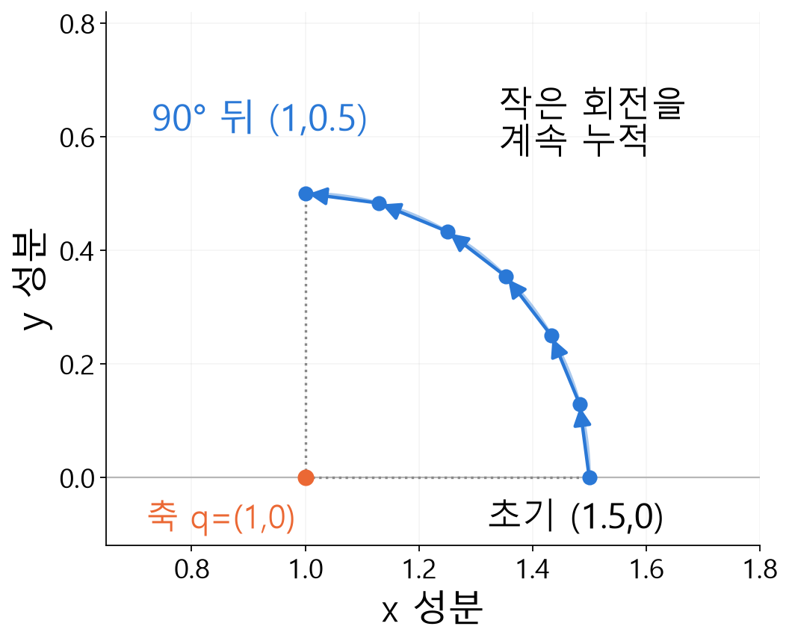

<link rel="stylesheet" href="https://cdn.jsdelivr.net/npm/katex@0.16.11/dist/katex.min.css">

앞 글에서는 한 순간의 강체 운동을 트위스트로 묶었습니다.
이제 그 속도로 얼마 동안 움직였을 때 위치와 방향이 어떻게 변하는지 구하겠습니다.
먼저 외적을 행렬곱으로 바꾸고, 그 행렬을 시간에 따라 누적하면 행렬지수가 나옵니다.

## 1. 외적의 계수를 모으면 반대칭행렬

공간좌표계 s에서 점 x의 속도는 다음과 같았습니다.

$$\dot x=\omega\times x+v_s$$

점을 바꿀 때마다 외적을 새로 쓰는 대신, x 앞에 곱할 행렬을 만들겠습니다.
외적을 성분으로 쓰면 다음과 같습니다.

$$\omega\times x=\begin{bmatrix}\omega_yx_z-\omega_zx_y\\\omega_zx_x-\omega_xx_z\\\omega_xx_y-\omega_yx_x\end{bmatrix}$$

첫 행에서 x_x의 계수는 0, x_y의 계수는 −ω_z, x_z의 계수는 ω_y입니다.
나머지 행도 같은 방식으로 모읍니다.

$$\omega\times x=\underbrace{\begin{bmatrix}0&-\omega_z&\omega_y\\\omega_z&0&-\omega_x\\-\omega_y&\omega_x&0\end{bmatrix}}_{[\omega]}\begin{bmatrix}x_x\\x_y\\x_z\end{bmatrix}$$

대괄호 $$[\omega]$$는 벡터 ω로 만든 이 행렬을 뜻합니다.
전치하면 부호가 반대가 되어 $$[\omega]^T=-[\omega]$$이므로 반대칭행렬이라고 부릅니다.
음수 부호는 외적의 각 성분에서 나온 것입니다.

트위스트 $$\mathcal V_s=(\omega_s,v_s)$$도 같은 방식으로 행렬로 바꿉니다.

$$[\mathcal V_s]=\begin{bmatrix}[\omega_s]&v_s\\0&0\end{bmatrix}$$

윗부분의 두 블록은 각각 3×3과 3×1이며, 아래는 0 네 개입니다.
이유를 보려면 동차좌표에 직접 곱하면 됩니다.

$$\begin{bmatrix}[\omega_s]&v_s\\0&0\end{bmatrix}\begin{bmatrix}x\\1\end{bmatrix}=\begin{bmatrix}\omega_s\times x+v_s\\0\end{bmatrix}=\begin{bmatrix}\dot x\\0\end{bmatrix}$$

동차좌표의 마지막 1은 시간이 지나도 1이므로 그 미분은 0입니다.
위치 변환 T의 마지막 칸은 1이었지만, 속도를 만드는 이 행렬의 마지막 칸은 0입니다.
이 모양의 4×4 행렬 집합을 $$se(3)$$라고 합니다.

## 2. 왜 T의 미분 양옆에 역행렬을 곱할까?

물체에 고정된 점은 b 기준 좌표 x_b가 일정합니다.
s에서 본 좌표만 시간에 따라 바뀝니다.
동차좌표를 $$\bar x=(x^T,1)^T$$라고 줄여 쓰겠습니다.

$$\bar x_s=T\bar x_b$$

x_b가 일정하므로 양변을 시간으로 미분하면 다음과 같습니다.

$$\dot{\bar x}_s=\dot T\bar x_b$$

앞에서 만든 속도 행렬을 써도 같은 점의 속도를 구할 수 있습니다.

$$\dot{\bar x}_s=[\mathcal V_s]\bar x_s=[\mathcal V_s]T\bar x_b$$

어느 고정점에 대해서도 두 결과가 같아야 하므로 다음 관계가 나옵니다.

$$\dot T=[\mathcal V_s]T$$

오른쪽에 $$T^{-1}$$를 곱해 T를 없애면 공간 트위스트를 얻습니다.

$$\boxed{[\mathcal V_s]=\dot T T^{-1}}$$

각 블록이 무엇인지도 계산해 보겠습니다.

$$\dot T=\begin{bmatrix}\dot R&\dot p\\0&0\end{bmatrix},\qquad T^{-1}=\begin{bmatrix}R^T&-R^Tp\\0&1\end{bmatrix}$$

$$\dot T T^{-1}=\begin{bmatrix}\dot RR^T&\dot p-\dot RR^Tp\\0&0\end{bmatrix}$$

위치의 미분이 ω×p+v_s라는 점 속도식과 비교하면 다음과 같습니다.

$$[\omega_s]=\dot RR^T,\qquad v_s=\dot p-\omega_s\times p$$

**v_s가 손끝 원점의 실제 속도 $$\dot p$$와 일반적으로 다른 이유**가 이 오른쪽 위 블록에 보입니다.

## 3. Body Twist와 Adjoint의 블록

같은 운동을 물체에 붙은 b 기준으로 나타낼 수도 있습니다.
행렬곱의 순서를 바꾸어 계산한 것을 Body Twist로 정의합니다.

$$[\mathcal V_b]=T^{-1}\dot T=\begin{bmatrix}R^T\dot R&R^T\dot p\\0&0\end{bmatrix}$$

따라서 $$\omega_b=R^T\omega_s$$이고 $$v_b=R^T\dot p$$입니다.
v_b는 **물체 원점의 실제 속도를 b의 축 성분으로 적은 값**입니다.
원점의 b 좌표가 0이어도 물체가 공간에서 움직이는 속도는 0일 필요가 없습니다.

앞에서 쓰던 예를 대입하겠습니다.

$$R=R_z(90^\circ),\qquad p=(1,0.5,0)^T$$

$$\omega_s=(0,0,2)^T,\quad v_s=(0,-2,0)^T,\quad\dot p=(-1,0,0)^T$$

$$\omega_b=R^T\omega_s=(0,0,2)^T,\qquad v_b=R^T\dot p=(0,1,0)^T$$

공간에서 −x 방향으로 움직이는 속도가 b의 +y 방향으로 표현된 것입니다.

두 트위스트를 연결하는 6×6 행렬도 직접 만들 수 있습니다.
먼저 각속도는 원점 위치와 관계없이 방향만 바꿉니다.

$$\omega_s=R\omega_b$$

선운동 성분은 $$\dot p=Rv_b$$를 앞의 식에 넣습니다.

$$v_s=Rv_b-\omega_s\times p=p\times(R\omega_b)+Rv_b$$

마지막 등식은 외적 순서를 뒤집으면 부호가 바뀌는 성질을 쓴 것입니다.
두 식에서 ω_b와 v_b의 계수를 모으면 됩니다.

$$\boxed{\mathcal V_s=\underbrace{\begin{bmatrix}R&0\\{[p]}R&R\end{bmatrix}}_{\operatorname{Ad}_T}\mathcal V_b}$$

위 두 블록 R, 0은 각속도의 방향만 바꾸고, 아래 두 블록은 원점 차이의 효과와 실제 속도의 방향 변환을 더합니다.
이 행렬이 수반표현(Adjoint Representation)입니다.

## 4. 순간 속도를 쌓으면 행렬지수

공간 트위스트가 일정하다고 가정하고 $$A=[\mathcal V_s]$$라고 줄이겠습니다.
위에서 구한 식은 $$\dot T=AT$$입니다.

속도는 짧은 시간 동안의 변화량을 시간으로 나눈 값입니다.
아주 짧은 Δt 동안에는 다음처럼 근사할 수 있습니다.

$$T(t+\Delta t)\approx T(t)+A T(t)\Delta t=(I+A\Delta t)T(t)$$

I는 여기서 4×4 단위행렬입니다.
전체 시간 t를 n조각으로 나누면 Δt=t/n입니다.
매 조각마다 같은 행렬을 왼쪽에 곱하므로 n번 뒤에는 다음과 같습니다.

$$T(t)\approx\left(I+\frac{At}{n}\right)^nT(0)$$

조각 수를 무한히 늘려 시간 간격을 0으로 보낸 극한이 행렬지수입니다.

$$\boxed{T(t)=e^{At}T(0)}$$

이는 행렬의 각 칸에 따로 e를 취한다는 뜻이 아닙니다.
행렬곱으로 정의한 다음 급수와 같습니다.

$$e^{At}=I+At+\frac{A^2t^2}{2!}+\frac{A^3t^3}{3!}+\cdots$$

A²는 A를 두 번 곱한 행렬이고, 3!=3×2×1입니다.
왜 2!, 3!이 붙는지도 속도식을 적분하며 확인할 수 있습니다.
$$T(t)=T(0)+\int_0^t A T(\tau)d\tau$$의 오른쪽 T 자리에 먼저 T(0)를 넣으면 At 항이 나옵니다.
다시 그 결과를 넣으면 $$\int_0^t A^2\tau d\tau=A^2t^2/2$$가 추가됩니다.
이 과정을 반복하면 차례로 같은 급수의 항을 얻습니다.

<figure></figure>

그림의 작은 이동을 점점 잘게 나누어 누적한 결과가 하나의 유한한 변환입니다.
몸체 기준 트위스트가 일정하면 곱이 오른쪽에 놓입니다.

$$T(t)=T(0)e^{[\mathcal V_b]t}$$

이를 미분하면 $$\dot T=T[\mathcal V_b]$$가 되어 앞서 구한 Body 식과 맞습니다.
트위스트가 시간에 따라 변할 때는 그 변화를 적분해야 합니다.
한 시점의 속도만 위 식에 넣어서 전체 운동을 계산할 수는 없습니다.

## 5. 행렬지수 안에서 sin과 cos가 다시 나오는 이유

z축 단위 방향에 대한 반대칭행렬을 W라고 하겠습니다.

$$W=\begin{bmatrix}0&-1&0\\1&0&0\\0&0&0\end{bmatrix},\qquad W^2=\begin{bmatrix}-1&0&0\\0&-1&0\\0&0&0\end{bmatrix}$$

한 번 더 곱하면 $$W^3=-W$$, 다시 곱하면 $$W^4=-W^2$$가 됩니다.
이후의 거듭제곱도 W와 W²의 부호가 반복됩니다.
이를 지수급수에서 모아 보겠습니다.

$$e^{W\theta}=I+\left(\theta-\frac{\theta^3}{3!}+\cdots\right)W+\left(\frac{\theta^2}{2!}-\frac{\theta^4}{4!}+\cdots\right)W^2$$

괄호는 각각 sinθ와 1−cosθ의 급수입니다.
이 급수에서 θ의 단위는 라디안입니다.

$$e^{W\theta}=I+\sin\theta\,W+(1-\cos\theta)W^2$$

대각선의 x·y 성분은 1−(1−cosθ)=cosθ이고, 두 비대각 성분은 −sinθ와 sinθ입니다.

$$e^{W\theta}=\begin{bmatrix}\cos\theta&-\sin\theta&0\\\sin\theta&\cos\theta&0\\0&0&1\end{bmatrix}=R_z(\theta)$$

처음에는 단위벡터를 회전시켜 만든 행렬이었습니다.
지금은 각속도를 작은 시간 동안 계속 누적해 같은 행렬을 얻었습니다.

회전축이 원점 밖의 q=(1,0,0)에 있으면 4×4 지수의 위치 열도 구해야 합니다.
초기 방향을 I, 초기 손끝 위치를 (1.5,0,0)으로 두겠습니다.
순수 회전에서 축 위 점 q는 움직이지 않으므로, 추가 변환의 위치 열을 p_Δ라고 쓰면 다음 조건이 필요합니다.

$$Rq+p_\Delta=q,\qquad p_\Delta=q-Rq$$

이는 점을 먼저 q만큼 빼서 원점 중심으로 돌린 뒤 q를 다시 더하는 $$R(x-q)+q$$와 같습니다.
90°에서 Rq=(0,1,0)이므로 p_Δ=(1,−1,0)입니다.
위의 속도로 π/4초 움직인 4×4 지수는 다음과 같습니다.

$$e^{[\mathcal V_s]\pi/4}=\begin{bmatrix}0&-1&0&1\\1&0&0&-1\\0&0&1&0\\0&0&0&1\end{bmatrix}$$

이 행렬을 초기 자세에 곱하면, 새 방향은 R_z(90°)이고 새 위치는 다음과 같습니다.

$$p(t)=R_z(90^\circ)\begin{bmatrix}1.5\\0\\0\end{bmatrix}+\begin{bmatrix}1\\-1\\0\end{bmatrix}=\begin{bmatrix}1\\0.5\\0\end{bmatrix}$$

이제 트위스트의 속도, 누적 시간, 지수행렬, 최종 손끝 위치가 하나의 계산으로 연결됩니다.

## 6. 속도에서 회전량·이동량으로: 지수좌표

일정한 스크루 축 S를 따라 $$\mathcal V=S\dot\theta$$로 움직인다고 하겠습니다.
일정한 속도로 t초 움직였다면 총 회전량은 $$\theta=\dot\theta t$$입니다.

$$[\mathcal V]t=[S]\dot\theta t=[S]\theta$$

Sθ의 여섯 성분을 변환 $$e^{[S]\theta}$$의 지수좌표라고 합니다.
$$[S]\theta$$는 이 벡터를 4×4 행렬로 바꾼 표현입니다.

공간 기준 축일 때 자세 변화는 다음과 같습니다.

$$\boxed{T(\theta)=e^{[S]\theta}T(0)}$$

S가 일정하면 속도가 바뀌더라도 누적한 θ를 사용할 수 있습니다.
순수 이동 관절에서는 θ가 회전각 대신 이동 거리입니다.
홈 자세에서 정의한 각 관절의 지수항을 순서대로 곱한 뒤, 초기 자세 M을 오른쪽에 한 번 붙이면 Space 형태의 PoE가 됩니다.

### 이해도 확인

공간 트위스트의 각속도는 (0,0,2) rad/s이고, 축 위 점은 (1,0,0) m입니다.
초기 손끝은 (1.5,0,0) m이며 순수 회전합니다.
얼마 동안 움직여야 그림처럼 (1,0.5,0) m에 도달할까요?

풀이 보기

초기점은 축 오른쪽에, 목표점은 축 위쪽에 있으므로 필요한 회전량은 π/2 rad입니다.

$$t=\frac{\theta}{\dot\theta}=\frac{\pi/2}{2}=\frac{\pi}{4}\ \mathrm{s}$$

지수 안에는 [𝒱_s]π/4를 넣거나 [S]π/2를 넣습니다. 같은 회전을 두 방식으로 표현한 것입니다.

참고: [Modern Robotics 트위스트와 수반표현](https://modernrobotics.northwestern.edu/nu-gm-book-resource/3-3-2-twists-part-2-of-2/), [강체운동의 지수좌표](https://modernrobotics.northwestern.edu/nu-gm-book-resource/3-3-3-exponential-coordinates-of-rigid-body-motion/). 2026년 11월 18일 확인.
