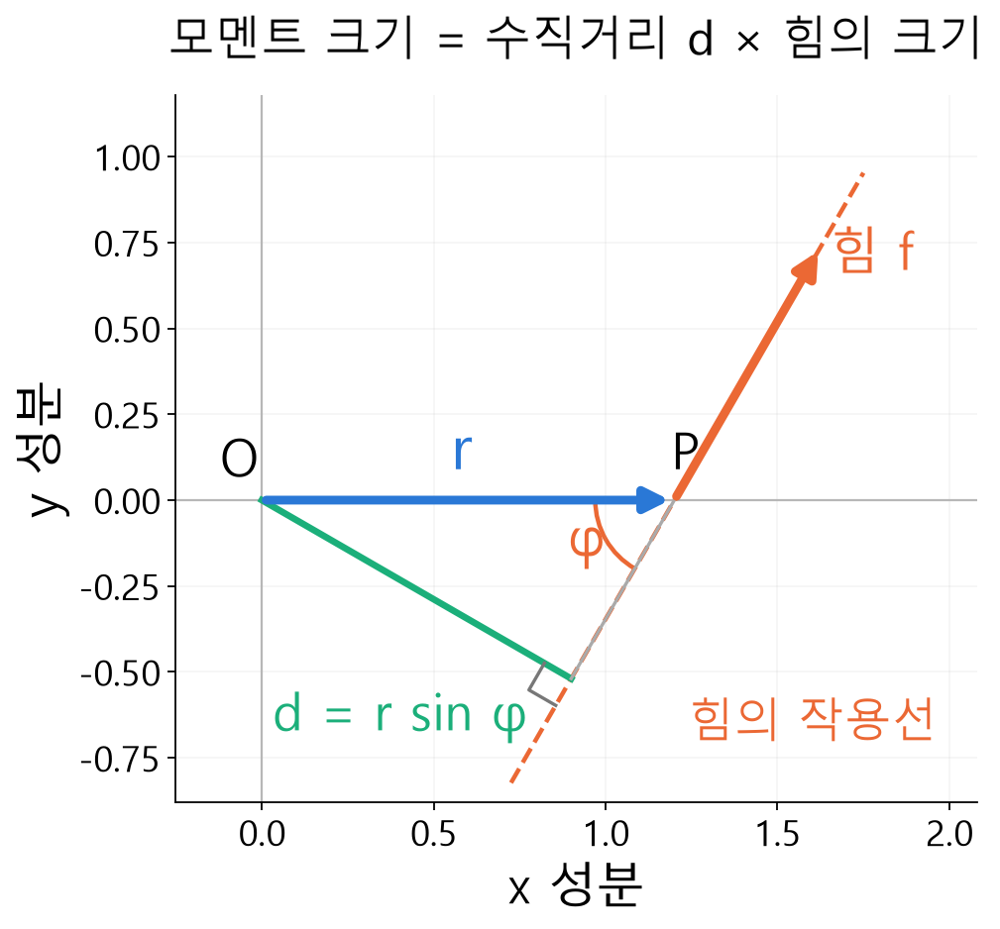
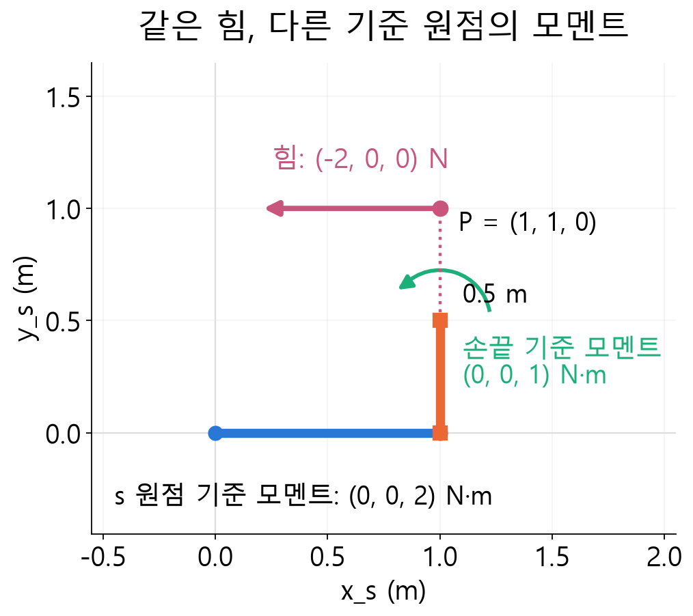

<link rel="stylesheet" href="https://cdn.jsdelivr.net/npm/katex@0.16.11/dist/katex.min.css">

앞에서는 물체가 어떻게 움직이는지 트위스트로 표현했습니다.
이번에는 그 물체의 어느 점에 어떤 힘이 작용하는지 보겠습니다.
힘만 적으면 빠지는 회전 효과를 모멘트로 계산하고, 둘을 하나의 렌치로 묶겠습니다.

## 1. 힘의 작용점을 함께 알아야 하는 이유

손끝 원점에서 0.5 m 떨어진 곳을 2 N의 힘으로 밀어 보겠습니다.
힘의 방향이 원점을 향하면 그 힘은 원점을 기준으로 물체를 돌리는 효과가 없습니다.
반대로 원점에서 작용점으로 향하는 선분에 수직으로 밀면 회전 효과가 생깁니다.

이 회전 효과를 원점에 대한 모멘트(moment)라고 합니다.
크기는 힘 F와 원점에서 힘의 작용선까지의 수직거리 d의 곱입니다.

$$\lVert m\rVert=d\lVert f\rVert$$

기호 $$\lVert\cdot\rVert$$는 벡터의 길이를 뜻합니다.
작용선은 힘 화살표를 앞뒤로 늘인 직선입니다.
원점에서 작용점까지의 벡터를 r, r과 f 사이 각도를 φ라고 하면 직각삼각형에서 다음 관계가 나옵니다.

$$d=\lVert r\rVert\sin\varphi$$

따라서 모멘트의 크기는 다음과 같습니다.

$$\lVert m\rVert=\lVert r\rVert\lVert f\rVert\sin\varphi$$

<figure></figure>

그림에서 P의 삼각형 안쪽 각도는 r과 f의 방향을 둘 다 뒤집어 만든 각입니다.
두 방향을 함께 뒤집으면 사이 각도는 같으므로 이 각도도 φ입니다.

여기서 sinφ가 나오는 이유는 회전에 기여하는 수직거리만 사용하기 때문입니다.
φ=0°이면 d=0이고, φ=90°이면 d는 r의 길이와 같습니다.

크기와 회전축 방향을 함께 담는 연산이 외적입니다.
앞의 트위스트에서 쓴 외적과 같은 규칙을 사용합니다.

$$\boxed{m=r\times f}$$

방향은 오른손 법칙으로 정합니다.
오른손 손가락을 r에서 f로 감으면 엄지가 모멘트의 양의 축을 향합니다.
xy 평면에서 반시계 회전 효과는 +z 방향입니다.
힘의 단위는 N, 모멘트는 N·m입니다.

## 2. 같은 손끝에 힘을 가해 계산하기

앞의 물체좌표계 b를 그대로 사용하겠습니다.
점 P의 b 좌표와 P에 작용하는 힘의 b 성분은 다음과 같습니다.

$$r_b=(0.5,0,0)^T\ \mathrm m,\qquad f_b=(0,2,0)^T\ \mathrm N$$

모멘트에 쓰는 r_b는 **기준 원점에서 힘의 작용점으로 향하는 벡터**입니다.
성분별 외적을 계산하면 다음과 같습니다.

$$m_b=\begin{bmatrix}r_y f_z-r_z f_y\\r_z f_x-r_x f_z\\r_x f_y-r_y f_x\end{bmatrix}=\begin{bmatrix}0\\0\\0.5\times2-0\times0\end{bmatrix}=\begin{bmatrix}0\\0\\1\end{bmatrix}$$

평면 위에서 b의 +x 위치를 +y 방향으로 미는 힘이므로 +z 모멘트가 나옵니다.
길이 0.5 m와 수직 힘 2 N을 곱한 1 N·m와도 일치합니다.

## 3. 힘과 모멘트를 묶는 렌치

렌치(wrench)는 모멘트와 힘을 함께 적은 6차원 벡터입니다.
이 글에서는 Modern Robotics의 순서로 위에 모멘트, 아래에 힘을 놓겠습니다.

$$\boxed{\mathcal F=\begin{bmatrix}m\\f\end{bmatrix}}$$

예제의 b 기준 렌치는 다음과 같습니다.

$$\mathcal F_b=\begin{bmatrix}0\\0\\1\\0\\2\\0\end{bmatrix}$$

첫 세 성분의 단위는 N·m, 뒤 세 성분의 단위는 N입니다.
여섯 숫자를 같은 물리량으로 더하는 것이 아니라, 힘의 작용을 이 두 종류로 함께 보관합니다.
여러 힘이 작용하면 힘끼리 더하고, **같은 원점에 대해 계산한 모멘트끼리** 더합니다.
별도의 순수 토크가 가해지면 그것도 모멘트에 더합니다.

트위스트가 각속도와 선운동 성분을 묶었다면, 렌치는 그 두 운동에 대응하는 모멘트와 힘을 묶습니다.

## 4. 원점을 바꾸면 모멘트도 바뀌는 이유

s에서 본 b의 자세는 앞과 같습니다.

$$R=R_z(90^\circ),\qquad p=(1,0.5,0)^T$$

힘은 방향벡터이므로 원점 위치 p를 더하지 않고 회전만 적용합니다.
작용점은 위치이므로 p를 더합니다.

$$f_s=Rf_b=(-2,0,0)^T$$

$$r_s=p+Rr_b=(1,1,0)^T$$

s 원점에서 모멘트를 다시 계산해 보겠습니다.

$$m_s=r_s\times f_s=\begin{bmatrix}0\\0\\1\times0-1\times(-2)\end{bmatrix}=\begin{bmatrix}0\\0\\2\end{bmatrix}$$

손끝 원점에서는 작용선까지의 거리가 0.5 m였고, s 원점에서는 1 m입니다.
힘은 같지만 기준 원점이 달라져 모멘트가 1 N·m에서 2 N·m로 달라집니다.

<figure></figure>

일반식에서도 이 원점 차이를 확인할 수 있습니다.

$$m_s=(p+Rr_b)\times(Rf_b)$$

외적은 덧셈에 분배되며, 회전행렬은 외적의 방향과 크기를 함께 회전시킵니다.
즉 $$(Rr_b)\times(Rf_b)=R(r_b\times f_b)$$입니다.

$$\boxed{m_s=p\times(Rf_b)+Rm_b}$$

Rm_b는 기존 모멘트의 방향을 바꾼 항이고, p×Rf_b는 기준 원점의 차이에서 추가된 항입니다.
힘의 식과 합쳐 계수를 모으면 렌치 변환행렬도 직접 만들 수 있습니다.

$$\begin{bmatrix}m_s\\f_s\end{bmatrix}=\begin{bmatrix}R&[p]R\\0&R\end{bmatrix}\begin{bmatrix}m_b\\f_b\end{bmatrix}$$

오른쪽 위 블록은 힘이 원점 차이에 따라 모멘트를 만든다는 것을 나타냅니다.
트위스트의 Adjoint에서는 왼쪽 아래에 놓였던 블록입니다.
이 차이는 두 벡터가 어떻게 짝을 이루는지 살펴보면 더 분명해집니다.

## 5. 트위스트와 렌치의 내적이 일률인 이유

힘 f가 작용하는 점이 작은 거리 dx만큼 움직이면, 힘이 한 일은 $$dW=f\cdot dx$$입니다.
이 일을 걸린 시간 dt로 나눈 값이 일률(power)입니다.

$$\mathcal P=\frac{dW}{dt}=f\cdot\dot x$$

힘 방향으로 움직인 속도 성분에 힘을 곱한 값이며, 단위는 W입니다.
강체의 점 속도 $$\dot x=\omega\times r+v$$를 넣겠습니다.
여기서는 모든 벡터를 같은 기준으로 표현합니다.

$$\mathcal P=f\cdot(\omega\times r)+f\cdot v$$

세 벡터의 스칼라 삼중곱은 순환 순서를 바꾸어도 같습니다.
따라서 $$f\cdot(\omega\times r)=\omega\cdot(r\times f)$$입니다.
오른쪽 괄호가 모멘트 m이므로 다음 식이 됩니다.

$$\boxed{\mathcal P=m\cdot\omega+f\cdot v=\mathcal F^T\mathcal V}$$

위의 세 성분끼리는 모멘트×각속도, 아래 세 성분끼리는 힘×선운동 성분으로 짝지어집니다.
이것이 렌치를 (m,f), 트위스트를 (ω,v) 순서로 함께 쓰는 이유입니다.

예제의 공간 트위스트와 렌치는 다음과 같습니다.

$$\mathcal V_s=(0,0,2,\;0,-2,0)^T$$

$$\mathcal F_s=(0,0,2,\;-2,0,0)^T$$

$$\mathcal P=2\times2+(-2)\times0+0\times(-2)=4\ \mathrm W$$

점 P의 실제 속도는 (−2,0,0) m/s였으므로, 힘과 직접 내적해도 4 W입니다.

$$(-2,0,0)\cdot(-2,0,0)=4$$

b 기준에서는 $$\mathcal V_b=(0,0,2,\;0,1,0)^T$$였고 $$\mathcal F_b=(0,0,1,\;0,2,0)^T$$입니다.

$$\mathcal P=1\times2+2\times1=4\ \mathrm W$$

같은 힘의 같은 운동에 대한 일률이므로 어느 기준으로 계산해도 같습니다.

## 6. 왜 렌치는 역전치로 변환할까?

트위스트의 변환행렬을 $$A=\operatorname{Ad}_T$$라고 줄이겠습니다.

$$\mathcal V_s=A\mathcal V_b,\qquad\mathcal V_b=A^{-1}\mathcal V_s$$

일률의 기준 독립성을 쓰고 두 번째 식을 대입합니다.

$$\mathcal F_s^T\mathcal V_s=\mathcal F_b^T A^{-1}\mathcal V_s$$

오른쪽 앞부분을 하나의 전치된 벡터로 쓰면 다음과 같습니다.

$$\mathcal F_b^TA^{-1}=(A^{-T}\mathcal F_b)^T$$

여기서 $$A^{-T}=(A^{-1})^T$$는 역행렬을 전치한 것입니다.
어떤 운동 트위스트와 짝지어도 일률이 같아야 하므로 계수 벡터가 일치합니다.

$$\boxed{\mathcal F_s=\operatorname{Ad}_T^{-T}\mathcal F_b}$$

앞에서 힘과 작용점을 직접 변환해 얻은 6×6 블록행렬이 바로 이 역전치입니다.
역행렬은 트위스트를 반대 방향으로 바꾸는 데서, 전치는 내적의 곱 순서를 정리하는 데서 나왔습니다.

### 이해도 확인

힘이 b의 +y 방향으로 2 N 작용할 때, 작용점이 b 원점에서 +x로 0.25 m 떨어져 있다면 b 기준 모멘트는 얼마일까요?

풀이 보기

$$m_b=(0.25,0,0)^T\times(0,2,0)^T=(0,0,0.5)^T\ \mathrm{N\!\cdot m}$$

수직거리 0.25 m에 힘 2 N을 곱하면 크기 0.5 N·m이고, 회전 효과는 +z 방향입니다.

지금까지 자세 T, 순간 운동 𝒱, 힘의 작용 𝓕를 구분했습니다.
관절각으로 손끝 자세를 계산하는 PoE에는 운동의 축과 변환을 사용합니다.
렌치는 이렇게 구한 로봇 자세에서 힘과 토크를 다룰 때 쓰는 표현입니다.

참고: [Modern Robotics 렌치와 일률, 좌표 변환](https://modernrobotics.northwestern.edu/nu-gm-book-resource/3-4-wrenches/). 2026년 11월 18일 확인.
