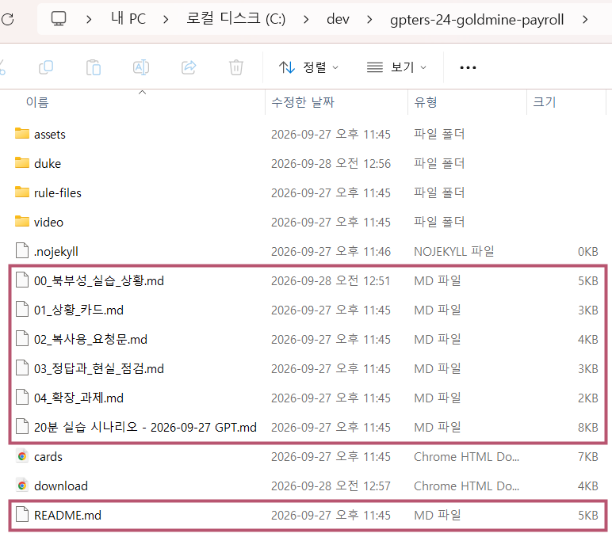
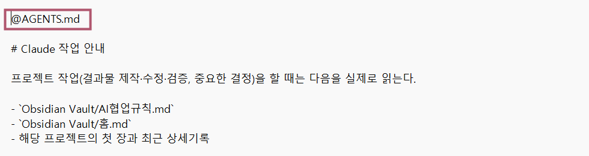
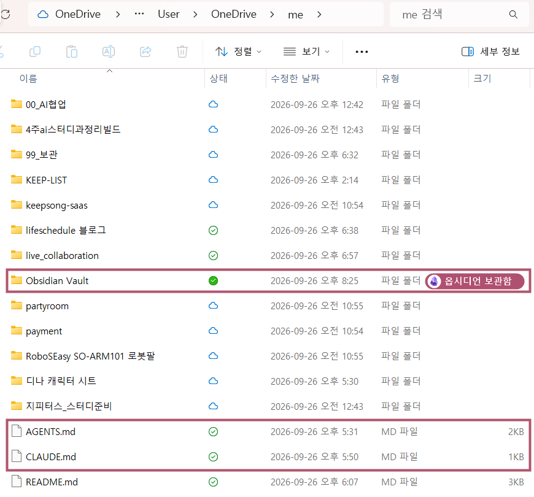

### What is an .md file?

An .md file is a **plain text file** that uses symbols like `#` for headings and `-` for lists. 
AI assistants often save rules and notes as Markdown. 
These files build up as you use AI for more work.

<figure><figcaption>A work log folder with Markdown files. The original screenshot uses Korean names.</figcaption></figure>

You’ll see a lot of Markdown files. Start with the ones that tell you how the project works.

## 1 Common Markdown files

<h3 class="step-h">1Files worth reading first</h3>

<b>Rules files</b> tell the assistant how to work.<code>AGENTS.md</code> <code>CLAUDE.md</code> <code>AI협업규칙.md</code> (AI collaboration rules)

<b>Project overview</b> gives you the essentials at a glance.<code>README.md</code> <code>Project Name.md</code>

<h3 class="step-h">2Files to read when you need them</h3>

<b>Product requirements document</b> explains what you’re building and why.<code>PRD.md</code>

<b>Work logs</b> record what you did on each date.<code>Work Logs</code>

<h3 class="step-h">3Files the assistant uses</h3>

<b>Assistant files</b> hold skills and notes for the assistant to use as it works.<code>SKILL.md</code> <code>MEMORY.md</code>

## 2 Files the apps find automatically

Claude Code looks for <code>CLAUDE.md</code> and Codex looks for <code>AGENTS.md</code> when working in a project folder.

Claude Code

Reads <b>CLAUDE.md</b> from the project.

Codex

Reads <b>AGENTS.md</b> from the project.

<svg><use href="#i-warn"/></svg>
A regular <b>web chat</b> can’t automatically read AGENTS.md or CLAUDE.md from a folder on your computer.

### How the rules link together

1Open the <code>me</code> folder in your coding assistant. Codex reads <code>AGENTS.md</code>.

2<b>Claude Code</b> follows <code>@AGENTS.md</code> on the first line of <code>CLAUDE.md</code> to read the same rules.

3<code>AGENTS.md</code> points both assistants to <code>AI협업규칙.md</code>, where the shared work and logging rules are written down.

<figure><figcaption>The <code>@AGENTS.md</code> import on the first line links the files.</figcaption></figure>

## 3 The AI work folder in OneDrive

Keep <code>AGENTS.md</code> and <code>CLAUDE.md</code> directly inside <code>me</code>. 
Put <code>AI협업규칙.md</code> and your work logs inside <code>Obsidian Vault</code>.

<figure><figcaption>The pink boxes mark <b>AGENTS.md</b>, <b>CLAUDE.md</b>, and <b>Obsidian Vault</b>. If you use Obsidian, the vault can live here inside <code>me</code>.</figcaption></figure>

## 4 A prompt to finish each task

Send this to the coding assistant with the <code>me</code> folder open when you finish working.

Wrap up the task<button class="copy" type="button">Copy</button>Please update the Markdown files with what we did.

### References

<ul class="refs">
<li>Anthropic, <a href="https://code.claude.com/docs/en/memory" target="_blank" rel="noopener">How Claude remembers your project (CLAUDE.md and imports)</a></li>
<li>Anthropic, <a href="https://code.claude.com/docs/en/skills" target="_blank" rel="noopener">Extend Claude with skills (SKILL.md)</a></li>
<li>Anthropic, <a href="https://support.claude.com/en/articles/9517075-what-are-projects" target="_blank" rel="noopener">What are projects?</a></li>
<li>OpenAI, <a href="https://developers.openai.com/codex/guides/agents-md" target="_blank" rel="noopener">Custom instructions with AGENTS.md (Codex)</a></li>
<li>OpenAI, <a href="https://help.openai.com/en/articles/10169521-projects-in-chatgpt" target="_blank" rel="noopener">Projects in ChatGPT</a></li>
<li><a href="https://agents.md/" target="_blank" rel="noopener">AGENTS.md</a>, an open format used by several AI tools</li>
</ul>
