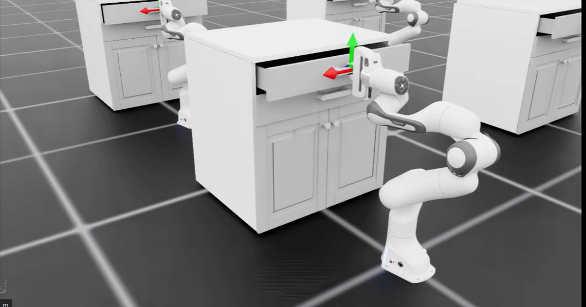

My laptop doesn’t have an NVIDIA graphics card. 
I rented a **cloud GPU** to run Isaac Sim and tried an example where a robot arm opens a drawer.

Run the example in two browser tabs, then change how long the robot pulls the drawer.

## 1 Two browser tabs

① VS Code tab

Enter <b>commands</b> here.

② Viewer tab

Watch <b>Isaac Sim</b> here.

The cloud computer runs both. Chrome displays the editor and the stream.

<figure></figure>

## 2 Start the cloud computer

<h3 class="step-h">1Sign up for Brev and add credits</h3>

Sign up for [NVIDIA Brev](https://brev.nvidia.com). Under **Billing**, add your payment method and buy credits.

<svg><use href="#i-warn"/></svg>
<b>Enter sign-up, login, and payment details yourself.</b>

<h3 class="step-h">2Deploy the Isaac Launchable</h3>

Select **Deploy Now** in the [Isaac Launchable repository](https://github.com/isaac-sim/isaac-launchable), then select **Deploy Launchable** in Brev. 
This starts a cloud computer with Isaac Sim and Isaac Lab installed.

The AWS L40S I used cost <b>US$3.65 per hour</b> on October 25, 2026. 
Allow a few minutes for the first launch.

<h3 class="step-h">3Open VS Code</h3>

Wait for the status to show **Running** and **Built**. Under **HTTP Ports**, select the **↗** next to the address. 
Sign in to Brev to open VS Code in Chrome.

<svg><use href="#i-warn"/></svg>
When you’re done, select <b>Stop</b> at the top right of the Brev page. 
Storage charges can continue after you stop the instance. 
The red <b>Delete</b> button also deletes files you changed on the instance.

## 3 Run the drawer example

In VS Code, select **☰ → Terminal → New Terminal** and enter these commands one at a time.

① Go to the Isaac Lab folder<button class="copy" type="button">Copy</button>cd /workspace/isaaclab

② Run the drawer example<button class="copy" type="button">Copy</button>./isaaclab.sh -p scripts/environments/state_machine/open_cabinet_sm.py --num_envs 4 --livestream 2 --viz kit

<b>-p</b> runs the Python script that follows it through Isaac Lab.

<b>--num_envs 4</b> starts four robot environments at once.

<b>--livestream 2 --viz kit</b> streams the Isaac Sim view to the browser.

Paste the VS Code address into a new tab and <b>replace <code>?folder=/workspace</code> with <code>viewer/</code></b> before opening it. 
The viewer says “Waiting for stream” while Isaac Sim starts. 
When it’s ready, you’ll see four robots.

## 4 Common errors

<h3 class="step-h">1“Command not found” or “No such file”</h3>

The terminal couldn’t find a command or file. 
Check the spelling and path first. For example, `mdkir` and `oepn` should be `mkdir` and `open`.

<b>↑ key</b> brings back the last command so you can fix the typo.

<b>Tab key</b> completes a folder or file name after you type its first few characters.

<h3 class="step-h">2FileNotFoundError for a robot asset</h3>

On October 25, 2026, the example couldn’t find the **Franka arm asset under the Isaac 6.0 path** on NVIDIA’s server. 
The 5.1 path worked for this run.

1. In the VS Code file explorer, open `isaaclab/apps/isaaclab.python.kit`.
2. Press **Ctrl + H**. Find `Assets/Isaac/6.0`, replace it with `Assets/Isaac/5.1`, and select **Replace All**.
3. Save with **Ctrl + S**. In the terminal, use **↑ → Enter** to rerun the example.

## 5 Move the camera

Click inside the viewer, then use the mouse.

<b>Alt + left-drag</b> orbits the camera.

<b>Middle-button drag</b> pans the camera.

<b>Scroll the wheel</b> to zoom.

## 6 Read the drawer-opening sequence

The example defines the sequence in code. 
In VS Code, press **Ctrl + P**, type `open_cabinet`, and open `open_cabinet_sm.py`.

<h3 class="step-h">1Six states and their wait times</h3>

`OpenDrawerSmState` lists the states, and `OpenDrawerSmWaitTime` lists the wait times. 
Use **Ctrl + F** to jump to each name.

<table class="order">
<thead><tr><th scope="col">State</th><th scope="col">What you see</th><th scope="col">Time</th></tr></thead>
<tbody>
<tr><td>① RestREST</td><td>The arm stays still.</td><td>0.5 s</td></tr>
<tr><td>② Move in frontAPPROACH_<wbr>INFRONT_<wbr>HANDLE</td><td>The arm reaches toward the drawer.</td><td>1.25 s</td></tr>
<tr><td>③ Approach handleAPPROACH_<wbr>HANDLE</td><td>The arm moves up to the handle.</td><td>1.0 s</td></tr>
<tr><td>④ Grip handleGRASP_<wbr>HANDLE</td><td>The gripper closes.</td><td>1.0 s</td></tr>
<tr class="hot"><td>⑤ Pull drawerOPEN_<wbr>DRAWER</td><td>The arm pulls while gripping.</td><td>3.0 s</td></tr>
<tr><td>⑥ Final stateRELEASE_<wbr>HANDLE</td><td>The arm stops with its gripper closed.</td><td>0.2 s*</td></tr>
</tbody>
</table>

A **state machine** tracks the current step and defines when to move to the next one. 
Steps ② and ③ check both the elapsed time and whether the arm has reached the target. 
*Step ⑥ stays in the same state with the gripper closed even after 0.2 seconds. See the [official example code](https://github.com/isaac-sim/IsaacLab/blob/v3.0.0-beta2/scripts/environments/state_machine/open_cabinet_sm.py).

<h3 class="step-h">2Change one number</h3>

Change the wait time for ⑤ `OPEN_DRAWER` from `3.0` to `0.5` and save with **Ctrl + S**. 
In the terminal, press **Ctrl + C** to stop the current run, then **↑ → Enter** to start it again.

In my recording, the drawer opened less when the arm had less time to pull.

🎉 You ran the drawer example and changed how the robot moves!

