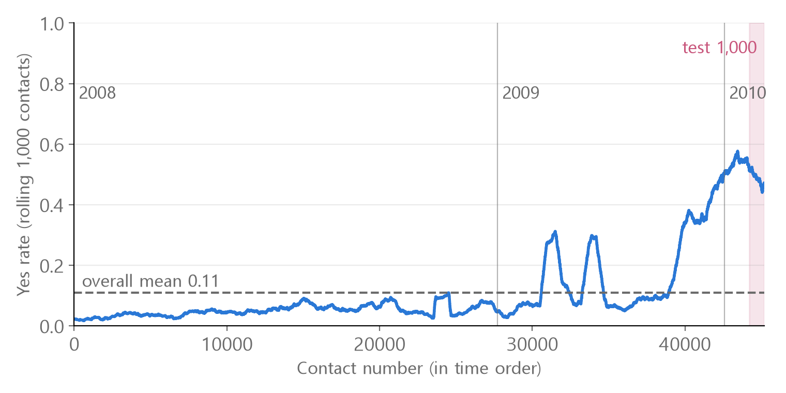
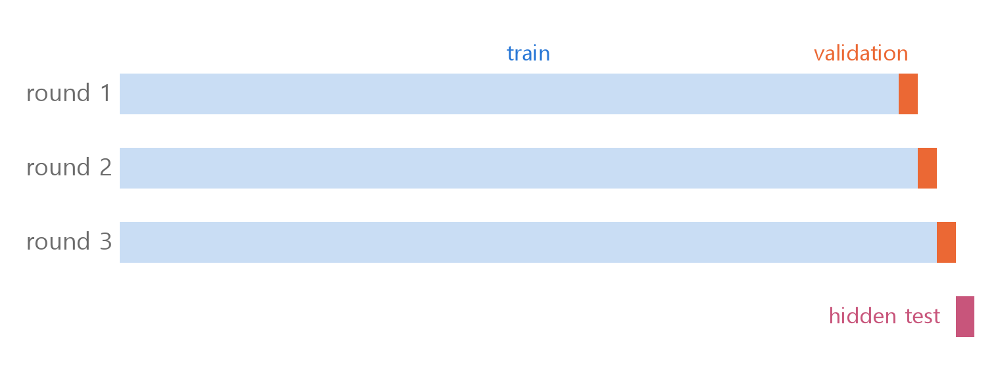
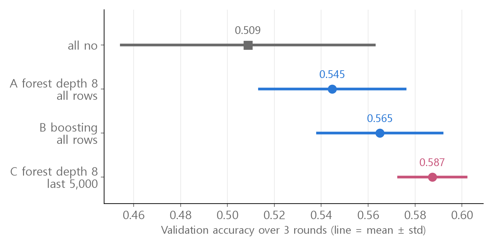
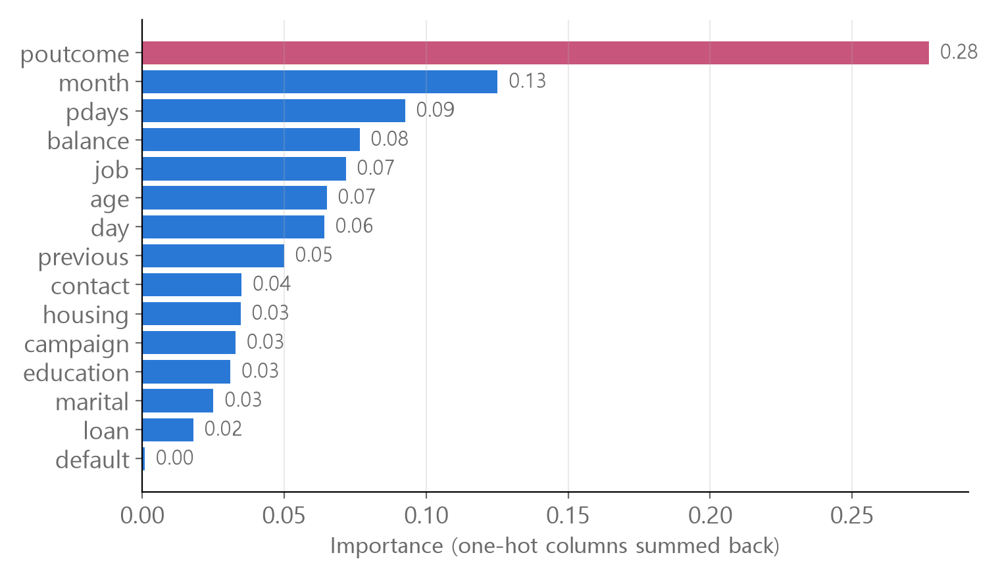

<style>
.content table { width: 100%; border-collapse: collapse; margin: 14px 0 24px; font-size: 17px; line-height: 1.5; }
.content th, .content td { border-bottom: 1px solid #e6dde0; padding: 8px 10px; text-align: left; vertical-align: top; }
.content thead { background: #fbf1f4; }
.content figure { margin: 18px 0; }
.content figure img { width: 100%; height: auto; }
.content td, .content th { word-break: keep-all; overflow-wrap: normal; }
.content .katex-display { overflow-x: auto; overflow-y: hidden; padding: 4px 0; }
@media (max-width: 560px) { .content th, .content td { padding: 7px 5px; font-size: 16px; } }
</style>
<link rel="stylesheet" href="https://cdn.jsdelivr.net/npm/katex@0.16.11/dist/katex.min.css">
<script defer src="https://cdn.jsdelivr.net/npm/katex@0.16.11/dist/katex.min.js"></script>
<script defer src="https://cdn.jsdelivr.net/npm/katex@0.16.11/dist/contrib/auto-render.min.js" onload="renderMathInElement(document.querySelector('.content')||document.body,{delimiters:[{left:'\\[',right:'\\]',display:true},{left:'\\(',right:'\\)',display:false}]})"></script>

<div class="wc"><p><b>Why try bank term deposit prediction?</b><br>
The <a href="https://archive.ics.uci.edu/dataset/222/bank+marketing">Bank Marketing data</a> holds 45,211 phone marketing records from a Portuguese bank, and the task is binary classification: did the customer sign up for a term deposit (yes/no)?<br>
The records are in date order (May 2008 to November 2010), so you get to face a dataset whose shape changes over time.<br>
"Drop what you would not know at prediction time" and "validate in time order" apply to any data that flows over time, such as sales, demand or sensor readings. (As of November 2, 2026)</p></div>

This post walks through **seven steps**, from exploring the data to choosing a model, focusing on the spots that are easy to get wrong, with real numbers.<br>
Every number and figure was computed in Python (pandas, scikit-learn).

<div class="keyline">We start by setting aside the last 1,000 of the 45,211 public records as a test with the answers hidden.</div>

```python
import pandas as pd

full = pd.read_csv("bank-full.csv", sep=";")
train, test = full.iloc[:-1000], full.iloc[-1000:]
```
Every decision uses the 44,211 rows in `train`. The 1,000 rows in `test` (July to November 2010) are never used for choosing; they are only scored at the end.<br>
`iloc[-1000:]` means "from the 1,000th row from the end to the end", and `iloc[:-1000]` means "from the start up to that point".

## <span class="no">1</span> The whole workflow at a glance

| Step | Question | Answer for this data |
|---|---|---|
| Baseline | What does guessing score? | 0.891 on training data, about 0.5 recently |
| Missing values | Are blanks hiding? | 0 NaN; `unknown` and `-1` act as blanks |
| Leakage | Which column is not known yet? | Drop `duration` (call length) |
| Encoding | What about text columns? | One-hot, 50 columns |
| Validation | Where does validation come from? | The end, in time order |
| Model | How do we pick? | Validation mean and spread |
| Improvement | How to go higher? | It needs new information |

With unfamiliar data, first look at what values each column holds, in one table.

```python
pd.set_option("display.max_colwidth", None)
num = pd.api.types.is_numeric_dtype
pd.DataFrame([[c, f"{train[c].min()} ~ {train[c].max()}" if num(train[c])
               else ", ".join(sorted(train[c].astype(str).unique()))] for c in train.columns])
```
Running it shows one 17-row table with every column's values, like `poutcome: failure, other, success, unknown`. Printing `value_counts()` for each column produces so many lines that the output easily gets cut off.

## <span class="no">2</span> The 0.891 baseline trap

A **baseline** is the score you get by guessing without a model.

$$\text{accuracy} = \frac{\text{number correct}}{\text{total}}$$

`train` has 39,411 no and 4,800 yes, so guessing "all no" scores 0.891. That number does not hold for recent customers.

<figure></figure>

| Period | Rows | Yes rate |
|---|---|---|
| 2008 | 27,729 | 0.051 |
| 2009 | 14,862 | 0.171 |
| 2010 (train) | 1,620 | 0.533 |
| Hidden test | 1,000 | 0.489 |

On the test period, "all no" scores 0.511. The real baseline for this problem is **around 0.5**.<br>
The data has no year column. Because it is in date order, the year was rebuilt by counting where the month wraps from December back to January.

## <span class="no">3</span> Hidden missing values and duration leakage

`isna().sum()` is 0 for every column. The blanks are **hidden as text or numbers**.

| Column | Hidden blank | Meaning |
|---|---|---|
| poutcome | `unknown` 36,614 | Not contacted in a previous campaign |
| pdays | `-1` 36,610 | No days since a previous contact |
| contact | `unknown` 12,889 | Contact type not recorded |
| education | `unknown` 1,798 | Education not recorded |
| job | `unknown` 277 | Job not recorded |

Keep poutcome even though 82% of it is `unknown`. The value means "never contacted before", and the yes rate differs a lot by value (success 0.612, unknown 0.089).

Drop **duration (call length in seconds)**. It is only known after the call ends, so it does not exist yet when you decide whom to call.

```python
X = pd.get_dummies(train.drop(columns=["y"]))                 # ❌
X = pd.get_dummies(train.drop(columns=["y", "duration"]))     # ✅
```
❌ runs without errors and scores high. The median call length is 453 seconds for yes customers and 164 for no, so it nearly gives away the answer.<br>
Letting information that is not available at prediction time into the inputs is called **data leakage**.

## <span class="no">4</span> One-hot encoding and matching columns

The 9 text columns are turned into 0/1 columns, one per value, with **one-hot encoding**. Mapping `job` to admin. 0, blue-collar 1 and so on would give an order to values that have none.

```python
X = pd.get_dummies(train.drop(columns=["y", "duration"]), dtype=int)
X_test = pd.get_dummies(test.drop(columns=["y", "duration"]), dtype=int)
X_test = X_test.reindex(columns=X.columns, fill_value=0)
y = (train["y"] == "yes").astype(int)
```
`X` is (44211, 50) and `X_test` is (1000, 50). The target `y` is 1 for yes and 0 for no.

The test period has no January to June or December, so one-hot encoding it separately never creates columns like `month_jan`. `reindex` makes the test columns match train in name, order and count, filling the missing ones with 0.

## <span class="no">5</span> Building validation in time order

Validation has to come from **where it looks like the test**. If the test is the most recent data, take validation from the most recent data too.

```python
from sklearn.model_selection import train_test_split
X_tr, X_val, y_tr, y_val = train_test_split(X, y, test_size=0.2, random_state=0)  # ❌
X_tr, X_val = X.iloc[:-1000], X.iloc[-1000:]                                       # ✅
y_tr, y_val = y.iloc[:-1000], y.iloc[-1000:]                                       # ✅
```
❌ shuffles 2008 to 2010 together, so most of the validation set is older customers who rarely said yes. With this split, "all no" scores 0.889 and a Random Forest (same settings as A below) scores 0.898.
- The model beats guessing by only 0.009, so the split cannot even show whether the model is useful.
- It does not look like the test period, so the score level is wrong too. On the hidden test, A scored 0.656.

One validation run includes luck, so we roll it **three times** along time. Each round trains on everything before and tests on the next 1,000 rows.

<figure></figure>

$$\bar{s} = \frac{1}{3}\sum_{i=1}^{3} s_i, \qquad \sigma = \sqrt{\frac{1}{3}\sum_{i=1}^{3}(s_i - \bar{s})^2}$$

$$s_i$$ is the accuracy of round $$i$$, $$\bar{s}$$ is the mean, and $$\sigma$$ is how much the score moves around.

## <span class="no">6</span> Comparing models on the hidden test

Three candidates were compared on the same validation rounds.

- **A** : Random Forest, `max_depth=8`, all training rows
- **B** : boosting (`HistGradientBoostingClassifier`), all training rows. Each new tree corrects what the previous trees got wrong.
- **C** : the same forest as A, trained on **only the latest 5,000 rows**

<figure></figure>

| Candidate | 3 scores | Mean | σ | Mean − σ |
|---|---|---|---|---|
| All no | 0.582, 0.490, 0.454 | 0.509 | 0.054 | 0.455 |
| A | 0.582, 0.506, 0.546 | 0.545 | 0.031 | 0.514 |
| B | 0.602, 0.552, 0.541 | 0.565 | 0.027 | 0.538 |
| C | 0.585, 0.606, 0.571 | **0.587** | **0.014** | **0.573** |

C has the highest mean and the smallest spread, so C was chosen. After choosing, it was retrained on the last 5,000 training rows and scored once on the hidden test.

| Model | Hidden test (1,000) |
|---|---|
| All no | 0.511 |
| A | 0.656 |
| B | 0.655 |
| C | **0.666** |

The standard error of a 1,000-row test is about 0.015. The gap between A, B and C (0.011) is inside it, so this test cannot rank them. All three clearly beat the baseline by about 0.15.

## <span class="no">7</span> How to push the score higher

Start with **feature importance** to see which columns the model leaned on.

```python
imp = pd.Series(model.feature_importances_, index=X.columns)   # model = C
imp.groupby(lambda c: c.split("_")[0]).sum().sort_values(ascending=False)
```
The one-hot columns (`poutcome_success` and so on) are summed back under their original column names.

<figure></figure>

Tree-based importance tends to inflate numeric columns with many distinct values, so treat the ranking as a hint. Still, "previous campaign outcome" being the strongest clue matches the yes rates in step 3.

Here is what other attempts gave. Every setting was chosen on validation; the hidden test scores are listed only for comparison and were never used to choose.

| Attempt | Hidden test |
|---|---|
| C (reference) | 0.666 |
| Lower threshold: yes if probability ≥ 0.45 | 0.663 |
| Lower threshold: 0.40 | 0.653 |
| Validation winner among 288 combinations (forest without depth limit (min 5 rows per leaf), all training rows, contact-order column added, threshold 0.45) | 0.673 |
| C + duration ❌ leakage | 0.751 |

- **Threshold** : the model outputs the probability of yes, and by default 0.5 or above means yes. C picked yes for only 28% of rows, so the threshold was lowered, but the score did not go up.
- **Trying many combinations** : out of 288 combinations of 4 models, training span, threshold and extra columns (year, contact order), the winner scored 0.626 on validation, 0.039 above C (0.587). On the hidden test it scored 0.673, only 0.007 above C and inside the 0.015 standard error. The more you compare, the more likely the winner is one that got lucky, so validation gaps shrink on the test.
- **duration** : it alone adds 0.085. What moves the score most is **information** more than the model, but this column is information you must not use.

To raise the score, the promising direction is adding **new information you can know before calling**. The extended version published by the same researchers (bank-additional) includes economic indicators such as interest rates and employment at the time of contact.

<div class="done"><div class="done-t">🎉 If the test is recent, validate on recent data, and drop columns you would not know at prediction time!</div></div>

<p style="font-size:16px">Data source: Moro, S., Rita, P., &amp; Cortez, P. (2014). Bank Marketing [Dataset]. UCI Machine Learning Repository. <a href="https://doi.org/10.24432/C5K306">https://doi.org/10.24432/C5K306</a> (CC BY 4.0)</p>
