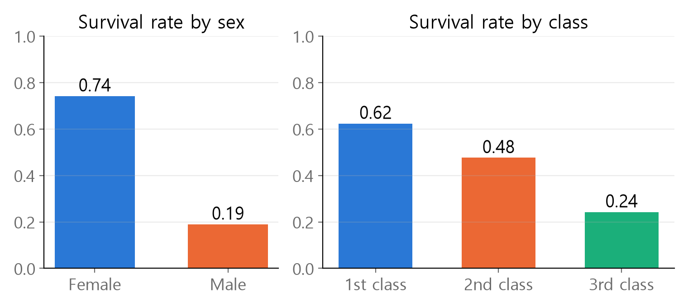
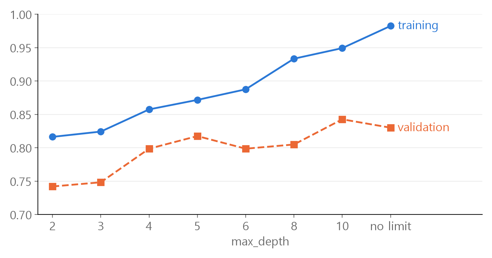
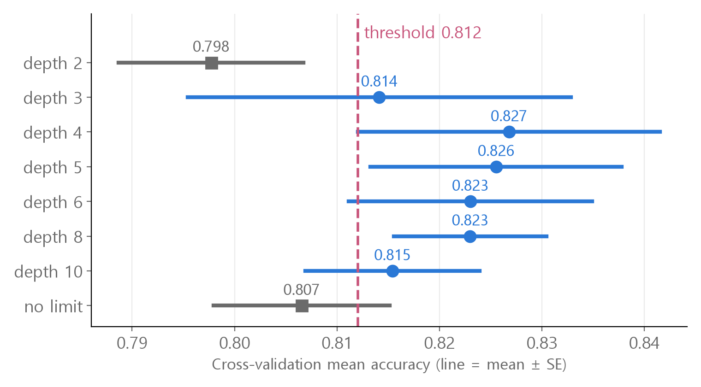

<style>
.content table { width: 100%; border-collapse: collapse; margin: 14px 0 24px; font-size: 17px; line-height: 1.5; }
.content th, .content td { border-bottom: 1px solid #e6dde0; padding: 8px 10px; text-align: left; vertical-align: top; }
.content thead { background: #fbf1f4; }
.content figure { margin: 18px 0; }
.content figure img { width: 100%; height: auto; }
.content td, .content th { word-break: keep-all; overflow-wrap: normal; }
.content .katex-display { overflow-x: auto; overflow-y: hidden; padding: 4px 0; }
@media (max-width: 560px) { .content th, .content td { padding: 7px 5px; font-size: 16px; } }
</style>
<link rel="stylesheet" href="https://cdn.jsdelivr.net/npm/katex@0.16.11/dist/katex.min.css">
<script defer src="https://cdn.jsdelivr.net/npm/katex@0.16.11/dist/katex.min.js"></script>
<script defer src="https://cdn.jsdelivr.net/npm/katex@0.16.11/dist/contrib/auto-render.min.js" onload="renderMathInElement(document.querySelector('.content')||document.body,{delimiters:[{left:'\\[',right:'\\]',display:true},{left:'\\(',right:'\\)',display:false}]})"></script>

<div class="wc"><p><b>Why try Titanic survival prediction?</b><br>
The Titanic data is a binary classification problem: predict survived (1) or died (0) from passenger details, and it is widely used as a <a href="https://www.kaggle.com/competitions/titanic">Kaggle beginner competition</a>.<br>
Filling missing values, turning text into numbers, training, validating and writing a prediction file: a full machine learning loop fits in one small table.<br>
The overfitting checks and cross-validation you practice here are the same tools you use when the data grows or the model changes. (As of November 2, 2026)</p></div>

This post walks through **six steps**, from exploring the data to saving a prediction file, focusing on the spots that are easy to get wrong, with real numbers.<br>
Every number and figure was computed in Python (pandas, scikit-learn).

<div class="keyline">We start by setting aside 100 of the 891 passengers in the public Titanic data, with their answers hidden.</div>

```python
import pandas as pd
from sklearn.model_selection import train_test_split

full = pd.read_csv("titanic.csv")
train, test = train_test_split(full, test_size=100, random_state=42)
test_answer = test["Survived"]
test = test.drop(columns=["Survived"])
```
Every decision is made with `train` (791 passengers, answers known). `test` (100 passengers) is scored only once, at the end.

## <span class="no">1</span> Survival rates and a baseline first

`Survived` is 0 or 1, so **the mean of each group is its survival rate**.

```python
train.groupby("Sex")["Survived"]         # ❌
train.groupby("Sex")["Survived"].mean()  # ✅
```

```text
Sex
female    0.741818
male      0.189922
Name: Survived, dtype: float64
```

The ❌ line alone only prints a `SeriesGroupBy object`. It splits the rows into groups but never says what to compute.<br>
The ✅ line shows the survival rate by sex: 0.742 for women and 0.190 for men.

<figure></figure>

Before building a model, set a **baseline**. If the model cannot beat it, training added nothing.

$$\text{accuracy} = \frac{\text{correct predictions}}{\text{total}}$$

| Guessing rule | Accuracy on 791 |
|---|---|
| Everyone died | 0.618 |
| Women survived, men died | 0.786 |

The sex column alone gives 0.786. The model's job is to beat that.

## <span class="no">2</span> Fill missing values with train values

Fill missing values **with values computed from train, the same way in train and test**.

| Column | Missing in train | Treatment |
|---|---|---|
| Age | 160 | train mean 29.7 (close to the median, 28.0) |
| Embarked (port) | 2 | train mode, S |
| Cabin | 612 (77%) | drop the column |

`dropna()` deletes **rows** with any missing value. Only 158 train and 25 test passengers would be left, so it is not an option. You must not delete a single test passenger you are supposed to predict.

```python
train = train.fillna(train["Embarked"].mode()[0])            # ❌ whole table
test["Age"] = train["Age"].fillna(test["Age"].mean())        # ❌ tables swapped

train["Embarked"] = train["Embarked"].fillna(train["Embarked"].mode()[0])  # ✅
test["Embarked"] = test["Embarked"].fillna(train["Embarked"].mode()[0])    # ✅
train["Age"] = train["Age"].fillna(train["Age"].mean())                    # ✅
test["Age"] = test["Age"].fillna(train["Age"].mean())                      # ✅
```
- First ❌ : it applies to the whole table, so missing ages are filled with `'S'` too.
- Second ❌ : it runs without an error. pandas aligns the two tables by row label (index), so the test ages become the wrong values or missing (NaN). Here the labels do not overlap, so all 100 become NaN.
- `mode()` can have more than one most-frequent value, so it returns a Series, and `[0]` takes the first one.

The fill value must match the one used in training. In practice new passengers arrive one at a time, so you cannot compute "their mean" in advance.<br>
If you fill train using the mean of train and test combined, information from the data you will predict leaks into training. This is **data leakage**, and it makes validation scores look better than they really are.

## <span class="no">3</span> Text to numbers, drop meaningless columns

scikit-learn models only take numbers, so for each text column, look at **how many distinct values it has (`nunique()`)**, then convert it or drop it.

| Column | Distinct values | Treatment |
|---|---|---|
| Sex | 2 | to numbers (male 0, female 1) |
| Embarked | 3 | to numbers (S 0, C 1, Q 2) |
| Ticket | 616 | drop |
| Name | 791 | drop |

```python
train["Sex"] = train["Sex"].map({"male": 0, "female": 1})
test["Sex"] = test["Sex"].map({"male": 0, "female": 1})
```
Convert Embarked the same way in both train and test. Run this **only once**. Run it twice and the values, already 0 and 1, no longer match `"male"`, so everything turns into `NaN`.

**Why not number Name or PassengerId?** Each passenger has a different value, so the model memorizes answers per person, like "number 357 survived". Test passengers are people it has never seen, so those numbers teach it nothing.

**Fare has 236 distinct values, but we keep it.** The size of the number means something. Split fares into four bands and the survival rate rises 0.21 → 0.29 → 0.46 → 0.57.

S 0, C 1, Q 2 for Embarked has no real order. Tree models only ask questions like "is it 1 or less?", so the effect is small. For KNN or logistic regression, which use the size of the number directly, one-hot encoding (one column per port) is safer.

## <span class="no">4</span> Random Forest and overfitting

A **Random Forest** builds many decision trees, each from a slightly different random sample of the data, and combines their predictions.

$$\hat{y} = \arg\max_{c} \ \frac{1}{T}\sum_{t=1}^{T} p_t(c \mid x)$$

$$T$$ is the number of trees (100 by default), and $$p_t(c \mid x)$$ is the probability tree $$t$$ gives that passenger $$x$$ is in class $$c$$. Instead of a per-tree vote, scikit-learn <a href="https://scikit-learn.org/stable/modules/ensemble.html">averages the probabilities</a> and picks the largest.

We set aside 20% of the 791 passengers (159) as a **validation set** and trained on the rest.

```python
from sklearn.ensemble import RandomForestClassifier

X = train.drop(columns=["PassengerId", "Name", "Ticket", "Cabin", "Survived"])
y = train["Survived"]
X_test = test.drop(columns=["PassengerId", "Name", "Ticket", "Cabin"])
X_tr, X_val, y_tr, y_val = train_test_split(X, y, test_size=0.2, random_state=42)
model = RandomForestClassifier(random_state=42).fit(X_tr, y_tr)
```

| Score | Accuracy |
|---|---|
| Training data (`X_tr`) | 0.983 |
| Validation (`X_val`) | 0.830 |
| Same 159, guessing by sex | 0.767 |

It gets almost all the training data right, and validation is 15 percentage points lower. Memorizing even the accidental quirks of the training data is called **overfitting**.<br>
Changing `max_depth`, which limits how many levels of questions a tree can ask, shows the gap.

<figure></figure>

By validation score alone, depth 10 (0.843) comes first. But one passenger out of 159 is worth 0.006, so a different 159 could change the ranking.

## <span class="no">5</span> Cross-validation and the 1-SE rule

**Cross-validation** splits the data into $$k$$ parts, uses each part once as the validation set, and averages the scores.

```python
from sklearn.model_selection import cross_val_score
s = cross_val_score(RandomForestClassifier(max_depth=d, random_state=42), X, y, cv=5)
```

$$\bar{s} = \frac{1}{k}\sum_{i=1}^{k} s_i, \qquad SE = \frac{\sigma}{\sqrt{k}}$$

$$s_i$$ is the $$i$$-th score and $$\sigma$$ is the standard deviation of the $$k$$ scores (the population standard deviation, numpy's default). $$\sigma$$ is how much **one** test wobbles, and the **SE (standard error)** is how much the average wobbles.

| Depth | Mean | SE | Mean − SE |
|---|---|---|---|
| 2 | 0.798 | 0.009 | 0.789 |
| 3 | 0.814 | 0.019 | 0.795 |
| 4 | **0.827** | 0.015 | 0.812 |
| 5 | 0.826 | 0.012 | 0.813 |
| 6 | 0.823 | 0.012 | 0.811 |
| 8 | 0.823 | 0.007 | **0.816** |
| 10 | 0.815 | 0.009 | 0.807 |
| no limit | 0.807 | 0.009 | 0.798 |

The **1-SE rule** draws a threshold at the best mean minus the best model's SE.

$$\text{threshold} = 0.827 - 0.015 = 0.812$$

<figure></figure>

Depths 3 to 10 have means above the threshold. A mean above the threshold means **this data cannot tell it apart from the best**, so we count it as tied.

There are two ways to pick within the tie.

- **The simplest model** (the 1-SE rule) : depth 3. The bet is that it memorizes less and wobbles less on new data.
- **The highest mean − SE** : depth 8. Even with a pessimistic estimate of the mean, it comes out on top.

## <span class="no">6</span> Check on 100 unseen passengers

Once the depth is chosen, retrain on **all 791 passengers** and predict test. The 159 held out for validation are used for training too.<br>
Here we picked depth 8 by the second rule (highest mean − SE).

```python
final = RandomForestClassifier(max_depth=8, random_state=42).fit(X, y)
pred = final.predict(X_test)
result = pd.DataFrame({"PassengerId": test["PassengerId"], "Survived": pred})
result.to_csv("result.csv", index=False)
```
PassengerId was left out of training, but it is still in the original `test`, so we take it from there.

| Model | Correct out of 100 |
|---|---|
| depth 3 | 82 |
| depth 4 | 84 |
| depth 5 | 83 |
| depth 6 | 82 |
| depth 8 | 82 |
| depth 10 | 80 |
| no limit | 80 |
| guessing by sex | 79 |

The tied depths, 3 to 10, scored between 80 and 84, within four passengers of each other.<br>
On a 100-passenger test, a gap this size can come from chance alone. It matches what cross-validation said: the ranking cannot be settled.

This table is a one-time check **after** choosing the model. If you look at the test answers and re-pick the depth, the test score no longer represents performance on new data.

<div class="done"><div class="done-t">🎉 Set a baseline first, and read score gaps together with the SE!</div></div>
