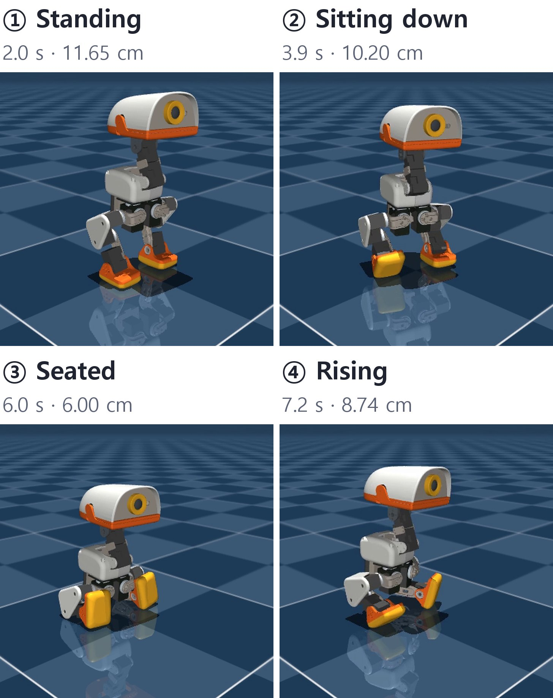
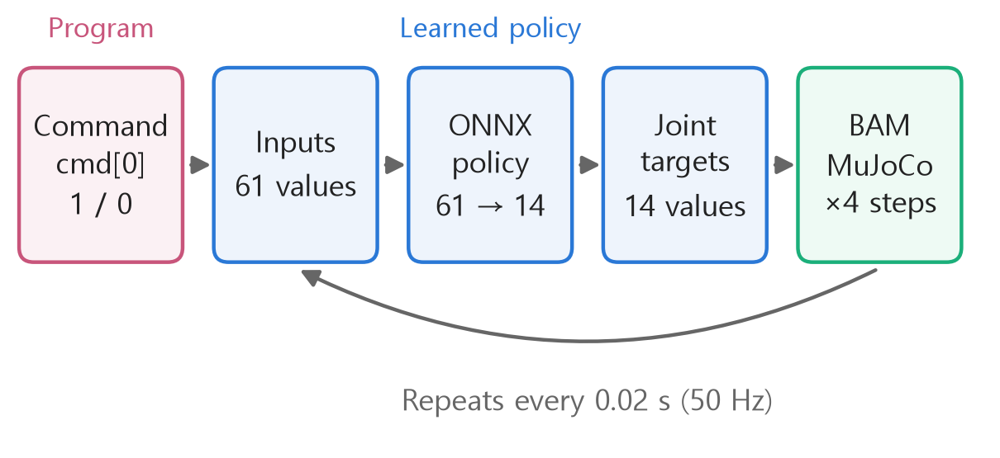
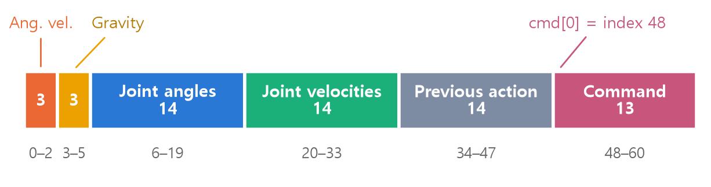
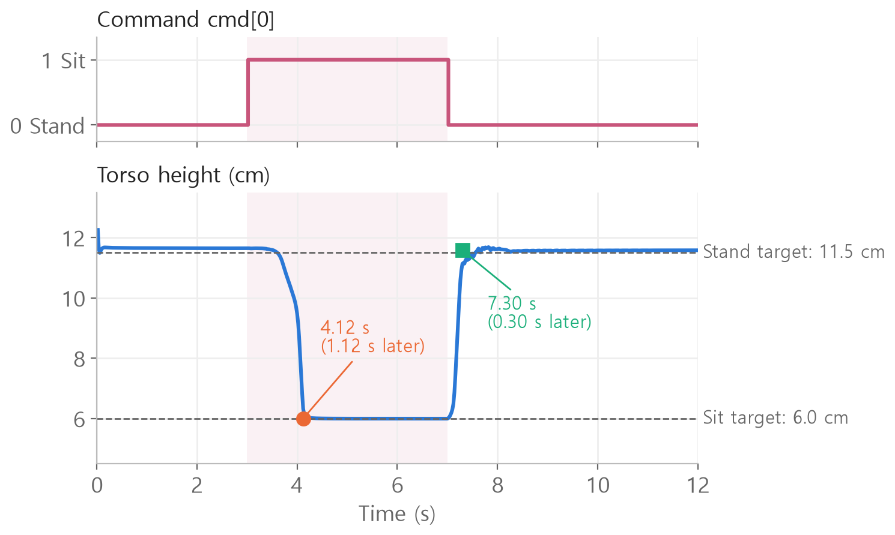
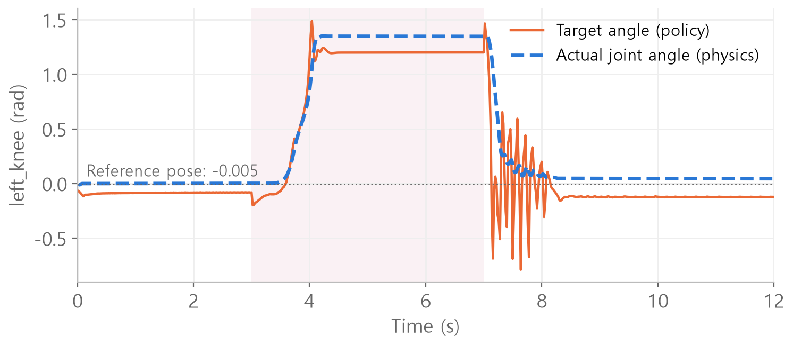
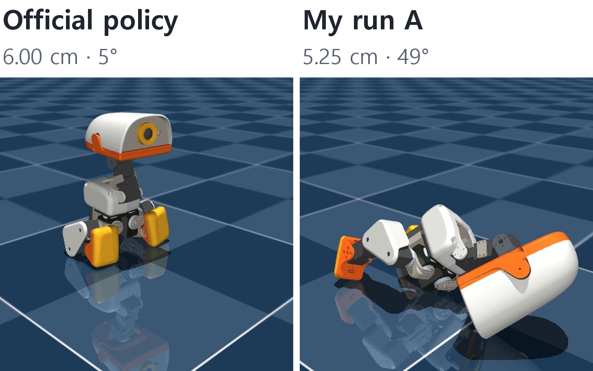

<style>
.content table { width: 100%; border-collapse: collapse; margin: 14px 0 24px; font-size: 17px; line-height: 1.5; }
.content th, .content td { border-bottom: 1px solid #e6dde0; padding: 8px 10px; text-align: left; vertical-align: top; }
.content thead { background: #fbf1f4; }
.content figure { margin: 18px 0; }
.content figure img { width: 100%; height: auto; }
.content td, .content th { word-break: keep-all; overflow-wrap: normal; }
.content .katex-display { overflow-x: auto; overflow-y: hidden; padding: 4px 0; }
.content td code { white-space: nowrap; }
.content pre .nb { padding: 0; border: 0; border-radius: 0; background: none; }
@media (max-width: 560px) { .content th, .content td { padding: 7px 5px; font-size: 16px; } }
</style>
<link rel="stylesheet" href="https://cdn.jsdelivr.net/npm/katex@0.16.11/dist/katex.min.css">
<script defer src="https://cdn.jsdelivr.net/npm/katex@0.16.11/dist/katex.min.js"></script>
<script defer src="https://cdn.jsdelivr.net/npm/katex@0.16.11/dist/contrib/auto-render.min.js" onload="renderMathInElement(document.querySelector('.content')||document.body,{delimiters:[{left:'\\[',right:'\\]',display:true},{left:'\\(',right:'\\)',display:false}]})"></script>

<div class="wc"><p><b>Why read the Microduck code?</b><br>
Microduck is a roughly 25 cm tall biped made by Pollen Robotics, which Hugging Face acquired in 2025. Its <a href="https://github.com/pollen-robotics/microduck_rl">training code</a> and <a href="https://huggingface.co/pollen-robotics/microduck-policies">trained policies</a> are public.<br>
It learns to walk, recover from falls, sit, and stand through reinforcement learning in simulation. The trained policies are exported to ONNX and run on the robot at 50 Hz.<br>
Tracing one control step, from a command entering the network to a joint angle target, helps you find the observations and actions in reinforcement learning code. (As of November 3, 2026)</p></div>

I replayed the public <code>alpha_sitstand.onnx</code> policy for 12 seconds and traced how a sit command becomes joint angle targets, using the code and the recorded values.

<div class="keyline">The program decides when to sit. The learned policy decides how to move all 14 joints.</div>

<figure></figure>

These frames come from the 12-second MuJoCo replay of the official policy. The number next to each timestamp is the torso height.
The robot's 3D model is by <a href="https://github.com/pollen-robotics/microduck_rl">Pollen Robotics</a>. The simulation images in this article use the same <a href="https://creativecommons.org/licenses/by-nc-sa/4.0/">CC BY-NC-SA 4.0</a> license. I cropped and labeled frames from the replay.

## <span class="no">1</span> Why I read the code

I started reading this code for Jjaekjjaeki.
Jjaekjjaeki is a talking bird robot we are building together.
The goal is to fit the bird body we designed with a leg mechanism like Microduck's so it can sit and stand.
Walking and flying are outside the current project scope.

Using the same legs means learning to read the policy that moves them.
I started by watching a replay of the official policy. Here, we trace the code from the lines that tell it to sit at 3 seconds and stand at 7 seconds.
The next sections cover the official replay. Section 7 reports my own short training runs separately.

## <span class="no">2</span> Run the 12-second replay

Clone the repository and download the public policy file.

```bash
git clone https://github.com/pollen-robotics/microduck_rl
cd microduck_rl
git checkout bae39f5
curl -LO https://huggingface.co/pollen-robotics/microduck-policies/resolve/main/alpha_sitstand.onnx
```

Join the blocks below in order, save them as `replay.py`, and run `uv run python replay.py`.
I ran this in an existing Python environment and did not test a fresh `uv` installation.

Import the tools first.

```python
import sys              # configure the import path
import numpy as np      # numerical arrays
import mujoco           # physics simulation

sys.path.insert(0, "scripts")
from infer_policy import (
    load_bam_model,        # motor model
    load_mujoco_with_bam,  # load the robot
    PolicyInference,       # run policy inference
    BAM_VIN_MIN,           # minimum voltage
)
```

Load the robot, motor model, and policy. BAM models the voltage and friction of the XL330 servo motor.

```python
XML = ("src/mjlab_microduck/robot/"
       "microduck/scene.xml")
# kp 200, 7.4 V, no current limit
motor = load_bam_model(200, 7.4, None)
model, data, bam, _ = load_mujoco_with_bam(
    XML, motor,    # robot and motor
    0.005,         # physics step (seconds)
    0.1,           # voltage drop under load
    BAM_VIN_MIN)   # minimum voltage
policy = PolicyInference(
    model, data, bam_ctrl=bam,
    sitstand_onnx_path="alpha_sitstand.onnx",
    new_cmd_obs=True,            # 13 command slots
    use_projected_gravity=True)  # gravity direction
```

Start the robot at 0.125 m in its reference pose.

```python
FREE = mujoco.mjtObj.mjOBJ_JOINT
j = mujoco.mj_name2id(
    model, FREE, "trunk_base_freejoint")
q = model.jnt_qposadr[j]   # torso position index
data.qpos[q:q+7] = [0, 0, 0.125,  # height
                    1, 0, 0, 0]   # upright orientation
pose = policy.default_pose
for i, k in enumerate(
        policy.joint_qpos_indices):
    data.qpos[k] = pose[i]    # reference pose
bam.reset(data.qpos)
policy.set_position_targets(pose)
mujoco.mj_forward(model, data)  # compute state
```

Run 600 control steps. This loop contains the full control flow.

```python
for step in range(600):      # 12 seconds
    if step in (150, 350):   # 3 s and 7 s
        policy.toggle_sit()  # sit or stand
    action = policy.infer()  # 14 actions
    policy.apply_action(action)  # target angles
    for _ in range(4):       # four physics steps
        bam.update()         # motor torque
        mujoco.mj_step(model, data)
    if step % 150 == 149:    # print every 3 seconds
        t = (step + 1) * 0.02
        z = data.qpos[q + 2] * 100
        print(f"{t:.0f} s {z:.2f} cm")
```

```text
3 s 11.65 cm
6 s 6.00 cm
9 s 11.57 cm
12 s 11.58 cm
```

<figure></figure>

MuJoCo advances the physics by 0.005 seconds at a time. The policy outputs one action for every four physics steps.

$$\Delta t = 4 \times 0.005\,\text{s} = 0.02\,\text{s}$$

$$\Delta t$$ is the interval between policy actions, or one control step. The policy runs 50 times per second (50 Hz).
Multiply it by step number $$N$$ to get the time.

$$t = N \times \Delta t$$

$$150 \times 0.02 = 3\,\text{s}$$

$$350 \times 0.02 = 7\,\text{s}$$

## <span class="no">3</span> From the sit command to 61 observations

The line numbers below refer to `scripts/infer_policy.py` at commit `bae39f5`.

`toggle_sit()` (line 808) flips the sit state. In keyboard mode, the Y key calls it.

```python
# Toggle between sitting and standing
self.sit_mode = not self.sit_mode
...
self._update_command()  # rebuild the command
```

`_update_command()` (line 461) builds a command with 13 values. The first slot, `cmd[0]`, is the sit flag for this policy.

```python
cmd = np.zeros(13, dtype=np.float32)
# 1 = sit, 0 = stand
cmd[0] = 1.0 if self.sit_mode else 0.0
cmd[3:7]  = self.head_offset  # four head slots
cmd[7:13] = self.body_cmd     # six torso slots
self.command = cmd
```

At step 149 (2.98 s), `cmd = [0, 0, 0, … 0]`. At step 150 (3.00 s), `cmd = [1, 0, 0, … 0]`.

`get_observations()` (line 656) joins the command to the robot's state to build the policy's 61 inputs.

<figure></figure>

| Group | Count | What it tells the policy |
|---|---|---|
| Angular velocity `base_ang_vel` | 3 | How fast the torso is rotating |
| Gravity direction `projected_gravity` | 3 | Which way the torso is tilted |
| Joint angles `joint_pos` | 14 | How far each joint is from the reference pose |
| Joint velocities `joint_vel` | 14 | How fast each joint is moving |
| Previous action `last_action` | 14 | The action issued on the previous step |
| Command `command` | 13 | Sit flag and head and torso pose commands |

3 + 3 + 14 + 14 + 14 + 13 = 61.

Gravity direction is the world's downward vector expressed in the torso's coordinate frame.

$$g^{body} = R^{\top} \begin{bmatrix} 0 \\ 0 \\ -1 \end{bmatrix}$$

$$R$$ is the torso rotation. $$R^{\top}$$ applies the inverse rotation.
At 2.98 s, the value is `[0.048, 0.021, -0.999]`. The third value is close to -1, so the torso is nearly upright.

## <span class="no">4</span> From policy output to joint targets

`infer()` (line 857) passes the observations to ONNX Runtime and returns the action.

```python
obs = self.get_observations()  # 61 values
obs_batch = obs.reshape(1, -1) # [1, 61]
# Run inference to get shape [1, 14]
action = self.ort_session.run(...)[0]
action = action.squeeze(0)     # 14 values
# Store in slots 34–47 of the next observation
self.last_action = action.copy()
```

$$a_t = \pi_\theta(o_t)$$

$$o_t \in \mathbb{R}^{61}, \quad a_t \in \mathbb{R}^{14}$$

$$\pi_\theta$$ is the policy network with weights $$\theta$$, $$o_t$$ is the observation, and $$a_t$$ is the action.

The 14 values cover five left-leg joints (0–4), four neck and head joints (5–8), and five right-leg joints (9–13), in that order. Each leg uses hip_yaw, hip_roll, hip_pitch, knee, and ankle.

`apply_action()` (line 866) converts the action to target joint angles.

$$q^{target} = q^{default} + s \cdot a_t$$

$$q^{default}$$ is the joint angle in the HOME pose, $$s$$ is the action scale, and angles are in radians. For SitStand, $$s = 1.0$$.

Plug in the values for the left knee (index 3) at 6.98 s, while the robot is sitting.

$$q^{target} = -0.0049 + 1.0 \times 1.2054$$

$$= 1.2005\ \text{rad}$$

The target is to bend the knee to about 69 degrees.

## <span class="no">5</span> What happened during the 12 seconds

Changing one command slot changed the torso height. Frames ② and ④ at the top show the descending and rising parts of this plot.

<figure></figure>

| Phase | Height | Settling time |
|---|---|---|
| Standing | 11.65 cm | From the start |
| Sitting | 6.00 cm | 4.12 s (1.12 s after the command) |
| Standing again | 11.58 cm | 7.30 s (0.30 s after the command) |

Each height is the average over the final second of that phase. Settling time is the end of the first step when the torso entered the target band (±0.5 cm) and stayed there for the rest of the phase. The training configuration sets targets of 0.115 m for standing and 0.060 m for sitting.

The robot lowers gradually, drops into its seat in the last tenth of a second or so, then rises in 0.3 seconds. This is one replay from one initial state, so it cannot establish the policy's average performance.

To reproduce the replay, use repository commit `bae39f5`, `alpha_sitstand.onnx` from the Hub (SHA256 prefix `a6f102d9`, checkpoint 2250 in the manifest), and the code above. No training is needed.

## <span class="no">6</span> Four easy points to miss

**① Zero is a command.**
For this policy, 0 means stand. The code comment says the first three slots set to zero represent a stand command. The Hub's `manifest.json` records the same rule as `"sit": 1.0, "stand": 0.0`.

**② There are 61 inputs.**
The `get_observations()` comment still says "Total: 51D" from an older layout with three command slots. The current SitStand policy uses 13 command slots, and the ONNX input shape is `[1, 61]`.

**③ An action is an offset from the reference pose.**

```python
# ❌ Use actions directly as targets
target = action
# ✅ Add the reference pose
target = (self.default_pose
          + action * self.action_scale)
```

When the action is zero, the target is the reference pose. The incorrect example would set every target to 0 rad, a different pose from what the policy learned. The motor model receives the angle target and computes the torque.

**④ A joint can settle away from its target.**

<figure></figure>

The averages from 6 to 7 s are 1.20 rad for the target and 1.35 rad for the actual knee angle. After standing, the averages from 11 to 12 s still differ: -0.12 rad for the target and 0.05 rad for the measured angle.

BAM uses the difference between the target and actual angle to set motor voltage.

$$d = g \cdot k_p \, (q^{target} - q)$$

$$V = v_{in} \cdot d$$

$$d$$ is the duty cycle, the signed fraction of supply voltage, clipped to the range from -1 to 1. $$g$$ converts angle error to duty cycle (about 0.0029 for the XL330), $$k_p$$ is proportional gain, and $$V$$ is the voltage applied to the motor.
With $$k_p = 200$$ and an error of 0.15 rad, $$d \approx 0.086$$, corresponding to about 0.64 V.

Zero error means zero voltage in this proportional model. The motor needs a steady error to support the robot's weight. The actual knee angle, 1.35 rad, matches the seated pose in the training configuration. The policy commands a smaller target, 1.20 rad, while the loaded joint settles at 1.35 rad.

## <span class="no">7</span> Short training runs and what remains

The replay above uses the official weights. I also ran a separate training experiment.
I ran PPO on the same task (`Mjlab-SitStand-Flat-MicroDuck`), first for five iterations with 64 environments, then for five more on each of two branches (A and B). For B, I changed only the weight of the `gentle_motion` impact penalty from 0.05 to 0.10.

I compared the results from the same starting state, using the same 12-second command sequence and metrics as the official replay.

| Policy | Training | Height error | Tilt |
|---|---|---|---|
| Official | 2250 iterations | 0.61 cm | 4.0° |
| My first run | 5 iterations | 5.06 cm | 73.2° |
| A | 5 more iterations | 3.93 cm | 49.6° |
| B | 5 more iterations | 4.04 cm | 51.4° |

Height error is the mean absolute difference from the commanded target height across 600 steps. Tilt is the mean torso tilt. The official iteration count comes from the checkpoint in the Hub manifest. The repository says the official policy was trained with 4,096 environments.

<figure></figure>

These frames show the same sit command at 6 s. The labels give the torso height and tilt.
A is close to the 6 cm target height, but it has fallen with a tilt of 49 degrees. B is similar at that moment, at 5.16 cm and 53 degrees. Height alone cannot tell whether the robot sat.

In both training replays, the body leaned toward the floor and failed to sit and stand.
The experiment verified that I could resume training, save the policy, and reload it for evaluation.
B had a lower peak impact than A (19.3 vs. 20.4 m/s²), but slightly larger height error and tilt. A fallen robot can remain still and register low impact, so that metric alone cannot establish policy quality.
The experiment used one seed and one initial state, so it does not establish whether A or B is better.

Before using the policy on Jjaekjjaeki, I still need to check the following.

- **Joint count.** The policy controls ten leg joints and four neck and head joints together. The neck and head design is still open, and changes would affect the policy's input and output sizes.
- **Upper-body physics.** The shell, speaker, board, and battery affect mass, center of mass, inertia, and ground contact surfaces. The new values are still unknown.
- **Validation.** The ability to sit and stand on Jjaekjjaeki still needs to be tested, even with the same legs.

<div class="done">🎉 cmd[0] decides whether to sit or stand. The policy supplies the offsets for the 14 joint targets, measured from the reference pose.</div>
