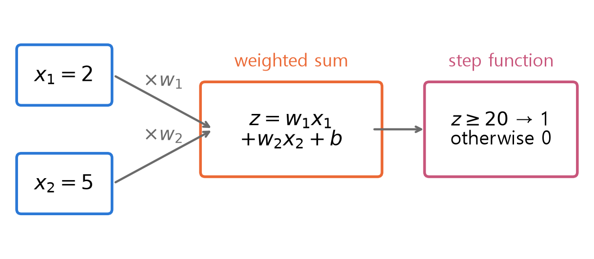
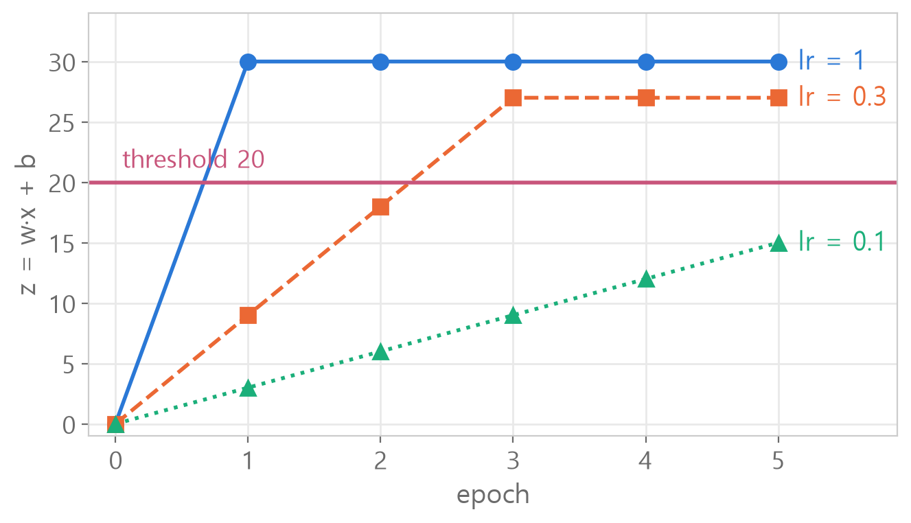

<style>
.content table { width: 100%; border-collapse: collapse; margin: 14px 0 24px; font-size: 17px; line-height: 1.5; }
.content th, .content td { border-bottom: 1px solid #e6dde0; padding: 8px 10px; text-align: left; vertical-align: top; }
.content thead { background: #fbf1f4; }
.content figure { margin: 18px 0; }
.content figure img { width: 100%; height: auto; }
.content td, .content th { word-break: keep-all; overflow-wrap: normal; }
.content .katex-display { overflow-x: auto; overflow-y: hidden; padding: 4px 0; }
@media (max-width: 560px) { .content th, .content td { padding: 7px 5px; font-size: 16px; } }
</style>
<link rel="stylesheet" href="https://cdn.jsdelivr.net/npm/katex@0.16.11/dist/katex.min.css">
<script defer src="https://cdn.jsdelivr.net/npm/katex@0.16.11/dist/katex.min.js"></script>
<script defer src="https://cdn.jsdelivr.net/npm/katex@0.16.11/dist/contrib/auto-render.min.js" onload="renderMathInElement(document.querySelector('.content')||document.body,{delimiters:[{left:'\\[',right:'\\]',display:true},{left:'\\(',right:'\\)',display:false}]})"></script>

<div class="wc"><p><b>Why build a perceptron by hand?</b><br>
A perceptron is the smallest artificial neuron: it multiplies the inputs by weights, adds them up, and outputs 1 when the total passes a threshold.<br>
PyTorch's <a href="https://docs.pytorch.org/docs/stable/generated/torch.nn.Linear.html">nn.Linear</a> layer computes the same kind of weighted sum: inputs times weights, plus a bias.<br>
Writing it once as a class shows what fit and predict actually do inside, which makes deep learning model code far less intimidating. (As of November 3, 2026)</p></div>

This post builds a single-layer perceptron as a numpy class and sorts out **six things that are easy to mix up**, plus the finished code.<br>
Every number and figure was computed in Python.

<div class="keyline">One example carries through the whole post: input x = [2, 5], answer y = 1, threshold 20.</div>

## <span class="no">1</span> Perceptron = weighted sum + step function

A perceptron **computes a weighted sum and only checks whether it passes the threshold**.

$$z = w_1x_1 + w_2x_2 + b$$

$$\hat{y} = \begin{cases} 1 & (z \geq 20) \\ 0 & (z < 20) \end{cases}$$

- $$w_1, w_2$$ : weights. How much each input matters
- $$b$$ : bias. A value added regardless of the inputs
- $$\hat{y}$$ : prediction. 0 or 1

<figure></figure>

With weights $$w = [2, 5]$$ and $$b = 1$$, $$z = 2 \times 2 + 5 \times 5 + 1 = 30$$.<br>
30 is 20 or more, so the prediction is 1. Learning is the process of finding such $$w$$ and $$b$$ on its own.

## <span class="no">2</span> The class is a blueprint, objects are products

A `class` is **the blueprint that stamps out perceptrons**. It holds four methods.

```python
class Perceptron:
    def __init__(self, n_inputs): ...
    # runs once when created
    def step_function(self, z): ...
    # 0/1 decision
    def predict(self, x): ...
    # weighted sum → decision
    def fit(self, X, y, lr, epoch): ...
    # learning
```

```python
p_a = Perceptron(2)
p_b = Perceptron(2)
```
Two perceptrons from the same blueprint. Same methods, but **each keeps its own weights**.

| Code | Meaning |
|---|---|
| `Perceptron(2)` | make one perceptron from the blueprint |
| `self.w` | the weights that perceptron holds |
| `p_a.predict(x)` | run the predict **inside** p_a, with p_a's weights |

The dot (`.`) means "the one inside that object". scikit-learn's `model.fit()` and `model.predict()` follow the same pattern.

**The 2 in `Perceptron(2)` is the number of inputs in one sample.** It has nothing to do with how many samples you have.

```python
X = np.array([[0, 0], [0, 1], [1, 0], [1, 1]])
X.shape
```

```text
(4, 2)
```

4 samples, 2 inputs each. The number for `Perceptron( )` is the second one, 2.

## <span class="no">3</span> \_\_init\_\_ and the step function

`__init__` sets up **one zero weight per input**.

```python
# ❌
def __init__(self, n_inputs):
    self.w = np.zeros(self, n_inputs)
    self.bias = 0
```
Written this way, creating `Perceptron(2)` raises a `TypeError`. `self` is not something you pass to an outside function like `np.zeros`.

```python
# ✅
def __init__(self, n_inputs):
    self.w = np.zeros(n_inputs)
    self.bias = 0
```
Now `Perceptron(2).w` is `[0. 0.]`.

`step_function` turns the rule into an inequality word for word. "0 if **less than** 20" means 20 itself gives 1.

```python
def step_function(self, z):
    if z < 20:
        return 0
    else:
        return 1
```
`p.step_function(15)` is 0, `p.step_function(20)` is 1, `p.step_function(30)` is 1.

Writing `<=` instead of `<` turns exactly 20 into 0. One boundary value changes the result, so test it directly.

## <span class="no">4</span> predict hands the weighted sum to the decision

`predict` has **two steps**: build z first, then pass the finished z to the step function.

```python
# ❌
def predict(self, x):
    z = np.dot(self.w, self.step_function(z)) + self.bias
    return self.dot(z)
```
- First line : the line that creates z is already using z, which does not exist yet.
- Second line : `dot` is a numpy function, so it is `np.dot`. The class has no `dot`.

```python
# ✅
def predict(self, x):
    z = np.dot(self.w, x) + self.bias
    return self.step_function(z)
```

`np.dot(self.w, x)` multiplies matching pairs and adds them all. With $$w = [2, 5]$$, $$x = [2, 5]$$, $$b = 1$$ → `np.dot` gives 29, z is 30, prediction 1.

Anything with `self.` is a value or method the object holds. `x` without it is a value passed in from outside.

## <span class="no">5</span> fit corrects by how wrong it was

The learning rule nudges the weights **toward the input, by the size of the error (answer - prediction)**.

$$w \leftarrow w + \eta \,(y - \hat{y})\, x$$

$$b \leftarrow b + \eta \,(y - \hat{y})$$

$$\eta$$ is the learning rate: how big each correction is.

| Case | answer - prediction | Weights |
|---|---|---|
| predicted 0, answer 1 | +1 | grow → z goes up next time |
| predicted 1, answer 0 | -1 | shrink → z goes down |
| correct | 0 | unchanged |

```python
def fit(self, X, y, lr, epoch):
    for e in range(epoch):
        for i in range(len(X)):
            pred = self.predict(X[i])
            error = y[i] - pred
            self.w += lr * error * X[i]
            self.bias += lr * error
        print(f"epoch {e+1}: w = {self.w}, bias = {self.bias}")
```

`X`, `y`, `lr` and `epoch` are **labels for the values passed in when you call it**. Calling `p.fit(X, y, 0.3, 5)` fills each name in order.

| Uppercase `X` | Lowercase `x` |
|---|---|
| **all** the data (fit takes it) | **one** sample (predict takes it) |

`X[i]` means "the i-th sample out of all of them". The calls chain as fit → predict(X[i]) → step_function(z).

Common mistakes:
```python
# ❌ only decides and skips the weighted sum; lowercase x doesn't exist
pred = self.step_function(x[i])
# ✅
pred = self.predict(X[i])

# ❌ input not multiplied, so w1 and w2 change by the same amount
self.w += lr * error
# ✅
self.w += lr * error * X[i]
```
`print` is indented to match `for i`. That way it prints **once per epoch**, after all the samples.

## <span class="no">6</span> A small learning rate may not get there

Same data, 5 epochs, only the learning rate changed (x = [2, 5], y = 1, starting from zero weights).

<figure></figure>

| lr | w | b | z | passed 20 at |
|---|---|---|---|---|
| 1 | [2, 5] | 1 | 30 | 1st |
| 0.3 | [1.8, 4.5] | 0.9 | 27 | 3rd |
| 0.1 | [1.0, 2.5] | 0.5 | 15 | never |

w, b and z are the values after all 5 epochs.

Each mistake raises z by $$\eta \times (2^2 + 5^2 + 1) = 30\eta$$.<br>
So lr 1 adds 30, 0.3 adds 9 and 0.1 adds 3 each time. With 0.1, passing 20 takes 7 updates, so 5 is not enough.

A large learning rate gets there fast but jumps in big steps. A small one moves finely but may not arrive within the given epochs.<br>
The `0.8999999999999999` you may see in the output is a tiny error from storing decimals in binary.

## <span class="no">7</span> The finished class, filled in slot by slot

Writing it all at once is where people get stuck. **Make an empty class with `pass` first, then fill and run one slot at a time**, and you will see exactly where things go wrong.

```python
class Perceptron:
    def __init__(self, n_inputs):
        pass
    def step_function(self, z):
        pass
    def predict(self, x):
        pass
    def fit(self, X, y, lr, epoch):
        pass
```
`pass` means "empty for now", so this runs without errors.

Each time you fill a slot, **rerun the class cell and create a fresh `p = Perceptron(2)`** before checking. An old `p` still runs the code from before the change.

1. `__init__` : `p.w` → `[0. 0.]`
2. `step_function` : `p.step_function(15)`, `p.step_function(20)` → `0`, `1`
3. `predict` : set `p.w = np.array([2.0, 5.0])`, `p.bias = 1`, then `p.predict([2, 5])` → `1`
4. `fit` : make a fresh `p = Perceptron(2)`, then `p.fit(np.array([[2, 5]]), np.array([1]), 0.3, 5)` → `w = [1.8 4.5]` from the 3rd epoch on

With all four slots filled, it looks like this.

```python
import numpy as np

class Perceptron:
    def __init__(self, n_inputs):
        self.w = np.zeros(n_inputs)
        self.bias = 0

    def step_function(self, z):
        if z < 20:
            return 0
        else:
            return 1

    def predict(self, x):
        z = np.dot(self.w, x) + self.bias
        return self.step_function(z)

    def fit(self, X, y, lr, epoch):
        for e in range(epoch):
            for i in range(len(X)):
                pred = self.predict(X[i])
                error = y[i] - pred
                self.w += lr * error * X[i]
                self.bias += lr * error
            print(f"epoch {e+1}: w = {self.w}, bias = {self.bias}")
```

<div class="done">🎉 Perceptron = weighted sum + step function, and learning = nudging toward the input by how wrong it was!</div>
