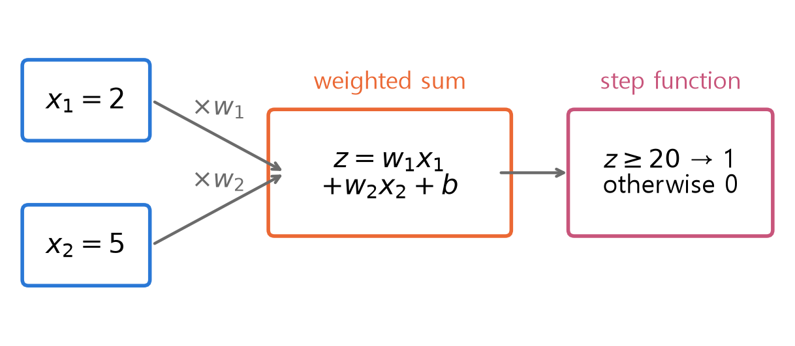
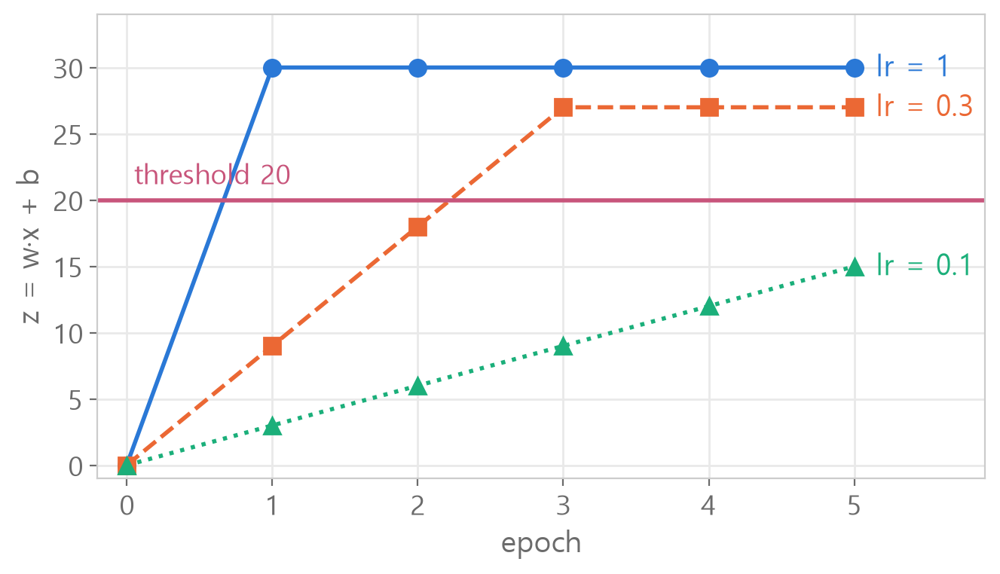
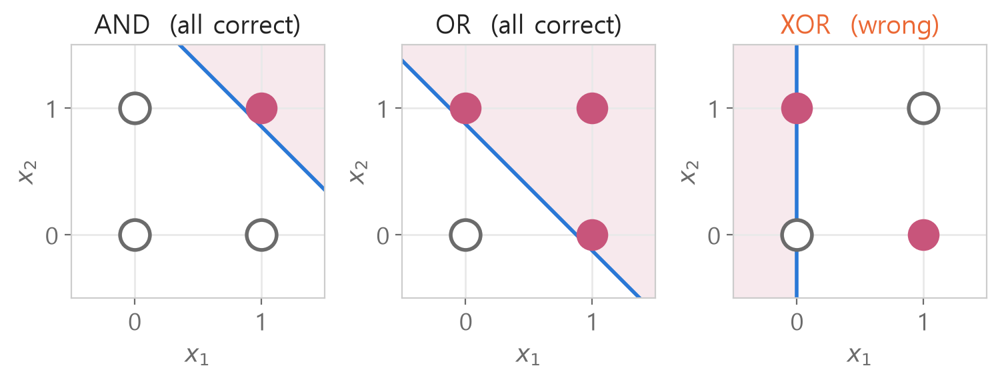

<style>
.content table { width: 100%; border-collapse: collapse; margin: 14px 0 24px; font-size: 17px; line-height: 1.5; }
.content th, .content td { border-bottom: 1px solid #e6dde0; padding: 8px 10px; text-align: left; vertical-align: top; }
.content thead { background: #fbf1f4; }
.content figure { margin: 18px 0; }
.content figure img { width: 100%; height: auto; }
.content td, .content th { word-break: keep-all; overflow-wrap: normal; }
.content .katex-display { overflow-x: auto; overflow-y: hidden; padding: 4px 0; }
@media (max-width: 560px) { .content th, .content td { padding: 7px 5px; font-size: 16px; } }
</style>
<link rel="stylesheet" href="https://cdn.jsdelivr.net/npm/katex@0.16.11/dist/katex.min.css">
<script defer src="https://cdn.jsdelivr.net/npm/katex@0.16.11/dist/katex.min.js"></script>
<script defer src="https://cdn.jsdelivr.net/npm/katex@0.16.11/dist/contrib/auto-render.min.js" onload="renderMathInElement(document.querySelector('.content')||document.body,{delimiters:[{left:'\\[',right:'\\]',display:true},{left:'\\(',right:'\\)',display:false}]})"></script>

<div class="wc"><p><b>Why build a perceptron by hand?</b><br>
A perceptron is the smallest artificial neuron: it multiplies the inputs by weights, adds them up, and outputs 1 when the total passes a threshold.<br>
PyTorch's <a href="https://docs.pytorch.org/docs/stable/generated/torch.nn.Linear.html">nn.Linear</a> layer computes the same kind of weighted sum: inputs times weights, plus a bias.<br>
The fact that a single-layer perceptron cannot solve XOR became widely known through the 1969 book <a href="https://en.wikipedia.org/wiki/Perceptrons_(book)">Perceptrons</a>, and seeing that limit shows why neural networks stack layers. (As of November 3, 2026)</p></div>

We build a perceptron by filling an empty class one slot at a time, then train it on AND, OR and XOR, going **all the way to its limit in seven steps**.<br>
The first wrong code and the questions asked along the way are kept right where they came up. Every number was computed in Python.

<div class="keyline">The example starts with input x = [2, 5], answer y = 1 and a threshold of 20.</div>

## <span class="no">1</span> Data and an empty class

First, prepare the data as numpy arrays.

```python
X = np.array([[2, 5]])
y = np.array([1])
```

```text
NameError: name 'np' is not defined
```

`np` has to be imported before you use it. Keep the `import` lines in the very first cell.

```python
import numpy as np
import pandas as pd

X = np.array([[2, 5]])
y = np.array([1])
X.shape
```

```text
(1, 2)
```

1 sample, 2 inputs per sample.

The perceptron is a class with four methods. Writing everything at once is where people get stuck, so start with **an empty class made of `pass`**.

```python
class Perceptron:
    def __init__(self, n_inputs):
        pass
    def step_function(self, z):
        pass
    def predict(self, x):
        pass
    def fit(self, X, y, lr, epoch):
        pass
```
`pass` means "empty for now", so this runs without errors. From here, fill one slot at a time and check it right away.

## <span class="no">2</span> \_\_init\_\_: weights start at 0

`__init__` runs once when a perceptron is created. It sets up **one zero weight per input** and a bias of 0.

```python
# ❌ first attempt
class Perception:
    def __init__(self, n_inputs):
        self.w = np.zeros(self, n_inputs)
        self.bias = 0
```

```python
p = Perceptron(2)
print(p.w, p.bias)
```
→ `NameError: name 'Perceptron' is not defined`

There are two mistakes.

- The class is named `Perception` (ending in -ion), so Python could not find `Perceptron` (ending in -ron).
- `np.zeros(self, n_inputs)` : `self` is not something you pass to an outside function like `np.zeros`. Fixing only the name gives a `TypeError` next.

```python
# ✅
class Perceptron:
    def __init__(self, n_inputs):
        self.w = np.zeros(n_inputs)
        self.bias = 0
```
Re-run the class cell, then the check cell prints `[0. 0.] 0`.

After fixing the code, **run the class cell again first**, then create a fresh object with `p = Perceptron(2)` in the check cell. If you skip rerunning the class cell or keep using an old `p`, you are still running the code from before the fix.

A value with `self.` in front, like `self.w`, is **a value the perceptron object keeps holding**.

## <span class="no">3</span> step_function and predict

A perceptron **computes a weighted sum and checks whether it passes the threshold**.

$$z = w_1x_1 + w_2x_2 + b$$

$$\hat{y} = \begin{cases} 1 & (z \geq 20) \\ 0 & (z < 20) \end{cases}$$

$$w$$ is the weight, $$b$$ is the bias, and $$\hat{y}$$ is the prediction.

<figure></figure>

`step_function` makes the call. The rule is "0 if **less than** 20", so exactly 20 gives 1. Writing `<=` would turn 20 into 0, which is wrong.

```python
def step_function(self, z):
    if z < 20:
        return 0
    else:
        return 1
```
`p.step_function(15)` is 0, `p.step_function(20)` is 1.

`predict` builds z and hands it to `step_function`. The first attempt had the two lines mixed up.

```python
# ❌ first attempt
def predict(self, x):
    z = np.dot(self.w, self.step_function(z)) + self.bias
    return self.dot(z)
```
Calling this predict raises `UnboundLocalError: cannot access local variable 'z' where it is not associated with a value`.

The line that creates z is already using z, which does not exist yet. `dot` is a numpy function, so there is no `self.dot` either.

```python
# ✅ step 1 build z → step 2 hand it to the decision
def predict(self, x):
    z = np.dot(self.w, x) + self.bias
    return self.step_function(z)
```
`np.dot` multiplies matching pairs and adds them up. Set the weights to `[3, 5]` and the bias to `1` by hand: $$3 \times 2 + 5 \times 5 + 1 = 32$$ → 20 or more, so `1`.

Things with `self.` (`self.w`, `self.bias`, `self.step_function`) belong to the perceptron. `x` without `self.` is the value passed in from outside.

## <span class="no">4</span> fit: correct by how wrong it was

Learning means **nudging the weights toward the input, by the size of the mistake**.

$$w \leftarrow w + \eta \,(y - \hat{y})\, x$$

$$b \leftarrow b + \eta \,(y - \hat{y})$$

$$\eta$$ is the learning rate: how big each correction is.

| Case | answer - prediction | Weights |
|---|---|---|
| predicted 0, answer 1 | +1 | grow → z goes up |
| predicted 1, answer 0 | -1 | shrink → z goes down |
| correct | 0 | unchanged |

```python
# ❌ first attempt
def fit(self, X, y, lr, epoch):
    for e in range(epoch):
         for i in  range(len(X)):
              pred = self.step_function(x[i])
              error = y[i] - pred
              self.w += lr * error
              self.bias += lr *error
        print(f"epoch {e+1}: w={self.w}, bias = {self.bias}")
```
`range(epoch)`, `error = y[i] - pred` and the bias line were right. There are four things to fix, and the errors show up one at a time from the top.

- Indentation : `for i` and the lines below it step in by 5 spaces, and `print` sits at 8, which matches no level. Running the class cell gives an `IndentationError` immediately.
- `x[i]` : the name fit receives is uppercase `X`. Lowercase `x` does not exist, so you get a `NameError`.
- `self.step_function(...)` : this skips the weighted sum and passes the whole sample `[2, 5]` to the decision, which raises a `ValueError`. It should call `predict`.
- `lr * error` : the `× X[i]` is missing, so w1 and w2 always change by the same amount.

```python
# ✅
def fit(self, X, y, lr, epoch):
    for e in range(epoch):
        for i in range(len(X)):
            pred = self.predict(X[i])
            error = y[i] - pred
            self.w += lr * error * X[i]
            self.bias += lr * error
        print(f"epoch {e+1}: w = {self.w}, bias = {self.bias}")
```
Each indentation level is 4 spaces. `print` is lined up with `for i`, so it prints **once per epoch**.

Uppercase `X` is **all** the data, and `X[i]` is **one** sample from it. The calls chain as fit → predict(X[i]) → step_function(z).

## <span class="no">5</span> Comparing learning rates and a results table

Train on the same data for 5 epochs, changing only the learning rate: 1, 0.3 and 0.1.

```python
p1 = Perceptron(2)
p1.fit(X, y, lr=1, epoch=5)
```
Make `p2` (lr 0.3) and `p3` (lr 0.1) the same way.

<figure></figure>

| lr | w | b | z | passed 20 at |
|---|---|---|---|---|
| 1 | [2, 5] | 1 | 30 | 1st |
| 0.3 | [1.8, 4.5] | 0.9 | 27 | 3rd |
| 0.1 | [1.0, 2.5] | 0.5 | 15 | never |

Each mistake raises z by $$\eta \times (2^2 + 5^2 + 1) = 30\eta$$. With lr 0.1 it rises by 3 at a time, so passing 20 takes 7 updates, and 5 is not enough.<br>
The `0.8999999999999999` you may see in the output is a tiny error from storing decimals in binary.

**❓ Question asked again: "I have no feel for how to write the results table"**

Sketch the table first and the code follows. Each column is one training run.

```python
result = pd.DataFrame(
    {1: [p1.w[0], p1.w[1], p1.bias],
     2: [p2.w[0], p2.w[1], p2.bias],
     3: [p3.w[0], p3.w[1], p3.bias]},
    index=["w1", "w2", "bias"])
```
```
        1    2    3
w1    2.0  1.8  1.0
w2    5.0  4.5  2.5
bias  1.0  0.9  0.5
```

- `{1: [...]}` : column named 1, three values from top to bottom
- `p1.w[0]` : the first of p1's weights (Python counts from 0)
- `index=` : the row names on the left

## <span class="no">6</span> Training AND and OR

Now train logic gates, which decide 0 or 1 from two inputs (each 0 or 1). Same perceptron, lr 1, 100 epochs.

**❓ Question asked again: "I don't get what X and y are here"**

`X` is **four questions**, and `y` is **the answers in the same order**.

```python
X = np.array([[0, 0], [0, 1], [1, 0], [1, 1]])
y = np.array([0, 0, 0, 1])
# answers for AND
```

| x1 | x2 | AND | OR | XOR |
|---|---|---|---|---|
| 0 | 0 | 0 | 0 | 0 |
| 0 | 1 | 0 | 1 | 1 |
| 1 | 0 | 0 | 1 | 1 |
| 1 | 1 | 1 | 1 | 0 |

AND is 1 only when both are 1, OR when at least one is 1, and XOR only when the two differ. Keep `X` and change only `y`.

```python
p_and = Perceptron(2)
p_and.fit(X, y, lr=1.0, epoch=100)
print([p_and.predict(x) for x in X])
```
→ `[0, 0, 0, 1]` (matches the answers), learned values `w = [7. 7.]`, `bias = 7.0`

z comes out as 7, 14, 14 and 21. **Only with both inputs on does it reach 21 and pass 20.** The weights stop changing after epoch 7: once everything is right, answer - prediction is 0, so the correction is 0.<br>
OR finds `w = [8, 8]`, `bias = 13`. Even one input on gives $$8 + 13 = 21$$.

**❓ "Does the 2 in Perceptron(2) mean there are 2 samples?"**

It is **the number of inputs in one sample**. When `X.shape` is `(4, 2)`, that is 4 samples with 2 inputs each, and the number you pass is the second one, 2. You also get one weight per input, so 2 weights.

**❓ "I'm not sure what X and y in fit are"**

The names in `def fit(self, X, y, lr, epoch)` are **labels for the values passed in when you call it**. Calling `p_and.fit(X, y, 1.0, 100)` fills them in order. It works the same even if the outside names are `inputs` and `answers`.

**❓ "The [p_and.predict(x) for x in X] form is hard to read"**

It is a for loop squeezed into one line. It equals these three lines:

```python
result = []
for x in X:
    result.append(p_and.predict(x))
```
Read it as "take each x from X, predict it, and collect the results in a list".

**❓ "Where does the predict function live?"**

Inside `class Perceptron`. The class is the **blueprint**, and `p_and` and `p_or`, made with `Perceptron(2)`, are **objects** built from it. They share the same methods but each keeps its own weights.<br>
The dot (`.`) in `p_and.predict(x)` means "the one inside p_and", so it computes with p_and's weights. scikit-learn's `model.predict()` works the same way.

## <span class="no">7</span> Why XOR fails

Train XOR (`y = [0, 1, 1, 0]`) the same way and you get `[1, 1, 0, 0]` even after 100 epochs. Two of the four are wrong.

<figure></figure>

$$w_1x_1 + w_2x_2 + b = 20$$ is **one straight line** on the plane. The shaded side is where the perceptron answers 1.<br>
For AND and OR, one line separates the 1s from the 0s. In XOR, the 1s face each other on one diagonal and the 0s on the other, so no line can split them.

The equations say the same. To get XOR right, all four conditions must hold at once.

$$b < 20, \quad w_1 + w_2 + b < 20$$

$$w_2 + b \geq 20, \quad w_1 + b \geq 20$$

Adding the top two gives $$w_1 + w_2 + 2b < 40$$, and adding the bottom two gives $$w_1 + w_2 + 2b \geq 40$$.<br>
Both cannot be true, so such $$w$$ and $$b$$ never existed. That is why more epochs or a different learning rate cannot fix it.

**Weights that stop changing at the end of an epoch do not mean training is done.** From epoch 26 on, XOR gets all four wrong in every epoch and corrects four times, yet after each full pass it lands back on `w = [-1, 0]`, `bias = 20`.<br>
During training the weights change after each mistake before the next question, so all four come out wrong in turn. Re-checking the four with the end-of-epoch weights gives two wrong.<br>
Check whether training is done by **whether the number of mistakes is 0**.

<div class="done">🎉 One perceptron is one straight line, so it cannot solve XOR, which no single line can split!</div>
