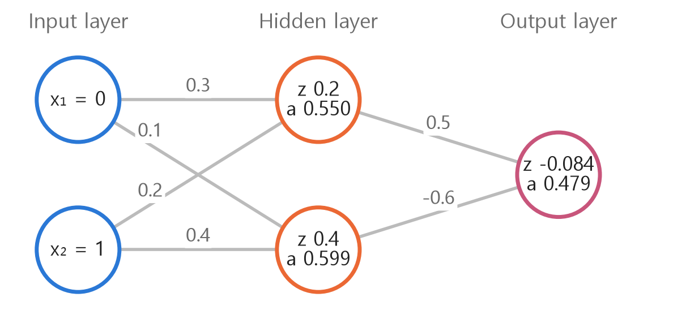
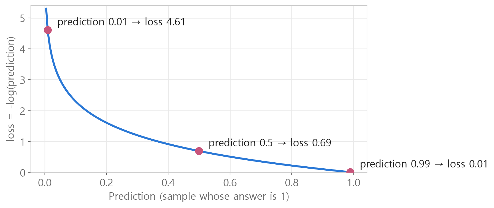
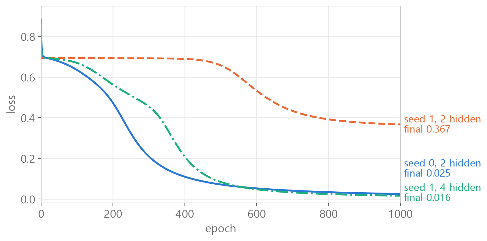

<style>
.content table { width: 100%; border-collapse: collapse; margin: 14px 0 24px; font-size: 17px; line-height: 1.5; }
.content th, .content td { border-bottom: 1px solid #e6dde0; padding: 8px 10px; text-align: left; vertical-align: top; }
.content thead { background: #fbf1f4; }
.content figure { margin: 18px 0; }
.content figure img { width: 100%; height: auto; }
.content td, .content th { word-break: keep-all; overflow-wrap: normal; }
.content .katex-display { overflow-x: auto; overflow-y: hidden; padding: 4px 0; }
.content td code { white-space: normal; overflow-wrap: anywhere; }
@media (max-width: 560px) { .content th, .content td { padding: 7px 5px; font-size: 16px; } }
</style>
<link rel="stylesheet" href="https://cdn.jsdelivr.net/npm/katex@0.16.11/dist/katex.min.css">
<script defer src="https://cdn.jsdelivr.net/npm/katex@0.16.11/dist/katex.min.js"></script>
<script defer src="https://cdn.jsdelivr.net/npm/katex@0.16.11/dist/contrib/auto-render.min.js" onload="renderMathInElement(document.querySelector('.content')||document.body,{delimiters:[{left:'\\[',right:'\\]',display:true},{left:'\\(',right:'\\)',display:false}]})"></script>

<div class="wc"><p><b>Why write forward and backpropagation by hand?</b><br>
The forward pass computes a prediction from the input, and backpropagation goes backward from the loss to find the gradient of every weight.<br>
A PyTorch network learns by repeating forward → loss → backpropagation → weight update, and the backpropagation part is computed automatically by <a href="https://docs.pytorch.org/tutorials/beginner/basics/autogradqs_tutorial.html">torch.autograd</a>.<br>
Writing it by hand once shows what <code>loss.backward()</code> and <code>.grad</code> actually do, which makes shape errors and stalled training much easier to track down. (As of November 3, 2026)</p></div>

We follow a one-hidden-layer network solving XOR **from the forward pass all the way to autograd**, and end with **a table of the PyTorch functions** used.<br>
The first wrong code and the questions asked along the way are kept right where they came up. Every number was computed in Python.

A [single-layer perceptron](/en/2026/11/03/perceptron-limit/) is a single straight line, so it cannot solve XOR. Here we solve it with a network that has 2 hidden nodes.

<div class="keyline">We start with the 4 XOR samples, 2 hidden nodes and seed 0.</div>

## <span class="no">1</span> Making the data and weights

Make the XOR inputs and answers as **float tensors**. sigmoid and log need real numbers.

```python
import torch

X = [[0, 0], [0, 1], [1, 0], [1, 1]]
y = [0, 1, 1, 0]
X_tensor = torch.tensor(X, dtype=torch.float32)
y_tensor = torch.tensor(y, dtype=torch.float32).view(4, 1)
print(X_tensor.shape, y_tensor.shape)
```
→ `torch.Size([4, 2]) torch.Size([4, 1])` : 4 samples × 2 inputs, 4 samples × 1 answer

A weight's shape is **(nodes coming in, nodes going out)**.

| Name | Shape | Meaning | Starts as |
|---|---|---|---|
| w1 | (2, 2) | 2 inputs → 2 hidden | random |
| b1 | (2,) | one per hidden node | 0 |
| w2 | (2, 1) | 2 hidden → 1 output | random |
| b2 | (1,) | one for the output node | 0 |

`X_tensor @ w1` is (4, 2) @ (2, 2). **The two inner numbers must match** for it to compute, and the result takes the two outer numbers, (4, 2).

```python
# ❌ first attempt
self.w1 = torch.tensor(2, 2)
self.b2 -= torch.tensor(1)
```
- `torch.tensor(2, 2)` → `TypeError: tensor() takes 1 positional argument but 2 were given`
- `self.b2 -=` → `AttributeError`. `-=` means "subtract from the existing b2", but b2 does not exist yet.

| Function | The number in parentheses is | Example |
|---|---|---|
| `torch.tensor` | a value | `torch.tensor(2)` → the single number 2 |
| `torch.randn` | a shape | `torch.randn(2, 2)` → 2×2 random |
| `torch.zeros` | a shape | `torch.zeros(2)` → two zeros |

```python
# ✅
class MLP:
    def __init__(self):
        self.w1 = torch.randn(2, 2)
        self.b1 = torch.zeros(2)
        self.w2 = torch.randn(2, 1)
        self.b2 = torch.zeros(1)
```

**❓ Question asked again: "Isn't initialization supposed to be random? Why do hidden and output start at 0?"**

What starts at 0 is the **bias**, not the node. "One per hidden node" in the table says how many numbers b1 holds. Randomness is essential for w. Take, as an example, the scores that input (1, 0) gives the two hidden nodes.

| Case | Hidden node 1 | Hidden node 2 |
|---|---|---|
| w all 0 | 1×0 + 0×0 = 0 | 1×0 + 0×0 = 0 |
| w random, b 0 | 1×0.34 + 0×0.23 = 0.34 | 1×0.13 + 0×(-0.41) = 0.13 |

If w is all 0, the two nodes start with the same value, get corrected identically by backpropagation, and stay the same node to the end. If w is random, they already differ even with b at 0. Initialization methods are covered in the [gradient descent and weight initialization post](/en/2026/10/26/gradient-descent-init/).

## <span class="no">2</span> sigmoid and the forward pass

sigmoid turns **any number into a value between 0 and 1**.

$$\sigma(z) = \frac{1}{1 + e^{-z}}$$

```python
def sigmoid(z):
    return 1 / (1 + torch.exp(-z))

print(sigmoid(torch.tensor([-5.0, 0.0, 5.0])))
```
→ `tensor([0.0067, 0.5000, 0.9933])` : a large negative goes toward 0, 0 gives one half, a large positive goes toward 1

```python
# ❌
torch.tensor(-5.0 0.0 5.0)
# ✅
torch.tensor([-5.0, 0.0, 5.0])
```
Several numbers go inside square brackets, separated by commas. Without commas you get a `SyntaxError`. Writing a power with `^` is another common mistake. In Python `^` is bitwise XOR, so write `torch.exp(-z)`.

**❓ Question asked again: "What value actually goes into sigmoid?"**

**A score z** goes in. z is the previous step's values multiplied by weights and added up, plus the bias. Let's follow just one input, (0, 1). The weights are chosen to be easy to compute, and the biases are 0.

<figure></figure>

- Hidden node 1 : $$z = 0 \times 0.3 + 1 \times 0.2 = 0.2$$ → $$\sigma(0.2) = 0.550$$
- Output : $$z = 0.550 \times 0.5 + 0.599 \times (-0.6) = -0.084$$ → $$\sigma(-0.084) = 0.479$$

0.479 means "a 47.9% probability that the answer for input (0, 1) is 1". What goes into sigmoid is a score, and what comes out is a probability between 0 and 1.

The forward pass does this for all 4 samples × all nodes at once.

$$Z_1 = XW_1 + b_1, \quad A_1 = \sigma(Z_1)$$

$$Z_2 = A_1W_2 + b_2, \quad \hat{Y} = \sigma(Z_2)$$

```python
# ❌
self.z2 = a1 @ self.w2 + self.b2
mlp = MLP
```
- `a1` → `NameError`. The line above stored it as `self.a1`, so read it back as `self.a1`.
- `MLP` is the blueprint itself and has no weights. `mlp.forward(X_tensor)` raises `TypeError: MLP.forward() missing 1 required positional argument: 'X'`. You have to build one with `MLP()` so `__init__` runs.

```python
# ✅ continuing below __init__
    def forward(self, X):
        self.z1 = X @ self.w1 + self.b1
        self.a1 = sigmoid(self.z1)
        self.z2 = self.a1 @ self.w2 + self.b2
        self.a2 = sigmoid(self.z2)
        return self.a2

mlp = MLP()
```
The values are stored on `self.` because backpropagation reads a1 and a2 again.

**❓ "Do I have to write the class again?"** Yes. You cannot slot a single function into a class from another cell, so you write `__init__` and `forward` together in one class again. In a Jupyter notebook, **the class you ran last** is the one that gets used.

**❓ "What is @?"** It is matrix multiplication: multiply in pairs, then **add everything up**. The $$0 \times 0.3 + 1 \times 0.2$$ in the figure above is one cell of `@`.

```python
a = torch.tensor([1.0, 2.0, 3.0])
b = torch.tensor([4.0, 5.0, 6.0])
print(a * b, a @ b)
```
→ `tensor([ 4., 10., 18.]) tensor(32.)` : `*` only multiplies, `@` multiplies and then adds

| Variable | Shape | Meaning |
|---|---|---|
| X | (4, 2) | 4 samples, 2 inputs |
| z1, a1 | (4, 2) | 4 samples, 2 hidden nodes |
| z2, y_pred | (4, 1) | 4 samples, 1 output |

The first number stays 4 the whole way, and only the second changes to the node count. b1 is (2,) yet gets added to a (4, 2), because PyTorch adds **the same b1 to all four rows** (broadcasting).

Before training, seed 0 predicts `[0.224, 0.268, 0.184, 0.237]`. Values that have nothing to do with the answers `[0, 1, 1, 0]` are normal.

## <span class="no">3</span> BCE loss: how wrong is it?

The loss is **how wrong the model is, as a single number**. For predicting 0 or 1 we use BCE (binary cross entropy).

$$L = -\frac{1}{N}\sum_{i=1}^{N}\Big[y_i \log \hat{y}_i + (1-y_i)\log(1-\hat{y}_i)\Big]$$

When the answer is 1 only $$-\log \hat{y}$$ remains, and when it is 0 only $$-\log(1-\hat{y})$$ remains. $$\frac{1}{N}\sum$$ is the average over N samples.

<figure></figure>

If the answer is 1, predicting 0.01 costs 4.61, a coin flip costs 0.69, and an almost-correct guess costs 0.01. The more confidently a prediction points the wrong way, the bigger the penalty.

```python
# ❌
def bce_loss(self, y_pred, y_true):
    rerturn =-(y_true*torch.log(y_pred) + (1-y_true)*torch.log(1-y_pred).mean())
```
- `rerturn =` : the typo plus `=` only stores the value in a variable and never returns it, so you get `None`.
- `.mean()` sits inside the second term, so it averages **only that term**. With one sample the result looks the same, but with 4 samples you no longer get a single number.

```python
# ✅
    def bce_loss(self, y_pred, y_true):
        return -(y_true*torch.log(y_pred) + (1-y_true)*torch.log(1-y_pred)).mean()

loss = mlp.bce_loss(y_pred, y_tensor)
```
`y_true` is a name used **only inside the function**. When calling it, pass the real variable that holds the answers, `y_tensor`.

**❓ Question asked again: "The loss was supposed to be around 0.7, but I get 0.99"**

When the predictions lean to one side, the loss gets bigger. Here is seed 0's loss of 0.8834 split by sample.

| Input | Answer | Prediction | Sample loss |
|---|---|---|---|
| (0, 0) | 0 | 0.224 | 0.25 |
| (0, 1) | 1 | 0.268 | 1.32 |
| (1, 0) | 1 | 0.184 | 1.69 |
| (1, 1) | 0 | 0.237 | 0.27 |

All predictions lean low, so the two samples whose answer is 1 are badly wrong. The value changes on every run because `MLP()` draws new random weights each time. Putting `torch.manual_seed(0)` above it makes the run the same every time.

## <span class="no">4</span> Backpropagation: splitting the blame

**❓ Question asked again: "Does the forward pass exist for backpropagation, or the other way round?"**

The forward pass is the main character. It produces the prediction, and once training is done only the forward pass is used. Backpropagation works out **which way and how much** to correct the weights for what the forward pass got wrong. It needs the a1 and a2 stored during the forward pass.

The gradient $$\frac{\partial L}{\partial w}$$ is "how much the loss changes if w grows a little". We compute it backward, starting from the output layer closest to the loss.

**① The gradient of the output score** becomes simple when sigmoid and BCE are differentiated together.

$$\frac{\partial L}{\partial Z_2} = \frac{\hat{Y} - Y}{N}$$

| Input | Answer | Pred. | dz2 | Meaning |
|---|---|---|---|---|
| (0, 0) | 0 | 0.224 | +0.056 | lower the score a little |
| (0, 1) | 1 | 0.268 | -0.183 | raise the score a lot |
| (1, 0) | 1 | 0.184 | -0.204 | raise the score a lot |
| (1, 1) | 0 | 0.237 | +0.059 | lower the score a little |

**② A weight's gradient = (the input that came into that weight) × dz2**

$$\frac{\partial L}{\partial W_2} = A_1^{\top}\,\frac{\partial L}{\partial Z_2}$$

The output score is $$z_2 = a_1[0]\,w_2[0] + a_1[1]\,w_2[1] + b_2$$. Raising w2[0] by 0.01 changes z2 by $$a_1[0] \times 0.01$$. For a sample where a1[0] is near 0, w2[0] carries almost no blame.

| Input | a1[0] | dz2 | a1[0] × dz2 |
|---|---|---|---|
| (0, 0) | 0.500 | +0.056 | +0.028 |
| (0, 1) | 0.102 | -0.183 | -0.019 |
| (1, 0) | 0.824 | -0.204 | -0.168 |
| (1, 1) | 0.346 | +0.059 | +0.021 |
| Sum | | | **-0.138** |

Multiplying the four rows and adding them is `self.a1.T @ self.dz2`. `.T` (transpose) lays a1 down from (4, 2) to (2, 4) so that each row holds "the 4 outputs of one hidden node".

```python
# ❌
self.dz2 = (y_pred - y) / N
self.dw2 = N.T @ self.dz2
```
- `y_pred` is a variable outside the class. It can quietly pick up some other prediction left outside, so without any error you get numbers that differ from `self.a2`. The prediction is `self.a2`.
- `N` is the number 4, which has no `.T` (`AttributeError`). The input that came into w2 is `self.a1`.

The hidden layer uses the same formula. Only two new lines appear.

```python
    def backward(self, X, y):
        N = X.shape[0]
        self.dz2 = (self.a2 - y) / N
        self.dw2 = self.a1.T @ self.dz2
        self.db2 = self.dz2.sum(dim=0)
        self.da1 = self.dz2 @ self.w2.T
        # send the output blame back through w2 to the hidden nodes
        self.dz1 = self.da1 * self.a1 * (1 - self.a1)
        # go back through sigmoid: σ' = a(1-a)
        self.dw1 = X.T @ self.dz1
        # same formula as the output layer
        self.db1 = self.dz1.sum(dim=0)
```
→ seed 0 : `dw2 = [-0.1382, -0.1423]`, `db2 = [-0.2717]`, `dw1 = [[0.0176, 0.0495], [0.0036, 0.0387]]`

**A gradient always has the same shape as its own weight.** If you get dw1 (2, 2), db1 (2,), dw2 (2, 1), db2 (1,), the structure is right.

**❓ "Why is db2 Size([1])?"** `dz2.sum(dim=0)` adds the 4 samples down the column, so the 4 disappears and only the output node count, 1, remains. `Size([2])` is a single row of 2 numbers with one pair of brackets, while `Size([1, 2])` is a table with 1 row and 2 columns.

## <span class="no">5</span> Gradient descent and learning curves

Move each weight **against the gradient** by the learning rate η.

$$W \leftarrow W - \eta\,\frac{\partial L}{\partial W}$$

If dw2 is -0.138, then $$-(-0.138) = +0.138$$, so w2 goes up. With seed 0 and η = 1, one correction moves w2 from `[-1.0845, -1.3986]` → `[-0.9464, -1.2563]` and lowers the loss from 0.8834 → 0.7784.

```python
# ❌ = instead of - in the two bias lines
self.b1 = self.b1 = lr * self.db1
self.b2 = self.b2 = lr * self.db2
```
Typing `=` instead of `-` puts the gradient itself into the bias slot, so the sign flips. There is no error, and the loss **goes up** to 0.9235. You can only catch this kind of mistake by checking that the loss goes down.

```python
# ✅ continuing inside the class
    def gd(self, lr):
        self.w1 = self.w1 - lr * self.dw1
        self.b1 = self.b1 - lr * self.db1
        self.w2 = self.w2 - lr * self.dw2
        self.b2 = self.b2 - lr * self.db2
```

Training is repeating four lines.

```python
torch.manual_seed(0)
mlp = MLP()
for epoch in range(1000):
    y_pred = mlp.forward(X_tensor)
    loss = mlp.bce_loss(y_pred, y_tensor)
    mlp.backward(X_tensor, y_tensor)
    mlp.gd(1.0)
    if epoch % 100 == 0:
        print(epoch, loss.item())
```
→ The loss goes down 0.8834, 0.6350, 0.4731 … 0.0283 (epoch 900). The final loss is 0.0245, the predictions are `[0.0217, 0.9722, 0.9717, 0.0190]`, and thresholding at 0.5 gives `[0, 1, 1, 0]`, matching the answers.

**A seed is the starting number of a list of random numbers.** A computer's randomness is a list produced by a fixed formula, so the same seed gives the same list. The seed 0 list is `1.5410, -0.2934, -2.1788, 0.5684, -1.0845, -1.3986, …`, and the first 4 become w1 while the next 2 become w2.

Keep the code as it is and change only the seed to 1, and training **gets stuck**.

<figure></figure>

- seed 1, 2 hidden : it sits near 0.693 for about 400 epochs. 0.693 is the loss when every prediction is 0.5. After that it drops, then flattens at 0.367.
- Predictions `[0.018, 0.970, 0.498, 0.513]` : it cannot tell (1, 0) from (1, 1) and stops at 0.5 for both.
- 0.349 after 3,000 epochs and 0.347 after 10,000, so **training longer barely helps.** Flattening somewhere other than 0 is the sign of being stuck.

**With 4 hidden nodes**, seed 1 also goes down to 0.016. You do not create new weight variables. You only change the number in the hidden-node-count position.

```python
# ❌ only adds variables that are never used
self.w3 = torch.randn(2, 2)
self.w4 = torch.randn(2, 1)
# ✅ change only the hidden-node-count position to 4
self.w1 = torch.randn(2, 4)
self.b1 = torch.zeros(4)
self.w2 = torch.randn(4, 1)
```
forward and backward stay the same. `@` computes according to the shapes.

| Hidden nodes | Runs with seeds 0 to 19 | Loss left above 0.2 |
|---|---|---|
| 2 | 20 | 6 |
| 4 | 20 | 0 |

The settings are learning rate 1.0, 1,000 epochs, sigmoid and BCE. With more hidden nodes, the same seed starts w2 from different numbers, so the effect of the node count is better judged from these 20 runs than from a single seed.

## <span class="no">6</span> Switching to autograd

PyTorch replaces the hand-written backpropagation with **one line**, `loss.backward()`. The network is the same, and here is everything that changes.

| Where | Hand-written version | autograd version |
|---|---|---|
| Weights | `torch.randn(2, 2)` | `torch.randn(2, 2, requires_grad=True)` |
| sigmoid | `sigmoid(z)` | `torch.sigmoid(z)` |
| loss | BCE formula by hand | `F.binary_cross_entropy(y_pred, y_true)` |
| Backprop | `mlp.backward(X, y)`, 7 gradient lines | `loss.backward()` |
| Gradient | `self.dw1` | `self.w1.grad` |
| Update | `self.w1 = self.w1 - lr * self.dw1` | `self.w1 -= lr * self.w1.grad` |

```python
# gd inside the class
    def gd(self, lr):
        with torch.no_grad():
            self.w1 -= lr * self.w1.grad
            # b1, w2, b2 follow the same pattern
            self.w1.grad.zero_()
            # clear the used gradient
```

Rerun the class with `__init__`, `forward` and `bce_loss` changed as in the table above, then check.

```python
import torch.nn.functional as F

torch.manual_seed(0)
mlp = MLP()
loss = F.binary_cross_entropy(mlp.forward(X_tensor), y_tensor)
loss.backward()
print(mlp.w2.grad.view(-1))
```
→ `tensor([-0.1382, -0.1423])` : exactly the dw2 computed by hand in section 4. The loss over 1,000 training epochs also matches to the fourth decimal place, 0.8834 → 0.0283 (epoch 900).

The two lines inside gd are where most autograd mistakes happen.

- `.grad.zero_()` : `backward()` does not clear the gradient, it **adds onto it.** Calling `backward()` twice with the same weights doubles w2.grad to `[-0.2763, -0.2845]`.
- `with torch.no_grad():` and `-=` : these keep the subtraction that updates the weights out of the record. Inside no_grad, making a new tensor with `self.w1 = self.w1 - …` sets `requires_grad` to `False`, so the next iteration cannot compute gradients. Using `-=` without no_grad raises a `RuntimeError`.

## <span class="no">7</span> PyTorch functions at a glance

These are the PyTorch functions used in this post.

| Function | What it does | Used for |
|---|---|---|
| `torch.tensor(data, dtype=torch.float32)` | list to float tensor | making X and y |
| `.view(4, 1)` | change the shape | y to (4, 1) |
| `.shape` | check the shape | `torch.Size([4, 2])` |
| `torch.randn(2, 2)` | that shape filled with random numbers | w1, w2 |
| `torch.zeros(2)` | that shape filled with 0 | b1, b2 |
| `torch.manual_seed(0)` | fix the start of the random list | reproducible results |
| `@` | matrix multiply: multiply in pairs and add | `X @ w1` |
| `.T` | transpose: swap rows and columns | `a1.T @ dz2` |
| `torch.exp`, `torch.log` | power of e, natural log | sigmoid, BCE |
| `.sum(dim=0)` | add along the sample direction | db1, db2 |
| `.mean()` | average | BCE |
| `.item()` | take the single number out of a tensor | printing the loss |
| `requires_grad=True` | mark a tensor that needs gradients | autograd weights |
| `torch.sigmoid` | sigmoid | autograd forward pass |
| `F.binary_cross_entropy` | BCE loss | autograd loss |
| `loss.backward()` | compute gradients by backpropagation | one line instead of 7 gradient lines |
| `.grad` | where the computed gradient is stored | `w1.grad` |
| `.grad.zero_()` | clear the accumulated gradient | every iteration |
| `torch.no_grad()` | turn gradient recording off | weight updates |

<div class="done">🎉 Forward → loss → backpropagation → update: these four lines are the basic shape of a PyTorch training loop!</div>
