<style>
.content table { width: 100%; border-collapse: collapse; margin: 14px 0 24px; font-size: 17px; line-height: 1.5; }
.content th, .content td { border-bottom: 1px solid #e6dde0; padding: 8px 10px; text-align: left; vertical-align: top; }
.content thead { background: #fbf1f4; }
.content figure { margin: 18px 0; }
.content figure img { width: 100%; height: auto; }
.content td, .content th { word-break: keep-all; overflow-wrap: normal; }
.content .katex-display { overflow-x: auto; overflow-y: hidden; padding: 4px 0; }
.content td code { white-space: nowrap; }
.content pre .nb { padding: 0; border: 0; border-radius: 0; background: none; }
@media (max-width: 560px) { .content th, .content td { padding: 7px 5px; font-size: 16px; } }
</style>
<link rel="stylesheet" href="https://cdn.jsdelivr.net/npm/katex@0.16.11/dist/katex.min.css">
<script defer src="https://cdn.jsdelivr.net/npm/katex@0.16.11/dist/katex.min.js"></script>
<script defer src="https://cdn.jsdelivr.net/npm/katex@0.16.11/dist/contrib/auto-render.min.js" onload="renderMathInElement(document.querySelector('.content')||document.body,{delimiters:[{left:'\\[',right:'\\]',display:true},{left:'\\(',right:'\\)',display:false}]})"></script>

<div class="wc"><p><b>Why learn gradient descent?</b><br>
Gradient descent adjusts model weights in the direction that lowers the loss.<br>
<a href="https://docs.pytorch.org/tutorials/beginner/basics/optimization_tutorial.html">PyTorch’s optimization tutorial</a> splits data into batches and updates the model once per batch.<br>
The batch size determines how many examples inform each update and how many updates happen in an epoch. (As of November 4, 2026)</p></div>

The diagrams compare the three methods before we run them on the same data. The last two sections cover four distinctions and four common mistakes.

**Gradient descent → Three methods → Experiments → Common pitfalls**

<div class="keyline">Each method uses the same update rule. The difference is how many rows it uses to estimate the gradient.</div>

## <span class="no">1</span> What is gradient descent?

Gradient descent repeatedly nudges the weights toward lower loss. These four terms describe the update.

| Term | Meaning |
|---|---|
| Weight | A parameter adjusted during training |
| Loss | A measure of how far predictions are from their labels. Lower is better |
| Gradient | How the loss changes as the weight increases |
| Learning rate | The factor that scales each update |

For one weight, the update rule is:

$$\theta_{new} = \theta_{old} - \eta \nabla L(\theta_{old})$$

$$\theta$$ is the weight, $$\eta$$ is the learning rate, and $$\nabla L$$ is the gradient.

If the gradient is positive, it means that the loss increases as the weight increases, so reduce the weight by subtracting the gradient multiplied by the learning rate. $$\theta_{old} = 3$$, $$\eta = 0.3$$, and if the gradient is 3, $$\theta_{new} = 3 - 0.3 \times 3 = 2.1$$.

The figure below shows this calculation repeated four times when the loss is $$\frac{1}{2}\theta^2$$ and the gradient is $$\theta$$. As the loss gets closer to the minimum, the gradient gets smaller and each step gets smaller.

<figure>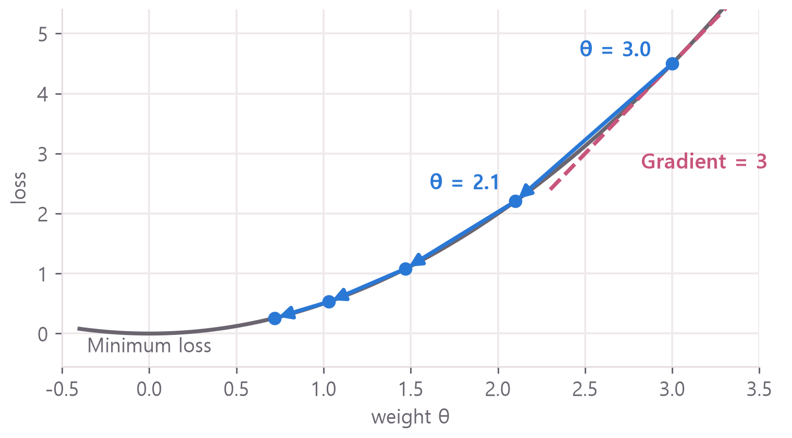</figure>

## <span class="no">2</span> Concepts and pros and cons of the three methods

The difference between the three methods is how many rows of data are used to calculate the gradient. Since the loss is calculated from the correct answer and the model's answer for each row, the gradient is also different for each row. If multiple rows are used, the gradient is calculated for each row and averaged.

$$\theta_{new} = \theta_{old} - \eta \cdot \frac{1}{B} \sum_{i=1}^{B} \nabla L_i(\theta_{old})$$

$$B$$ is the number of rows in one batch, and $$\nabla L_i$$ is the gradient from row $$i$$. For example, gradients of 2 and 4 average to 3 when $$B=2$$.

| Method | Data used to calculate the gradient |
|---|---|
| Batch GD | All training rows |
| SGD | 1 row selected at random |
| Mini-batch GD | Small batches (e.g. 32 rows) |

SGD stands for stochastic gradient descent. Some sources include mini-batches under SGD. Here, SGD refers to a batch size of 1.

An **epoch** is one pass through the training data. An **iteration** is one weight update. The diagram compares a single epoch on 700 rows.

<figure>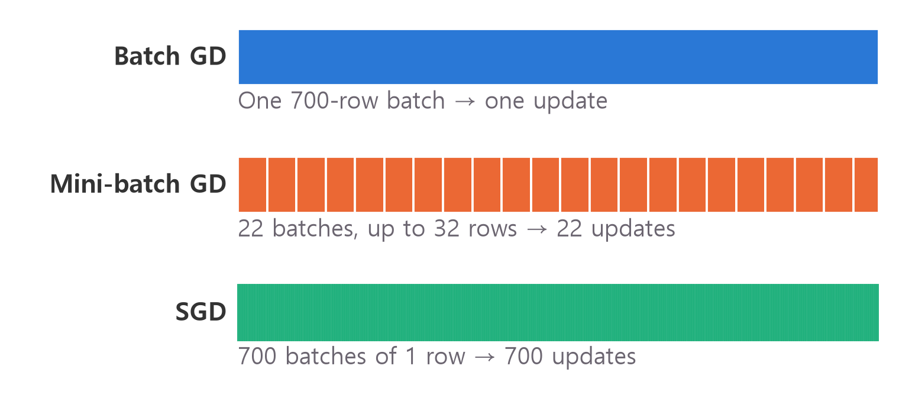</figure>

The number of iterations in one epoch is:

$$\text{Iterations} = \left\lceil \frac{N}{B} \right\rceil$$

$$N$$ is the number of rows, and $$\lceil \ \rceil$$ rounds up. With $$N = 700$$ and $$B = 32$$, 21.875 rounds up to 22. One iteration means one weight update.

Batch size also affects the direction of an update. To see it, use a model that multiplies two input features by their weights, adds the products, and maps the result to a number between 0 and 1. The inputs are features 2 and 3 of the dataset below. From the same weights, draw 40 batches and plot the resulting updates.

<figure>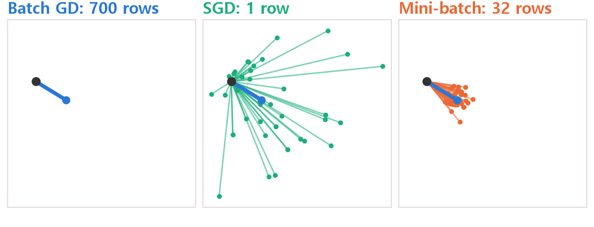</figure>

The black dot marks the current weights and each line ends at the updated weights. The thick blue line uses all 700 rows and always points in the same direction. Single-row updates vary widely, while updates from 32 rows cluster around the blue line.

Next, start the same model at the same weights and train for 10 epochs. Each method uses `lr=0.1` and sees 7,000 rows. Gray contours connect points of equal loss and the star marks the minimum. The plots use the same axes.

### Batch GD

Average the gradients from all 700 rows and update once. From the same weights, this always gives the same direction.

<figure>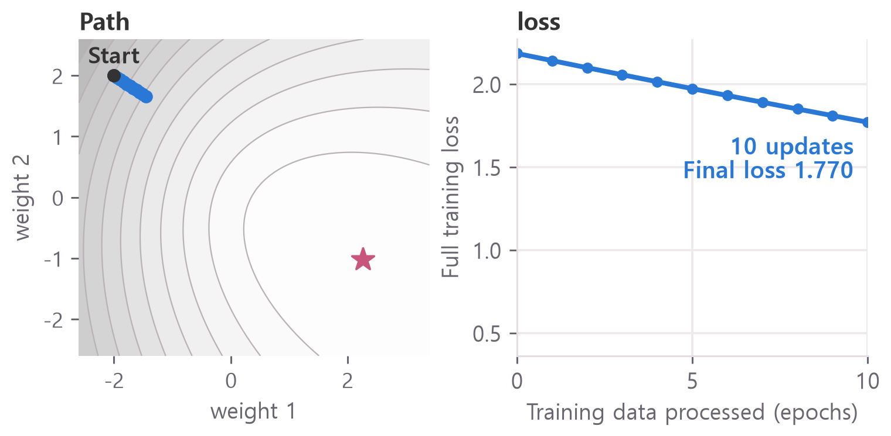</figure>

The path is straight, but 10 updates only take the loss from 2.18 to 1.77.

- **Advantage:** The direction is consistent. With a modest learning rate, the loss falls smoothly.
- **Drawback:** Each update needs all the rows. Larger datasets take more time and memory per update. This method also makes the fewest updates per epoch.

### SGD

Use the gradient from one row at a time. With 700 rows, that is 700 updates per epoch.

<figure>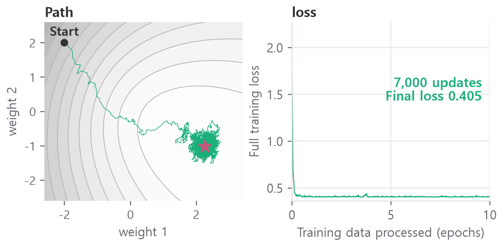</figure>

The loss reaches about 0.41 after one epoch, but the weights continue to move around the minimum because the gradient differs from row to row.

- **Advantage:** Each update is cheap, and there are more updates per epoch. In this experiment the loss falls quickly at first.
- **Drawback:** Update directions vary substantially. A lower learning rate can reduce fluctuations. Processing one row at a time also makes an epoch slower in this run.

Noisy updates are sometimes described as helping a model escape a local minimum. This experiment did not test that claim.

### Mini-batch GD

Average the gradients from a small batch, such as 32 rows. With 700 rows, that gives 22 updates per epoch.

<figure>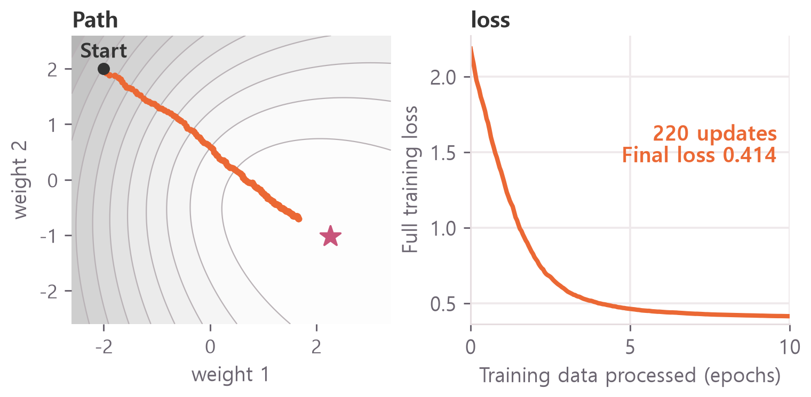</figure>

The path is nearly straight and the loss falls smoothly to about 0.41.

- **Advantage:** Updates vary less than in SGD and occur more often than in batch GD. Computing 32 rows together is faster per row than processing them one by one.
- **Drawback:** Changing the batch size changes the noise and number of updates, so you may need to tune the learning rate again.

Mini-batches are common in training code. The PyTorch tutorial linked above uses `batch_size=64`.

The timings below come from the four-feature model with a 32-unit hidden layer in section 4.

| Measure | Batch GD | SGD | Mini-batch |
|---|---|---|---|
| Rows per update | 700 | 1 | 32 |
| Updates per epoch | 1 | 700 | 22 |
| Time per update | About 3 ms | About 0.14 ms | About 0.32 ms |
| Time per epoch | About 3 ms | About 100 ms | About 7 ms |
| Variation in update direction | None | High | Low |

Batch GD has the shortest epoch here because it updates only once. Next, reproduce these measurements in code. See [Gradient Descent Explained](/en/2026/10/26/gradient-descent-init/) for more on the update rule.

## <span class="no">3</span> Build the dataset and inspect a batch

Create 1,000 examples with four input features and a binary label. Each row in the table is one example.

Run the code blocks in order. Install PyTorch with `pip install torch` or use Google Colab. Blocks marked ❌ are intentionally incorrect. Results were recorded with PyTorch 2.11 on a CPU. Timings vary by machine and run.

```python
import torch  # Tensor Calculation Tool
import torch.nn as nn  # Neural network layers and loss
from torch.utils.data import (
    DataLoader,  # yields batches
    TensorDataset,  # Tool to match X and Y
)

torch.manual_seed(42)  # random number fixed
X = torch.randn(1000, 4)  # 1000 rows 4 spaces
noise = 0.3 * torch.randn(1000)
# Cell 0 × Cell 1 + Cell 2
score = X[:, 0] * X[:, 1] + X[:, 2]
score = score - 0.5 * X[:, 3] + noise
# 1000 rows and 1 space
y = (score > 0).float().reshape(-1, 1)

X_train, y_train = X[:700], y[:700]
X_test, y_test = X[700:], y[700:]
print(X_train.shape, y_train.shape)
print(X_test.shape, y_test.shape)
print(round(y_train.mean().item(), 4))
```

```text
torch.Size([700, 4]) torch.Size([700, 1])
torch.Size([300, 4]) torch.Size([300, 1])
0.5014
```

The first line shows 700 training inputs with four features and 700 labels with one value. The second line shows the corresponding 300 test inputs and labels.<br>
The mean label is 0.5014, so about half the training labels are 1. Random guesses would score about 50%.

`X` contains the inputs and `y` contains the labels. `torch.randn` generates random values, and a positive `score` gives a label of 1.

Train on 700 rows and evaluate on the 300 held-out rows.

`TensorDataset` pairs each row of X with its label in y. `DataLoader` returns those pairs in batches.

```python
dataset = TensorDataset(X_train, y_train)
loader = DataLoader(
    dataset,
    batch_size=32,  # 32 rows at a time
    shuffle=True,  # Shuffle every epoch
)

X_batch, y_batch = next(iter(loader))
print(X_batch.shape, y_batch.shape)
print(len(loader))
```

```text
torch.Size([32, 4]) torch.Size([32, 1])
22
```

The loader returns up to 32 rows at a time, with 22 batches in total.

`iter(loader)` creates an iterator and `next` reads the first batch. The training loop iterates over the loader directly.

`[32, 4]` means **32 rows with four features each**. The second number is a property of the input, independent of the number of epochs.

<figure>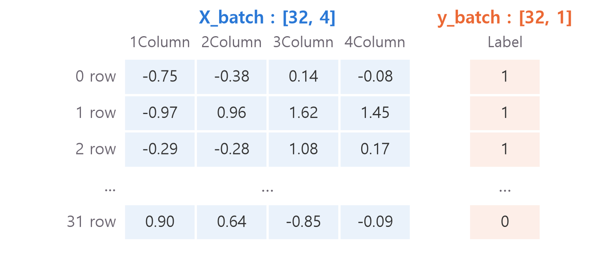</figure>

The model predicts one label from four features in each row. Changing `batch_size` changes the first dimension. The feature and label dimensions remain four and one.

## <span class="no">4</span> Train and compare the three methods

Run the same training code with different batch sizes. The model takes four features and outputs one number between 0 and 1. Section 6 explains `Linear`, and [Introduction to PyTorch nn.Module](/en/2026/11/04/nn-module-shape-dim/) explains the class structure.

```python
class SimpleNet(nn.Module):
    def __init__(self):
        super().__init__()
        self.net = nn.Sequential(
            nn.Linear(4, 32),  # 4 spaces → 32 spaces
            nn.ReLU(),  # Negative numbers are 0
            nn.Linear(32, 1),  # 32 spaces → 1 space
            nn.Sigmoid(),  # between 0 and 1
        )

    def forward(self, x):
        return self.net(x)
```

The outer loop goes through epochs and the inner loop goes through batches. Each inner iteration applies the update rule in section 2.

```python
def train(size, epochs=100, lr=0.1, seed=0):
    torch.manual_seed(seed)  # same starting point
    loader = DataLoader(
        TensorDataset(X_train, y_train),
        batch_size=size,
        shuffle=True,
    )
    model = SimpleNet()
    optimizer = torch.optim.SGD(
        model.parameters(), lr=lr
    )
    criterion = nn.BCELoss()
    losses, updates = [], 0

    for epoch in range(epochs):
        model.train()
        epoch_loss = 0
        for X_b, y_b in loader:
            # Predict and Score
            pred = model(X_b)
            loss = criterion(pred, y_b)
            optimizer.zero_grad()  # Empty
            loss.backward()  # Gradient Calculation
            optimizer.step()  # update weights
            epoch_loss += loss.item()
            updates += 1
        losses.append(
            epoch_loss / len(loader)
        )

    model.eval()
    with torch.no_grad():
        # If it is greater than 0.5, answer 1
        p = (model(X_test) >= 0.5).float()
    correct = (p == y_test).float()
    acc = correct.mean().item()  # Proportion correct
    return losses, updates, acc
```

Here is what the training calls do.

| Code | Meaning |
|---|---|
| `torch.optim.SGD` | Tool to modify weights by gradient (optimizer) |
| `nn.BCELoss` | Binary cross-entropy for labels of 0 or 1 |
| `loss.backward()` | Compute gradients |
| `optimizer.step()` | Modify the weights using the formula in Section 2. |
| `optimizer.zero_grad()` | Clear gradients left over from the previous batch |
| `torch.no_grad()` | Disable gradient recording during evaluation |
| `model.train()`, `model.eval()` | Switch between training and evaluation modes |

The inner loop follows the [five steps of a PyTorch training loop](/en/2026/11/04/xor-training-loop/). With 22 batches per epoch, 100 epochs give 2,200 updates.

For batch GD, a batch size of 700 or more returns all training rows in one batch. Compare four batch sizes. The SGD run takes about 10 seconds.

```python
sizes = {
    "Batch GD": 700,
    "Mini-batch 256": 256,
    "Mini-batch 32": 32,
    "SGD": 1,
}
for name, size in sizes.items():
    losses, updates, acc = train(size)
    print(name, updates,
          round(losses[-1], 4),
          round(acc, 4))
```

```text
Batch GD 100 0.3978 0.7767
Mini-batch 256 300 0.279 0.8367
Mini-batch 32 2200 0.1575 0.8933
SGD 70000 0.1779 0.88
```

The output lists the method, number of updates, mean loss in the last epoch, and accuracy on the 300 test rows. The plot shows mean loss by epoch.

<figure>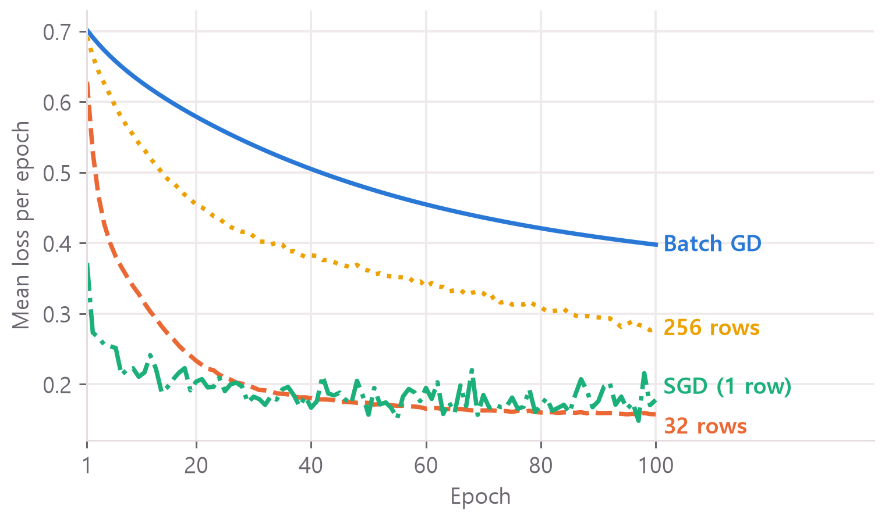</figure>

At the same number of epochs, smaller batches make more updates and the loss falls faster at first. At `lr=0.1`, SGD fluctuates and stays above the 32-row mini-batch. The gradient estimated from one row can differ sharply from the gradients of other rows.

A single run can be misleading. Changing the random seed changes the initial weights and shuffle order. Average the results over five seeds. This takes about a minute.

```python
import time

def repeat(size, epochs=100, lr=0.1):
    accs, ends = [], []
    start = time.perf_counter()
    for seed in range(5):
        losses, _, acc = train(
            size, epochs, lr, seed
        )
        accs.append(acc)
        ends.append(losses[-1])
    sec = (time.perf_counter() - start) / 5
    return (round(sum(accs) / 5, 4),
            round(sum(ends) / 5, 4),
            round(sec, 2))

for name, size in sizes.items():
    print(name, repeat(size))
```

| Method | Updates in 100 epochs | Final loss | Test accuracy | Time per run |
|---|---|---|---|---|
| Batch GD | 100 times | 0.3810 | 0.7913 | 0.3 seconds |
| Mini-batch 256 | 300 times | 0.2707 | 0.8500 | 0.3 seconds |
| Mini-batch 32 | 2,200 times | 0.1581 | 0.9013 | 0.7 seconds |
| SGD | 70,000 times | 0.1780 | 0.8727 | 10 seconds |

The model uses 700 training rows, 300 test rows, one 32-unit hidden layer, `lr=0.1`, and seeds 0 through 4. Under these conditions, the 32-row mini-batch was the most accurate and much faster than SGD.

This table reflects the chosen settings. Batch GD made far fewer updates, and SGD fluctuated at `lr=0.1`. The next experiment matches update counts.

## <span class="no">5</span> Compare equal numbers of updates

At 700 updates, the curves for 32, 256, and 700 rows per batch nearly overlap. The code records the loss on the full training set after each update and stops after update 700.

```python
def by_updates(size, max_updates=700):
    torch.manual_seed(0)
    loader = DataLoader(
        TensorDataset(X_train, y_train),
        batch_size=size,
        shuffle=True,
    )
    model = SimpleNet()
    optimizer = torch.optim.SGD(
        model.parameters(), lr=0.1
    )
    criterion = nn.BCELoss()
    curve = []
    while len(curve) < max_updates:
        for X_b, y_b in loader:
            pred = model(X_b)
            loss = criterion(pred, y_b)
            optimizer.zero_grad()
            loss.backward()
            optimizer.step()
            with torch.no_grad():
                all_loss = criterion(
                    model(X_train), y_train
                )
            curve.append(all_loss.item())
            if len(curve) == max_updates:
                break
    return curve

for name, size in sizes.items():
    curve = by_updates(size)
    print(name, round(curve[-1], 4))
```

```text
Batch GD 0.1872
Mini-batch 256 0.1871
Mini-batch 32 0.188
SGD 0.2483
```

<figure>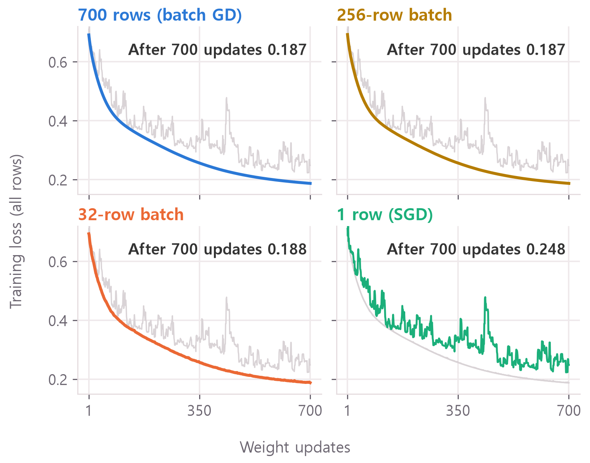</figure>

In the two-weight model from section 2, batch GD and the 32-row mini-batch follow nearly the same path across 40 updates.

<figure>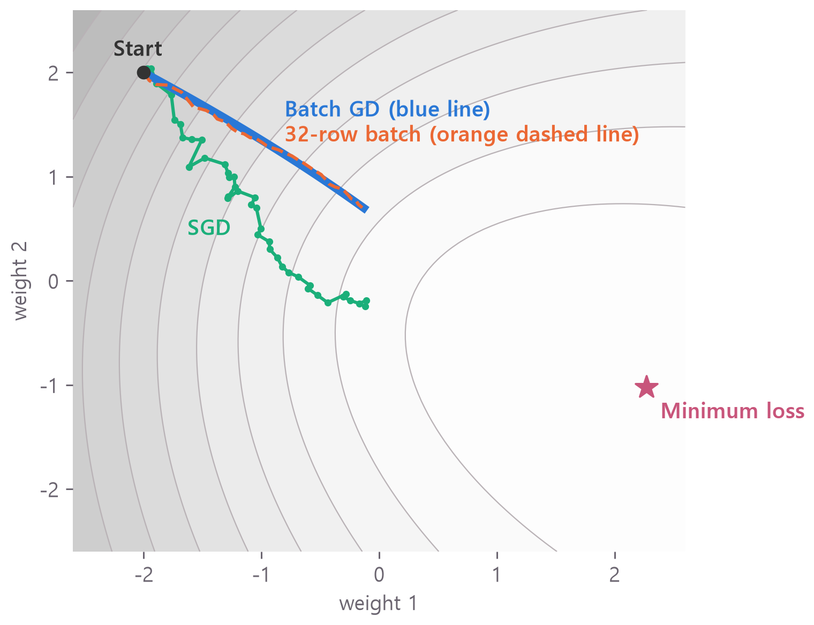</figure>

SGD follows a different path. After 40 updates its loss is 0.71, below batch GD’s 0.88. The earlier 700-update experiment puts SGD above batch GD, so a short run can give a different impression.

Do individual 32-row gradients point in the same direction as the full gradient? We measured cosine similarity with the four-feature model from section 4. A value of 1 means the directions coincide, and 0 means they are perpendicular.

<figure>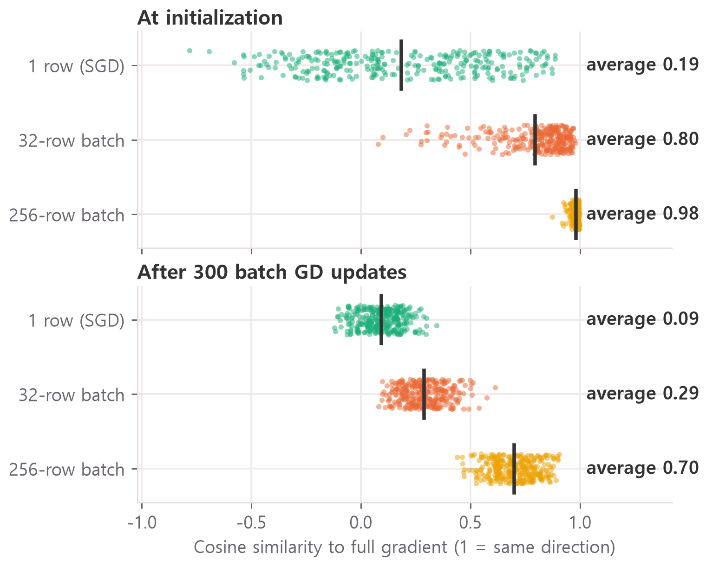</figure>

Each dot is one random batch. By update 300, the mean similarity for a batch of 32 is down to 0.29. A single batch can point in a substantially different direction from the full gradient.

Each epoch still covers all 700 rows. At fixed weights, the mean of the 22 batch gradients is almost parallel to the full gradient (cosine similarity 0.9997). Differences among batches largely cancel. If the weights move little during those 22 updates, this helps explain the overlap in loss. Single-row directions are more dispersed and the loss fluctuates more.

Finally, measure how long the methods take to reach similar accuracy. Increase batch GD to 2,200 epochs and reduce the SGD learning rate to 0.003. This takes about two minutes.

```python
print(repeat(700, epochs=2200))
print(repeat(32))
print(repeat(1, lr=0.003))
```

| Setting | Updates | Final loss | Test accuracy | Time per run |
|---|---|---|---|---|
| Batch GD, 2,200 Epoch | 2,200 | 0.1533 | 0.8993 | 7.4 seconds |
| Mini-batch 32, 100 Epoch | 2,200 | 0.1581 | 0.9013 | 0.8 seconds |
| SGD, lr=0.003, 100 Epoch | 70,000 | 0.1585 | 0.9033 | 11 seconds |

The 32-row mini-batch repeats the earlier experiment, so only the measured time differs.

<figure>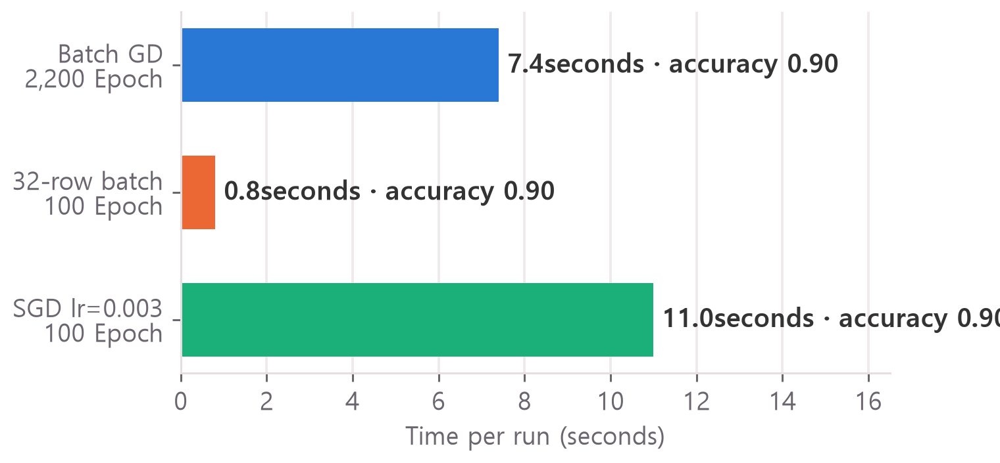</figure>

All three methods reach about 0.90 accuracy. Batch GD processes 700 rows per update and takes about nine times as long as the 32-row mini-batch. SGD and the mini-batch both see 70,000 rows in 100 epochs, but SGD takes more than ten times as long. The per-update estimates in section 2 come from section 4: 10 seconds ÷ 70,000 updates for SGD, and 0.7 seconds ÷ 2,200 updates for the mini-batch. Processing 32 rows together takes roughly twice as long as processing one row, so batching saves time per row.

This experiment favors mini-batches for speed at comparable accuracy. Results can change with the data and learning rate.

## <span class="no">6</span> Four details to keep straight

**The final batch has 28 rows.** Dividing 700 by 32 leaves 28 rows for the 22nd batch.

```python
counts = [len(X_b) for X_b, _ in loader]
print(counts[0], counts[-1], len(counts))

small = DataLoader(
    dataset, batch_size=32, drop_last=True
)
print(len(small))
```

```text
32 28 22
21
```

The first batch has 32 rows, the last has 28, and there are 22 batches.<br>
With `drop_last=True`, the loader skips the incomplete batch and returns 21 batches.

**The 32 in `Linear(32, 1)` is the hidden layer width.** It is independent of `batch_size=32`. You can change the batch size without changing the model.

`Linear` combines the inputs using a weighted sum and bias. A three-feature input $$[2, 1, 3]$$ with weights $$[0.5, -1, 1]$$ has a weighted sum of $$1 - 1 + 3 = 3$$. Each output feature gets its own set of weights.

**`DataLoader` sets the batch size.** All four runs use `torch.optim.SGD` to update weights. The optimizer uses the gradients it receives and does not divide the data into batches.

**The first plotted loss measures different things across methods.** Batch GD starts at 0.7018 because the loss was measured before its only update that epoch. SGD’s 0.3718 averages losses measured during 700 updates. Both started at the same weights.

## <span class="no">7</span> Summary of common mistakes and functions

**The target has the wrong shape.** `BCELoss` expects the predictions and targets to have matching shapes.

```python
# ❌ Error: Prediction is [32, 1], correct answer is [32]
wrong = y_batch.reshape(-1)
p = torch.full((32, 1), 0.5)
nn.BCELoss()(p, wrong)
```

```text
ValueError: Using a target size (torch.Size([32])) that is different to the input size (torch.Size([32, 1])) is deprecated. Please ensure they have the same size.
```

Add `.reshape(-1, 1)` when creating the target tensor.

**A new model needs a new optimizer.** The optimizer updates only the parameters it received at creation. Running notebook cells out of order can cause training to stall without an error.

```python
# ❌ The optimizer fixes the old model
torch.manual_seed(0)
model = SimpleNet()
optimizer = torch.optim.SGD(
    model.parameters(), lr=0.1
)
model = SimpleNet()  # new model

criterion = nn.BCELoss()
for epoch in range(3):
    pred = model(X_train)
    loss = criterion(pred, y_train)
    optimizer.zero_grad()
    loss.backward()
    optimizer.step()
    print(round(loss.item(), 4))
```

```text
0.7513
0.7513
0.7513
```

The loss is identical for all three steps.

Create a fresh optimizer immediately after creating the new model.

**Count each update inside the loop.** Outside the loop the count increments only once. Training still works, so the incorrect count is easy to miss.

```python
# ❌ I ran it 100 times, but 1
updates = 0
for epoch in range(100):
    pass
updates += 1
print(updates)

# ✅
updates = 0
for epoch in range(100):
    updates += 1
print(updates)
```

```text
1
100
```

**Shuffle sorted training data.** With labels sorted and `shuffle=False`, early batches contain only 0s and late batches only 1s. Over five seeds and 100 epochs with 32-row batches, mean test accuracy was 0.888 without shuffling and 0.9013 with shuffling. Shuffling scored higher for each seed.

These are the main calls used above.

| function | Purpose |
|---|---|
| `TensorDataset(X, y)` | Pair each input row with its label |
| `DataLoader(...)` | Return the pairs in batches |
| `next(iter(loader))` | Read the first batch |
| `len(loader)` | Count batches per epoch |
| `torch.optim.SGD(...)` | Update the weights using the computed gradients |

<div class="done">🎉 Batch size changes both how often the model updates and how much data each update uses.</div>
