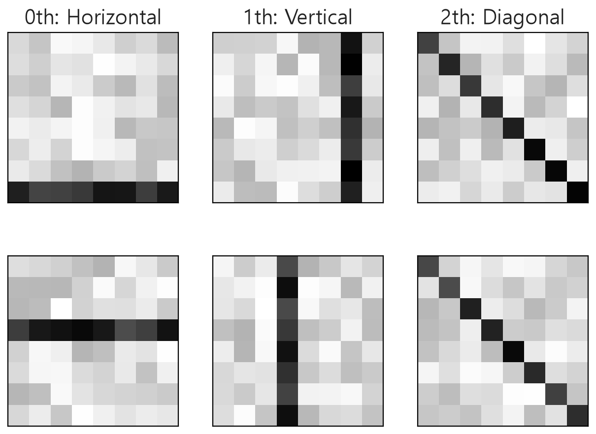
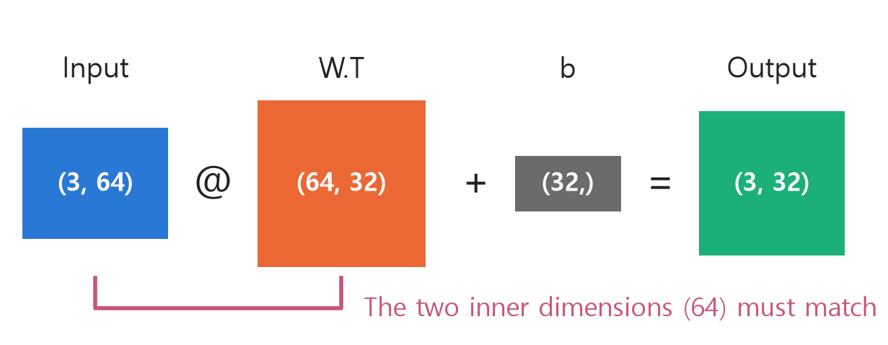
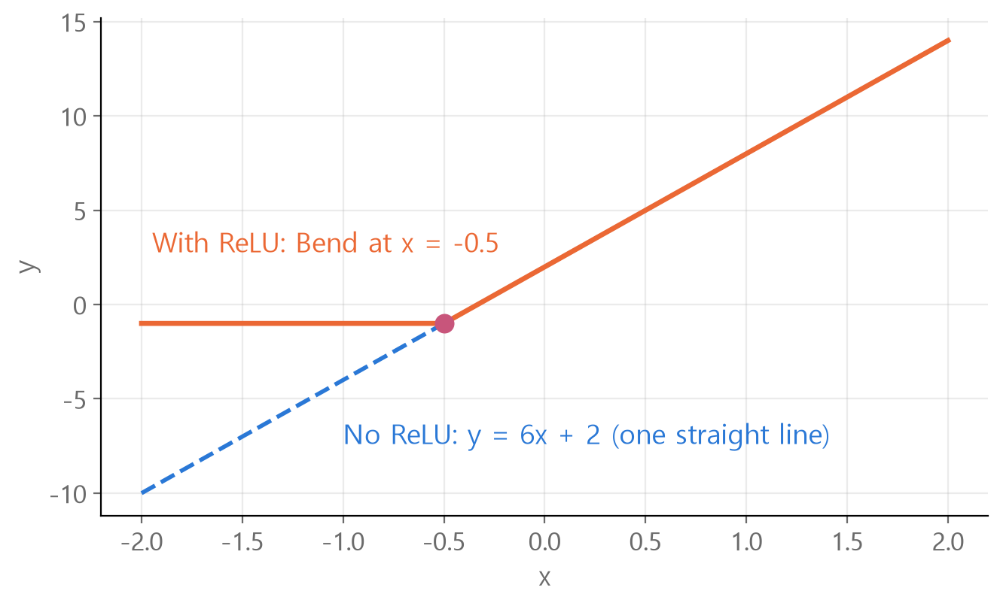
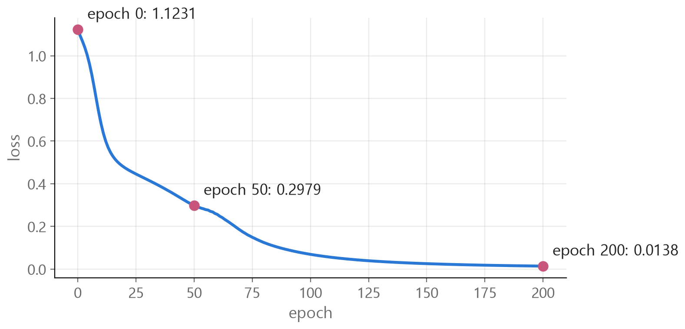
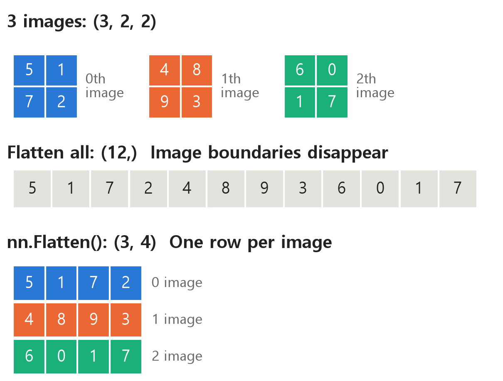
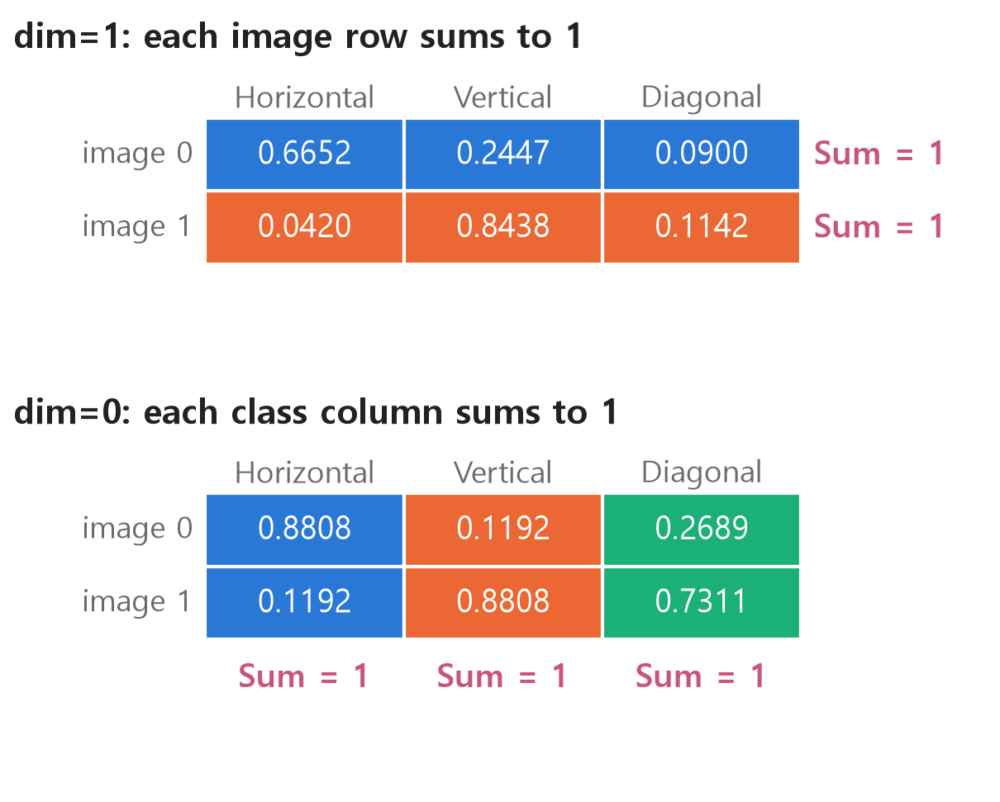

<style>
.content table { width: 100%; border-collapse: collapse; margin: 14px 0 24px; font-size: 17px; line-height: 1.5; }
.content th, .content td { border-bottom: 1px solid #e6dde0; padding: 8px 10px; text-align: left; vertical-align: top; }
.content thead { background: #fbf1f4; }
.content figure { margin: 18px 0; }
.content figure img { width: 100%; height: auto; }
.content td, .content th { word-break: keep-all; overflow-wrap: normal; }
.content .katex-display { overflow-x: auto; overflow-y: hidden; padding: 4px 0; }
.content td code { white-space: nowrap; }
.content pre .nb { padding: 0; border: 0; border-radius: 0; background: none; }
@media (max-width: 560px) { .content th, .content td { padding: 7px 5px; font-size: 16px; } }
</style>
<link rel="stylesheet" href="https://cdn.jsdelivr.net/npm/katex@0.16.11/dist/katex.min.css">
<script defer src="https://cdn.jsdelivr.net/npm/katex@0.16.11/dist/katex.min.js"></script>
<script defer src="https://cdn.jsdelivr.net/npm/katex@0.16.11/dist/contrib/auto-render.min.js" onload="renderMathInElement(document.querySelector('.content')||document.body,{delimiters:[{left:'\\[',right:'\\]',display:true},{left:'\\(',right:'\\)',display:false}]})"></script>

<div class="wc"><p><b>Why learn nn.Module?</b><br>
nn.Module is the <a href="https://docs.pytorch.org/docs/2.14/generated/torch.nn.Module.html">base class</a> for all neural network modules in PyTorch.<br>
Individual layers and models made of multiple layers inherit from it.<br>
Following the training flow and tensor shapes makes it easier to read model code and diagnose shape errors. (As of November 4, 2026)</p></div>

Train a classifier on 8×8 images, then work through five mistakes involving shapes, gradients, and layer registration.

Run the code cells in order. Install PyTorch with `pip install torch` or use Google Colab. Blocks marked ❌ intentionally raise errors. Outputs come from PyTorch 2.11 on a CPU and decimals may vary by environment.

**Generate data → Build the model → Trace the shapes → Train → Predict**

<div class="keyline">The model classifies images with horizontal, vertical, or diagonal lines.</div>

## <span class="no">1</span> Create 8×8 image data

The network receives images as tensors. Generate three kinds of 8×8 images with a line of higher values. Larger values appear darker in the figure.

```python
import torch          # Tensor Calculation Tool
from torch import nn  # Layers and Model Tools

torch.manual_seed(0)  # random number fixed

def make_images(n):   # Make n pieces of each type
    images, labels = [], []
    for label in range(3):  # Types 0, 1, and 2
        for _ in range(n):
            img = torch.rand(8, 8) * 0.3  # background value
            pos = torch.randint(0, 8, (1,)).item()  # line position
            if label == 0:
                img[pos, :] += 0.7  # entire row at pos
            elif label == 1:
                img[:, pos] += 0.7  # All pos columns
            else:
                img[range(8), range(8)] += 0.7  # diagonal
            images.append(img)
            labels.append(label)
    # Returns the list as a tensor.
    return torch.stack(images), torch.tensor(labels)

X_train, y_train = make_images(100)  # 300 training images
X_test, y_test = make_images(20)     # 60 test images
print(X_train.shape)  # image
print(y_train.shape)  # answer number
print(y_train[0], y_train[100], y_train[200])
```

```text
torch.Size([300, 8, 8])
torch.Size([300])
tensor(0) tensor(1) tensor(2)
```

<figure></figure>

| Tensor | Shape | Meaning |
|---|---|---|
| `X_train` | `(300, 8, 8)` | 300 8×8 images |
| `y_train` | `(300,)` | One class label per training image |
| `X_test` | `(60, 8, 8)` | 60 held-out test images |
| `y_test` | `(60,)` | One class label per test image |

The first dimension usually counts examples. Test the classifier on images it did not see during training.

## <span class="no">2</span> Creating a model with nn.Module

Inherit from `nn.Module`, create the layers in `__init__`, and define the order of computation in `forward`.

```python
class ImageNet(nn.Module):  # Inheriting nn.Module
    def __init__(self):     # Deciding which parts to use
        super().__init__()  # Prepare nn.Module
        self.flatten = nn.Flatten()  # 8×8 → 64 spaces
        # Sequential: Execute in the order entered
        self.layers = nn.Sequential(
            nn.Linear(64, 32),  # 64 spaces → 32 spaces
            nn.ReLU(),          # negative numbers to 0
            nn.Linear(32, 3),   # 32 spaces → 3 points
        )

    def forward(self, x):       # Decide the order in which you will pass
        x = self.flatten(x)     # Spread it out first
        return self.layers(x)   # run the layers

torch.manual_seed(1)  # Fixed starting weight
model = ImageNet()    # Create a physical model from a blueprint
print(model)
```

```
ImageNet(
  (flatten): Flatten(start_dim=1, end_dim=-1)
  (layers): Sequential(
    (0): Linear(in_features=64, out_features=32, bias=True)
    (1): ReLU()
    (2): Linear(in_features=32, out_features=3, bias=True)
  )
)
```

Here is where the layer widths come from.

- **64:** Flattening an 8×8 image gives 64 features.
- **32:** This is a chosen width for the hidden layer.
- **3:** The model outputs one score for each of the three classes.

## <span class="no">3</span> Trace the shape through the model

The leading 3 counts images and stays fixed. The remaining dimensions change as the images pass through the layers.

```python
x = X_train[:3]         # 3 images
print(x.shape)
x = model.flatten(x)    # unfold
print(x.shape)
x = model.layers[0](x)  # Linear(64, 32)
print(x.shape)
x = model.layers[1](x)  # ReLU
print(x.shape)
x = model.layers[2](x)  # Linear(32, 3)
print(x.shape)
```

```text
torch.Size([3, 8, 8])
torch.Size([3, 64])
torch.Size([3, 32])
torch.Size([3, 32])
torch.Size([3, 3])
```

It changes in the following order: `(3, 8, 8)` → `(3, 64)` → `(3, 32)` → `(3, 32)` → `(3, 3)`.

**Linear** changes the feature dimension using trainable weights and biases.

$$y = xW^{T} + b$$

$$x$$ is the input, $$W$$ is the weight matrix, $$W^T$$ is its transpose, and $$b$$ is the bias.

<figure></figure>

```python
print(model.layers[0].weight.shape)  # (output, input) order
```

```text
torch.Size([32, 64])
```

The first linear layer stores its weights with shape (32, 64). `nn.Linear` handles the transpose and multiplication.

**ReLU** changes negative numbers to 0 and leaves positive numbers as is.

$$\text{ReLU}(x) = \max(0, x)$$

```python
print(nn.ReLU()(torch.tensor([-0.5, 0.3, 0.0, 1.2])))
```

```text
tensor([0.0000, 0.3000, 0.0000, 1.2000])
```

Without ReLU, two linear layers with biases collapse into a single affine transformation. Composing $$u = 2x + 1$$ and $$y = 3u - 1$$ gives $$y = 6x + 2$$. A ReLU between them introduces a bend.

<figure></figure>

To solve problems that cannot be solved with a single straight line, such as [XOR](/en/2026/11/03/xor-forward-backprop/), you need a nonlinear function like this.

Call `model(x)` to run the model. Its outputs are class scores, or logits. `nn.Softmax` converts them to probabilities.

$$p_i = \frac{e^{z_i}}{\sum_j e^{z_j}}$$

$$z_i$$ is the logit for class $$i$$ and $$p_i$$ is its probability.

```python
logits = model(X_train[:3])        # Score by type
probs = nn.Softmax(dim=1)(logits)  # With a probability that the sum is 1
print(probs.argmax(dim=1))         # biggest number
print(y_train[:3])                 # actual answer

pred = model(X_test).argmax(dim=1)      # Test image prediction
print((pred == y_test).float().mean())  # Proportion correct
```

```text
tensor([1, 1, 1])
tensor([0, 0, 0])
tensor(0.2167)
```

Before training, the weights are random. This initialization correctly classifies 13 of 60 images, below the $$1/3$$ accuracy expected from random guessing.

## <span class="no">4</span> Train and evaluate

Training repeats four operations: **predict, compute the loss, calculate gradients, and update the weights**. For this classification problem, use cross-entropy loss.

$$L = -\ln p_{y}$$

$$p_y$$ is the probability assigned to the correct class. At $$p_y=1/3$$, the loss is $$L=1.0986$$. At $$p_y=0.9$$, it is $$L=0.1054$$. The batch loss is the mean over images.

Use SGD to update the weights.

$$\theta_{new} = \theta_{old} - \eta \nabla L$$

$$\theta$$ is the weight, $$\eta$$ is the learning rate, and $$\nabla L$$ is the gradient of the loss.

```python
loss_fn = nn.CrossEntropyLoss()  # Grading method
optimizer = torch.optim.SGD(     # optimizer
    model.parameters(),          # weights to fix
    lr=0.5,                      # learning rate
)

model.train()                    # training mode
for epoch in range(201):         # Total data no. 201
    logits = model(X_train)          # 1 prediction
    loss = loss_fn(logits, y_train)  # 2 Grading
    optimizer.zero_grad()            # 3 Clear past gradients
    loss.backward()                  # 4 compute gradients
    optimizer.step()                 # 5 Weight modification
    if epoch % 50 == 0:              # Printed every 50 times
        print(epoch, round(loss.item(), 4))
```

| epoch | loss |
|---|---|
| 0 | 1.1231 |
| 50 | 0.2979 |
| 100 | 0.0689 |
| 150 | 0.0253 |
| 200 | 0.0138 |

The initial loss of 1.1231 is close to 1.0986, the loss when the correct class gets probability $$1/3$$.

<figure></figure>

Evaluate the model on the held-out test images.

```python
model.eval()            # evaluation mode
with torch.no_grad():   # disable gradient recording
    pred = model(X_test).argmax(dim=1)
print((pred == y_test).float().mean())

with torch.no_grad():
    samples = X_test[[0, 20, 40]]  # one image of each class
    probs = nn.Softmax(dim=1)(model(samples))
print(probs.round(decimals=3))
```

```text
tensor(1.)
tensor([[0.9230, 0.0760, 0.0010],
        [0.0150, 0.9840, 0.0010],
        [0.0000, 0.0000, 1.0000]])
```

The first line, `tensor(1.)`, means the model classified all 60 test images correctly. Accuracy before training was 0.2167.

| Test image | Horizontal | Vertical | Diagonal |
|---|---|---|---|
| Horizontal | 0.923 | 0.076 | 0.001 |
| Vertical | 0.015 | 0.984 | 0.001 |
| Diagonal | 0.000 | 0.000 | 1.000 |

These synthetic images have clear patterns. Real images pose a harder classification problem.

`model.eval()` switches layers such as dropout to evaluation behavior. This model has no such layers, but calling it is standard practice before inference.

## <span class="no">5</span> What dim means

`dim` indexes an axis of the tensor shape, starting at 0. That applies to `nn.Softmax(dim=1)`, `argmax(dim=1)`, and `Flatten(start_dim=1)`.

```
shape:  (2, 3)
dim:     0  1
```

```python
t = torch.tensor([[2., 1., 0.],
                  [0., 3., 1.]])
print(t.sum(dim=0))  # sum along the row axis
print(t.sum(dim=1))  # Values where only the cell number changes
```

```text
tensor([2., 4., 1.])
tensor([3., 4.])
```

The first result sums down the columns: 2+0, 1+3, 0+1. The second sums across rows: 2+1+0, 0+3+1.

| Tensor | Example shape | Valid dimensions | Interpretation |
|---|---|---|---|
| Vector | `(3,)` | 0 | One axis |
| Matrix | `(2, 3)` | 0, 1 | Axis 0 is rows, axis 1 is columns |
| Batch of images | `(300, 8, 8)` | 0, 1, 2 | Batch, height, and width |

An index in square brackets selects a value. `dim` chooses an axis of the shape.

```python
v = torch.tensor([10., 20., 30.])
print(v[1])          # position of value 1
print(v.sum(dim=0))  # Position 0 of shape
```

```text
tensor(20.)
tensor(60.)
```

**Flatten preserves the batch dimension.** `nn.Flatten()` defaults to `start_dim=1`, so it flattens the image dimensions while keeping axis 0.

$$(N, H, W) \rightarrow (N, H \times W)$$

$$N$$ counts images and $$H$$ and $$W$$ are height and width. The following example uses three images.

<figure></figure>

```python
# ❌ Error: When unfolded, there are 192 numbers in one line.
model.layers(X_train[:3].flatten())
```

```text
RuntimeError: mat1 and mat2 shapes cannot be multiplied (1x192 and 64x32)
```

```python
# ✅ (3, 64): 64 spaces per image
model.layers(nn.Flatten()(X_train[:3]))
```

**Softmax over dim=1 and dim=0 normalizes in different directions.** Treat `t` as the class scores for two images.

<figure></figure>

```python
e = torch.exp(t)  # e to the power
# Same as Softmax(dim=1)
print(e / e.sum(dim=1, keepdim=True))
# Same as Softmax(dim=0)
print(e / e.sum(dim=0, keepdim=True))
```

For the first entry, $$e^2=7.389$$. The row sum is $$7.389+2.718+1=11.107$$, so its probability is $$7.389/11.107=0.6652$$. `keepdim=True` preserves a size-one dimension so division broadcasts along the intended axis.

`dim=0` gives the same tensor shape and raises no error. But the first image’s values add to 0.8808 + 0.1192 + 0.2689 = 1.2689. Use `dim=1` to get a distribution over classes for each image.

## <span class="no">6</span> Five common mistakes

**1. Wrong type or shape for the labels.** For class indices, pass an integer tensor of shape `(batch_size,)` to `nn.CrossEntropyLoss`.

```python
# ❌ Error: Mistake
loss_fn(model(X_train[:4]), y_train[:4].float())
```

```text
RuntimeError: expected scalar type Long but found Float
```

```python
# ❌ Error: shape (4, 1)
loss_fn(model(X_train[:4]), y_train[:4].view(4, 1))
```

```text
RuntimeError: 0D or 1D target tensor expected, multi-target not supported
```

```python
# ✅ Integer, shape (4,)
loss_fn(model(X_train[:4]), y_train[:4])
```

**2. Adding Softmax before cross-entropy.** [`nn.CrossEntropyLoss`](https://docs.pytorch.org/docs/2.14/generated/torch.nn.modules.loss.CrossEntropyLoss.html) expects logits and applies log-softmax internally. Adding Softmax to the model makes the loss treat probabilities as logits.

With the same initial weights and learning rate, train for 201 epochs with and without `nn.Softmax(dim=1)` after `nn.Linear(32, 3)`.

| model | last loss | test accuracy |
|---|---|---|
| Pass logits as is | 0.0138 | 1.0 |
| Add Softmax to model | 0.5896 | 1.0 |

In this easy data, even if the accuracy is the same, the loss remains large. Even when the probability of the correct answer is 1 and the remainder is 0, the loss cannot fall below $$-\ln\frac{e}{e+2} \approx 0.551$$.

**3. Skipping zero_grad.** `loss.backward()` accumulates gradients instead of replacing them.

```python
torch.manual_seed(1)
m = ImageNet()
loss_fn(m(X_train), y_train).backward()
print(m.layers[2].bias.grad)  # 1st
loss_fn(m(X_train), y_train).backward()
print(m.layers[2].bias.grad)  # Stacked 2 times
```

```text
tensor([-0.0113,  0.0221, -0.0108])
tensor([-0.0226,  0.0443, -0.0216])
```

The weights stayed fixed, so the second gradient is twice the first.

Skipping `zero_grad()` still gives 1.0 test accuracy for this initialization, but the accumulated gradient drives much larger updates. By iteration 50, some logits are about 400 in magnitude and loss is nearly zero. Clear gradients before each backward pass when you intend to use the current iteration alone.

**4. Calling forward directly.** It computes the output but bypasses [registered hooks](https://docs.pytorch.org/docs/2.14/generated/torch.nn.Module.html) that normally run around the call.

```python
# ❌ The hook is not running
model.forward(X_test)

# ✅
model(X_test)
```

**5. Storing layers in a plain Python list.** The layers are not registered as submodules, so their parameters are missing from `model.parameters()` and never reach the optimizer.

```python
class ListNet(nn.Module):
    def __init__(self):
        super().__init__()
        # ❌ Python list
        self.layers = [nn.Linear(64, 32), nn.Linear(32, 3)]

class ModuleListNet(nn.Module):
    def __init__(self):
        super().__init__()
        # ✅ nn.ModuleList
        self.layers = nn.ModuleList([nn.Linear(64, 32), nn.Linear(32, 3)])

print(sum(p.numel() for p in ListNet().parameters()))
print(sum(p.numel() for p in ModuleListNet().parameters()))
```

```text
0
2179
```

There are 2,179 trainable parameters, the same number as in the original model.

$$64 \times 32 + 32 + 32 \times 3 + 3 = 2179$$

`Flatten` and `ReLU` have no trainable parameters. Use `model.named_parameters()` to inspect names and shapes.

## <span class="no">7</span> Summary of PyTorch functions

The following calls appear in the order used above.

| function | Purpose |
|---|---|
| `torch.rand(8, 8)` | Create a tensor of that shape with random numbers between 0 and 1 |
| `torch.randint(0, 8, (1,))` | Random integer between 0 and less than 8 |
| `torch.stack(tensors)` | Grouping tensors of the same shape into the first dimension |
| `torch.manual_seed(0)` | Fixed random number starting value |
| `nn.Module` | Base class from which the model class inherits |
| `super().__init__()` | nn.Module initial preparation |
| `nn.Flatten()` | Spread in one line starting from position 1 |
| `nn.Linear(in_features, out_features)` | Changing the number of columns with weights and biases |
| `nn.ReLU()` | negative numbers to 0 |
| `nn.Sequential(...)` | Run layers in the order you put them in |
| `model(x)` | Execute model, call forward inside |
| `nn.Softmax(dim=1)` | With a probability that the sum of the scores is 1 |
| `.argmax(dim=1)` | the number of the largest value |
| `nn.CrossEntropyLoss()` | Calculate loss using logits and answer number |
| `torch.optim.SGD(...)` | Modifying Weights with Gradient |
| `optimizer.zero_grad()` | Clear accumulated gradients |
| `loss.backward()` | Compute gradients |
| `optimizer.step()` | Update the weights |
| `model.train()`, `model.eval()` | Learning mode, evaluation mode |
| `torch.no_grad()` | Disable gradient recording |
| `model.parameters()` | List of weights to learn |
| `.numel()` | Number of numbers in tensor |

<div class="done">🎉 The basic PyTorch workflow is data → model → predictions → loss → weight updates.</div>
