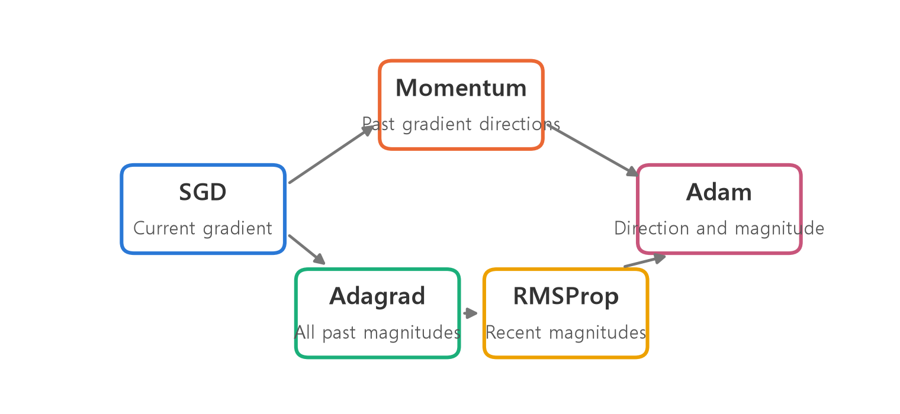
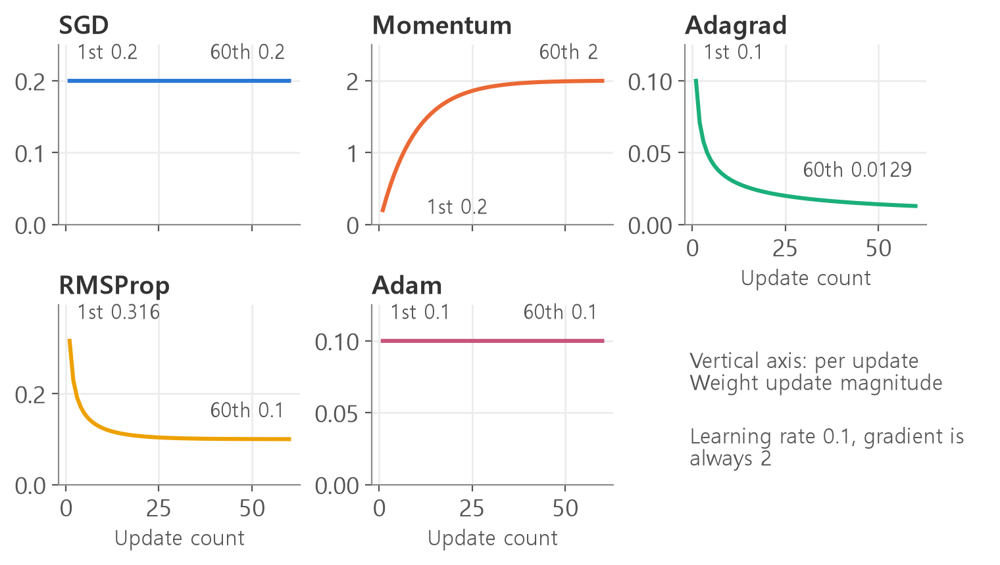
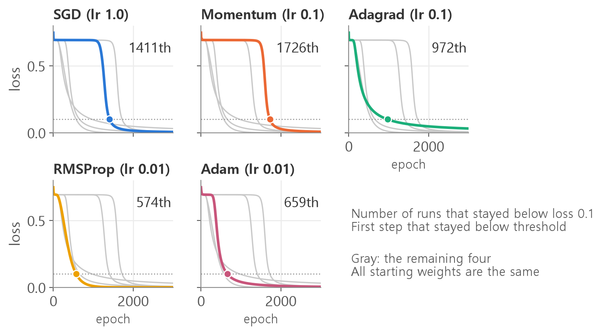
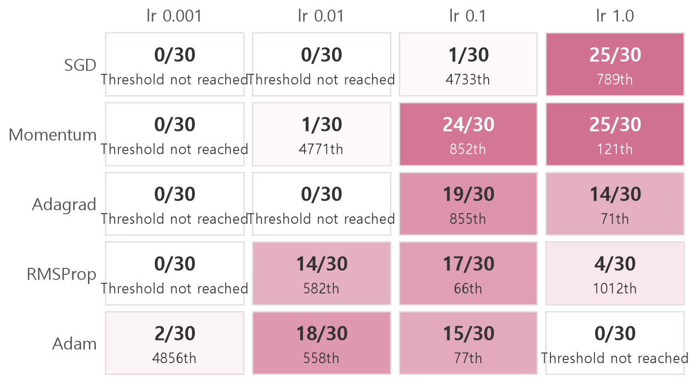
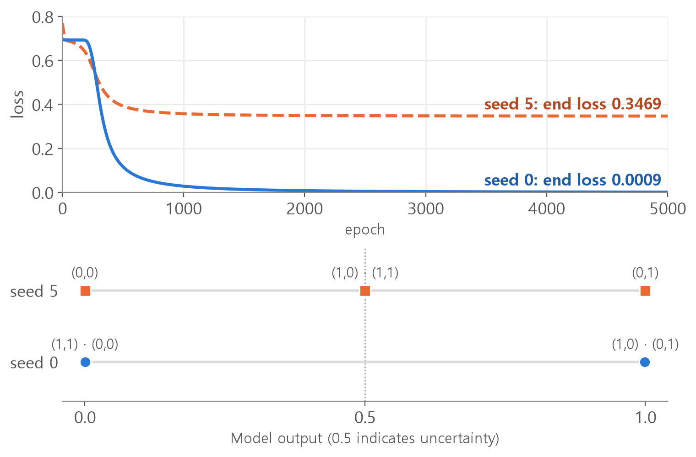
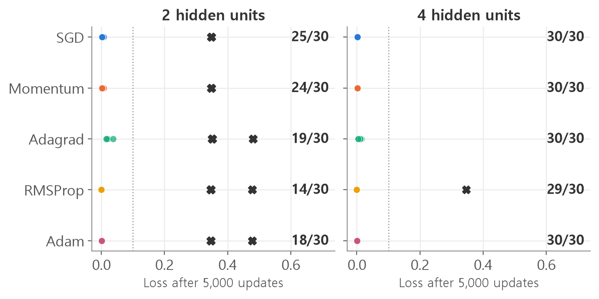

<style>
.content table { width: 100%; border-collapse: collapse; margin: 14px 0 24px; font-size: 17px; line-height: 1.5; }
.content th, .content td { border-bottom: 1px solid #e6dde0; padding: 8px 10px; text-align: left; vertical-align: top; }
.content thead { background: #fbf1f4; }
.content figure { margin: 18px 0; }
.content figure img { width: 100%; height: auto; }
.content td, .content th { word-break: keep-all; overflow-wrap: normal; }
.content .katex-display { overflow-x: auto; overflow-y: hidden; padding: 4px 0; }
.content td code { white-space: nowrap; }
.content pre .nb { padding: 0; border: 0; border-radius: 0; background: none; }
@media (max-width: 560px) { .content th, .content td { padding: 7px 5px; font-size: 16px; } }
</style>
<link rel="stylesheet" href="https://cdn.jsdelivr.net/npm/katex@0.16.11/dist/katex.min.css">
<script defer src="https://cdn.jsdelivr.net/npm/katex@0.16.11/dist/katex.min.js"></script>
<script defer src="https://cdn.jsdelivr.net/npm/katex@0.16.11/dist/contrib/auto-render.min.js" onload="renderMathInElement(document.querySelector('.content')||document.body,{delimiters:[{left:'\\[',right:'\\]',display:true},{left:'\\(',right:'\\)',display:false}]})"></script>

<div class="wc"><p><b>Why learn about optimizers?</b><br>
An optimizer uses gradients to update a model’s parameters. PyTorch provides them in <a href="https://docs.pytorch.org/docs/stable/optim.html"><code>torch.optim</code></a>.<br>
PyTorch’s <a href="https://docs.pytorch.org/tutorials/intermediate/reinforcement_q_learning.html">DQN tutorial</a> uses <code>optim.AdamW</code> to train its network.<br>
Reading the optimizer calls helps you find where parameters change and where to look if training stalls. (As of November 4, 2026)</p></div>

Work through the optimizer calls one piece at a time, then compare five optimizers on the same problem. Results were recorded with PyTorch 2.11 on a CPU.

**What optimizers do → Training loop → Five update rules → Learning rates and starting weights → Common mistakes**

<div class="keyline">First, let's look at what the optimizer does.</div>

## <span class="no">1</span> What the optimizer does

An optimizer adjusts weights using their gradients. Start with four terms.

| Term | Meaning |
|---|---|
| Weight | A model parameter that changes during training |
| Loss | A measure of prediction error. Lower is better |
| Gradient | How the loss changes as a weight increases |
| Learning rate (lr) | A factor that controls how large an update is |

The simplest weight update is:

$$w_{new} = w_{old} - \eta \, g$$

$$w$$ is the weight, $$\eta$$ is the learning rate, and $$g$$ is the gradient. If $$w=10$$, $$g=2$$, and $$\eta=0.1$$, then $$10 - 0.1 \times 2 = 9.8$$.

Optimizers use different rules to determine the update. Some keep track of past gradient directions, some track magnitudes, and Adam combines the two.

<figure></figure>

For the underlying theory, see [Gradient Descent Explained](/en/2026/10/26/gradient-descent-init/). Here we focus on the code.

## <span class="no">2</span> Build the XOR model and read its optimizer

XOR returns 1 when its two inputs differ and 0 when they match. Install PyTorch with `pip install torch` if needed.

```python
# Tensor Calculation Tool
import torch
# Collection of model parts
import torch.nn as nn

# 4 examples with 2 features each
X = torch.tensor(
    [[0., 0.], [0., 1.],
     [1., 0.], [1., 1.]])
# 4 labels
y = torch.tensor(
    [[0.], [1.], [1.], [0.]])
```

Put the model definition in a function.

```python
def make_model(hidden=2):
    return nn.Sequential(
        nn.Linear(2, hidden),
        nn.Sigmoid(),
        nn.Linear(hidden, 1),
        nn.Sigmoid(),
    )

torch.manual_seed(42)  # random number fixed
model = make_model()
n = 0
for p in model.parameters():
    n += p.numel()  # add count
print(n)
```

```text
9
```

The model has nine trainable parameters.

| Code | Meaning |
|---|---|
| `def` | Define a function. Its body runs when you call it |
| `return` | Return a value to the caller |
| `hidden=2` | Use two hidden units by default |
| `nn.Sequential` | Run the layers in the order listed |
| `nn.Linear` | Compute a weighted sum plus a bias |
| `nn.Sigmoid` | Map a number to the interval between 0 and 1 |
| `manual_seed` | Set the random seed used before initialization |

The number entered into `manual_seed` is called **seed**. If the seeds are the same, the starting weights are also the same.

The optimizer is created by one call, split across several lines for readability.

```python
optimizer = torch.optim.SGD(
    model.parameters(),
    lr=1.0,
)
```

| code snippet | Meaning |
|---|---|
| `optimizer =` | Name the one on the right `optimizer`. |
| `torch.optim.SGD` | Look up SGD in `torch.optim` |
| `( ... )` | Call it with comma-separated arguments |
| `model.parameters()` | Pass in the model’s trainable parameters |
| `lr=1.0` | Option name and value |

**Why pass the model’s parameters?** The optimizer only updates the parameters it receives. If you call `make_model()` again, create a new optimizer for the new model.

## <span class="no">3</span> Three lines used in the training loop

Call `optimizer.zero_grad()`, then `loss.backward()`, then `optimizer.step()`. Print one weight and its gradient to see what changes.

```python
# binary cross-entropy loss
criterion = nn.BCELoss()
# Weight of first part
w = model[0].weight

def show(name):
    g = w.grad
    if g is not None:
        g = g[0, 0].item()
        g = round(g, 4)
    v = w[0, 0].item()
    v = round(v, 4)
    print(name, g, v)

# prediction
y_pred = model(X)
# grading
loss = criterion(y_pred, y)
show("Initial")
# Clear Tilt
optimizer.zero_grad()
# Gradient Calculation
loss.backward()
show("After backward")
# Weight modification
optimizer.step()
show("After step")
optimizer.zero_grad()
show("After zero_grad")
```

| Stage | Weight | Gradient |
|---|---|---|
| Initial | 0.5406 | `None` |
| After `backward()` | 0.5406 | −0.004 |
| After `step()` | 0.5446 | −0.004 |
| After `zero_grad()` | 0.5446 | `None` |

`show` prints the values for inspection. `None` means that no gradient is stored. **`backward()` computes gradients and `step()` updates weights.** Plugging in the numbers gives $$0.5406 - 1.0 \times (-0.004) = 0.5446$$.

Now run the full training loop.

```python
torch.manual_seed(42)
model = make_model()
optimizer = torch.optim.SGD(
    model.parameters(),
    lr=1.0)

for epoch in range(2000):
    y_pred = model(X)
    loss = criterion(y_pred, y)
    optimizer.zero_grad()
    loss.backward()
    optimizer.step()
    if epoch % 500 == 0:
        v = loss.item()
        print(epoch, round(v, 4))

# Turn off calculation history
with torch.no_grad():
    print(model(X).flatten())
```

```text
0 0.7482
500 0.6931
1000 0.6917
1500 0.0573
tensor([0.0181, 0.9862, 0.9862, 0.0149])
```

The last line shows predictions close to the labels 0, 1, 1, and 0.

Here are the new expressions in that loop.

| Code | Meaning |
|---|---|
| `for epoch in range(2000):` | Repeat the indented lines 2000 times. `epoch` is numbered 0, 1, 2 |
| `epoch % 500 == 0` | Only when the remainder after dividing by 500 is 0, i.e. every 500 times |
| `loss.item()` | Take one number out of a tensor |
| `torch.no_grad()` | Disable gradient recording for evaluation |
| `.flatten()` | Flatten the output into one dimension |

## <span class="no">4</span> Five optimizers in equations and code

**Only the `optimizer =` line changes.** To see each rule in isolation, update one weight three times with a constant gradient of 2. The loss `loss = 2 * w` gives that gradient.

```python
def three_steps(w, optimizer):
    for step in range(3):
        loss = 2 * w
        optimizer.zero_grad()
        loss.backward()
        optimizer.step()
        print(round(w.item(), 4))

def new_w():
    return torch.tensor(
        10.0, requires_grad=True)
```

`requires_grad=True` enables gradient tracking for the weight. The list `[w]` tells the optimizer which parameter to update.

### SGD uses the current gradient

$$w \leftarrow w - \eta \, g$$

```python
w = new_w()
opt = torch.optim.SGD(
    [w], lr=0.1)
three_steps(w, opt)
```

```text
9.8
9.6
9.4
```

It moves by 0.2 each time.

### Momentum carries forward past gradients

$$v \leftarrow \mu v + g, \qquad w \leftarrow w - \eta \, v$$

$$v$$ stores the accumulated gradient and $$\mu$$ controls how much of the previous value carries forward. A common setting is 0.9. Here $$v$$ progresses from 2 to $$0.9 \times 2 + 2 = 3.8$$ and then to $$0.9 \times 3.8 + 2 = 5.42$$.

```python
w = new_w()
opt = torch.optim.SGD(
    [w], lr=0.1,
    momentum=0.9)
three_steps(w, opt)
```

```text
9.8
9.42
8.878
```

When gradients keep pointing in the same direction, updates grow larger.

If the gradient changes from +2 to −2, $$v$$ becomes $$0.9 \times 2 - 2 = -0.2$$. That damps back-and-forth movement. In PyTorch, momentum is an option on SGD.

### Adagrad accumulates squared gradients

$$s \leftarrow s + g^2, \qquad w \leftarrow w - \frac{\eta}{\sqrt{s}+\epsilon} \, g$$

$$s$$ is the running sum of squared gradients. The small positive value $$\epsilon$$ prevents division by zero. Ignoring $$\epsilon$$, the magnitude of the first update is $$\left|\frac{\eta}{\sqrt{g^2}} g\right|=\eta$$ for nonzero $$g$$. This normalizes the update across gradient magnitudes.

```python
w = new_w()
opt = torch.optim.Adagrad(
    [w], lr=0.1)
three_steps(w, opt)
```

```text
9.9
9.8293
9.7716
```

As $$s$$ grows to 4, 8, and 12, the update magnitude falls to 0.1, 0.0707, and 0.0577.

### RMSprop emphasizes recent magnitudes

$$s \leftarrow \rho s + (1-\rho) g^2, \qquad w \leftarrow w - \frac{\eta}{\sqrt{s}+\epsilon} \, g$$

$$\rho$$ controls how much of the previous average remains. At 0.9, combine 90% of the previous value with 10% of the new squared gradient. PyTorch calls this option `alpha`. The class is spelled `RMSprop` and its default `alpha` is 0.99.

```python
w = new_w()
opt = torch.optim.RMSprop(
    [w], lr=0.1,
    alpha=0.9)
three_steps(w, opt)
```

```text
9.6838
9.4544
9.2623
```

$$s$$ starts at 0.4, rises to 0.76 and 1.084, and approaches 4.

### Adam combines direction and magnitude

$$m \leftarrow \beta_1 m + (1-\beta_1) g, \qquad v \leftarrow \beta_2 v + (1-\beta_2) g^2$$

$$\hat m = \frac{m}{1-\beta_1^t}, \qquad \hat v = \frac{v}{1-\beta_2^t}, \qquad w \leftarrow w - \frac{\eta}{\sqrt{\hat v}+\epsilon} \, \hat m$$

$$m$$ and $$v$$ are moving averages of the gradient and its square, and $$t$$ counts the updates. The defaults are $$\beta_1=0.9$$ and $$\beta_2=0.999$$. Since $$m$$ and $$v$$ start at zero, $$\hat m$$ and $$\hat v$$ correct their initial bias. On the first update, $$m=0.2$$ becomes $$0.2 \div 0.1=2$$ after correction.

```python
w = new_w()
opt = torch.optim.Adam(
    [w], lr=0.1)
three_steps(w, opt)
```

```text
9.9
9.8
9.7
```

With a constant positive gradient, $$\hat m/\sqrt{\hat v}=1$$. Ignoring the small epsilon term, the update magnitude is the learning rate.

Plot the first 60 updates to see the differences.

<figure></figure>

Adagrad keeps reducing the update as $$s$$ grows. RMSprop’s update instead approaches 0.1.

## <span class="no">5</span> Compare the same starting weights

Run all five optimizers on XOR. Define one function to select the optimizer by name and another to train.

```python
def make_opt(name, p, lr):
    o = torch.optim
    if name == "SGD":
        return o.SGD(p, lr=lr)
    if name == "Momentum":
        return o.SGD(p, lr=lr,
                     momentum=0.9)
    if name == "Adagrad":
        return o.Adagrad(p, lr=lr)
    if name == "RMSprop":
        return o.RMSprop(p, lr=lr,
                         alpha=0.9)
    if name == "Adam":
        return o.Adam(p, lr=lr)

def train(name, lr, seed,
          hidden=2, epochs=5000):
    torch.manual_seed(seed)
    model = make_model(hidden)
    optimizer = make_opt(
        name,
        model.parameters(),
        lr)
    losses = []
    for epoch in range(epochs):
        y_pred = model(X)
        loss = criterion(
            y_pred, y)
        optimizer.zero_grad()
        loss.backward()
        optimizer.step()
        v = loss.item()
        losses.append(v)
    return model, losses

# When loss starts to stay below 0.1
def stay_time(ls):
    last = -1
    for i, v in enumerate(ls):
        if v >= 0.1:
            last = i
    return last + 1

runs = [("SGD", 1.0),
        ("Momentum", 0.1),
        ("Adagrad", 0.1),
        ("RMSprop", 0.01),
        ("Adam", 0.01)]
for name, lr in runs:
    model, losses = train(
        name, lr, 42)
    t = stay_time(losses)
    v = round(losses[-1], 4)
    print(name, t, v)
```

| Code | Meaning |
|---|---|
| `if name == "SGD":` | Execute the line below only when the name is SGD. `==` compares for equality. |
| `train` | This is a function that bundles the loop statement seen earlier. Collect losses in `losses` |
| `enumerate` | Take out the number and value together. |
| `for name, lr in runs:` | Remove the name and lr pair from `runs` one by one. |
| `o = torch.optim` | Shorten long names to ‘o’ |

`train` resets the seed each time so all five runs start with the same weights.

| Optimizer | Learning rate | First step that stayed below 0.1 | Final loss |
|---|---|---|---|
| SGD | 1.0 | 1411 | 0.0026 |
| Momentum | 0.1 | No. 1726 | 0.0029 |
| Adagrad | 0.1 | No. 972 | 0.0189 |
| RMSProp | 0.01 | No. 574 | 0.0000 |
| Adam | 0.01 | No. 659 | 0.0013 |

<figure></figure>

The plateau near 0.69 corresponds to predictions around 0.5 for all four inputs. A prediction of 0.5 gives [a binary cross-entropy loss of 0.693](/en/2026/11/04/xor-training-loop/).

**The table describes a single seed with different learning rates.** With the same seed, Momentum at `lr=1.0` reaches the threshold at step 159. The next experiment uses four learning rates and 30 seeds, 0 through 29, for each optimizer, with 5,000 updates per run.

<figure></figure>

Each cell shows how many of 30 runs reached and stayed below loss 0.1 within 5,000 updates. The lower number is the median step among those runs. RMSprop uses `alpha=0.9`.

- **Momentum reached the threshold faster at matched learning rates in this experiment.** At 1.0, both succeeded for 25 seeds. The median was 789 steps for SGD and 121 for Momentum. At 0.1, SGD succeeded for one seed and Momentum for 24.
- **The best learning rate varies by optimizer.** Of the four tested values, SGD succeeded most often at 1.0. Adam had zero successes at that setting.
- **Leaving out the learning rate uses a default.** The defaults are 0.001 for SGD, 0.01 for Adagrad, 0.01 for RMSprop, and 0.001 for Adam. Adam at 0.001 succeeded for 2 of 30 seeds in 5,000 updates.

Retune the learning rate when switching optimizers. These results describe a small XOR model under the tested settings.

## <span class="no">6</span> Compare different starting weights

The same code can behave differently with a different initialization. Keep Adam at `lr=0.01` and change only the seed.

```python
for seed in [5, 0]:
    model, losses = train(
        "Adam", 0.01, seed)
    with torch.no_grad():
        p = model(X).flatten()
    v = round(losses[-1], 4)
    print(seed, v)
    print(p)
```

```text
5 0.3469
tensor([4.3269e-04, 9.9952e-01, 4.9992e-01, 5.0011e-01])
0 0.0009
tensor([1.0516e-03, 9.9910e-01, 9.9910e-01, 8.2465e-04])
```

The notation `e-04` means moving the decimal point four places to the left. The table shows the raw probabilities.

| input | Correct answer | Seed 5's answer | Seed 0's answer |
|---|---|---|---|
| 0, 0 | 0 | 0.00043 | 0.00105 |
| 0, 1 | 1 | 0.99952 | 0.99910 |
| 1, 0 | 1 | 0.49992 | 0.99910 |
| 1, 1 | 0 | 0.50011 | 0.00082 |
| Based on 0.5 | 0 1 1 0 | 0 1 0 1 | 0 1 1 0 |

<figure></figure>

**Why is seed 5’s loss near 0.3466?** Two predictions are nearly correct and the others are near 0.5, giving $$(0 + 0 + 0.693 + 0.693) \div 4=0.3466$$. Values just below and just above 0.5 become different labels after thresholding. Inspect the raw probabilities to see how close they really are.

**Why does training stall?** It reaches a flat region with a very small gradient. For seed 5, the norm across all nine gradient components goes from 0.243 at initialization to 0.00016 at step 5,000. Small changes to the weights barely affect the loss there.

The other optimizers can stall too. Test 30 seeds with a suitable learning rate, then repeat with four hidden units.

<figure></figure>

An X marks a stalled run. Near loss 0.48, the model predicts one input confidently and gives the other three the same probability, either $$\frac{2}{3}$$ or $$\frac{1}{3}$$. The mean loss is $$(0 + 0.405 + 0.405 + 1.099) \div 4=0.477$$.

| What to do when you're stuck | Code |
|---|---|
| Take a look at the actual values | `print(model(X).flatten())` |
| Change starting weight | Change `torch.manual_seed` number |
| Widen the hidden layer | `nn.Linear(2, 4)`, `nn.Linear(4, 1)` |

With four hidden units, RMSprop still stalled on one of 30 seeds. Widening helped in this experiment without guaranteeing convergence.

## <span class="no">7</span> Summary of common mistakes and functions

**Mistake 1. Missing the parentheses of `zero_grad`.** It is difficult to find because there is no error.

```python
# ❌
torch.manual_seed(3)
model = make_model()
optimizer = torch.optim.SGD(
    model.parameters(),
    lr=1.0)
for epoch in range(1000):
    y_pred = model(X)
    loss = criterion(y_pred, y)
    optimizer.zero_grad
    loss.backward()
    optimizer.step()
    if epoch % 200 == 0:
        v = loss.item()
        print(epoch, round(v, 4))
print(round(loss.item(), 4))
```

```text
0 0.7112
200 0.4883
400 0.4934
600 0.4977
800 0.5005
0.4978
```

After step 200, the loss fluctuates between 0.49 and 0.50 without falling further.

A function name without parentheses does not call the function. The gradients keep accumulating and can produce larger updates. Use `optimizer.zero_grad()`.

Calling the function gives a final loss of 0.0349 for the same seed. Across 30 seeds trained for 1,000 updates, omitting the call reduced the number that correctly classified all four inputs from 18 to 12, yet it lowered final loss in 19 runs. Check the code even when the loss looks reasonable.

**Mistake 2. Incorrect case.**

```python
# ❌
torch.optim.adagrad(
    model.parameters(), lr=0.1)
```

```text
AttributeError: module 'torch.optim' has no attribute 'adagrad'
```

`AttributeError` means there is no such name. Python has different names for uppercase and lowercase letters. Correct names are `SGD`, `Adagrad`, `RMSprop`, and `Adam`.

**Mistake 3. Passing parameters from the wrong model.** The optimizer updates the model it received at creation. A newly created model’s loss may stay flat without an error. See [the gradient descent comparison](/en/2026/11/04/batch-sgd-mini-batch/).

### Functions used in this article

`optim` in the table is an abbreviation of `torch.optim`.

| function | Purpose |
|---|---|
| `torch.manual_seed` | Set the seed before initializing weights |
| `model.parameters()` | Return the model parameters |
| `optim.SGD` | Use gradient only, `momentum=` is optional |
| `optim.Adagrad` | Accumulate squared gradients |
| `optim.RMSprop` | Average recent squared gradients, with optional `alpha=` |
| `optim.Adam` | Combine gradient and squared-gradient averages |
| `optimizer.zero_grad()` | Clear accumulated gradients |
| `loss.backward()` | Compute gradients |
| `optimizer.step()` | Update the weights |
| `loss.item()` | take out a number |
| `torch.no_grad()` | Disable gradient recording |

<div class="done">🎉 You can now read the optimizer call and trace where a PyTorch model’s weights change.</div>
