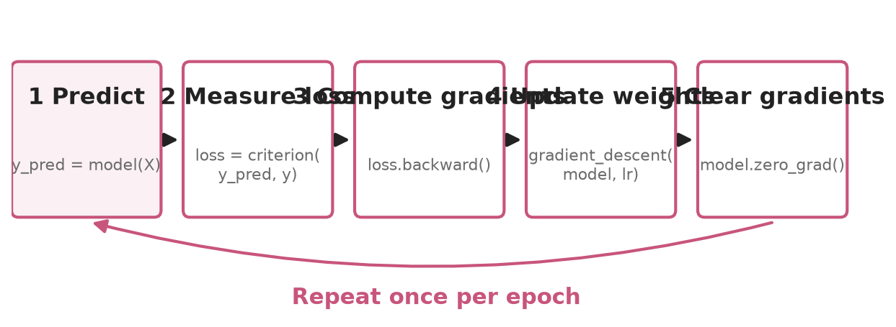
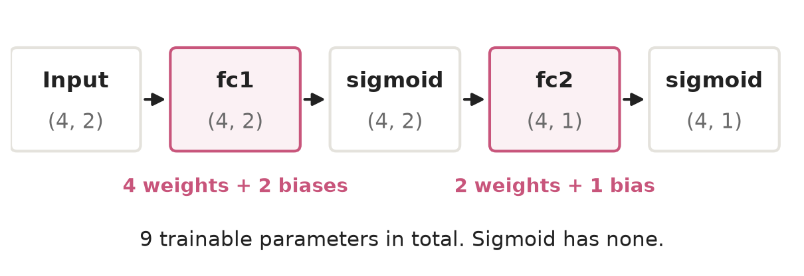
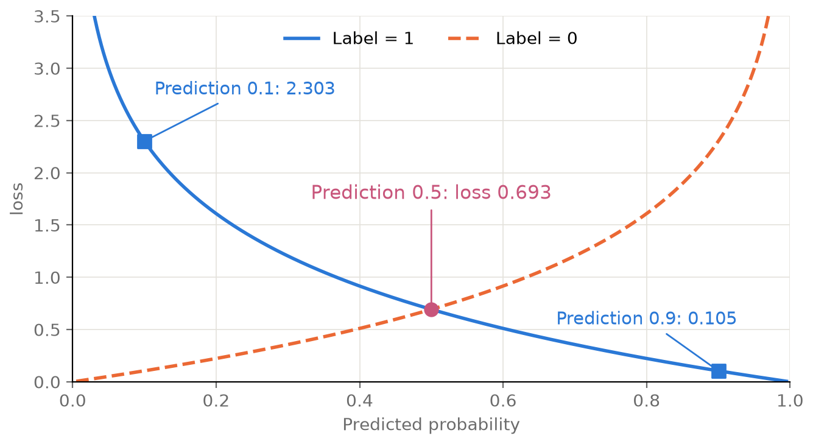
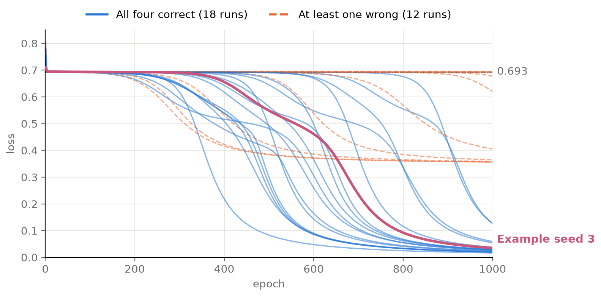
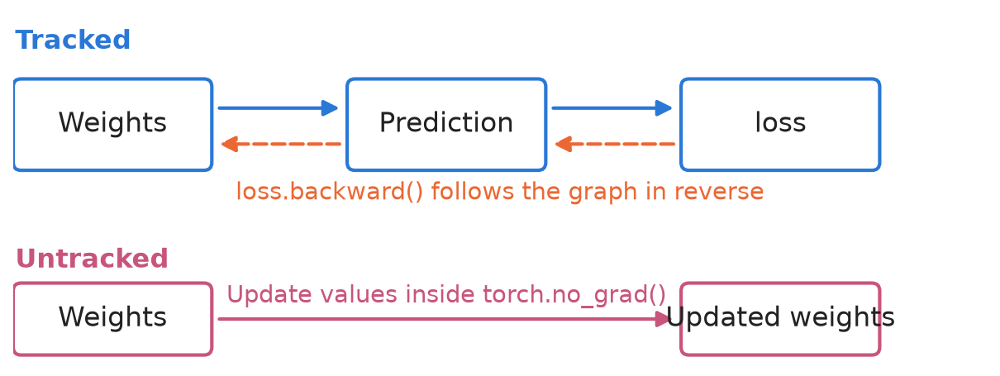

<style>
.content table { width: 100%; border-collapse: collapse; margin: 14px 0 24px; font-size: 17px; line-height: 1.5; }
.content th, .content td { border-bottom: 1px solid #e6dde0; padding: 8px 10px; text-align: left; vertical-align: top; }
.content thead { background: #fbf1f4; }
.content figure { margin: 18px 0; }
.content figure img { width: 100%; height: auto; }
.content td, .content th { word-break: keep-all; overflow-wrap: normal; }
.content .katex-display { overflow-x: auto; overflow-y: hidden; padding: 4px 0; }
.content td code { white-space: normal; overflow-wrap: anywhere; }
.content pre .nb { padding: 0; border: 0; border-radius: 0; background: none; }
@media (max-width: 560px) { .content th, .content td { padding: 7px 5px; font-size: 16px; } }
</style>
<link rel="stylesheet" href="https://cdn.jsdelivr.net/npm/katex@0.16.11/dist/katex.min.css">
<script defer src="https://cdn.jsdelivr.net/npm/katex@0.16.11/dist/katex.min.js"></script>
<script defer src="https://cdn.jsdelivr.net/npm/katex@0.16.11/dist/contrib/auto-render.min.js" onload="renderMathInElement(document.querySelector('.content')||document.body,{delimiters:[{left:'\\[',right:'\\]',display:true},{left:'\\(',right:'\\)',display:false}]})"></script>

<div class="wc"><p><b>Why learn the training loop first?</b><br>
The loop trains a model by repeatedly making predictions, measuring loss, computing gradients, and updating weights.<br>
PyTorch’s <a href="https://docs.pytorch.org/tutorials/intermediate/reinforcement_q_learning.html">DQN tutorial</a> updates weights with the same <code>backward</code> and <code>step</code> calls.<br>
Once you know the loop, you can spot where learning happens in reinforcement learning code. (Checked November 4, 2026.)</p></div>

These seven sections walk through XOR with `nn.Module`. The reported results come from runs with PyTorch 2.11.

<div class="keyline">Start with the five steps. Fill in the code once you can see where each line belongs.</div>

## <span class="no">1</span> The five steps of training

Make a prediction, measure the loss, compute gradients, update the weights, and clear the gradients.

<figure></figure>

Try naming the steps in order with the code covered.

| How to practice | Which code | Why |
|---|---|---|
| Type it yourself | The model class and training loop | You will see them in other models |
| Paste it | The gradient descent helper and diagnostic `print` calls | You can read them once you have the main flow |
| Look it up | Names such as `nn.BCELoss` | The documentation lists the exact APIs |

If a blank page feels hard to start from, paste the scaffold and fill in each `____`.

## <span class="no">2</span> Four mistakes in the input data

Create floating-point tensors with shapes `(4, 2)` for inputs `X` and `(4, 1)` for labels `y`.

```py
# ❌
X = tensor([0,0], [0,1], [1,0], [1,1]).float
y = tensor(0, 1, 1, 0).float
```

Use this version for the rest of the exercise.

```python
# ✅
import torch
import torch.nn as nn

X = torch.tensor([[0,0], [0,1], [1,0], [1,1]]).float()
y = torch.tensor([[0], [1], [1], [0]]).float()
print(X.shape, y.shape)
```

```text
torch.Size([4, 2]) torch.Size([4, 1])
```

There are two input values per row and one label per row.

| Mistake | Fix | Why |
|---|---|---|
| `tensor(...)` | `torch.tensor(...)` | `tensor` belongs to `torch` |
| Separate comma-delimited arguments | Wrap them in outer brackets | The constructor takes a single data object |
| `.float` | `.float()` | The parentheses call the conversion method |
| `[0, 1, 1, 0]` | `[[0], [1], [1], [0]]` | The labels now match the model output shape `(4, 1)` |

## <span class="no">3</span> The MLP class and in_features

Define the layers in `__init__` and put them in execution order in `forward`. See the [nn.Module walkthrough](/en/2026/11/04/nn-module-shape-dim/) for more on this structure.

**Type it yourself.** Paste the scaffold and fill in the five blanks.

```python
class MLP(____):
    def __init__(self):
        super().__init__()
        self.fc1 = nn.Linear(____)
        self.fc2 = nn.Linear(2, 1)
        self.sigmoid = ____

    def forward(self, x):
        x = self.fc1(x)
        x = self.sigmoid(x)
        x = ____
        x = ____
        return x
```

| Blank | Code |
|---|---|
| 1 | `nn.Module` |
| 2 | `2, 2` |
| 3 | `nn.Sigmoid()` |
| 4 | `self.fc2(x)` |
| 5 | `self.sigmoid(x)` |

```python
torch.manual_seed(0)
model = MLP()
print(model)
print(model(X).shape)
```

```text
MLP(
  (fc1): Linear(in_features=2, out_features=2, bias=True)
  (fc2): Linear(in_features=2, out_features=1, bias=True)
  (sigmoid): Sigmoid()
)
torch.Size([4, 1])
```

The final `torch.Size([4, 1])` means the model produces one output for each of the four rows.

`in_features` counts the values entering a layer per row, and `out_features` counts the values leaving it. For `X` of shape `(4, 2)`, `in_features` is 2. The 4 counts the rows in the batch.

`bias=True` lets the layer learn an additive bias. It computes one output as follows.

$$\text{output} = w_1 x_1 + w_2 x_2 + b$$

$$w$$ represents the weights, $$x$$ the input, and $$b$$ the bias. With $$w=(0.5,-0.3)$$, $$b=0.1$$, and input $$(0,1)$$, the output is $$0.5 \times 0 - 0.3 \times 1 + 0.1 = -0.2$$.

<figure></figure>

## <span class="no">4</span> BCELoss and the 0.693 baseline

`nn.BCELoss` measures the error in a probability prediction when the label is 0 or 1. BCE stands for binary cross-entropy.

$$l = -[y \log p + (1 - y) \log (1 - p)]$$

$$L = \frac{1}{N}\sum_{n=1}^{N} l_n$$

$$y$$ is the label, $$p$$ the predicted probability, $$l$$ the loss for one row, and $$N$$ the number of rows. $$\log$$ is the natural logarithm. The sigmoid at the end of `forward` keeps the prediction between 0 and 1.

A prediction of 0.5 gives $$-\log 0.5 \approx 0.693$$ for either label. **If the model predicts 0.5 for every input, its average loss is about 0.693.**

<figure></figure>

**Type it yourself.** Start with the first line.

```python
criterion = nn.BCELoss()
print(criterion(model(X), y))
```

```text
tensor(0.6977, grad_fn=<BinaryCrossEntropyBackward0>)
```

The untrained model starts close to the 0.693 baseline. `grad_fn` shows that PyTorch recorded the computation, which `loss.backward()` uses in the next step. To implement the formula by hand, see [forward and backpropagation with XOR](/en/2026/11/03/xor-forward-backprop/).

## <span class="no">5</span> The training loop and zero_grad

Write the five steps as five lines in the loop. First, define the function that updates the weights.

$$\theta_{new} = \theta_{old} - \eta \nabla L$$

$$\theta$$ contains weights and biases, $$\eta$$ is the learning rate, and $$\nabla L$$ is the gradient. If a weight is 0.5, its gradient is 0.2, and the learning rate is 1.0, its new value is $$0.5 - 1.0 \times 0.2 = 0.3$$.

**Paste this helper.** In ordinary PyTorch code, `optimizer.step()` does the update.

```python
def gradient_descent(model, lr):
    with torch.no_grad():
        for param in model.parameters():
            param -= lr * param.grad
```

**Type it yourself.** Fill in the five lines of the training loop.

```python
torch.manual_seed(3)
model = MLP()
model.train()

for epoch in range(1000):
    y_pred = ____
    loss = ____
    ____
    ____
    ____

    if (epoch + 1) % 100 == 0:
        print(epoch + 1, round(loss.item(), 4))
```

| Step | Code | What it does |
|---|---|---|
| 1 | `model(X)` | Makes predictions |
| 2 | `criterion(y_pred, y)` | Measures the loss |
| 3 | `loss.backward()` | Computes gradients |
| 4 | `gradient_descent(model, 1.0)` | Updates weights |
| 5 | `model.zero_grad()` | Clears gradients |

| Epoch | Loss | Trend |
|---|---|---|
| 100, 200, 300 | 0.6933, 0.6927, 0.69 | Near 0.693 |
| 400, 500, 600 | 0.6559, 0.5486, 0.4613 | Begins falling |
| 700, 800 | 0.2351, 0.0924 | Falls rapidly |
| 900, 1000 | 0.0516, 0.0349 | Approaches zero |

**Why clear the gradients?** PyTorch [accumulates gradients by default](https://docs.pytorch.org/tutorials/beginner/basics/optimization_tutorial.html). If you leave the previous gradient in place, the next backward pass adds to it.

```python
w = torch.tensor(2.0, requires_grad=True)
(3 * w).backward()
print(w.grad)
(3 * w).backward()
print(w.grad)
```

```text
tensor(3.)
tensor(6.)
```

The derivative of $$3w$$ is 3. Calling `backward()` a second time without clearing the gradient gives 6.

**Training can stall even with the correct code.** The following run varied the random seed from 0 to 29 and kept the learning rate at 1.0 and training at 1,000 epochs.

<figure></figure>

| Outcome | Runs | Final loss |
|---|---|---|
| All four inputs correct | 18 | 0.017 to 0.127 |
| At least one input incorrect | 12 | 0.356 to 0.693 |

The seeds only changed the initial parameters. If your loss stays between 0.35 and 0.7, try a different value in `torch.manual_seed`.

## <span class="no">6</span> Check predictions with no_grad and eval

`torch.no_grad()` temporarily disables gradient recording. Use it for manual weight updates and for predictions you only want to inspect.

<figure></figure>

The arithmetic still runs, so the weight values change. Inside the update helper, omitting the `no_grad` block raises this error.

```python
# ❌
param -= lr * param.grad
```

```text
RuntimeError: a leaf Variable that requires grad is being used in an in-place operation.
```

The update tried to modify a parameter in place while PyTorch was tracking its gradients.

**Type it yourself.** After training, switch to evaluation mode and make predictions with gradient recording off.

```python
model.eval()
with torch.no_grad():
    y_pred = model(X)
print(y_pred.flatten())
print((y_pred > 0.5).float().flatten())
```

```text
tensor([0.0241, 0.9694, 0.9692, 0.0511])
tensor([0., 1., 1., 0.])
```

| Input | Prediction | Class at threshold 0.5 | Label |
|---|---|---|---|
| `[0, 0]` | 0.0241 | 0 | 0 |
| `[0, 1]` | 0.9694 | 1 | 1 |
| `[1, 0]` | 0.9692 | 1 | 1 |
| `[1, 1]` | 0.0511 | 0 | 0 |

This model gives the same predictions in `train` and `eval` modes. The mode affects layers such as [Dropout and BatchNorm](https://docs.pytorch.org/docs/stable/generated/torch.nn.Module.html), which the MLP does not use. Calling `eval()` is still a good habit for inference.

## <span class="no">7</span> What changes in reinforcement learning

Reinforcement learning uses the same pattern to compute gradients and update weights. The data, model, and loss change.

First, replace the manual gradient descent helper with `torch.optim`.

```python
torch.manual_seed(3)
model = MLP()
optimizer = torch.optim.SGD(model.parameters(), lr=1.0)

for epoch in range(1000):
    y_pred = model(X)
    loss = criterion(y_pred, y)
    loss.backward()
    optimizer.step()
    optimizer.zero_grad()
print(loss.item())
```

```text
0.034896522760391235
```

The final loss matches the manual run at epoch 1,000.

The [PyTorch DQN tutorial](https://docs.pytorch.org/tutorials/intermediate/reinforcement_q_learning.html) uses the same slots for a different problem.

| Role | XOR example | DQN tutorial |
|---|---|---|
| Data | Four fixed rows | A sample of 128 transitions from replay memory |
| Target | `y` | Reward plus the discounted value of the next state from `target_net`, where applicable |
| Prediction | `model(X)` | Values from `policy_net` for the actions actually taken |
| Loss | `BCELoss` | `SmoothL1Loss` |
| Update | An SGD `step` | Gradient clipping followed by an AdamW `step` |

The tutorial clears gradients just before `loss.backward()`. You can also clear them after `step()`, as long as each new backward pass starts with cleared gradients and the optimizer gets to use them first.

In unfamiliar training code, find `loss.backward()`. Look above it for the data and loss, and below it for the update.

<div class="done">🎉 Predict, measure the loss, compute gradients, update the weights, and clear the gradients. That’s the training loop.</div>
