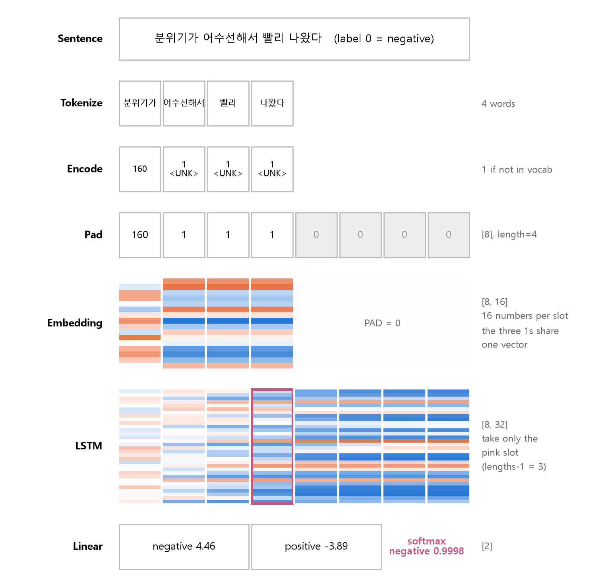
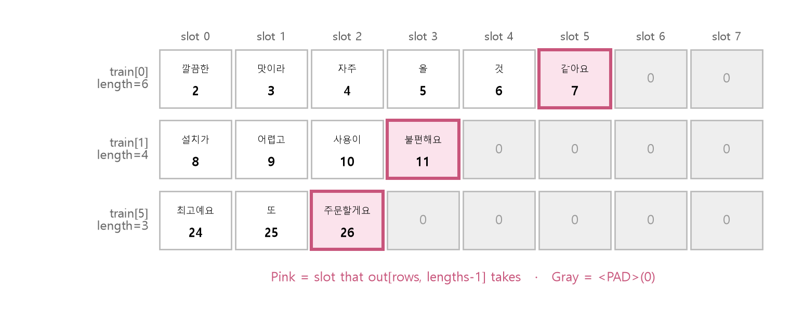
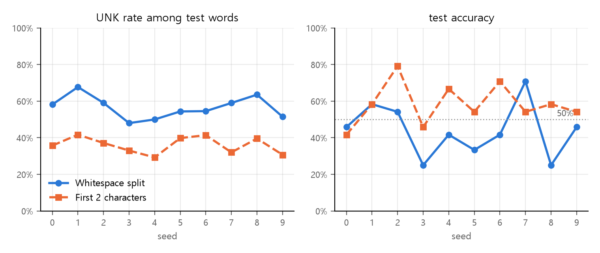

<style>
.content table { width: 100%; border-collapse: collapse; margin: 14px 0 24px; font-size: 17px; line-height: 1.5; }
.content th, .content td { border-bottom: 1px solid #e6dde0; padding: 8px 10px; text-align: left; vertical-align: top; }
.content thead { background: #fbf1f4; }
.content figure { margin: 18px 0; }
.content figure img { width: 100%; height: auto; }
.content td, .content th { word-break: keep-all; overflow-wrap: normal; }
.content .katex-display { overflow-x: auto; overflow-y: hidden; padding: 4px 0; }
.content td code { white-space: nowrap; }
.content pre .nb { padding: 0; border: 0; border-radius: 0; background: none; }
@media (max-width: 560px) { .content th, .content td { padding: 7px 5px; font-size: 16px; } }
</style>
<link rel="stylesheet" href="https://cdn.jsdelivr.net/npm/katex@0.16.11/dist/katex.min.css">
<script defer src="https://cdn.jsdelivr.net/npm/katex@0.16.11/dist/katex.min.js"></script>
<script defer src="https://cdn.jsdelivr.net/npm/katex@0.16.11/dist/contrib/auto-render.min.js" onload="renderMathInElement(document.querySelector('.content')||document.body,{delimiters:[{left:'\\[',right:'\\]',display:true},{left:'\\(',right:'\\)',display:false}]})"></script>

<div class="wc"><p><b>Why write sentiment analysis by hand?</b><br>
Sentiment analysis sorts sentences into positive and negative. It is a natural language processing (NLP) task.<br>
Splitting sentences into words and turning them into numbers for a model is the same first step in other NLP models, such as translation and chatbots.<br>
Once you write everything from tokenization to the <a href="https://docs.pytorch.org/docs/stable/generated/torch.nn.LSTM.html">LSTM</a> yourself, you can see what a library does in one line and where to look when results are bad. (As of November 9, 2026)</p></div>

We build a sentiment model end to end with 120 Korean reviews I wrote, find out why its accuracy is low, try a different tokenization, and then go over six concepts that are easy to mix up. The reviews stay in Korean because they are the source data, and an English gloss follows in parentheses the first time a Korean sentence or word is quoted.

**At a glance:** feed one test sentence into the model from this post, and it changes like this at each step. Tokenization, `<UNK>`, padding, Embedding, and taking the last slot are all in this one figure.

<figure></figure>

Run the cells from top to bottom, one after another. Each cell has a copy button at its top right, and its output is in the box right below it. Install PyTorch with `pip install torch` or run the code in Google Colab. Cells marked ❌ raise errors on purpose. The results come from torch 2.11 on CPU, and decimal values can differ slightly by environment.

<div class="keyline">We build a model that sorts reviews of restaurants, cafés, stays, and products into positive and negative.</div>

## <span class="no">1</span> Review data and tokenization

### Corpus: sentences and labels

A corpus is the collection of sentences the model learns from. Each sentence gets a correct label (positive 1, negative 0), and the two are paired as `(sentence, label)`.

```python
import random   # shuffling
import torch    # tensor operations
from torch import nn  # layers, models
# bundle tensors, split into batches
from torch.utils.data import TensorDataset, DataLoader
```

I wrote 60 positive and 60 negative reviews. Open the box below to copy them.

<details markdown="1"><summary>Show the code for 120 reviews</summary>

```python
pos = [
    "음식이 정말 맛있어요 또 올게요", "직원분들이 친절하고 분위기도 좋았어요",
    "커피 향이 진하고 맛있었다", "배송이 빨라서 기분이 좋네요",
    "가격 대비 양이 많아서 만족합니다", "방이 깨끗하고 침대가 편했어요",
    "디저트가 달지 않고 맛있어서 좋았다", "사장님이 친절해서 또 가고 싶어요",
    "포장이 꼼꼼하고 상태가 완벽했어요", "재질이 부드럽고 착용감이 좋아요",
    "국물이 진해서 정말 맛있었어요", "뷰가 예쁘고 조용해서 쉬기 좋았다",
    "설명대로 작동하고 튼튼해요", "아이가 너무 좋아해서 만족해요",
    "생각보다 훨씬 맛있네요 추천합니다", "청소가 잘 되어 있어서 깨끗했어요",
    "빵이 촉촉하고 고소해요", "응대가 빠르고 친절했습니다",
    "사이즈가 딱 맞고 예뻐요", "분위기가 아늑해서 오래 있고 싶었다",
    "가성비 최고 재구매 의사 있어요", "고기가 부드럽고 양념이 맛있었다",
    "위치가 좋아서 이동이 편했어요", "품질이 좋아서 선물용으로 추천해요",
    "매장이 넓고 깔끔해서 좋았어요", "소리가 깨끗하고 배터리도 오래가요",
    "친구들이 다 맛있다고 했어요", "직원이 친절하게 설명해 줘서 좋았다",
    "기대 이상이라 정말 만족스러웠어요", "향이 은은하고 오래가서 좋아요",
    "주차가 편하고 음식도 맛있어요", "조식이 다양하고 맛있었습니다",
    "색감이 예쁘고 마감이 깔끔해요", "처음 와 봤는데 너무 좋았어요",
    "면이 쫄깃하고 국물이 시원해요", "직원분이 웃으며 맞아 줘서 기분 좋았다",
    "화면이 선명하고 반응이 빨라요", "침구가 포근해서 푹 잤어요",
    "커피가 고소하고 디저트도 훌륭했다", "배송도 빠르고 포장도 좋았어요",
    "다시 방문하고 싶은 곳이에요", "맛도 좋고 가격도 착해요",
    "조용하고 깨끗해서 공부하기 좋아요", "설치가 쉽고 사용이 편리해요",
    "반찬이 정갈하고 맛있었어요", "생일에 갔는데 서비스가 훌륭했다",
    "신선한 재료라 맛이 좋아요", "오래 써도 튼튼하고 좋네요",
    "친절한 안내 덕분에 편하게 이용했어요", "전망이 멋지고 방도 넓었어요",
    "양이 넉넉하고 맛있어서 배불렀다", "가볍고 튼튼해서 들고 다니기 좋아요",
    "부모님도 만족하셨어요 추천합니다", "따뜻한 분위기라 마음이 편했어요",
    "디자인이 예쁘고 실용적이에요", "바삭하고 고소해서 계속 먹게 돼요",
    "친절하고 꼼꼼하게 챙겨 주셨어요", "깔끔한 맛이라 자주 올 것 같아요",
    "기능이 많고 쓰기 편해서 만족했다", "최고예요 또 주문할게요",
]
neg = [
    "음식이 너무 짜고 맛없어요", "직원이 불친절해서 기분이 나빴다",
    "커피가 밍밍하고 비싸요", "배송이 늦어서 짜증났어요",
    "가격에 비해 양이 적어서 실망했어요", "방이 더럽고 냄새가 났어요",
    "디저트가 너무 달아서 별로였다", "사장님이 무뚝뚝해서 다시 안 갈래요",
    "포장이 찢어져서 왔어요", "재질이 거칠고 금방 늘어나요",
    "국물이 싱거워서 맛이 없었어요", "시끄러워서 잠을 못 잤다",
    "설명과 다르게 작동이 안 돼요", "아이가 쓰다가 바로 고장났어요",
    "생각보다 훨씬 별로네요 비추합니다", "청소가 안 되어 있어서 지저분했어요",
    "빵이 딱딱하고 퍽퍽해요", "응대가 느리고 불친절했습니다",
    "사이즈가 작고 핏이 이상해요", "분위기가 어수선해서 빨리 나왔다",
    "돈이 아까워요 재구매 안 합니다", "고기가 질기고 양념이 짰다",
    "위치가 외져서 찾기 힘들었어요", "품질이 나빠서 환불했어요",
    "매장이 좁고 지저분해서 불편했어요", "소리가 지직거리고 배터리가 금방 닳아요",
    "친구들도 다 별로라고 했어요", "직원이 대충 설명해서 답답했다",
    "기대 이하라 정말 실망스러웠어요", "향이 독하고 금방 날아가요",
    "주차가 불편하고 음식도 늦게 나와요", "조식이 부실하고 차가웠습니다",
    "색이 사진과 다르고 마감이 엉망이에요", "처음 와 봤는데 너무 별로였어요",
    "면이 불어 있고 국물이 미지근해요", "직원분이 인사도 안 해서 기분 나빴다",
    "화면이 흐리고 반응이 느려요", "침구가 눅눅해서 잠을 설쳤어요",
    "커피가 쓰기만 하고 디저트도 별로였다", "배송도 늦고 포장도 엉망이었어요",
    "다시는 방문하고 싶지 않아요", "맛도 없고 가격도 비싸요",
    "시끄럽고 더러워서 공부하기 힘들어요", "설치가 어렵고 사용이 불편해요",
    "반찬이 성의 없고 맛없었어요", "생일에 갔는데 서비스가 엉망이었다",
    "재료가 상한 것 같아서 불안해요", "며칠 만에 부서져서 화가 나요",
    "안내가 엉망이라 이용하기 힘들었어요", "창밖이 벽이고 방도 좁았어요",
    "양이 적고 맛없어서 배고팠다", "무겁고 약해서 들고 다니기 불편해요",
    "부모님도 실망하셨어요 비추합니다", "차가운 분위기라 마음이 불편했어요",
    "디자인이 촌스럽고 쓸모없어요", "눅눅하고 기름져서 남겼어요",
    "대충대충 챙겨 줘서 불쾌했어요", "느끼한 맛이라 다시 안 올 것 같아요",
    "기능이 부족하고 쓰기 불편해서 후회했다", "최악이에요 다시는 안 시킬게요",
]
```

</details>

```python
# positive → 1, negative → 0, one list
corpus = [(s, 1) for s in pos] + [(s, 0) for s in neg]
print(len(corpus))
print(corpus[0])
print(corpus[60])
```

```text
120
('음식이 정말 맛있어요 또 올게요', 1)
('음식이 너무 짜고 맛없어요', 0)
```

The first positive review means "The food is really delicious, I'll come again." The first negative one means "The food is too salty and tastes bad."

### Tokenization: split on spaces

Tokenization cuts a sentence into pieces (tokens) that the model can handle. Here we use the simplest method: split on spaces.

```python
# sentence → list of words
def tokenize(sentence):
    # split on spaces
    return sentence.split()

# (sentence, label) → ([words], label)
data = [(tokenize(s), y) for s, y in corpus]
print(data[0])
```

```text
(['음식이', '정말', '맛있어요', '또', '올게요'], 1)
```

### Train/test split, 8:2

To know whether the model handles reviews it has never seen, we test it on sentences it did not train on. After shuffling, the first 80% becomes train and the last 20% becomes test.

```python
random.seed(0)        # fixed order
random.shuffle(data)  # mix pos, neg
n = int(len(data) * 0.8)  # 120 × 0.8 = 96
train, test = data[:n], data[n:]
print(len(train), len(test))
# label sum = number of positives
print(sum(y for _, y in train), sum(y for _, y in test))
```

```text
96 24
49 11
```

## <span class="no">2</span> Vocabulary and encoding

### Vocabulary: word → ID

A model cannot compute with letters, so we build a vocabulary that gives each word a number (ID). **Build the vocabulary from train only.** Adding test words to the vocabulary is like seeing the exam questions in advance. This is called data leakage.

```python
vocab = {}
# look at train only
for words, label in train:
    for w in words:
        if w not in vocab:
            # current size = next ID
            vocab[w] = len(vocab)
print(len(vocab))
print(list(vocab.items())[:4])
```

```text
308
[('깔끔한', 0), ('맛이라', 1), ('자주', 2), ('올', 3)]
```

`len(vocab)` is the number of words added so far, so the first word gets 0 and the next word gets 1. No separate counter variable is needed.

### Special tokens: `<PAD>`=0, `<UNK>`=1

IDs 0 and 1 are kept for special uses, and every existing word ID moves up by 2.

| Token | ID | Used for |
|---|---|---|
| `<PAD>` | 0 | Filling empty slots in short sentences |
| `<UNK>` | 1 | Words not in the vocabulary (unknown) |
| Regular words | From 2 | Words that appear in train |

```python
# old ID + 2 → 0 and 1 are free
vocab = {w: i + 2 for w, i in vocab.items()}
vocab["<PAD>"] = 0  # for empty slots
vocab["<UNK>"] = 1  # unknown words
print(len(vocab))
print(list(vocab.items())[:4])
```

```text
310
[('깔끔한', 2), ('맛이라', 3), ('자주', 4), ('올', 5)]
```

### Encoding: 1 if not in the vocabulary

Encoding turns a list of words into a list of IDs. `dict.get(key, default)` returns the default value instead of raising an error when the key is missing.

```python
def encode(words):
    # not in vocab → 1 (<UNK>)
    return [vocab.get(w, 1) for w in words]

print(train[0][0], encode(train[0][0]))
print(test[0][0], encode(test[0][0]))
```

```text
['깔끔한', '맛이라', '자주', '올', '것', '같아요'] [2, 3, 4, 5, 6, 7]
['분위기가', '어수선해서', '빨리', '나왔다'] [160, 1, 1, 1]
```

The test sentence means "The atmosphere was hectic, so we left early." Only its first word is in the vocabulary. The other three become 1.

## <span class="no">3</span> Padding and DataLoader

### Padding: equal lengths

Sentences have different numbers of words, so we make every sentence `MAX_LEN` slots long. Short ones are filled with 0 at the end, and long ones are cut. The **real length** before filling is saved separately in `lengths`. The model uses it to find the position of the last real word.

```python
MAX_LEN = 8  # 8 slots per sentence

def pad(ids):
    ids = ids[:MAX_LEN]  # cut if long
    # fill short ones with 0 (<PAD>)
    return ids + [0] * (MAX_LEN - len(ids))

def to_tensors(rows):
    X, L, Y = [], [], []
    for words, label in rows:
        ids = encode(words)[:MAX_LEN]
        # real length, before padding
        L.append(len(ids))
        X.append(pad(ids))
        Y.append(label)
    # 3 return values → 1 tuple
    return torch.tensor(X), torch.tensor(L), torch.tensor(Y)

X_train, L_train, y_train = to_tensors(train)
X_test, L_test, y_test = to_tensors(test)
print(X_train.shape, L_train.shape, y_train.shape)
print(X_train[0], L_train[0])
```

```text
torch.Size([96, 8]) torch.Size([96]) torch.Size([96])
tensor([2, 3, 4, 5, 6, 7, 0, 0]) tensor(6)
```

### Tensor → TensorDataset → DataLoader

`TensorDataset` returns the sentence, length, and label from the same row as one bundle. `DataLoader` shuffles those bundles and hands them out 32 at a time.

```python
train_ds = TensorDataset(X_train, L_train, y_train)
# reshuffle every epoch
train_dl = DataLoader(train_ds, batch_size=32,
                      shuffle=True)
# sentence count, batch count
print(len(train_ds), len(train_dl))
# (sentence, length, label)
print(train_ds[0])
```

```text
96 3
(tensor([2, 3, 4, 5, 6, 7, 0, 0]), tensor(6), tensor(1))
```

## <span class="no">4</span> The LSTM model and its shapes

The model runs in this order: **Embedding → LSTM → output at the real last word → Linear(2)**.

An LSTM (Long Short-Term Memory) is a layer that reads words one at a time from the left and carries what it has read so far in a hidden state $$h_t$$.

$$ h_t,\ c_t = \mathrm{LSTM}(x_t,\ h_{t-1},\ c_{t-1}) $$

$$x_t$$ is the vector of the t-th word, and $$h_{t-1}$$ and $$c_{t-1}$$ are the memory of the words before it. So the $$h_t$$ at the last real word holds the content of the whole sentence.

```python
class SentimentLSTM(nn.Module):
    def __init__(self, vocab_size, embed_size,
                 hidden_size, num_classes):
        super().__init__()
        # ID → embed_size numbers
        # ID 0 = empty slot
        self.embedding = nn.Embedding(
            vocab_size, embed_size, padding_idx=0)
        # batch_first: [B, len, vec]
        self.lstm = nn.LSTM(embed_size, hidden_size,
                            batch_first=True)
        self.fc = nn.Linear(hidden_size, num_classes)

    def forward(self, x, lengths):
        e = self.embedding(x)  # [B, 8] → [B, 8, 16]
        out, _ = self.lstm(e)  # → [B, 8, 32]
        rows = torch.arange(x.size(0))  # 0, 1, …, B-1
        # slot (real len - 1) per row
        last = out[rows, lengths - 1]  # → [B, 32]
        return self.fc(last)  # → [B, 2]

# fix the starting weights
torch.manual_seed(0)
model = SentimentLSTM(len(vocab), 16, 32, 2)
```

```python
xb, lb = X_train[:32], L_train[:32]
e = model.embedding(xb)
out, _ = model.lstm(e)
last = out[torch.arange(32), lb - 1]
print(xb.shape)    # IDs
print(e.shape)     # 16 numbers/word
print(out.shape)   # 32 numbers/slot
print(last.shape)  # one slot per row
print(model(xb, lb).shape)  # 2 scores
```

```text
torch.Size([32, 8])
torch.Size([32, 8, 16])
torch.Size([32, 8, 32])
torch.Size([32, 32])
torch.Size([32, 2])
```

`out` holds the output of all 8 slots. For a 4-word sentence, slots 5 through 8 are the outputs after reading `<PAD>`. `out[rows, lengths - 1]` picks a different slot for each row.

<figure></figure>

## <span class="no">5</span> Training, evaluation, and predicting new sentences

### Training loop

For each batch, repeat five steps: **predict → loss → zero_grad → backward → step**. The loss is cross entropy, which is used for classification.

$$ L = -\log p_{\text{correct}} $$

$$p_{\text{correct}}$$ is the probability the model gives to the correct label. The closer that probability is to 1, the closer the loss is to 0.

```python
loss_fn = nn.CrossEntropyLoss()
optimizer = torch.optim.Adam(model.parameters(),
                             lr=0.01)

for epoch in range(30):
    model.train()
    total = 0
    for xb, lb, yb in train_dl:  # unpack 3 values
        pred = model(xb, lb)      # 1 pred
        loss = loss_fn(pred, yb)  # 2 loss
        optimizer.zero_grad()     # 3 clear grads
        loss.backward()           # 4 get grads
        optimizer.step()          # 5 update
        total += loss.item()
    if epoch % 10 == 9:  # mean loss every 10
        print(epoch + 1, round(total / len(train_dl), 4))
```

```text
10 0.0304
20 0.0005
30 0.0002
```

### Evaluation: eval, no_grad, argmax

For evaluation, switch to evaluation mode with `model.eval()` and turn off gradient tracking inside `torch.no_grad()`. Of the two scores, the index of the larger one (`argmax`) is the predicted label.

```python
def accuracy(X, L, y):
    # eval mode (matters for layers
    # such as dropout)
    model.eval()
    with torch.no_grad():  # no grads
        pred = model(X, L).argmax(dim=1)  # top score
    return round((pred == y).float().mean().item(), 3)

print(accuracy(X_test, L_test, y_test))
```

```text
0.458
```

### Predicting a new sentence

A new sentence goes through the same steps: tokenize → encode → pad → model → softmax. The result is the probability of positive.

```python
def predict(sentence):
    ids = encode(tokenize(sentence))[:MAX_LEN]
    x = torch.tensor([pad(ids)])  # [1, 8]
    l = torch.tensor([len(ids)])  # [1]
    model.eval()
    with torch.no_grad():
        # scores → probs, [0] = row 0
        p = torch.softmax(model(x, l), dim=1)[0]
    # "긍정" = positive
    # "부정" = negative
    label = "긍정" if p[1] > 0.5 else "부정"
    return label, round(p[1].item(), 3), ids

for s in ["직원이 친절하고 음식이 맛있어요",
          "배송이 늦고 포장이 엉망이에요",
          "맛있었어요 또 갈게요"]:
    print(s, predict(s))
```

```text
직원이 친절하고 음식이 맛있어요 ('부정', 0.185, [290, 242, 233, 38])
배송이 늦고 포장이 엉망이에요 ('부정', 0.0, [16, 13, 77, 248])
맛있었어요 또 갈게요 ('긍정', 0.996, [99, 25, 1])
```

The three sentences mean "The staff were kind and the food was delicious," "Shipping was slow and the packaging was a mess," and "It was delicious, I'll go again." The first sentence was predicted negative, which is wrong, even though all four of its words are in the vocabulary. In the third sentence, `갈게요` ("I'll go") is not in the vocabulary, so it became 1. The loss went down to 0.0002, yet the model gets less than half of the test set right.

## <span class="no">6</span> Why accuracy is 45.8%, and a fix

A test accuracy of 45.8% means 11 of 24 sentences were right. That is no better than random guessing (50%). With 24 sentences, one sentence is worth 4.2 percentage points. Let's narrow down the cause with two numbers.

### Check 1: share of `<UNK>` in test words

$$ \text{UNK rate} = \frac{\text{test words not in the vocabulary}}{\text{all test words}} $$

```python
test_words = [w for words, _ in test for w in words]
unk = [w for w in test_words if w not in vocab]
print(len(test_words), len(unk),
      round(len(unk) / len(test_words), 3))
```

```text
98 57 0.582
```

### Check 2: train accuracy

```python
print(accuracy(X_train, L_train, y_train))
```

```text
1.0
```

| Check | Result | Meaning |
|---|---|---|
| Test UNK rate | 58.2% (57 of 98) | More than half of the test words enter as vector 1 |
| Train accuracy | 1.0 (100%) | The model memorized every training sentence |

ID 1 never appears in the train sentences. So vector 1 keeps its initial random values throughout training, and 58.2% of the test words enter the model as that vector.

Together, the two numbers point to **the limits of whitespace tokenization + overfitting**. Overfitting means the model fits only the training data and fails on sentences it has never seen.

In Korean, endings and particles attach to the end of a word, so the same word keeps changing shape. Splitting on spaces turns words with the same meaning into different IDs.

```python
for w in unk:
    # vocab words, same first 2 chars
    same = [v for v in vocab if v[:2] == w[:2]]
    if same:
        # "사전에는" = "in vocab:"
        print(w, "→ 사전에는", same)
```

```text
설명대로 → 사전에는 ['설명과', '설명해서']
작동하고 → 사전에는 ['작동이']
튼튼해요 → 사전에는 ['튼튼하고']
빨라요 → 사전에는 ['빨라서']
친절했습니다 → 사전에는 ['친절한', '친절하고', '친절해서']
가격에 → 사전에는 ['가격', '가격도']
실망했어요 → 사전에는 ['실망하셨어요', '실망스러웠어요']
친절하게 → 사전에는 ['친절한', '친절하고', '친절해서']
… (모두 22줄)
```

The output is cut after 8 lines. The full list has 22 lines (`모두 22줄`). For example, `친절했습니다` ("was kind") is an unknown test word, while `친절한`, `친절하고`, and `친절해서` (all forms of "kind") are in the vocabulary. They share the stem `친절` ("kindness") but get different IDs.

`친절하고` ("kind and") has another problem. Its ending `하고` ("do, and") is a neutral piece that appears in both positive and negative sentences. Because the whole chunk is one token, it learns only from the labels of the sentences that contain `친절하고`.

### Fix: keep only the first 2 characters of each word

Endings usually attach at the back, so let's use only the first 2 characters of each word (`word[:2]`) as the token. In Python, each Hangul syllable block, such as `직` in `직원` ("staff"), is one character, so `w[:2]` keeps the first two syllables. We wrap steps 1 through 5 into one function to compare both tokenizations under the same conditions.

```python
def tokenize2(sentence):
    # first 2 characters of each word
    return [w[:2] for w in sentence.split()]

print(tokenize2("직원이 불친절해서 기분이 나빴다"))

def run_all(tok, seed=0):
    # so encode and accuracy use
    # the new vocab and model
    global vocab, model
    data = [(tok(s), y) for s, y in corpus]
    random.seed(seed)
    random.shuffle(data)
    train, test = data[:96], data[96:]
    vocab = {}
    for words, _ in train:
        for w in words:
            if w not in vocab:
                vocab[w] = len(vocab)
    vocab = {w: i + 2 for w, i in vocab.items()}
    vocab["<PAD>"], vocab["<UNK>"] = 0, 1
    Xtr, Ltr, ytr = to_tensors(train)
    Xte, Lte, yte = to_tensors(test)
    torch.manual_seed(seed)
    model = SentimentLSTM(len(vocab), 16, 32, 2)
    opt = torch.optim.Adam(model.parameters(), lr=0.01)
    dl = DataLoader(TensorDataset(Xtr, Ltr, ytr),
                    batch_size=32, shuffle=True)
    for epoch in range(30):
        model.train()
        for xb, lb, yb in dl:
            loss = loss_fn(model(xb, lb), yb)
            opt.zero_grad()
            loss.backward()
            opt.step()
    ws = [w for words, _ in test for w in words]
    unk = sum(w not in vocab for w in ws) / len(ws)
    return (round(unk, 3), accuracy(Xtr, Ltr, ytr),
            accuracy(Xte, Lte, yte))

# "띄어쓰기" = whitespace
# "앞 2글자" = first 2 chars
print("띄어쓰기", run_all(tokenize))   # UNK, train, test
print("앞 2글자", run_all(tokenize2))
```

```text
['직원', '불친', '기분', '나빴']
띄어쓰기 (0.582, 1.0, 0.458)
앞 2글자 (0.357, 1.0, 0.417)
```

The sample sentence means "The staff were unfriendly, so I felt bad." Each of its four words is cut to two syllables.

### Reading the results: one test run is noisy

Under the original condition (seed 0), accuracy actually dropped to 41.7%. Let's repeat the same comparison with 10 different shuffle orders (seeds).

```python
for seed in range(10):
    a = run_all(tokenize, seed)
    b = run_all(tokenize2, seed)
    print(seed, a, b)
# later cells use the seed 0 vocab
# and model again
_ = run_all(tokenize, 0)
```

```text
0 (0.582, 1.0, 0.458) (0.357, 1.0, 0.417)
1 (0.677, 1.0, 0.583) (0.417, 1.0, 0.583)
2 (0.59, 1.0, 0.542) (0.371, 1.0, 0.792)
3 (0.48, 1.0, 0.25) (0.33, 1.0, 0.458)
4 (0.5, 1.0, 0.417) (0.292, 1.0, 0.667)
5 (0.544, 1.0, 0.333) (0.398, 1.0, 0.542)
6 (0.545, 1.0, 0.417) (0.414, 1.0, 0.708)
7 (0.59, 1.0, 0.708) (0.32, 1.0, 0.542)
8 (0.635, 1.0, 0.25) (0.396, 1.0, 0.583)
9 (0.515, 1.0, 0.458) (0.307, 1.0, 0.542)
```

<figure></figure>

| Tokenization | Mean UNK | Mean test | Lowest test | Highest test |
|---|---|---|---|---|
| Whitespace | 56.6% | 44.2% | 25.0% | 70.8% |
| First 2 characters | 36.0% | 58.3% | 41.7% | 79.2% |

1. **UNK clearly went down.** It dropped for all 10 seeds.
2. **Mean accuracy went up, but it swings a lot.** For seeds 0 and 7 it actually dropped, so a single test run is not enough to say the change helped.
3. **Train accuracy is 1.0 in all 20 runs.** 96 sentences are few enough for the model to memorize them whole. That is enough to memorize and too little to handle unseen sentences, so the biggest cause appears to be the small corpus.

In practice, people solve this in these ways.

- **More data:** the Naver Sentiment Movie Corpus (NSMC) has 200,000 reviews.
- **Pretrained models:** take a BERT-family Korean model trained in advance on a large amount of text, and train it a little more for sentiment analysis (fine-tuning).
- **Better tokenizers:** a morphological analyzer (such as Mecab in KoNLPy) splits `친절하고` into stem and endings, as in `친절 / 하 / 고` (kindness / do / and). A subword tokenizer (SentencePiece, WordPiece) splits text into frequently occurring pieces.

## <span class="no">7</span> Six concepts that are easy to mix up

### Why padding is needed

A tensor must be a rectangle where every row has the same length.

```python
# ❌ lengths 3 and 2
torch.tensor([[5, 6, 7], [8, 9]])
```

```text
ValueError: expected sequence of length 3 at dim 1 (got 2)
```

Filling empty slots brings along tools that handle those slots.

| Tool | What it does |
|---|---|
| `<PAD>` = ID 0 | Empty slots always get the same ID |
| `padding_idx=0` | Keeps vector 0 at zero and never updates it in training |
| `lengths` | Uses only the output at the real last slot and drops outputs after empty slots |

The LSTM still reads the zero-vector slots, so its hidden state keeps changing. That is why `lengths` is needed to pick the real last slot. With PyTorch's `pack_padded_sequence`, you can also make the LSTM skip empty slots entirely.

```python
print(model.embedding.weight[0][:4])  # PAD
print(model.embedding.weight[2][:4])  # a word
```

```text
tensor([0., 0., 0., 0.], grad_fn=<SliceBackward0>)
tensor([-0.8075,  0.2139, -0.4970,  0.0481], grad_fn=<SliceBackward0>)
```

### Why Embedding is needed

The size of a word ID has no meaning. Word 10 is not twice as good as word 5. If you feed the IDs in as they are, though, the model treats 10 as a value twice as large as 5.

Embedding is a table that attaches `embed_size` trainable numbers to each ID. During training, words that are used in similar ways end up with similar vectors.

$$ \text{Embedding weights} = \text{vocab\_size} \times \text{embed\_size} $$

`embed_size` is the number of coordinates that represent one word. It has the same structure as a map that places a location with two numbers, latitude and longitude.

| embed_size | Weights (vocab of 310) | Notes |
|---|---|---|
| 2 | 620 | Few numbers to capture differences between words |
| 16 | 4,960 | The value in this post |
| 64 | 19,840 | Lots of room to express, but needs lots of data to fill it |

A larger embed_size means more numbers to learn. With little data, such as 96 sentences, that only makes memorizing easier.

### Hyperparameters vs values set by the data

| Value | In this post | Who decides |
|---|---|---|
| `embed_size` | 16 | A hyperparameter you choose |
| `hidden_size` | 32 | A hyperparameter you choose |
| `vocab_size` | `len(vocab)` | Set by the data (vocabulary size) |
| `num_classes` | 2 | Set by the data (number of labels) |

Getting a data-defined value wrong causes an error. For example, if `vocab_size` is smaller than the vocabulary, large IDs raise an `IndexError`.

### `for a, b in items` and tuples

When each item in a list is a pair such as `(words, label)`, `for words, label in train` unpacks it directly. When a function returns several values with `return a, b, c`, they come out packed in one tuple.

```python
words, label = train[0]  # 2 values
print(label)
# a function that returns three values
r = to_tensors(train[:2])
print(type(r), len(r))
out, (h, c) = model.lstm(model.embedding(X_train[:32]))
print(out.shape, h.shape)  # also a tuple
```

```text
1
<class 'tuple'> 3
torch.Size([32, 8, 32]) torch.Size([1, 32, 32])
```

In `out, _ = self.lstm(e)`, the `_` takes the `(h, c)` value that we receive but do not use.

### backward and optimizer.step

`loss.backward()` uses backpropagation to compute a gradient for each weight and only stores it in `.grad`. The step that actually changes the weights is `optimizer.step()`. An optimizer is a kind of gradient descent (SGD, Adam, and others), and the update rule of the most basic one, SGD, is below.

$$ \theta_{new} = \theta_{old} - \eta \nabla L(\theta_{old}) $$

$$\theta$$ is a weight, $$\eta$$ is the learning rate, and $$\nabla L$$ is the gradient computed by backward. Adam adds a running average of gradients and a scale adjustment to this rule.

```python
w = model.fc.weight
before = w[0, 0].item()
loss = loss_fn(model(X_train[:32], L_train[:32]),
               y_train[:32])
optimizer = torch.optim.Adam(model.parameters(),
                             lr=0.01)
optimizer.zero_grad()
loss.backward()
print(w.grad is not None, w[0, 0].item() == before)
optimizer.step()
print(w[0, 0].item() == before)
```

```text
True True
False
```

After backward, the weight is unchanged. It changes after step.

### What you write yourself vs what libraries do in practice

| Step | In practice |
|---|---|
| Tokenize → vocabulary → encode → pad | A pretrained model's tokenizer does it in one line |
| Model class | Write it yourself, or load a pretrained model and add a layer at the end |
| Training loop, evaluation | Write it yourself (tools such as Trainer are also used) |

A Hugging Face transformers tokenizer does tokenization, vocabulary lookup, encoding, and padding at once. The example below shows the shape of the code. It was not run for this post.

```py
from transformers import AutoTokenizer
tok = AutoTokenizer.from_pretrained("klue/bert-base")
batch = tok(["직원이 친절해요", "배송이 늦어요"],
            padding=True, truncation=True,
            max_length=8, return_tensors="pt")
# batch["input_ids"]: tensor of IDs
# batch["attention_mask"]:
#   real slot 1, empty slot 0
# [CLS] and [SEP] also take slots, and
# padding=True pads to the longest
# sentence in the batch
```

## <span class="no">8</span> Common mistakes and a function summary

### Taking the last slot with plain `-1`

```python
xb, lb = X_train[:32], L_train[:32]
out, _ = model.lstm(model.embedding(xb))
# ❌ slot 8 of every row
# = output after reading PAD
wrong = out[:, -1]
# ✅ each row's real last word
right = out[torch.arange(32), lb - 1]
print(lb[0].item(), torch.allclose(wrong[0], right[0]))
```

```text
6 False
```

For any sentence shorter than 8, `out[:, -1]` is the output after reading the empty slots too. No error is raised, so this mistake is hard to spot.

### Building the vocabulary from all the data

```python
# ❌ vocab from train + test
# = data leakage
leak = {w for words, _ in data for w in words}
print(sum(w not in leak for w in test_words))
```

```text
0
```

Every test word gets into the vocabulary, so the UNK count comes out as 0. Real new reviews will contain words the model has never seen, so checks like the one in section 6 also give wrong answers.

### Looking up a missing word with `vocab[w]`

```python
# ❌ a missing key raises an error
vocab["처음보는단어"]
```

```text
KeyError: '처음보는단어'
```

```python
# ✅ 1 (<UNK>) if missing
print(vocab.get("처음보는단어", 1))
```

```text
1
```

`처음보는단어` is a made-up word meaning "never-seen word."

### Function summary

| Function | What it does |
|---|---|
| `dict.get(key, default)` | Default value if the key is missing |
| `torch.tensor` | Rectangular list → tensor |
| `TensorDataset` | Bundles matching rows |
| `DataLoader` | Splits into batches (32 each) |
| `nn.Embedding` | ID → embed_size numbers |
| `nn.LSTM` | Reads words in order |
| `out[rows, lengths-1]` | Takes a different slot from each row |
| `nn.CrossEntropyLoss` | Classification loss |
| `loss.backward()` | Computes gradients |
| `optimizer.step()` | Updates weights |
| `torch.no_grad()` | Turns off gradient tracking |
| `argmax(dim=1)` | Index of the largest score |
| `torch.softmax` | Scores → probabilities |

<div class="done">🎉 You turned sentences into IDs, classified them with an LSTM, and traced the cause of low accuracy with the UNK rate and train accuracy!</div>
