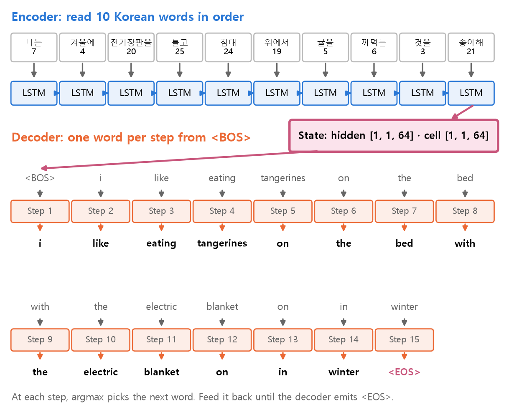
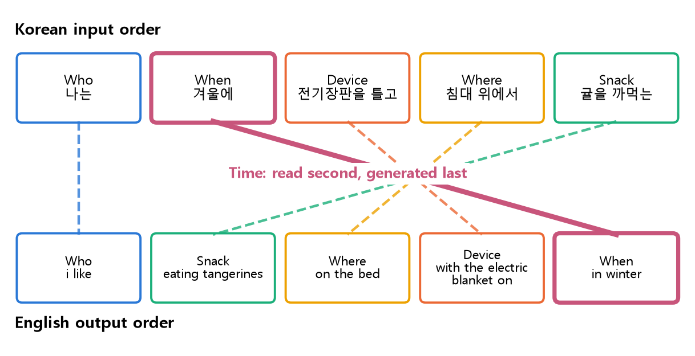
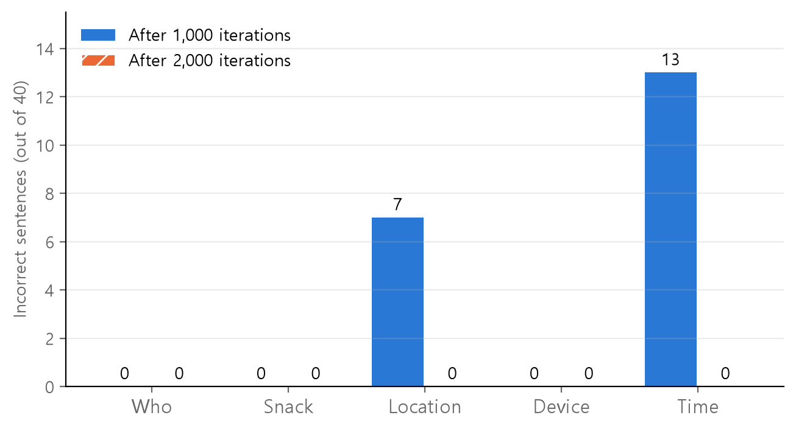

<style>
.content table { width: 100%; border-collapse: collapse; margin: 14px 0 24px; font-size: 17px; line-height: 1.5; }
.content th, .content td { border-bottom: 1px solid #e6dde0; padding: 8px 10px; text-align: left; vertical-align: top; }
.content thead { background: #fbf1f4; }
.content figure { margin: 18px 0; }
.content figure img { width: 100%; height: auto; }
.content td, .content th { word-break: keep-all; overflow-wrap: normal; }
.content .katex-display { overflow-x: auto; overflow-y: hidden; padding: 4px 0; }
.content td code { white-space: nowrap; }
.content pre .nb { padding: 0; border: 0; border-radius: 0; background: none; }
@media (max-width: 560px) { .content th, .content td { padding: 7px 5px; font-size: 16px; } }
</style>
<link rel="stylesheet" href="https://cdn.jsdelivr.net/npm/katex@0.16.11/dist/katex.min.css">
<script defer src="https://cdn.jsdelivr.net/npm/katex@0.16.11/dist/katex.min.js"></script>
<script defer src="https://cdn.jsdelivr.net/npm/katex@0.16.11/dist/contrib/auto-render.min.js" onload="renderMathInElement(document.querySelector('.content')||document.body,{delimiters:[{left:'\\[',right:'\\]',display:true},{left:'\\(',right:'\\)',display:false}]})"></script>

<div class="wc"><p><b>Why build Seq2Seq from scratch?</b><br>
Seq2Seq (sequence to sequence) takes one sequence and produces another. In this model, an LSTM encoder reads the input into a fixed-size state, and an LSTM decoder uses that state to produce the output sentence (<a href="https://arxiv.org/abs/1409.3215">Sutskever et al., 2014</a>).<br>
Translation is a common application because the input and output can have different lengths and word orders. <a href="https://arxiv.org/abs/1409.0473">Attention</a> was introduced to address limitations of the fixed-size encoding.<br>
Implementing what the encoder passes to the decoder makes it easier to see what Attention changed. (As of November 9, 2026)</p></div>

We build a model that translates a Korean sentence meaning “I like eating tangerines on the bed with the electric blanket on in winter,” then find and fix errors on sentences the model has never seen.

**At a glance.** The encoder reads 10 Korean words and passes its final hidden and cell states to the decoder. The decoder starts with `<BOS>`, produces one word at a time, and stops at `<EOS>`.

<figure></figure>

Run the cells from top to bottom. Each output is shown immediately after its cell. Install PyTorch with `pip install torch` or run the code in Google Colab. Cells marked ❌ deliberately raise errors. The numbers are from a CPU run with torch 2.11. Decimal values can differ slightly by environment. Korean tokens remain in the code and output because they are the source language.

<div class="keyline">We generate 432 Korean–English sentence pairs and hold out 40 for evaluation.</div>

## <span class="no">1</span> Generate sentences from a pattern

One example is too little to learn translation. The model needs examples that connect a Korean phrase meaning “eating tangerines” to its English words and the position those words occupy. Split the tangerine sentence into five slots and supply several options for each slot.

| Slot | Korean options, glossed in English | English pattern |
|---|---|---|
| Who | I, you, we | i, you, we |
| When | Winter, summer, night, weekends | in winter … |
| Device | An electric blanket, air conditioner, or fan switched on | with the … on |
| Where | Bed, sofa, desk | on the bed … |
| Snack | Tangerines, watermelon, popcorn, ramen | eating … |

```python
import itertools  # generate every combination
import random     # shuffle examples
import torch      # tensor operations
from torch import nn  # layers and models

torch.manual_seed(0)  # reproducible initialization
BOS, EOS = 1, 2       # beginning and end token IDs
```

```python
who = {"나는": "i", "너는": "you",
       "우리는": "we"}
when = {"겨울에": "in winter",
        "여름에": "in summer",
        "밤에": "at night",
        "주말에": "on weekends"}
device = {
    "전기장판을 틀고":
        "with the electric blanket on",
    "에어컨을 틀고":
        "with the air conditioner on",
    "선풍기를 틀고":
        "with the electric fan on",
}
where = {"침대 위에서": "on the bed",
         "소파 위에서": "on the sofa",
         "책상 앞에서": "at the desk"}
snack = {"귤을 까먹는": "eating tangerines",
         "수박을 먹는": "eating watermelon",
         "팝콘을 먹는": "eating popcorn",
         "라면을 먹는": "eating ramen"}
```

Combining all the options gives 3 × 4 × 3 × 3 × 4 = 432 sentences. The Korean order is who → when → device → where → snack. The English order is who → snack → where → device → when. After the subject, the order is almost reversed.

```python
pairs = []
for a, b, c, d, e in itertools.product(
        who.items(), when.items(),
        device.items(), where.items(),
        snack.items()):
    # one (Korean, English) phrase pair, such as ("나는", "i")
    kor = f"{a[0]} {b[0]} {c[0]} {d[0]} {e[0]} 것을 좋아해"
    eng = f"{a[1]} like {e[1]} {d[1]} {c[1]} {b[1]}"
    pairs.append((kor, eng))

print(len(pairs))
print(pairs[0])
```

```text
432
('나는 겨울에 전기장판을 틀고 침대 위에서 귤을 까먹는 것을 좋아해', 'i like eating tangerines on the bed with the electric blanket on in winter')
```

`pairs[0]` is the tangerine sentence we want to translate. Hold it out along with 39 other test examples. Including it in training would let the model memorize the answer, so it would tell us less about translation on unseen combinations.

```python
target = pairs[0]     # sentence we want to translate
rest = pairs[1:]
random.seed(0)        # make shuffling reproducible
random.shuffle(rest)
test = [target] + rest[:39]  # 40 unseen sentences
train = rest[39:]            # training sentences
print(len(train), len(test))
print(target in train)
```

```text
392 40
False
```

## <span class="no">2</span> Build vocabularies and tensors

`nn.Embedding` takes token IDs. Build separate Korean and English vocabularies and assign IDs starting at 3. IDs 0, 1, and 2 are reserved for `<PAD>`, `<BOS>`, and `<EOS>`, for padding, beginning of sequence, and end of sequence. All the sentences in this example have equal length within each language, so we reserve `<PAD>` without using it.

```python
def make_vocab(sentences):
    # sort the unique whitespace-separated tokens
    words = sorted({w for s in sentences
                    for w in s.split()})
    # reserve 0, 1, and 2 for PAD, BOS, and EOS
    return {w: i + 3 for i, w in enumerate(words)}

kor2idx = make_vocab([k for k, e in pairs])
eng2idx = make_vocab([e for k, e in pairs])
# Look up English words by ID to display translations
idx2eng = {i: w for w, i in eng2idx.items()}

kor_vocab_size = len(kor2idx) + 3
eng_vocab_size = len(eng2idx) + 3
print(kor_vocab_size, eng_vocab_size)
print(eng2idx)
```

```text
27 29
{'air': 3, 'at': 4, 'bed': 5, 'blanket': 6, 'conditioner': 7, 'desk': 8, 'eating': 9, 'electric': 10, 'fan': 11, 'i': 12, 'in': 13, 'like': 14, 'night': 15, 'on': 16, 'popcorn': 17, 'ramen': 18, 'sofa': 19, 'summer': 20, 'tangerines': 21, 'the': 22, 'watermelon': 23, 'we': 24, 'weekends': 25, 'winter': 26, 'with': 27, 'you': 28}
```

The vocabularies are built from all `pairs`, including the test sentences. A word absent from the vocabulary would cause a lookup error at translation time (section 7). The training tensors `X` and `y` are made from `train` alone.

Append `<EOS>` (2) to each target sequence in `y`. The decoder learns this token like any other word, so it knows when to stop.

```python
def to_ids(sentence, vocab):
    return [vocab[w] for w in sentence.split()]

X = torch.tensor([to_ids(k, kor2idx)
                  for k, e in train])
y = torch.tensor([to_ids(e, eng2idx) + [EOS]
                  for k, e in train])
print(X.shape, y.shape)
print(train[0][0], X[0])
print(train[0][1], y[0])
```

```text
torch.Size([392, 10]) torch.Size([392, 15])
우리는 주말에 에어컨을 틀고 침대 위에서 귤을 까먹는 것을 좋아해 tensor([18, 22, 16, 25, 24, 19,  5,  6,  3, 21])
we like eating tangerines on the bed with the air conditioner on on weekends tensor([24, 14,  9, 21, 16, 22,  5, 27, 22,  3,  7, 16, 16, 25,  2])
```

## <span class="no">3</span> Build the encoder and decoder

Encoding turns the input sentence into a numeric state, and decoding turns that state into an output sentence. The encoder reads all 10 Korean words and returns only the final hidden and cell states. At each step, the decoder uses the current state and previous token to produce one English token. The final encoder state is the decoder's only access to the input sentence.

$$ (h, c) = \text{Encoder}(x_1, x_2, \dots, x_{10}) $$

$$x_t$$ is the ID of the $$t$$th Korean token. $$h$$ and $$c$$ are the LSTM hidden and cell states, each with 64 values.

```python
class Encoder(nn.Module):
    def __init__(self, vocab, emb, hid):
        super().__init__()
        self.embedding = nn.Embedding(vocab, emb)
        self.lstm = nn.LSTM(emb, hid,
                            batch_first=True)

    def forward(self, x):
        x = self.embedding(x)  # token IDs to vectors
        # keep the final states only
        _, (hidden, cell) = self.lstm(x)
        return hidden, cell
```

The decoder processes one token per call. It takes the preceding token ID and the current state, then returns an updated state and a score for each of the 29 English vocabulary entries: 26 words and PAD, BOS, EOS.

$$ \hat{y}_t = \arg\max_k \, s_{t,k} $$

$$s_{t,k}$$ is the score of word ID $$k$$ at step $$t$$, and $$\hat{y}_t$$ is the ID with the highest score. `argmax` returns the **index** of the largest value. The index among the 29 scores is the token ID.

```python
class Decoder(nn.Module):
    def __init__(self, vocab, emb, hid):
        super().__init__()
        self.embedding = nn.Embedding(vocab, emb)
        self.lstm = nn.LSTM(emb, hid,
                            batch_first=True)
        self.fc = nn.Linear(hid, vocab)

    def forward(self, x, hidden, cell):
        # [batch] → [batch, 1, 16]: one time step
        x = self.embedding(x).unsqueeze(1)
        out, (hidden, cell) = self.lstm(
            x, (hidden, cell))
        # [batch, 1, 64] → [batch, 29]
        pred = self.fc(out.squeeze(1))
        return pred, hidden, cell
```

Create the two models and inspect their tensor shapes.

```python
encoder = Encoder(kor_vocab_size, 16, 64)
decoder = Decoder(eng_vocab_size, 16, 64)

hidden, cell = encoder(X)
print(hidden.shape, cell.shape)
start = torch.full((len(X),), BOS)
pred, hidden, cell = decoder(start, hidden, cell)
print(start.shape, pred.shape)
```

```text
torch.Size([1, 392, 64]) torch.Size([1, 392, 64])
torch.Size([392]) torch.Size([392, 29])
```

The state shape `[1, 392, 64]` means one LSTM layer, 392 sentences, and 64 state values. The decoder output `[392, 29]` has 29 vocabulary scores for each sentence.

## <span class="no">4</span> Train with teacher forcing

At each decoder step, compare the predicted scores with the correct token. Add the losses across all 15 steps, then update both models together.

$$ L = \sum_{t=1}^{15} \text{CE}(s_t, y_t) $$

$$\text{CE}$$ is the mean CrossEntropyLoss across 392 sentences, and $$y_t$$ is the correct token at step $$t$$. The printed loss divides by 15 to show the mean per step.

Feeding the correct token $$y_t$$ into the decoder at the next step is called teacher forcing. Here we flip a coin at each step, giving the correct token and the model prediction equal probability (teacher forcing ratio 0.5).

$$ \text{Next input} = \begin{cases} y_t & \text{with probability } 0.5 \\ \hat{y}_t & \text{with probability } 0.5 \end{cases} $$

Feeding $$y_t$$ lets the decoder learn a later step even after an earlier mistake. Feeding its prediction $$\hat{y}_t$$ lets it practice the conditions it will face when translating without a reference answer.

A mistake may come from how the encoder writes the state or how the decoder reads it. Put both sets of parameters in one optimizer so training can update both.

```python
criterion = nn.CrossEntropyLoss()
params = (list(encoder.parameters())
          + list(decoder.parameters()))
optimizer = torch.optim.Adam(params, lr=0.001)

def train_model(epochs, start=0):
    for epoch in range(epochs):
        optimizer.zero_grad()
        hidden, cell = encoder(X)  # encode the inputs
        dec_in = torch.full((len(X),), BOS)
        loss = 0
        for t in range(y.size(1)):  # 15 time steps
            pred, hidden, cell = decoder(
                dec_in, hidden, cell)
            loss += criterion(pred, y[:, t])
            if torch.rand(1).item() < 0.5:
                dec_in = y[:, t]  # feed the correct token
            else:
                dec_in = pred.argmax(dim=1)
        loss.backward()
        optimizer.step()
        n = start + epoch + 1
        if n % 200 == 0:
            print(n, round(loss.item() / 15, 4))

train_model(1000)
```

```text
200 0.6852
400 0.4948
600 0.192
800 0.1034
1000 0.0614
```

## <span class="no">5</span> Translate unseen sentences

At inference time there is no reference answer, so the decoder always feeds its own prediction back as the next input. Stop at `<EOS>`, or after 20 tokens if it never appears.

```python
def translate(kor):
    x = torch.tensor([to_ids(kor, kor2idx)])
    with torch.no_grad():  # disable gradient tracking
        hidden, cell = encoder(x)
        dec_in = torch.tensor([BOS])
        words = []
        for _ in range(20):
            pred, hidden, cell = decoder(
                dec_in, hidden, cell)
            dec_in = pred.argmax(dim=1)
            if dec_in.item() == EOS:
                break
            words.append(idx2eng[dec_in.item()])
    return " ".join(words)

print("Korean:", target[0])
print("Target:", target[1])
print("Prediction:", translate(target[0]))
```

```text
Korean: 나는 겨울에 전기장판을 틀고 침대 위에서 귤을 까먹는 것을 좋아해
Target: i like eating tangerines on the bed with the electric blanket on in winter
Prediction: i like eating tangerines on the bed with the electric blanket on in winter
```

The model got the tangerine sentence right. Translate all 40 test sentences and count mistakes by slot. Use the English token positions to define the five slots and print two examples with an incorrect time phrase.

```python
slots = {"who": [0], "snack": [2, 3],
         "location": [4, 5, 6],
         "device": [7, 8, 9, 10, 11],
         "time": [12, 13]}

def check(pairs_to_test, show=2):
    right = 0
    wrong = {name: 0 for name in slots}
    for kor, eng in pairs_to_test:
        out = translate(kor).split()
        ans = eng.split()
        if out == ans:
            right += 1
            continue
        bad = []  # slots this sentence got wrong
        for name, pos in slots.items():
            a, b = pos[0], pos[-1] + 1
            if out[a:b] != ans[a:b]:
                bad.append(name)
                wrong[name] += 1
        if "time" in bad and show > 0:
            print("Korean:", kor)  # show an example
            print("Prediction:", " ".join(out))
            show -= 1
    print("Correct sentences:", right, "/", len(pairs_to_test))
    print("Errors by slot:", wrong)

check(test)
```

```text
Korean: 너는 여름에 에어컨을 틀고 침대 위에서 수박을 먹는 것을 좋아해
Prediction: you like eating watermelon on the bed with the air conditioner on in winter
Korean: 나는 여름에 선풍기를 틀고 책상 앞에서 팝콘을 먹는 것을 좋아해
Prediction: i like eating popcorn at the desk with the electric fan on in winter
Correct sentences: 20 / 40
Errors by slot: {'who': 0, 'snack': 0, 'location': 7, 'device': 0, 'time': 13}
```

## <span class="no">6</span> Why the time slot caused trouble

The model missed 20 of 40 sentences. Time was the most error-prone slot, with 13 mistakes. All 13 swapped “in summer” and “in winter.” The model always got “at night” and “on weekends” right.

The encoder reads the words for winter or summer second in Korean. The decoder produces the time phrase last in English. The encoder's hidden and cell states must carry that information while the encoder reads eight more words and the decoder produces its first 12 words.

<figure></figure>

| Slot | Korean input positions | English output positions |
|---|---|---|
| Who | 1 | 1 |
| When | 2 | 13 and 14 (last) |
| Device | 3 and 4 | 8–12 |
| Where | 5 and 6 | 5–7 |
| Snack | 7 and 8 | 3 and 4 |

The time slot has the longest gap between reading and writing, which may help explain why the two similar seasons were confused. Distance alone does not account for all errors. The location slot travels a shorter distance than the device slot, yet had seven mistakes, all substituting “bed” for “sofa.” One seed and 40 test sentences are too little to establish the cause.

Train the same model for 1,000 more iterations.

```python
train_model(1000, start=1000)
check(test)
```

```text
1200 0.0312
1400 0.0092
1600 0.0057
1800 0.004
2000 0.003
Correct sentences: 40 / 40
Errors by slot: {'who': 0, 'snack': 0, 'location': 0, 'device': 0, 'time': 0}
```

<figure></figure>

After more training, the model got all 40 sentences right. A single fixed-size state can become a bottleneck as sentences grow longer. The original Seq2Seq paper reversed the input sequence. The authors found that this kept the average distance the same while creating shorter paths for early output words, making training easier. Attention lets the decoder revisit the encoder output at each input position instead of relying on a single state.

## <span class="no">7</span> Common mistakes and function reference

### ❌ Use a word outside the vocabulary

The model can only convert words in its vocabulary to IDs. The Korean token meaning “in spring” never occurs in the 432 sentences, so the lookup fails.

```python
# ❌ Deliberate error: "in spring" is outside the vocabulary
translate("나는 봄에 전기장판을 틀고 침대 위에서 귤을 까먹는 것을 좋아해")
```

```text
KeyError: '봄에'
```

✅ To add a new word, add sentences that use it, rebuild the vocabulary, and retrain.

### ❌ Instantiate a model before running its class cell

In Jupyter, running `decoder = Decoder(...)` before the `class Decoder` cell raises `NameError: name 'Decoder' is not defined`. Python defines a name when the cell executes. ✅ Run the class definition first.

### Function reference

| Function | What it does |
|---|---|
| `itertools.product` | Generates all combinations of slot options |
| `nn.Embedding` | Maps token IDs to vectors |
| `nn.LSTM` | Reads tokens in order and updates the hidden and cell states |
| `unsqueeze(1)` | Adds a sequence dimension of length one |
| `nn.Linear` | Maps 64 state values to scores for the 29 vocabulary entries |
| `argmax(dim=1)` | Returns the ID with the highest score |
| `torch.no_grad()` | Disables gradient tracking during translation |

<div class="done">🎉 The encoder reads the input into a state, and the decoder uses that state to translate one word at a time.</div>
