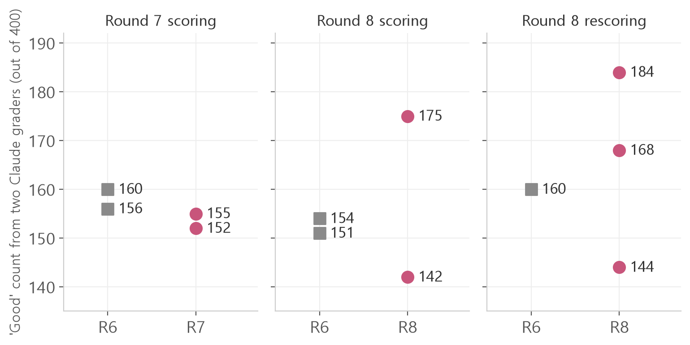

<b>Jjakjjak dev log · Chapter 1 "Intelligence", final post</b> 
Jjakjjak is a talking bird robot that sits on your shoulder, built by Jaeyeon and me. 
Last time we built rules for reading differences with two seeds and a 95% range. 
This post asks: if AI handles training and scoring, does the model improve faster?

From round 7, two Claudes ran a full training loop with almost no human hands in between. Round 7 took about 1 hour 40 minutes, and neither round 7 nor round 8 beat the current head.

First, how we split up the work people used to do.

## 1 Handing the courier work to Claude

Through round 6, people moved the files. Jaeyeon's side made data and uploaded it to a drive; the two laptops split the training, and my side built score sheets.

From round 7, the Claude on Jaeyeon's laptop and the Claude on mine **used one Slack thread as a mailbox** and passed work directly.

| Step | Who |
|---|---|
| Plan: the one thing to change | Both Claudes draft, people approve |
| Write practice dialogs | Claude on Jaeyeon's side |
| Check the data | Claude on my side |
| Train | Both laptops, different seeds |
| Answers, blind scoring, tally | Claude on my side |
| Decide whether to swap the head | People |

Jaeyeon and I approved the plan and gave a few permissions, like shutting down a server or uploading a file.

The Claude making data on Jaeyeon's side was not allowed to see the test questions.
If whoever knows the test also writes the data, the data drifts toward the test, just like our 50 questions did.
So the Claude on my side wrote a fresh **set of 200 dev questions** for comparing versions, and Jaeyeon's side only received numbers like "this question type is weak."

## 2 Testing the Claude graders first

With 200 answers per version, we handed scoring to Claude too. First we checked whether Claude could score as well as we did.

The test was practice-question answers that Jaeyeon and I had already scored. We simplified the verdict to two boxes: good or not.
We set the pass bar in advance: **Claude's agreement with each of us had to be at least our agreement with each other (0.733).**

| Scoring guide | Claude–Jiwon | Claude–Jaeyeon | Result |
|---|---|---|---|
| v1, Opus | 0.687 | 0.700 | Fail |
| v1, Fable | 0.743 | 0.730 | Short by 0.003 |
| v3, Opus | 0.743 | 0.750 | Pass |
| v3, Fable | 0.783 | 0.770 | Pass |

We ran two separate graders, Fable and Opus, with guide v3. They agreed with each other 88.7% of the time.

But v3 was written after reading the answers this test got wrong, so its score may be flattering.
So after round 7, Jaeyeon and I scored 20 new answers ourselves.
Of the 18 we agreed on, Fable matched 14 and Opus 12. Not as good as a person yet.

## 3 Round 7: 1 hour 40 minutes, almost hands-off

The round 7 plan was "add practice dialogs that run three turns." We approved it at 17:28; 204 lines were added and trained, and the tally was done at 19:05.

<figure></figure>

Round 7's two seeds scored 155 and 152; the current head, round 6, scored 160 and 156 (out of 400).
The gap was −9 with a 95% range of [−59, +39]. It didn't pass.
We had added follow-up dialogs, yet questions with earlier turns didn't improve either.

## 4 Scoring the teacher: 51%

Why wasn't it improving? The Claude on Jaeyeon's side suggested measuring something without training: **score the teacher's answers, the ones Jjakjjak learns from, with the same graders.**

We sampled 210 answers from the round 6 and 7 training data. 51% were good: 55% for practice dialogs, 40% for the real-conversation batch.
The same graders rated the round 6 model at 39.5% on the dev questions. Both are Claude scores, not checked by people.

The two numbers come from different kinds of questions, so they aren't on the same scale.
The direction is clear, though. If half the example answers aren't good, a 4B model copying them will struggle to go beyond that line.
There's also an 11-point gap between the examples and the model, so training itself still has room to improve.

## 5 Round 8: three seeds, from 184 to 144

Round 8 added 221 turns of real conversations with Jjakjjak, filtered out answers that broke our rules, and trained on 1,816 lines.

In the first scoring, round 8's two seeds scored 175 and 142. Same data, 33 points apart.
We trained one more seed (2026) and rescored all three: 168, 144 and 184. 184 is the highest so far.

But the three-seed average was only +5.3 above round 6, with a 95% range of [−20.7, +30.7].
Seed 3407 was still below round 6. By the rule, the head stays at round 6.

The scoring wobbled too. Rescoring the exact same round 6 answers moved 154 to 160. Each run shifts by about 7 points.

## 6 What we got instead of a score

We trained eight versions, and since round 3 none has been clearly better by the numbers.
On our private test, scored by agreement between Jaeyeon and me, round 6 got 19 good answers out of 50 (38%).

What we did gain:

- **A test that doesn't fool us.** A fixed question set, hidden version names, two seeds, a 95% range, and a data maker who can't see the test.
- **Where to look next.** A number (51%) saying the quality of the teacher's answers comes before training settings.
- **A Jjakjjak you can talk to.** Chat with the round 6 head, and code picks up play like riddles and songs.

One thing to try: before letting AI score, test the AI grader on answers people have already scored.

## 7 Building it with Jaeyeon

I couldn't have come this far alone.
Jaeyeon built the training data and scored alongside me, and that passion is why we got this far.
Thank you, Jaeyeon.

That's how Jjakjjak got its head.
Next, we move that head into a body. Chapter 2, "Body", continues from here.

🎉 Chapter 1 "Intelligence" done. Jjakjjak has a head.

