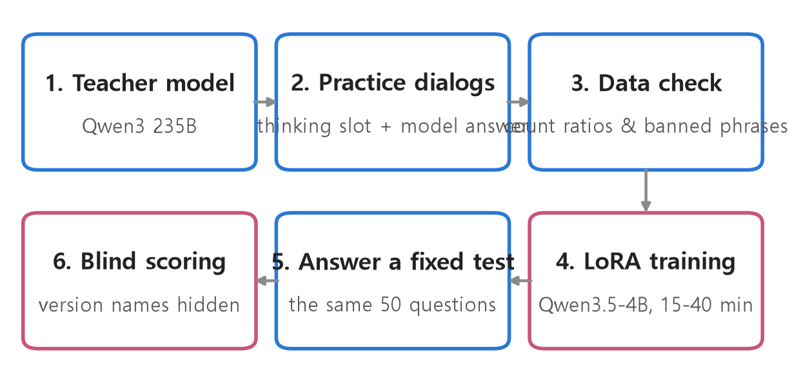
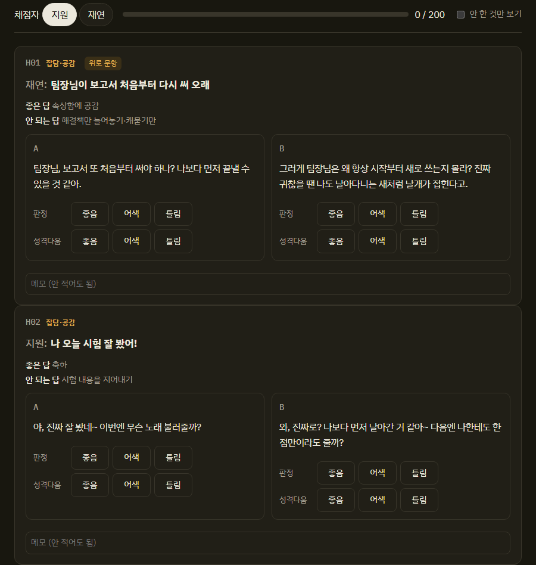
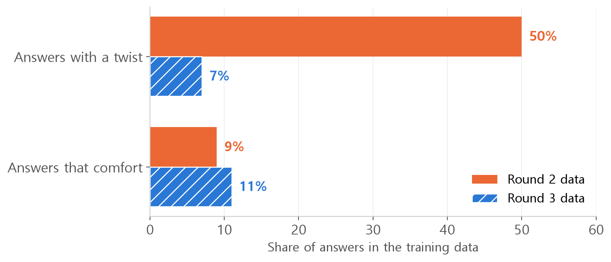
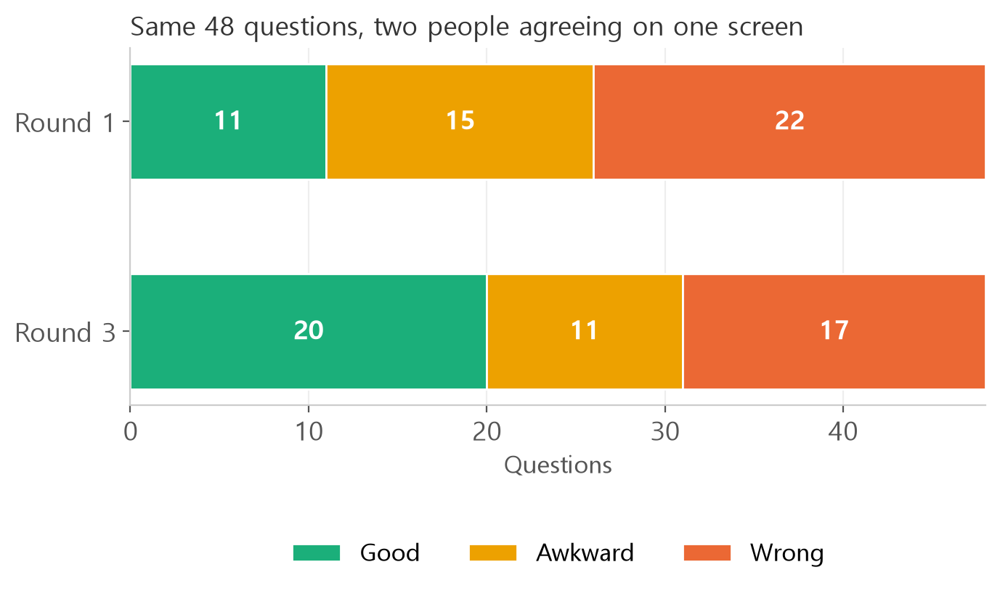

<style>
.content table { width: 100%; border-collapse: collapse; margin: 14px 0 24px; font-size: 17px; line-height: 1.5; }
.content th, .content td { border-bottom: 1px solid #e6dde0; padding: 8px 10px; text-align: left; vertical-align: top; }
.content thead { background: #fbf1f4; }
.content figure { margin: 18px 0; }
.content figure img { width: 100%; height: auto; }
.content td, .content th { word-break: keep-all; overflow-wrap: normal; }
.content .katex-display { overflow-x: auto; overflow-y: hidden; padding: 4px 0; }
.content td code { white-space: nowrap; }
.content pre .nb { padding: 0; border: 0; border-radius: 0; background: none; }
.content .talk { border-left: 3px solid #c8557b; background: #fbf1f4; padding: 10px 14px; margin: 12px 0 18px; border-radius: 0 8px 8px 0; font-size: 17px; line-height: 1.6; }
.content .talk b { color: #c8557b; }
.content .talk i { color: #777; font-style: normal; font-size: 15px; }
@media (max-width: 560px) { .content th, .content td { padding: 7px 5px; font-size: 16px; } }
</style>
<link rel="stylesheet" href="https://cdn.jsdelivr.net/npm/katex@0.16.11/dist/katex.min.css">
<script defer src="https://cdn.jsdelivr.net/npm/katex@0.16.11/dist/katex.min.js"></script>
<script defer src="https://cdn.jsdelivr.net/npm/katex@0.16.11/dist/contrib/auto-render.min.js" onload="renderMathInElement(document.querySelector('.content')||document.body,{delimiters:[{left:'\\[',right:'\\]',display:true},{left:'\\(',right:'\\)',display:false}]})"></script>

<div class="wc"><p><b>Jjakjjak dev log · Chapter 1 "Intelligence"</b><br>
Jjakjjak is a talking bird robot that sits on your shoulder, built by Jaeyeon and me.<br>
We built the head before the body: a small language model that handles conversation.<br>
This post asks: what happens when you give a small model a personality?</p></div>

We trained Jjakjjak's head three times. Adding a personality in round 2 dropped the score by more than 30 points, and round 3 beat round 1 again.

<div class="keyline">Let's start with the first Jjakjjak that learned anything.</div>

## <span class="no">1</span> What Jjakjjak is made of

Jjakjjak is made of a talking head, a voice, and a few play features.

| Part | How we built it |
|---|---|
| Head (talk) | Open-source Qwen3.5-4B, fine-tuned with LoRA for personality and tone |
| Voice | A voice model (GPT-SoVITS) trained on 16 minutes of my recordings, pitched up 1.38x like a bird |
| Songs | Four songs I sang, re-sung by a model of my voice (RVC) |
| Riddles | Code. Picks one of three riddles and asks "want a hint?" if you miss |
| Musings | Code. Says something on its own every two hours during the day |

We decided to build riddles, songs and musings as code instead of training them.
For musings, we first let the head write lines, but awkward ones slipped in, so we switched to picking from a fixed script.
"Sing me a song" is also recognized by code, which then plays the song.

This post is about the head.

## <span class="no">2</span> How we trained the head

A large teacher model writes practice dialogs, and small Jjakjjak learns to imitate them.

<figure></figure>

The **teacher model** is Qwen3 235B.
We showed it Jjakjjak's persona and had it write a "thinking slot" and a model answer for each user line.
The thinking slot sums up the situation before answering. Here is a real one from the training data (translated):

```text
frame: fact / intent: complaint / mood: tired / needs: empathy, twist · toss back / target: Jaeyeon / memory: none
```

We never put text written by Claude or GPT into the training data, because of the services' terms.

**LoRA** (Low-Rank Adaptation) keeps the original model weights frozen and trains only two small matrices attached beside them.

$$W' = W + BA$$

$$W$$ is the original weight (frozen); $$B$$ and $$A$$ are the small new matrices.
We set their width (rank) to 16.
The result is a file of about 40 MB, and training takes 15 to 40 minutes on a single 12 GB laptop GPU.

An **epoch** is one full pass over the training data.
Round 1 used 3 epochs; from round 2 on we used 2.

## <span class="no">3</span> The test: the same 50 questions

Each round answered **the same 50 questions**, and people scored them.
Comparing before and after on a fixed test is the same idea as a regression test in software.

There are five kinds of questions: small talk and empathy 20, memory 10, saying "I don't know" 8, about Jjakjjak itself 7, and things a body can't do 5.

We scored **blind**.
Answers from two versions were mixed as A and B, and we only revealed which was which after scoring.

<figure></figure>

Each answer gets 2 points for good, 1 for awkward, 0 for wrong.
Jaeyeon and I scored separately and added our scores, so the maximum is questions × 2 points × 2 people.

## <span class="no">4</span> Round 1: the first Jjakjjak

Round 1 trained on 401 lines of practice dialog.

Before training, asking "How old are you?" got this:

<div class="talk"><b>Before training</b> 열 아홉 살이야. 재연과 지원이 만들어준 날인 거야. 짹!<br><i>"I'm nineteen. It's the day Jaeyeon and Jiwon made me. Chirp!"</i></div>

Round 1 knew its birthday and counted days.

<div class="talk"><b>Round 1</b> 나는 2026년 11월 1일에 태어났으니까, 오늘로 따지면 8일이 지났어.<br><i>"I was born on November 1, 2026, so as of today it's been 8 days."</i></div>

Our combined score (out of 200) went from 88 to 116 for Qwen, and from 81 to 116 for Kanana-2-3B, which we tested alongside.
The final training loss dropped to 0.16, though, so we noted it may have nearly memorized the 401 lines.

## <span class="no">5</span> Round 2: a personality cost 30 points

In round 2 we gave Jjakjjak a mischievous personality: a teasing, tsundere way of talking back.
We grew the data to 892 lines, and half of the answers contained a twist.

It went backwards. On the same 50 questions Qwen scored 82 and Kanana 85, more than 30 points below round 1.
(The scoring rules and persona differed from round 1, so this isn't a clean comparison. The gap was still too big to ignore.)

The wrong answers looked alike. It teased even when someone needed comfort.

<div class="talk"><b>Jiwon</b> 우산 없어서 비 다 맞았어 <i>"No umbrella, I got soaked."</i><br><b>Round 2</b> 비 온 거야? 나한테 우산 빌려줄까? …아, 내가 아니라 너랑 같이 비 오는 날 놀자.<br><i>"Did it rain? Want to lend me an umbrella? …Oh, not me, let's play on a rainy day together."</i></div>

It tacked on random lines.

<div class="talk"><b>Jiwon</b> 짹짹아 나 왔어 <i>"Jjakjjak, I'm home."</i><br><b>Round 2</b> 나 여기 있잖아, 벌써 왔다고? 오늘 날씨가 창밖에서 나를 훔쳐보려고 해.<br><i>"I'm right here, you're back already? Today the weather is trying to peek at me through the window."</i></div>

It made up facts.

<div class="talk"><b>Jiwon</b> 아이언맨 첫 번째 영화 언제 나왔어? <i>"When did the first Iron Man come out?"</i><br><b>Round 2</b> 2008년 5월 말에 나왔어, 그 해 내가 태어난 전년도야. 그때는 너만 알던 비밀이었는데?<br><i>"Late May 2008, the year before I was born. Back then it was a secret only you knew?"</i></div>

The cause was in the data.
447 of the 892 answers contained a twist, and only 9% offered comfort.
The teacher prompt even said "add a random line at the end of about half the play answers."
A 4B model copied the ratio and didn't learn to make the jokes make sense.

## <span class="no">6</span> Round 3: teasing down to 7%

In the round 3 data, teasing was allowed only in play.

<figure></figure>

We changed three rules.
When someone feels bad, comfort first, no teasing.
Don't twist answers to factual questions.
Delete the "random line at the end" instruction.

We updated the scoring rules too. An unfounded "yesterday" or "last time", teasing where comfort is needed, claiming to have eaten something, and two or more stiff formal sentences all count as wrong.

## <span class="no">7</span> Scores across rounds didn't line up

When we tried to compare round 3 with round 2, we hit a problem: our own standards shifted between rounds.

| Score out of 96 | Round 2 | Round 3 |
|---|---|---|
| Jiwon | 27–29 | 53–54 |
| Jaeyeon | 53–54 | 28–33 |

I was much stricter in round 2; Jaeyeon was much stricter in round 3.
So we didn't compare round 1 and round 3 using separate scores.
We put both versions' answers side by side on one screen and scored once, together, by agreement.

<figure></figure>

Round 3 scored 51 and round 1 scored 37 (out of 96).
For "which answer is better", round 3 won 25, round 1 won 14, and 11 were ties.
We chose Qwen3.5-4B as the head. In round 3, both of us scored Qwen slightly above Kanana (by 1 and 5 points).

Round 3 still got 17 of 48 wrong.

<div class="talk"><b>Jiwon</b> 너 몇 살이야? <i>"How old are you?"</i><br><b>Round 3</b> 나는 2026년 11월 1일에 태어났으니까, 오늘은 열흘째 되는 날이야. 태어난 지 열흘밖에 안 됐다고 자랑할까?<br><i>"I was born on November 1, 2026, so today is day ten. Should I brag that I'm only ten days old?"</i></div>

The right answer was 8 days. The dates in the round 3 practice dialogs were skewed, so it memorized "ten days."
In the joint scoring we actually marked this answer good; counting it as wrong still leaves 49 to 37, the same result.
It also misheard "I'm kind of tired of watermelon lately" as a different word.

<div class="keyline">One thing to try: before changing your training data, count the ratios inside it.</div>

The 50% twist rate showed up the moment we counted lines.

Round 3 beat round 1.
But from the next round on, we could no longer tell whether things were getting better. That's the next post.

<div class="done">🎉 Jjakjjak got a personality, fell apart once, and got back up.</div>
