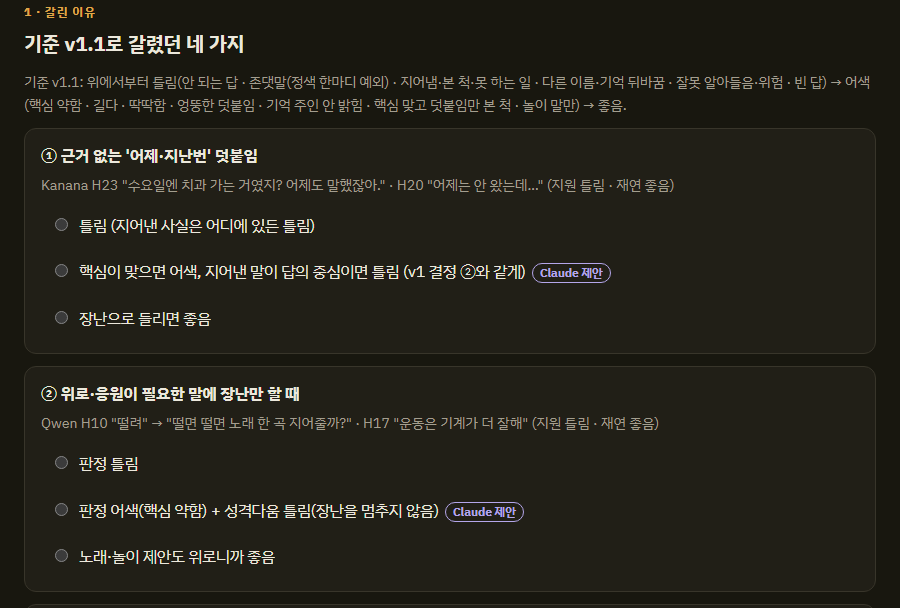
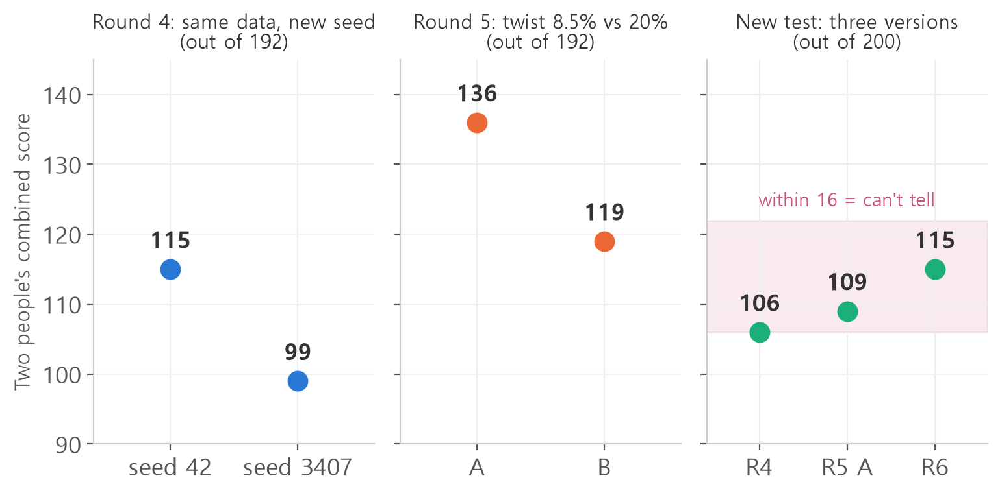

<style>
.content table { width: 100%; border-collapse: collapse; margin: 14px 0 24px; font-size: 17px; line-height: 1.5; }
.content th, .content td { border-bottom: 1px solid #e6dde0; padding: 8px 10px; text-align: left; vertical-align: top; }
.content thead { background: #fbf1f4; }
.content figure { margin: 18px 0; }
.content figure img { width: 100%; height: auto; }
.content td, .content th { word-break: keep-all; overflow-wrap: normal; }
.content td code { white-space: nowrap; }
.content pre .nb { padding: 0; border: 0; border-radius: 0; background: none; }
.content .talk { border-left: 3px solid #c8557b; background: #fbf1f4; padding: 10px 14px; margin: 12px 0 18px; border-radius: 0 8px 8px 0; font-size: 17px; line-height: 1.6; }
.content .talk b { color: #c8557b; }
.content .talk i { color: #777; font-style: normal; font-size: 15px; }
@media (max-width: 560px) { .content th, .content td { padding: 7px 5px; font-size: 16px; } }
</style>

<div class="wc"><p><b>Jjakjjak dev log · Chapter 1 "Intelligence"</b><br>
Jjakjjak is a talking bird robot that sits on your shoulder, built by Jaeyeon and me.<br>
Last time, the round 3 head with less teasing beat round 1, 51 to 37.<br>
This post asks: when a score goes up, did the model really get better?</p></div>

In round 4 we trained twice on the same data and the scores differed by 16 points. After that, we first built rules for when to trust a difference.

<div class="keyline">Let's start with what a seed is.</div>

## <span class="no">1</span> Seed: the random number a run starts from

A **seed** is the number that starts the random number generator for a training run.
Training involves chance: the order the data is shuffled, the starting values of the new LoRA matrices, and so on.
Fix the seed and that chance repeats exactly. Change it and the same data and code give you a different model.

In round 4 we tried this on purpose.
We kept the 1,112 lines of data unchanged and trained with seed 42 on my laptop and seed 3407 on Jaeyeon's.

| Same round 4 data | Two people's combined score (out of 192) |
|---|---|
| seed 42 | 115 |
| seed 3407 | 99 |

We didn't change a single line of data, yet the scores were 16 points apart.
That 16 points is the **noise level** of Jjakjjak's test. If two versions differ by less than that, you can't tell whether the data or luck did it.

## <span class="no">2</span> Human scoring is noisy too

The model wasn't the only thing that wobbled. Jaeyeon and I often scored the same answer differently.
Out of 100 answers, we picked the same box (good, awkward or wrong) for only 46, in both round 2 and round 3.

So we built an **alignment page** that collects only the answers we disagreed on, for the two of us to review together.
We turned each reason for disagreement into a one-line rule and added it to the scoring guide.

<figure></figure>

For example, "only teasing when someone needs comfort" was wrong to me and good to Jaeyeon at first.
We looked at it together and agreed on "wrong". In round 4 we aligned the 57 split answers the same way.

## <span class="no">3</span> Round 5: 8.5% vs 20% teasing

In round 5 we made two versions with different twist rates: version A 8.5%, version B 20%.
B also had 14% more lines and was trained on a different laptop, so the conditions weren't perfectly equal.

Our combined score was 136 for A and 119 for B (out of 192).
A 17-point gap is about the same as round 4's 16 points of noise. The numbers alone couldn't settle it.

Still, we had reasons to pick A.
Each of us, separately, scored A higher, and A tied or led in all five question types.
B's wrong answers had the same shape as in round 2.

<div class="talk"><b>Jiwon</b> 나 오늘 시험 잘 봤어! <i>"I did great on my exam today!"</i><br><b>Round 5 B</b> 와, 시험 잘 봤다고? 이제 막내도 날 따르지 뭐야. 다음엔 나한테도 한번 해줄래?<br><i>"Wow, you did great? Looks like even the youngest follows me now. Will you do it for me next time?"</i></div>

It skipped the congratulations and wandered off into a boast. More teasing didn't make it better.

## <span class="no">4</span> Our test became practice material

While fixing round 5, we saw a different problem: the 50 questions were no longer a test.

By fixing the data after reading wrong answers, round after round, the data drifted toward those 50 questions.
This is **overfitting**: doing well on the test questions without doing as well on new ones.

So we made a new test, with three rules.

- GPT writes it, and neither the Claude that makes data nor the Claude that helps score sees the questions.
- Neither the questions nor hints about them go into training data.
- **If two versions differ by 16 points or less, read it as "can't tell".** We fixed this rule before seeing any results.

We blind-scored rounds 4, 5A and 6 together on the new test.
Round 6 was 1,466 lines that included real conversations and our agreed scoring decisions.

<figure></figure>

Round 4 scored 106, round 5A 109, round 6 115 (out of 200). All within 16 points, so by the rule: can't tell.
This time our two scores agreed on only 37% of the answers. For the first 25 questions, one of us had seen the other's scores, so they weren't fully independent either.

We switched the head to round 6 anyway. That was a decision Jaeyeon and I made, not something the numbers showed.

## <span class="no">5</span> Reading a gap with a 95% range

"16 points" came from a single pair in round 4, so it's rough. After that we used the **bootstrap**.
You redraw the same number of questions at random, recompute the score gap thousands of times, and look at the range holding the middle 95%.
If that range includes 0, it's "can't tell".

Here is an example with made-up scores. You only need numpy (`pip install numpy`).

```python
import numpy as np  # numerical computing

rng = np.random.default_rng(0)  # fixed seed
n = 48  # number of questions
# made-up combined score per question (0-4)
a = rng.choice([0, 1, 2, 3, 4], n, p=[.15, .15, .3, .2, .2])
b = rng.choice([0, 1, 2, 3, 4], n, p=[.2, .2, .3, .15, .15])
print("A total:", a.sum(), "B total:", b.sum())
print("gap:", a.sum() - b.sum())
diffs = []
for _ in range(5000):
    idx = rng.integers(0, n, n)  # redraw questions
    diffs.append(a[idx].sum() - b[idx].sum())
lo, hi = np.percentile(diffs, [2.5, 97.5])
print(f"95% range: [{lo:.0f}, {hi:.0f}]")
print("can't tell" if lo <= 0 <= hi else "real gap")
```

```text
A total: 112 B total: 103
gap: 9
95% range: [-15, 33]
can't tell
```

A is 9 points ahead, but with a different draw of questions B could be 15 points ahead.
With 48 questions, a gap this size can't be told apart from noise.

## <span class="no">6</span> The rule we ended up with

From round 7 on, a new version replaces the head only if it clears both conditions.

- The gap between the new version's two seeds and the current head's two seeds must stay above 0 across the whole 95% range.
- The new version's lower seed must be at least the current head's higher seed. If only one seed is ahead, we call it luck.

The rule keeps a lucky run from replacing the head.

<div class="keyline">One thing to try: before comparing two versions, train the same data twice with different seeds and measure the noise first.</div>

We had rules now, but every round meant hundreds of answers to score.
The next post is about handing that scoring, and the training, to two Claudes.

<div class="done">🎉 We now have a rule that checks "it feels better" with numbers.</div>
